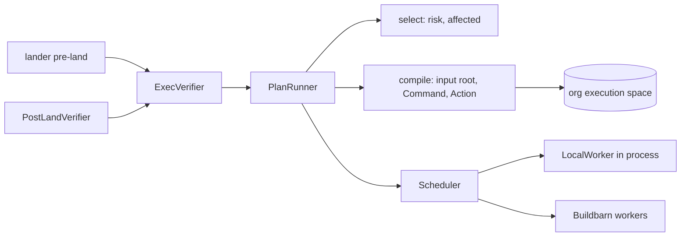

# Exec

A repository says how to verify itself in `.rill/verify.toml`, versioned
with the code it checks. `rill-exec` compiles each step into an REAPI
action in the org's execution space and queues it on the same scheduler
that serves Bazel ([remote execution](remote-execution.md)), so every
check runs on a sandboxed worker, is cached by what it reads, and merges
with an identical check already running. The server wraps this as the
lander's `Verifier` for pre-land and post-land verification. Repository
code never runs in the request path of the server.



`rill-exec` decides how to run a step. When verification runs, and what a
red result means for landing, belongs to `rill-lander` (see
[landing](../04-workflow/landing.md)).

## Plans

```toml
[[step]]
name = "unit"                              # default "step-<index>"; unique
command = ["cargo", "test", "--locked"]   # required
inputs = ["**/*.rs", "**/Cargo.toml", "Cargo.lock"]   # default: every file
working_dir = "crates/core"               # default: the root
env = { RUST_BACKTRACE = "1" }
outputs = ["report.xml"]                  # relative to working_dir
timeout_secs = 900                        # default 600
platform = { OSFamily = "linux" }         # added to [verify] platform
shards = 4                                # 1 to 256
risk = ["normal", "sensitive", "critical"] # default: every class
```

`Plan::parse` (`verify/plan.rs`) refuses unknown keys, empty commands,
duplicate names, shard counts out of range, unknown risk classes and
invalid paths with `Error::Config`. A tree without the file is green with
no steps. The verifier turns a plan that does not parse into a red result
for the change that carries it.

**Inputs** are globs (`globset`, `*` within a component, `**` across
them). They decide two things:

* **The input root.** `ExecSpace::input_root` (`remote/inputs/`) copies
  only the matching files into the execution space as REAPI `Directory`
  messages, so an edit outside a step's inputs leaves its action digest,
  and so its cached result, unchanged. Directories no pattern can reach are
  not read. Each directory's digest is remembered under (filter, path,
  tree hash) in the derived kind `reapi:input`, so a new tree costs only
  its changed directories. File digests come straight from the tree for
  raw blobs ([ADR 016](../10-decisions/016-plain-blake3-for-content.md));
  chunked files are read once and their digest remembered (`reapi:whole`).
  Files the space lacks are copied in. `with_directory` adds the working
  directory, empty, when no input lives there.
* **Selection.** `select` (`verify/select.rs`) skips a step when the
  change's risk class is not in its `risk` list (`NotGating`), or when a
  base tree is known and no changed path matches its inputs
  (`Unaffected`). An unaffected step's action is the one the base already
  ran. A change to the plan file itself runs every step.

## Build graphs

Bazel and Buck2 repositories test by target, and a change affects the
targets whose transitive inputs it touched. A plan can declare how to list
targets with a hash of everything each depends on:

```toml
[graph]
tool = "bazel"      # bazel-diff generate-hashes -w . -b bazel target-hashes.json
# tool = "buck2"    # buck2 targets //... --show-target-hash --json
# command = [...], output = "...", inputs, working_dir, env, platform, timeout_secs (1800)

[[step]]
name = "affected-tests"
command = ["sh", "-c", "bazel test $(cat \"$RILL_AFFECTED_TARGETS\")"]
targets = "affected"
```

The query is an action like any step (`verify/graph/`), named
`build-graph`, so its result is cached per tree: the base's query usually
ran when trunk was verified. `parse_target_hashes` reads bazel-diff's
output (`{"hashes": {label: "hash~directHash"}, "metadata": ...}`, checked
against bazel-diff 63 on a sample workspace) and Buck2's array of targets. `affected_targets`
is every label whose hash differs from the base's or that is new; with no
base, or when the base's query fails, every target. A step with
`targets = "affected"` gets the list, one label per line, in
`.rill-affected-targets` in its working directory (named by
`RILL_AFFECTED_TARGETS`), which is part of its action, and is
`Unaffected` when the list is empty. A failing query fails verification.
bazel-diff and the build tool come from the worker image; the query
usually needs a platform whose workers can fetch external dependencies.

**Compiling** (`verify/compile.rs`) writes one `Command` and `Action` per
shard: arguments, sorted environment, `output_paths`, the working
directory, the step timeout, and the platform (`[verify] platform` plus
the step's). Shards differ only in `TEST_SHARD_INDEX` and
`TEST_TOTAL_SHARDS`, the test sharding protocol runners such as Bazel's
and `nextest --partition` scripts read.

## Running

`PlanRunner::verify(Target { root, base, risk, priority })`
(`verify/run.rs`):

1. loads the plan, diffs `base` against `root` when given, and selects
   steps;
2. compiles the selected steps concurrently;
3. for each action, returns the cached result if the space's action cache
   has one, otherwise submits it to the scheduler as `verify:<repo>` and
   waits on the operation's update counter;
4. stops at the first step that does not pass, and keeps the last 4 KiB of
   its standard error (or output) as the excerpt.

`VerificationOutcome { green, steps, excerpt }` lists each step or shard
as `Passed`, `Failed { exit_code }`, `TimedOut`, `Error` (the action could
not run), `Unaffected` or `NotGating`, with whether it was cached, its
action, output digests, worker and duration. `summary()` is the one line
the lander records, for example
`step "unit" shard 2/4 failed with exit code 1; 3 passed (1 cached)`.
Only successful results enter the action cache.

Pre-land requests run at `High` priority, post-land at `Normal`.

## Secrets

A step names org secrets it needs; the command gets them as environment
variables:

```toml
[[step]]
name = "publish"
command = ["./scripts/publish.sh"]
secrets = ["NPM_TOKEN"]
```

Org administrators set them with `SecretService` (`rill admin secret set
NAME --allow-repo app --trunk-only < value`). No call returns a value.
`remote/secrets/`:

* **Storage.** A secret is a record in the org's execution space (`xsec`)
  whose value is sealed with the org's data keys (AES-256-GCM, namespace
  `<org>.secrets`, bound to the name) where objects are sealed, and stored
  as is otherwise. Names are environment variable names; values are 6
  bytes to 64 KiB, so a short value cannot mask ordinary output. A set or
  delete writes a `SecretChanged` identity event in the same commit,
  audited as `secret.set` / `secret.delete`. Setting skips the
  idempotency table, which would keep a hash of the request.
* **Scope.** `repos` limits which repositories' plans may use it;
  `trunk_only` gives it only to post-land verification, never to a change
  before it lands. A step whose secret is unset or out of scope is an
  `Error` and the tree is red.
* **No value in the action.** The stored `Command` lists only the step's
  own environment. The action is `do_not_cache`, is never looked up in or
  written to the action cache, and is not merged with an identical action
  in flight. Only `PlanRunner` submissions carry secret names: a client's
  `Execute` never does.
* **Injection.** When a worker takes the action, the scheduler opens the
  values, writes a copy of the command with them, sealed, under its
  digest (`xscmd`), and gives the worker an action pointing at it.
  `Scheduler::worker_read` (and the CAS and ByteStream services, for
  callers that are workers) serves that digest; nobody else can read it.
  It is deleted when the operation finishes, fails or is reaped.
* **Masking.** On completion the scheduler replaces every value in standard
  output and error with `[secret NAME]` (`Redactor`, Aho-Corasick,
  longest match), stores the masked copies, and records those in the
  operation, so the excerpt and anything that reads the result see masked
  text.

## Local workers

`LocalWorker` (`worker/`) runs actions inside the server for development
and single-host setups. It speaks Buildbarn's worker protocol to the
scheduler directly (`Scheduler::synchronize`), so queueing, merging,
leases and the reaper treat it like any other worker:

* idle, it reports and is offered the next action for its platform;
* it stages the input root from the execution space into a temporary
  directory, creates the working directory and output parents, runs the
  command in its `Sandbox`, and stores standard output, standard error and
  each output path that is a regular file;
* while running it reports progress every `report_every_secs`, which
  renews its claim; a reply that gives it another state means the claim
  was lost, and it drops the action;
* a timeout is `DEADLINE_EXCEEDED` with the partial result; an action it
  cannot run (a missing blob, a bad path) is a status with no result.

`[exec.local] workers` starts that many on servers with the workers role,
each one action at a time; `rill dev` starts two and turns verification
on. Outside dev mode the server refuses to start them with
`sandbox = "local"`.

## Sandboxes

`Sandbox::run(dir, invocation) -> RawOutcome` is the whole contract: the
worker owns staging and output capture. An `Invocation` is a command,
environment, working directory and timeout.

* `LocalSandbox` runs a `tokio::process::Command` in the staged directory
  with `env_clear()`, the invocation's environment, and `PATH` and `HOME`
  from the host unless set. stdin is null and the child gets its own
  process group. stdout and stderr are drained while waiting. On timeout it
  `killpg`s the group and waits at most 2 s for the pipes; the exit code is
  124 (`TIMEOUT_EXIT_CODE`).
* `[exec.local] sandbox` picks its `Isolation`:
  * `local` (`None`): nothing more; `network` is advisory. For trusted
    single-tenant servers, tests and development.
  * `confined` (Linux only): `sandbox/confine.rs` prepares, before `fork`,
    a Landlock ruleset (read and execute on system directories and the
    host `PATH`, read and write on `/dev` and the step's directory; TCP
    bind and connect refused without `network`) and a seccomp filter
    (`EPERM` for `ptrace`, `mount`, `unshare`, `setns`, `bpf`, `kexec_load`,
    module loading, key management and clock changes). The child applies
    `RLIMIT_FSIZE` (4 GiB), `RLIMIT_CORE` (0), the ruleset and the filter
    in `pre_exec`; a kernel without Landlock fails the step. `TMPDIR` is
    `.rill-tmp` inside the step directory.
  * `gvisor`: each command under `runsc --network=none|host --overlay2=none
    do`.

Multi-tenant deployments run Buildbarn workers under gVisor instead
([remote execution](remote-execution.md#workers-and-sandboxes)) and leave
`[exec.local] workers` at 0.

## Limitations

* A step whose platform no worker serves waits in its queue until the
  lander's `max_wait` (30 min) ends the attempt.
* A local worker captures only regular files as outputs; a directory
  output is ignored. Standard output and error are held in memory whole.
* A chunked input file is read whole once to learn its digest.
* `Isolation::None` commands run as the server's user with its network and
  filesystem. `Confined` does not limit reads of system directories, UDP,
  memory or process count.
* Steps of one plan run concurrently; a failure stops the wait, but the
  others' actions still run to completion on their workers.
* Affected targets select what a step runs; the lander's conflict
  domains are still paths and declared groups, not targets.
* The base's and the change's queries each parse their whole hash file;
  nothing keeps parsed graphs in memory.
* Secrets: output files are not masked, only standard output and error;
  a command can still leak a value it was given (encoded, or over the
  network if its platform has one), so scope secrets to the repositories
  and stage that need them. Values must be UTF-8. The unmasked logs a
  Buildbarn worker uploaded stay in the CAS under digests nothing
  records.
* Platform properties are the only toolchain identity: a worker image
  upgrade under the same properties keeps old cached results.

## Code

* [verify/](../../crates/domain/exec/src/verify/mod.rs): [plan.rs](../../crates/domain/exec/src/verify/plan.rs), [select.rs](../../crates/domain/exec/src/verify/select.rs), [compile.rs](../../crates/domain/exec/src/verify/compile.rs), [run.rs](../../crates/domain/exec/src/verify/run.rs), [submit.rs](../../crates/domain/exec/src/verify/submit.rs), [outcome.rs](../../crates/domain/exec/src/verify/outcome.rs)
* [verify/graph/](../../crates/domain/exec/src/verify/graph/mod.rs): [spec.rs](../../crates/domain/exec/src/verify/graph/spec.rs), [query.rs](../../crates/domain/exec/src/verify/graph/query.rs), [hashes.rs](../../crates/domain/exec/src/verify/graph/hashes.rs), [affected.rs](../../crates/domain/exec/src/verify/graph/affected.rs)
* [remote/secrets/](../../crates/domain/exec/src/remote/secrets/mod.rs): [store.rs](../../crates/domain/exec/src/remote/secrets/store.rs), [inject.rs](../../crates/domain/exec/src/remote/secrets/inject.rs), [redact.rs](../../crates/domain/exec/src/remote/secrets/redact.rs); service [secrets.rs](../../crates/server/api/src/services/secrets.rs)
* [remote/inputs/](../../crates/domain/exec/src/remote/inputs/mod.rs): [filter.rs](../../crates/domain/exec/src/remote/inputs/filter.rs), [upload.rs](../../crates/domain/exec/src/remote/inputs/upload.rs), [graft.rs](../../crates/domain/exec/src/remote/inputs/graft.rs)
* [worker/](../../crates/domain/exec/src/worker/mod.rs): [local.rs](../../crates/domain/exec/src/worker/local.rs), [execute.rs](../../crates/domain/exec/src/worker/execute.rs), [stage.rs](../../crates/domain/exec/src/worker/stage.rs)
* [sandbox/](../../crates/domain/exec/src/sandbox/mod.rs): [local.rs](../../crates/domain/exec/src/sandbox/local.rs), [confine.rs](../../crates/domain/exec/src/sandbox/confine.rs)
* Server: [workers/verifier.rs](../../crates/server/runtime/src/workers/verifier.rs), [workers/local_exec.rs](../../crates/server/runtime/src/workers/local_exec.rs), [state/repo_build.rs](../../crates/server/runtime/src/state/repo_build.rs)
* Tests: [tests/verification/](../../crates/domain/exec/tests/verification/main.rs), [grpc verification](../../crates/server/api/tests/grpc/verification.rs)

---
← Previous: [Search](search.md) · [Index](../index.md) · Next: [Remote execution](remote-execution.md) →
