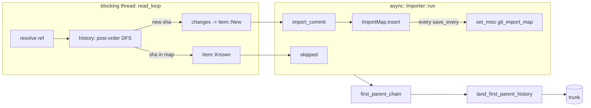

# Git import

`rill-git-import` converts git history into change versions, one per
commit, then lands the head's first-parent ancestry on trunk in order. It
is one-way and incremental: the sha-to-version map is stored in the
repository, so a second import converts only commits the map does not
know. There is no export back to git and no other git compatibility.

## Reading git

`GitSource` is a synchronous trait: `resolve(ref_or_hex)`, `commit(sha)`
and `changes(sha)`. The importer drives it from `spawn_blocking` and joins
reader and writer with an `mpsc` channel of `read_ahead` items. A reader
error is sent down the channel and becomes the import result.

* `GixSource` reads a local repository (worktree or bare) through
  `gix::ThreadSafeRepository`. It reads only refs and the object database.
* `MemorySource` builds a history by hand for tests.

`GixSource::resolve` peels a reference, else accepts a full hex object id;
anything else is `Error::UnknownRef`. `changes` diffs the commit's tree
against its first parent's tree (or the empty tree). Tree records are
dropped. Blob records become `GitChange::Set` with a `FileKind` from the
entry mode (link to `Symlink`, executable to `Executable`, else `Regular`)
or `GitChange::Delete`. A rename is a delete plus a set. Submodule entries
are skipped and reported in `CommitChanges::warnings`.

`history(source, head)` is an iterative post-order DFS: every commit
reachable from `head`, parents before children, a merge's first-parent
ancestry before its other parents. It avoids recursion so deep histories do
not overflow the stack.

## Commits to change versions

`Importer::import_commit` builds one `ChangeVersion` with
`rill_core::ChangeBuilder`:

| Git | Change version |
| --- | --- |
| sha | `change_id = ChangeId::derived("git", sha)`; `extra["git_sha"]` holds the raw sha bytes |
| parents, in git order | `parents`, mapped through the import map |
| author name and email | `Principal::human(name, or email if empty)`, `identity = email` |
| committer time | `created_at` |
| message | `message` |
| diff against first parent | `file_changes` |
| (none) | `provenance.tool = "rill-git-import"` |

A merge becomes a version with several parents and file changes relative
to `parents[0]`, which is the data model's rule (see
[objects and ids](../02-data/objects-and-ids.md)). The version is written
with `RepoStore::put_change_version`, which stores the object and its
`change_info` row and is a no-op for a hash it already has. A parent missing
from the map is `Error::MissingParent`; a path `RepoPathBuf` rejects is
`Error::InvalidPath`.

## Landing the mainline

After conversion, `first_parent_chain` follows `parents[0]` from the head
to a root commit and returns `(version, first_parent_version)` pairs,
oldest first. `land_first_parent_history` skips pairs whose version already
has a trunk sequence number. For the rest it requires the trunk head to
equal the pair's first parent, then calls `RepoStore::land_on_trunk`, a CAS
transaction that sets `refs/trunk`, the `trunk/<seq>` row and the
`trunk_by_hash` row together.

Any other trunk head is `Error::TrunkDiverged`: trunk holds history the git
mainline does not continue, and landing on top would make sequence numbers
lie. The converted versions and the map are still kept.

This path writes trunk rows only. It does not create a `Landing` record,
emit a `LandEvent`, or run review, policy or verification. Imported
versions do not appear in `ListLandings`.

## Idempotency and options

The `ImportMap` (`BTreeMap<GitSha, ChangeVersionHash>`) is one misc record
under `git_import_map`, rewritten whole on each save. `Importer::import`
saves it after `run` returns, on success or failure, so a retry resumes.
An interrupted import redoes at most `save_every` commits, which is
harmless because version hashes are content-derived. Re-importing an
unchanged ref reports every commit as skipped and lands nothing.

| `ImportOptions` | Default | Effect |
| --- | --- | --- |
| `land_first_parent_history` | `true` | Land the mainline after converting |
| `save_every` | 256 | Commits between map saves |
| `read_ahead` | 8 | Channel capacity between reader and writer |

`ImportReport` carries `imported`, `skipped`, `head`, `trunk_head`, `seq`,
`landed` and `warnings`.

## CLI

`rill import git <path> --repo <name> [--ref HEAD] --storage-dir <dir>
[--no-land]` opens `LocalStores` at `--storage-dir` (or `RILL_STORAGE_DIR`,
the layout `rill api --storage local:<dir>` uses), creates the repository
if missing, and runs the importer with a `GixSource`. It refuses
`--endpoint` with a usage error: import writes objects and the map
directly, which the API does not expose. Run it while no server uses that
directory. See [CLI](../08-clients/cli.md).

## Limitations

* `history` holds the metadata of every reachable commit in memory before
  emitting the first one.
* Each changed blob is copied whole into memory before it reaches the
  writer.
* Import bypasses the lander: no review, policy, verification or landing
  record applies, and a running server on the same storage does not see
  the trunk moves.
* Only the one `--ref` is imported. Other branches, tags, notes, committer
  identity, author date and signatures are not recorded.
* Non-UTF-8 paths are converted lossily.
* Only local repositories are readable; there is no clone or fetch.
* Imported roots are not indexed by the search worker; they are indexed on
  first `Grep` (see [search](search.md)).

## Code

* [lib.rs](../../crates/rill-git-import/src/lib.rs), [error.rs](../../crates/rill-git-import/src/error.rs)
* [reader/source.rs](../../crates/rill-git-import/src/reader/source.rs), [reader/gix_source.rs](../../crates/rill-git-import/src/reader/gix_source.rs), [reader/history.rs](../../crates/rill-git-import/src/reader/history.rs), [reader/memory.rs](../../crates/rill-git-import/src/reader/memory.rs)
* [import/importer.rs](../../crates/rill-git-import/src/import/importer.rs), [import/land.rs](../../crates/rill-git-import/src/import/land.rs), [import/map.rs](../../crates/rill-git-import/src/import/map.rs), [import/options.rs](../../crates/rill-git-import/src/import/options.rs)
* CLI: [commands/import.rs](../../crates/rill-cli/src/commands/import.rs)
* Store: [repo/](../../crates/rill-store/src/repo/mod.rs) (`put_change_version`, `land_on_trunk`, `set_misc`)

---
← Previous: [Exec](exec.md) · [Index](../index.md) · Next: [Server](../07-runtime/server.md) →
