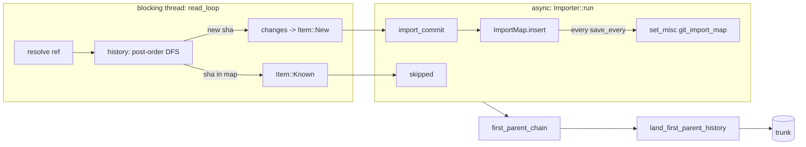

# Git import and export

`rill-git-import` converts git history into change versions, one per
commit, then lands the head's first-parent ancestry on trunk in order. It
is incremental: a sha-to-version map remembers what was imported, so a
second import converts only new commits. It writes either straight into a
storage directory or into a running server through its API. In the other
direction, `rill export git` mirrors trunk into a git branch, one commit
per trunk position, so git tooling and hosting can follow a repository
whose changes land through Rill. There is no other git compatibility.

## Reading git

`GitSource` is a synchronous trait: `resolve(ref_or_hex)`, `commit(sha)`
and `changes(sha)`. The importer drives it from `spawn_blocking` and joins
reader and writer with an `mpsc` channel of `read_ahead` items. A reader
error is sent down the channel and becomes the import result.

* `GixSource` reads a local repository (worktree or bare) through
  `gix::ThreadSafeRepository`. It reads only refs and the object database.
* `MemorySource` builds a history by hand for tests.

`GixSource::resolve` peels a reference, else accepts a full hex object id;
anything else is `Error::UnknownRef`. `changes` diffs the commit's tree
against its first parent's tree (or the empty tree). Tree records are
dropped. Blob records become `GitChange::Set` with a `FileKind` from the
entry mode (link to `Symlink`, executable to `Executable`, else `Regular`)
or `GitChange::Delete`. A rename is a delete plus a set. Submodule entries
are skipped and reported in `CommitChanges::warnings`.

`history(source, head)` is an iterative post-order DFS: every commit
reachable from `head`, parents before children, a merge's first-parent
ancestry before its other parents. It avoids recursion so deep histories do
not overflow the stack.

## Where an import writes

`Importer<T: ImportTarget>` writes through seven operations: store
content, store a version, read the trunk head and a version's position,
append to trunk, and load and save the map.

* `RepoStore` implements them directly (`--storage-dir`): content and
  versions go into the stores, trunk moves with `land_on_trunk`, the map
  is the misc record `git_import_map`. Run it while no server uses the
  directory.
* The CLI's `RemoteTarget` (the default) goes through a server: content
  through `PutBlob` or inline, versions through `CreateChangeVersion`,
  trunk through the admin-only `AppendTrunk` RPC (`land_on_trunk` with the
  expected head, idempotent like every mutation), and the map is a JSON
  file in the git directory (`rill-import-<repo>.json`, `--map-file`),
  saved after every commit. The server stamps the importing principal and
  the current time as the version's author and time; the git author and
  date are kept in provenance.

## Commits to change versions

`Importer::import_commit` builds one `ChangeVersion`:

| Git | Change version |
| --- | --- |
| sha | `change_id = ChangeId::derived("git", sha)`; `extra["git_sha"]` holds the raw sha bytes |
| parents, in git order | `parents`, mapped through the import map |
| author name and email | `Principal::human(name, or email if empty)`, `identity = email` |
| committer time | `created_at` |
| message | `message` |
| diff against first parent | `file_changes` |
| author and commit time | also `provenance.extra["git_author"]` (`Name <email>`) and `["git_date"]` (milliseconds) |
| (none) | `provenance.tool = "rill-git-import"` |

A merge becomes a version with several parents and file changes relative
to `parents[0]`, which is the data model's rule (see
[objects and ids](../02-data/objects-and-ids.md)). The version is written
through the target (`put_change_version` in the store, which is a no-op
for a hash it already has; `CreateChangeVersion` through a server). A parent missing
from the map is `Error::MissingParent`; a path `RepoPathBuf` rejects is
`Error::InvalidPath`.

## Landing the mainline

After conversion, `first_parent_chain` follows `parents[0]` from the head
to a root commit and returns `(version, first_parent_version)` pairs,
oldest first. `land_first_parent_history` skips pairs whose version already
has a trunk sequence number. For the rest it requires the trunk head to
equal the pair's first parent, then calls `RepoStore::land_on_trunk`, a CAS
transaction that sets `refs/trunk`, the `trunk/<seq>` row and the
`trunk_by_hash` row together.

Any other trunk head is `Error::TrunkDiverged`: trunk holds history the git
mainline does not continue, and landing on top would make sequence numbers
lie. The converted versions and the map are still kept.

This path writes trunk rows only. It does not create a `Landing` record,
emit a `LandEvent`, or run review, policy or verification. Imported
versions do not appear in `ListLandings`.

## Idempotency and options

The `ImportMap` (`BTreeMap<GitSha, ChangeVersionHash>`) is one misc record
under `git_import_map`, rewritten whole on each save. `Importer::import`
saves it after `run` returns, on success or failure, so a retry resumes.
An interrupted import redoes at most `save_every` commits, which is
harmless because version hashes are content-derived. Re-importing an
unchanged ref reports every commit as skipped and lands nothing.

| `ImportOptions` | Default | Effect |
| --- | --- | --- |
| `land_first_parent_history` | `true` | Land the mainline after converting |
| `save_every` | 256 | Commits between map saves |
| `read_ahead` | 8 | Channel capacity between reader and writer |

`ImportReport` carries `imported`, `skipped`, `head`, `trunk_head`, `seq`,
`landed` and `warnings`.

## Export

`rill export git <path> [--branch trunk] [--follow]` (with `--repo`) writes trunk into
the git repository at `<path>`, creating it if missing, through `git
fast-import`. Each trunk position becomes one commit on the branch: its
author is the git author kept by an import, else the Rill principal; the
committer is `Rill` at landing time; the message is the version's, with
`Rill-Trunk: trunk@N` and `Rill-Version: <hash>` trailers. Files are the
paths that position changed against the one before (a server `Diff`), with
modes for executables and symlinks; the first position, or one whose diff
the server truncates, is written as a full snapshot. An export resumes
after the position named in the branch's last commit and refuses a branch
whose last commit is not an export. Importing a git history and exporting
it again gives the same git tree (`rill-cli/tests/import.rs`).

`--follow` keeps a standing mirror: after the first export it watches
trunk (`WatchTrunk` from the mirrored head) and runs the same incremental
export on each landing event, so the branch trails trunk by one landing.
A dropped stream reconnects from the branch's last position, with backoff
up to 30 s while the server is unreachable; Ctrl-C stops it. Each export
re-reads the branch, so a mirror restarted or run twice never writes a
position twice.

## CLI

`rill import git <path> --repo <name> [--ref HEAD] [--no-land]` imports
into the server the client is configured for, creating the repository if
missing; `--storage-dir <dir>` (or `RILL_STORAGE_DIR`) imports into a
storage directory instead. See [CLI](../08-clients/cli.md).

## Limitations

* `history` holds the metadata of every reachable commit in memory before
  emitting the first one.
* Each changed blob is copied whole into memory before it reaches the
  writer.
* Import bypasses the lander: no review, policy, verification or landing
  record applies. A direct import into a storage directory is not seen by
  a server already running on it.
* Only the one `--ref` is imported. Other branches, tags, notes, committer
  identity and signatures are not recorded.
* Export mirrors trunk only, linearly; it is not a two-way bridge.
* Non-UTF-8 paths are converted lossily.
* Only local repositories are readable; there is no clone or fetch.
* Imported roots are not indexed by the search worker; they are indexed on
  first `Grep` (see [search](search.md)).

## Code

* [lib.rs](../../crates/domain/git-import/src/lib.rs), [error.rs](../../crates/domain/git-import/src/error.rs)
* [reader/source.rs](../../crates/domain/git-import/src/reader/source.rs), [reader/gix_source.rs](../../crates/domain/git-import/src/reader/gix_source.rs), [reader/history.rs](../../crates/domain/git-import/src/reader/history.rs), [reader/memory.rs](../../crates/domain/git-import/src/reader/memory.rs)
* [import/importer.rs](../../crates/domain/git-import/src/import/importer.rs), [import/commit_version.rs](../../crates/domain/git-import/src/import/commit_version.rs), [import/reader_thread.rs](../../crates/domain/git-import/src/import/reader_thread.rs), [import/land.rs](../../crates/domain/git-import/src/import/land.rs), [import/map.rs](../../crates/domain/git-import/src/import/map.rs), [import/options.rs](../../crates/domain/git-import/src/import/options.rs)
* [import/target.rs](../../crates/domain/git-import/src/import/target.rs)
* CLI: [commands/import/](../../crates/clients/cli/src/commands/import/mod.rs) (`git.rs`, `remote.rs`), [commands/export.rs](../../crates/clients/cli/src/commands/export.rs)
* Store: [repo/](../../crates/foundation/store/src/repo/mod.rs) (`put_change_version`, `land_on_trunk`, `set_misc`)

---
← Previous: [Checks](checks.md) · [Index](../index.md) · Next: [Server](../07-runtime/server.md) →
