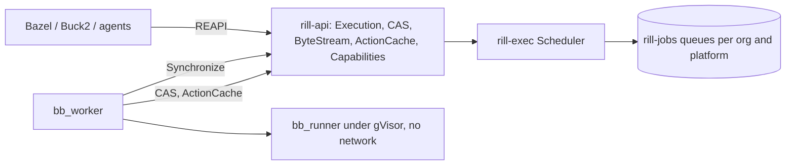

# Remote execution

Rill speaks the Remote Execution API v2 (REAPI), the protocol Bazel,
Buck2, Pants and BuildStream use to run build and test actions remotely
([ADR 007](../10-decisions/007-reapi-execution.md)). A client points at
the server (`bazel --digest_function=blake3 build
--remote_executor=grpc://rill:7420`), and actions run on sandboxed
Buildbarn workers that take them from Rill's scheduler. Results go into a
shared action cache, so an action anyone already ran is never run again.
Repositories' own `.rill/verify.toml` checks compile to actions on the
same scheduler ([exec](exec.md)). Repository code runs only on workers:
Buildbarn's, or the in-process local workers of development setups.

## Execution spaces

Every org has an execution space (`remote/space.rs`):

* **Content** lives in the namespace `<org>.exec`, beside the org's own
  objects. It is separate so that the right to execute never reads
  repository content past its read grants (Phase 11's grants serve objects
  by hash only to holders). Repository files can enter it by copy, with no
  rehashing: raw content is plain BLAKE3, the digest REAPI clients compute
  ([ADR 016](../10-decisions/016-plain-blake3-for-content.md)). The sealer
  encrypts it with the org's data keys, bound to the `.exec` namespace.
* **Records** (action results, operations, queues, org secrets) live
  under a `RepoStore` whose id no repository uses, in the `xop`, `xopn`,
  `xif`, `xpl`, `xsec` and `xscmd` tables; worker sessions and the idle
  wake counter are instance-wide (`xwk`, `xwake`).

The REAPI instance name is the org: `""` is the default org, `acme` is
`acme`. Only the BLAKE3 digest function is accepted.

## Content store

`ExecSpace` (`remote/cas.rs`) stores content below 1 MiB as one `Blob`
object and larger content chunked like repository content, with an index
from the whole digest to its manifest (`reapi:large`). `FindMissingBlobs`,
`BatchUpdateBlobs` and `BatchReadBlobs` (4 MiB per batch) and `GetTree`
serve small content; ByteStream reads and writes any size. Write resource
names are `{instance}/uploads/{uuid}/blobs/[blake3/]{hash}/{size}`; a write
of content already stored returns at once. Every write is checked against
its digest. `SplitBlob` and `SpliceBlob` are unimplemented.

## Action cache

`GetActionResult` reads `reapi:ac` records. **Only workers write**
(`UpdateActionResult` from anyone else is `PERMISSION_DENIED`), so a client
cannot plant a result for an action it never ran. The scheduler also
records a result when a worker completes an action with exit code 0,
unless the action or the request says `do_not_cache`.

## Execute

`Execute` (`services/exec/execution.rs`):

1. Reads the `Action`; unless `skip_cache_lookup` or `do_not_cache`, a
   cached result returns a finished operation at once (`cached_result`).
2. Checks the command and input root are stored. Missing blobs are
   `FAILED_PRECONDITION` with a `PreconditionFailure` of `MISSING`
   violations, which makes Bazel upload them and retry.
3. Spends a registered agent's `executions_per_day` budget.
4. Submits to the scheduler and streams the operation
   (`<org>/operations/<id>`) as its stage moves through `QUEUED`,
   `EXECUTING` and `COMPLETED`, repeating it every 30 s while nothing
   changes. `WaitExecution` resumes a stream; a stopping server ends its
   streams so clients resume elsewhere.

## Scheduler

`Scheduler` (`remote/scheduler/`) keeps no state of its own, so any server
answers any request:

* **Queues:** one `rill-jobs` queue per org and platform
  (`exec/<platform key>`, the key a hash of the sorted platform
  properties). REAPI priority below 0 is `High`, 0 `Normal`, above 0
  `Low`.
* **Merging:** `xif` maps an action to its in-flight operation; a second
  identical `Execute` joins it instead of queueing again.
* **Workers** speak Buildbarn's `OperationQueue.Synchronize`. An idle
  worker is offered the next action, serving orgs in turn, or waits up to
  `idle_wait_secs` on the wake counter. The worker's claim and action are
  kept in its session, so its next report may reach another server. A
  progress report renews the claim and is answered with no desired state
  (any `Executing` state, even for the same action, restarts it in
  Buildbarn). A completion records the result, finishes the operation and
  the job in one commit, and offers the next action. Actions with no
  timeout get `default_timeout_secs`, capped at `max_timeout_secs`.
* **Secrets:** an operation from a verify plan may name org secrets; the
  scheduler injects and masks them ([exec](exec.md#secrets)). Such
  operations neither merge nor are cached.
* **Lost workers:** a claim not renewed within `lease_secs` is taken back
  by the reaper (every 10 s on workers servers) and runs elsewhere; after
  `max_attempts` losses the operation fails with `UNAVAILABLE`.

## Access

* Workers present `Authorization: Bearer rwk_<secret>` with a secret from
  `[exec] worker_secret_file` (one per line, so they rotate). They act as
  `service:exec-worker` for every org, skip rate limits, and alone may
  write the action cache and call `Synchronize`.
* Everyone else must belong to the org (or administer it); a narrowed
  token must carry the `execute` verb. Dev mode admits everyone.

## Workers and sandboxes

Workers are Buildbarn's `bb_worker` and `bb_runner` (Apache-2.0, pinned to
release `20261020T112007Z-e88a90a`, protocol vendored in
`rill-reapi-proto`). The runner executes each action under gVisor with no
network, a read-only root filesystem, process and memory limits, and
between actions empties `/tmp` and kills leftover processes.
`deploy/exec/run.sh` starts this locally inside a Docker engine with
gVisor (for macOS and engines without it) and runs a sample build and the
escape suite. In Kubernetes, the runner pod uses the `gvisor` RuntimeClass.

## Metrics

`rill_exec_requests_total{outcome}` counts `Execute` calls served from
the cache (`cache_hit`), `queued`, or `merged` into a running action;
`rill_exec_completions_total{outcome}` counts actions workers finished
(`ok`, `failed` for a non-zero exit, `error` when they could not run).
Both are on the queues dashboard. Queue depths appear with every other
`rill-jobs` queue.

## Limitations

* The scheduler tries each org's queue in turn on every idle worker
  request, which scales with the number of orgs; there is no index of
  orgs with pending work.
* Completed operation records are kept; nothing expires them yet.
* `GetTree` returns the whole tree in one page.
* Large content read over ByteStream is read per 1 MiB range, but a
  `BatchReadBlobs` or `Action` read loads the blob whole.
* In Kubernetes the worker and runner share a pod network; actions are
  kept off the network only by NetworkPolicy, not per container.

## Code

* [remote/](../../crates/domain/exec/src/remote/mod.rs): [space.rs](../../crates/domain/exec/src/remote/space.rs), [cas.rs](../../crates/domain/exec/src/remote/cas.rs), [results.rs](../../crates/domain/exec/src/remote/results.rs), [operation.rs](../../crates/domain/exec/src/remote/operation.rs), [platform.rs](../../crates/domain/exec/src/remote/platform.rs), [scheduler/](../../crates/domain/exec/src/remote/scheduler/mod.rs)
* Services: [services/exec/](../../crates/server/api/src/services/exec/mod.rs), worker auth [auth/worker.rs](../../crates/server/api/src/auth/worker.rs), [runtime exec.rs](../../crates/server/runtime/src/exec.rs)
* Protos: [rill-reapi-proto](../../crates/foundation/reapi-proto/proto/README.md)
* Local workers: [deploy/exec/](../../deploy/exec/run.sh)
* Tests: [tests/grpc/exec/](../../crates/server/api/tests/grpc/exec/mod.rs)

---
← Previous: [Exec](exec.md) · [Index](../index.md) · Next: [Checks](checks.md) →
