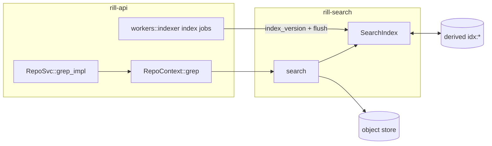
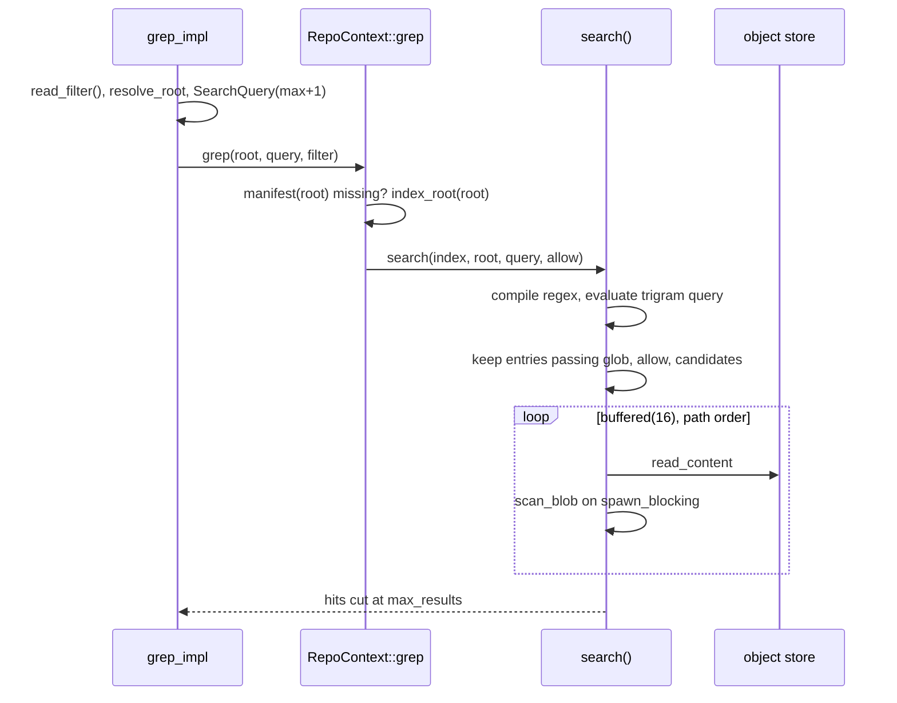

# Search

`rill-search` is a trigram text index over blob content plus a manifest of
paths per root tree. The index is keyed by blob hash, not by path or
version, so a blob is tokenized once no matter how many roots contain it.
The server serves the `Grep` RPC from it and keeps it current as versions
land on trunk.

The caller decides permissions by passing a `PathFilter`.

## Index build

`SearchIndex::index_root(root)` is a no-op when the root already has a
manifest. Otherwise it walks the whole tree, builds a `RootManifest`
(entries sorted by path, each with its `ContentRef` and `FileKind`), and
tokenizes only content hashes that the index has not seen in memory or as
a persisted `BlobMarker`. Blob reads run `IndexConfig::concurrency` (16)
at a time. `index_version` derives the version's `RootTree` first.

`index_blob` is the only tokenizer entry point:

* Blobs over `IndexConfig::max_blob_size` (1 MiB) or flagged by
  `rill_core::is_binary` get a marker with `doc: None` and are never
  searched.
* Other blobs get the next dense `DocId` (`u32`) from the `DocTable`, and
  the id is added to the `PostingList` of every trigram in the blob.
* `trigrams()` packs three consecutive bytes into a `u32`. Postings are
  always ASCII-case-folded (`fold_byte`), so one index serves both
  case-sensitive and case-insensitive queries; the regex filters exactly.
* A `PostingList` is a `roaring::RoaringBitmap` of `DocId`s, persisted in
  roaring's portable serialization; `evaluate` intersects and unions them
  with the bitmap operators.

## Query

`required_trigrams_for_regex` parses the pattern with `regex_syntax` and
folds the HIR into a `TrigramQuery`. Literal runs become `And` of their
trigrams, alternations become `Or`, captures and zero-width assertions are
transparent, and anything unconstrained (wide classes, repetitions with
`min == 0`) becomes `All`. The query is sound but not complete: a matching
document always satisfies it, and the regex always runs over candidates.
`evaluate` intersects and unions posting lists into `Candidates::Docs` or
`Candidates::All`.

`search` never reads a blob whose path the glob or `PathFilter` rejects,
or a blob with no `DocId`. A `SearchHit` is one line of one file: `path`,
1-based `line_no`, the line, context lines, and the `byte_range` of the
first match on that line. Hits come back in path order, then line order.
Patterns are Rust `regex` over bytes, multi-line; globs use `globset`.

## Server surface

`RepoSvc::grep_impl` rejects an empty pattern, takes the caller's
`Permit::read_filter()` (allow-all in dev mode or bootstrap, else the
paths the caller can read; a failed relation load denies all), resolves the
root (trunk head by default), and asks for `max + 1` hits so `truncated` is
exact. `max_results` of 0 means 200 and is capped at 5000; `context_lines`
is capped at 20. A root without a manifest is not indexed by the server
that was asked: `RepoContext::grep` queues a high-priority `index_root`
job and waits up to 30 s for the manifest (then `RootNotIndexed`), so any
tree is searchable at the cost of a full walk by the index writer. Concurrent searches of one root on a server share one job
(`state::index_requests`): under load every search of a new trunk head
would otherwise queue its own, and the queue grows without bound.

Error mapping: `InvalidPattern` and `InvalidGlob` are `InvalidArgument`,
`RootNotIndexed` is `Unavailable`, `Codec` and `Join` are `Internal`.

Indexing runs as jobs, written by one server per repository. Document ids
are allocated in memory, so two writers would corrupt the index: index
jobs run only on the server holding the repository's `search` lease, which
loads the stored index when it takes the lease, and every index write is
fenced on that lease. Each landing enqueues an `index_version` job for the
new trunk head on the repository's `index` queue, in the land transaction.
The index worker (`workers::indexer::run`) queues the current head once at
start (trunk can move without a landing, by import), then runs
`index_version` and `index_root` jobs. A failure is retried with backoff
and a job whose worker died reruns when its claim expires (see
[events and workers](../07-runtime/events-and-workers.md#jobs)). It
flushes once more on shutdown. The server always uses
`IndexConfig::default()`; nothing in server config tunes the index.

## Persistence

All records live in the repository's derived keyspace (see
[derived data](../02-data/derived-data.md)) with `encode_record` framing.

| Kind | Key | Value |
| --- | --- | --- |
| `idx:blob@1` | content hash | `BlobMarker { doc }`; `None` means skipped |
| `idx:root@1` | root `TreeHash` | `RootManifest` |
| `idx:docs@1` | `ObjectHash::ZERO` | `DocTableRecord { hashes }`; id = position |
| `idx:post@1` | `shard_key(trigram >> 16)`, 256 shards | `ShardRecord` of encoded lists |
| `idx:sym@1` | root `TreeHash` | symbol table (see below) |

| `idx:state@1` | `ObjectHash::ZERO` | `IndexState`: a generation per shard and for the table |

`index_root` tokenizes, flushes, and only then writes the root's manifest,
so a manifest is never visible without the postings behind it. `flush`
writes dirty shards whole, then the document table, then pending blob
markers, then the new generations, in that order; a crash between steps
never leaves a blob marked indexed without its postings. On read, a marker
whose `DocId` does not map back to the same hash in the loaded table is
treated as unknown and the blob is re-indexed. `open` loads every shard and
the document table into memory.

Every other server keeps a read-only copy. `search` calls `refresh` after
reading the root's manifest: it compares the stored `IndexState` with the
one it loaded (one read) and reloads only the shards, and the table, whose
generation moved. A process with unflushed writes of its own is the writer
and skips refreshing.

## Symbols

`SymbolIndex::for_root` extracts definitions with `sem-core` (pinned; the
same tree-sitter entity extraction weave's structural merge uses) from
every file sem-core's registry parses as code, up to 1 MiB. Each entity
becomes a `Symbol { name, kind, line }`, its kind mapped from sem-core's
entity type. Extraction is cached per `(content hash, path)` and the
per-root table is stored as derived data (`idx:sym@1`), so a root is
walked once. It offers `find_definition` and `list_symbols`. It is
library-only: the server never constructs one and there is no RPC.

## Limitations

* Pruning is by trigram only. A pattern with no mandatory three-byte
  literal scans every indexed blob in the root.
* The whole index lives in memory, and shards are rewritten whole on every
  flush.
* Case-insensitive planning considers only ASCII fold variants, so a match
  that exists only through a non-ASCII fold (the Kelvin sign for `k`) can
  be pruned.
* Only trunk heads are indexed ahead of time: one per landing batch, and
  the head at worker start. Intermediate landed roots and roots from other
  refs are indexed lazily on first `Grep`.
* Symbols cover the languages sem-core parses; definitions produced by
  macros are not seen.

## Code

* [lib.rs](../../crates/rill-search/src/lib.rs), [error.rs](../../crates/rill-search/src/error.rs), [trigram/extract.rs](../../crates/rill-search/src/trigram/extract.rs), [trigram/literals.rs](../../crates/rill-search/src/trigram/literals.rs), [trigram/query.rs](../../crates/rill-search/src/trigram/query.rs)
* [index/search_index.rs](../../crates/rill-search/src/index/search_index.rs), [index/persist.rs](../../crates/rill-search/src/index/persist.rs), [index/docs.rs](../../crates/rill-search/src/index/docs.rs), [index/manifest.rs](../../crates/rill-search/src/index/manifest.rs), [index/config.rs](../../crates/rill-search/src/index/config.rs)
* [query/search.rs](../../crates/rill-search/src/query/search.rs), [query/request.rs](../../crates/rill-search/src/query/request.rs), [query/lines.rs](../../crates/rill-search/src/query/lines.rs)
* [symbols/index.rs](../../crates/rill-search/src/symbols/index.rs), [symbols/extract.rs](../../crates/rill-search/src/symbols/extract.rs)
* Server: [workers/indexer.rs](../../crates/rill-api/src/workers/indexer.rs), [services/repo/grep.rs](../../crates/rill-api/src/services/repo/grep.rs), [state/registry.rs](../../crates/rill-api/src/state/registry.rs), [repo.proto](../../crates/rill-proto/proto/rill/v1/repo.proto)

---
← Previous: [Security review packet](../05-policy/security-review.md) · [Index](../index.md) · Next: [Exec](exec.md) →
