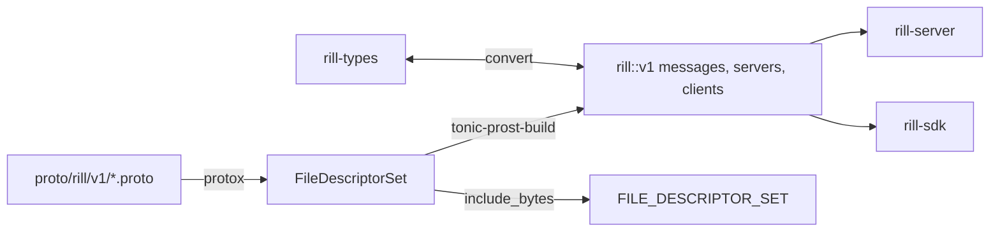

# API surface

The server exposes two wire surfaces. The first is the `rill.v1` gRPC
package, generated from protobuf in `rill-proto`. The second is a small HTTP
protocol for content-addressed objects that a cache or CDN can sit in front
of. `rill-proto` also holds the conversions between wire messages and
`rill-types`, so no crate below it depends on tonic or prost.

## Build



`build.rs` compiles the seven `.proto` files with `protox`, so no `protoc`
binary is needed. It writes the descriptor set that
`rill_proto::FILE_DESCRIPTOR_SET` embeds for gRPC reflection. It configures
`.btree_map(".rill.v1")` and `.bytes(".rill.v1")`, so maps are ordered and
byte fields are `bytes::Bytes`, as in `rill-types`. It generates both server
and client stubs.

## gRPC services

The server registers all six services behind `AuthLayer`
([server](server.md#request-path)). It also registers `tonic-reflection` and
`tonic-health`, which report every service as serving.

| Service | Proto | Handler | Covers |
| --- | --- | --- | --- |
| `RepoService` | `repo.proto` | `services/repo/` | repositories, history, blame, grep, trees and blobs, diff, merge base, writes (`CreateChangeVersion`, `ApplyEdits`, `Rebase`, `Merge`, `Resolve`), refs and trunk, `Watch*` streams, derived data |
| `WorkspaceService` | `workspace.proto` | `services/workspace.rs` | server-side workspaces, snapshots, operation log, `Undo`, `WorkspaceDiff` |
| `ReviewService` | `review.proto` | `services/review.rs` | votes, threads, stacks, `EvaluateSubmit`, `RequestLand`, `GetLandStatus`, `WatchReview` |
| `IntentService` | `intent.proto` | `services/intent.rs` | intents, change links, `FindSimilarIntents` |
| `LanderService` | `lander.proto` | `services/lander.rs` | trunk status, landings, verification records and reports, `RevertSeq`, `Bisect` |
| `AdminService` | `admin.proto` | `services/admin.rs` | `WhoAmI`, `IssueToken`, relations, `GetPolicy`/`SetPolicy`, `Health` |

`types.proto` holds the shared object model. The streaming RPCs are
`GetBlob` (server stream of `BlobChunk`), `PutBlob` (client stream: one
`PutBlobHeader`, then `data`), and `WatchRefs`, `WatchTrunk`, `WatchLog` and
`WatchReview`. [Events and workers](events-and-workers.md) describes how the
watches behave.

`LandStatus` on the wire is `QUEUED | REBASING | LANDED | FAILED | CANCELLED`.
`land_status_proto` folds `Verifying` and `Landing` into `REBASING`,
`Conflict` into `FAILED`, and `Returned` into `CANCELLED`. Admin requests
have no `repo` field. The repository is named inside the relation object,
the token scope, or the policy name (`<repo>/submit`, `<repo>/risk`).

## Message conventions

These conventions are stated at the top of `types.proto` and enforced by
`convert`:

* Object hashes are 32 raw bytes (BLAKE3). Record ids (`ChangeId`,
  `RepoId`, `OperationId`, ...) are 16 raw bytes. For an optional id, empty
  bytes mean absent.
* Paths are normalized `/`-separated strings, and `""` is the root.
  Timestamps are `int64` milliseconds since the Unix epoch, UTC.
* Every enum has `*_UNSPECIFIED = 0`. Decoding rejects zero and unknown
  values.
* `Merge<T>` terms travel as `MergeTerms.terms` in interleaved
  `[add0, remove0, ..., addN]` order. A list of even length is invalid (see
  [merge algebra](../02-data/merge-algebra.md)).
* `RootSpec` is a `oneof` of `ref`, `version_hash`, `tree_hash` and
  `trunk_seq`. Absent means the trunk head.
* Every repo-scoped request carries `string repo`: a name, `rp_<hex>` or
  bare hex.
* Write requests carry `bytes operation_id`, and list requests carry
  `uint32 limit` (0 means the server default, clamped by `common::limit`).

## Conversion rules

Each module in `convert/` provides `From<&T>`/`From<T>` into the wire
message and `TryFrom<pb::T>` back to the `rill-types` value. The scalar
helpers live in `primitives.rs` (`hash_from_proto`, `id_from_proto` over the
`RillId` trait, `path_from_proto`, `enum_from_proto`, `required`, ...).
Decoding never guesses. A bad field yields a `ConvertError`: `BadLength`,
`Missing`, `BadEnum`, `Invalid` or `OutOfRange`. Each one names the field
with a dotted path such as `content_ref.blob.hash`. A `ConvertError` becomes
`INVALID_ARGUMENT` with that text. `convert/roundtrip_tests.rs` checks that
values survive a trip through the wire and back.

## HTTP object protocol

`objects/mod.rs` builds an axum router on the HTTP listener. An object URL
names exactly one byte string forever, so responses carry
`ETag: "<hash>"` and `Cache-Control: public, immutable, max-age=31536000`.

| Route | Permission | Behaviour |
| --- | --- | --- |
| `GET`/`HEAD /o/{repo}/{kind}/{hash}` | read on root | raw bytes as `application/octet-stream`; 404 when absent |
| `PUT /o/{repo}/{kind}/{hash}` | write on root | `rill_store::object::verify` checks the body hashes to `{hash}` (400 otherwise); 201 when new, 200 when it existed; body limit `MAX_PUT_BYTES` (256 MiB) |
| `POST /o/{repo}/batch` | read on root | JSON `[{"kind","hash"}]`, at most `MAX_BATCH` (10 000), streamed back as `application/vnd.rill.objects` |
| `GET /healthz` | none | `ok` |
| `GET /readyz` | none | 200 when every `health_components` entry is ok, else 503 listing the failures |

`{kind}` is one of `blob`, `chunk`, `manifest`, `tree`, `cv` or `derived`.
The batch response has one frame per requested object, in request order:

```text
kind u8 | hash [u8; 32] | length u64 BE | bytes
```

A missing object has `length = u64::MAX` and no bytes. Frames are produced
lazily, so a batch is never fully in memory. `require_auth` (`auth/http.rs`)
mirrors `AuthLayer` and answers 401. `ObjectError` maps server error codes
to HTTP statuses: 404, 403, 401, 400 (invalid argument or failed
precondition), 409 (already exists or aborted), 503, and 500 for the rest.

## Limitations

* `next_page_token` exists on list responses, but the server always returns
  `None`. `limit` truncates and there is no continuation.
* Only workspace RPCs read `operation_id`, where it becomes the `Operation`
  record id. Other writes ignore it, and there is no deduplication.
* `MergeBaseResponse.bases` is repeated, but the server returns at most one
  base.
* `rill.v1` is the only version. A missing RPC surfaces as `UNIMPLEMENTED`.
  The only client that handles this is the `Grep` fallback in `rill-mcp`.
* The object protocol checks read or write permission on the repository
  root only. Path-scoped relations do not apply to objects.
* A batch read error is reported as a missing frame, not as an error.
* `PUT` stores any object kind after hash verification only. It does not run
  the existence checks of `commit_version`.

## Code

* [proto/rill/v1/types.proto](../../crates/rill-proto/proto/rill/v1/types.proto), [repo.proto](../../crates/rill-proto/proto/rill/v1/repo.proto), [workspace.proto](../../crates/rill-proto/proto/rill/v1/workspace.proto), [review.proto](../../crates/rill-proto/proto/rill/v1/review.proto), [intent.proto](../../crates/rill-proto/proto/rill/v1/intent.proto), [lander.proto](../../crates/rill-proto/proto/rill/v1/lander.proto), [admin.proto](../../crates/rill-proto/proto/rill/v1/admin.proto)
* [build.rs](../../crates/rill-proto/build.rs), [src/lib.rs](../../crates/rill-proto/src/lib.rs), [src/error.rs](../../crates/rill-proto/src/error.rs)
* [convert/mod.rs](../../crates/rill-proto/src/convert/mod.rs), [convert/primitives.rs](../../crates/rill-proto/src/convert/primitives.rs), [convert/roundtrip_tests.rs](../../crates/rill-proto/src/convert/roundtrip_tests.rs)
* [rill-server/src/serve.rs](../../crates/rill-server/src/serve.rs), [services/mod.rs](../../crates/rill-server/src/services/mod.rs)
* [objects/mod.rs](../../crates/rill-server/src/objects/mod.rs), [objects/handlers.rs](../../crates/rill-server/src/objects/handlers.rs), [objects/batch.rs](../../crates/rill-server/src/objects/batch.rs), [auth/http.rs](../../crates/rill-server/src/auth/http.rs)

---
← Previous: [Server](server.md) · [Index](../index.md) · Next: [Events and workers](events-and-workers.md) →
