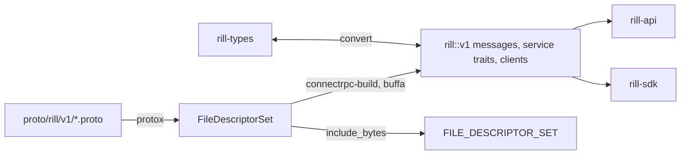

# API surface

The server exposes two wire surfaces. The first is the `rill.v1` package,
generated from protobuf in `rill-proto` and served over the Connect
protocol, gRPC and gRPC-web from the same handlers. The second is a small
HTTP protocol for content-addressed objects that a cache or CDN can sit in
front of. `rill-proto` also holds the conversions between wire messages and
`rill-types`, so no crate below it depends on the protobuf runtime.

## Build



`build.rs` compiles the `.proto` files with `protox`, so no `protoc` binary
is needed, and hands the descriptor set to `connectrpc-build` (ADR 017),
which generates buffa messages, a trait per service and a client per
service. `rill_proto::FILE_DESCRIPTOR_SET` embeds the set for reflection and
`rill_proto::SERVICES` names every service. Byte fields are `bytes::Bytes`,
maps are ordered and oneof variants are stored inline, as in `rill-types`;
an optional sub-message is a `MessageField` and an enum an `EnumValue`
(`rill_proto::convert::known` reads one). Each message's oneofs are under
its name (`pb::event::Kind`). Unknown fields are dropped.

## Services

One axum router serves the API listener. The Rill services sit in a
`connectrpc` router behind two interceptors: `RecordCodes`, which records a
failed call's code for the RPC metrics, and `AuthInterceptor`, which
resolves the caller ([server](server.md#request-path)) and refuses a bad
token in whichever protocol the client spoke; `SessionService`, health
(`grpc.health.v1`, every service serving until the server drains) and
reflection need no token. REAPI's tonic services are mounted on the same
router behind the tower `AuthLayer`. Handlers implement the generated
traits; each takes the call into a `Call<T>` (the owned message and the
request context) before its body runs.

Every service follows Google's API design guide (AIP) in place, still as
`rill.v1` ([ADR 017](../10-decisions/017-api-in-place-on-connect.md)):
resource names, standard methods, pages, filters, etags and request ids,
with one service per `.proto` file.

| Service | Proto | Handler | Covers |
| --- | --- | --- | --- |
| `RepoService` | `repos.proto` | `services/repo/` | `GetRepo`, `ListRepos`, `CreateRepo`, `ResolveRevision`, refs (`GetRef`, `ListRefs`, `UpdateRef`, `DeleteRef`), `CreateRelease`, trunk positions (`GetTrunkPosition`, `ListTrunkPositions`), `WatchTrunk`, `WatchRefs`, `WatchVersions`, derived data |
| `ContentService` | `content.proto` | `services/content/` | `ReadFile`, `BatchReadFiles`, `Stat`, `ListDirectory`, `GetTree`, `ReadBlob` (stream), `WriteBlob` (client stream), `BatchCheckObjects`, `Diff`, `Blame`, `ListHistory`, `ListPathHistory`, `Grep`, `FindMergeBase`, `IsAncestor` |
| `ChangeService` | `changes.proto` | `services/changes/` | `GetVersion` (`BASIC` or `FULL` view), `BatchGetVersions`, `ListVersions`, `CreateVersion`, `ApplyEdits`, `RebaseVersion`, `MergeVersions`, `ResolveConflicts` |
| `EventService` | `events.proto` | `services/events.rs` | `WatchEvents` |
| `WorkspaceService` | `workspace.proto` | `services/workspace/` | `Create`/`Get`/`List`/`Update`/`DeleteWorkspace`, `SnapshotWorkspace`, `StartChange`, `SyncWorkspace`, `HandoffWorkspace`, `UndoOperation`, `ListWorkspaceOperations`, `DiffWorkspace` |
| `ReviewService` | `review.proto` | `services/review/` | `GetReview`, `BatchGetReviews`, `ListReviews`, `SubmitChange`, `Vote`, `CreateThread`, `ReplyThread`, `ResolveThread`, `UpdateStack`, `EvaluateLanding`, `AbandonChange`, `WatchReview` |
| `LandingService` | `landing.proto` | `services/landing/` | `RequestLand`, `RequestLandStack` (`onto` trunk or a release), `GetLandRequest`, `ListLandRequests` (the queue) |
| `TrunkService` | `trunk.proto` | `services/trunk/` | `GetTrunkStatus`, `ListLandings`, `GetVerification`, `ReportVerification`, `RevertLanding`, `PreviewBulkRevert`, `BulkRevert` (an operation), `Bisect`, `GetTrunkHealth`, `ListIncidents`, `FreezeTrunk`, `UnfreezeTrunk` |
| `OperationService` | `operations.proto` | `services/operations/` | `GetOperation`, `ListOperations`, `WaitOperation` |
| `IntentService` | `intent.proto` | `services/intent/` | `CreateIntent`, `GetIntent`, `UpdateIntent` (mask, etag), `ListIntents`, `LinkChange`, `FindSimilarIntents` |
| `PolicyService` | `policy.proto` | `services/policy/` | `GetPolicy`, `UpdatePolicy` (etag) |
| `OrgService` | `orgs.proto` | `services/orgs/` | `CreateOrg`, `GetOrg`, `ListOrgs` |
| `AdminService` | `admin.proto` | `services/admin/` | `GetHealth`, `ImportTrunkPosition` (importers) |
| `AccessService` | `access.proto` | `services/access/` | `CreateRelation`, `DeleteRelation`, `ListRelations`, `CheckAccess`, `ExpandAccess`, `LookupPaths` ([permissions](../05-policy/permissions.md#accessservice)) |
| `IdentityService` | `identity.proto` | `services/identity/` | `GetCaller`, `IssueToken`, `RevokeToken`, `RevokeSession`, `RotateTokenKeys`, `ListTokenKeys`, identity providers, users, agents, workload issuers, `KillSwitch`, SCIM credentials ([identity and auth](../05-policy/identity-and-auth.md#the-identity-view)) |
| `AuditService` | `audit.proto` | `services/audit.rs` | `ListAuditEntries`, `ListAuditRoots`, `SealAudit`, `ListAuditKeys`, `WatchAudit` ([audit log](../05-policy/audit.md)) |
| `ProtectionService` | `protection.proto` | `services/protection/` | `CreateRedaction`, `ApproveRedaction`, `ListRedactions`, `ReleaseVersion`, `RotateDataKeys` ([data protection](../05-policy/data-protection.md)) |
| `ChecksService` | `checks.proto` | `services/checks/` | `ListRuns`, `GetRun`, `WatchRun`, `ReadLog`, `ReadArtifact`, `ListNonhermeticSteps`, `GetTestHistory`, `ListFlakyTests`, `ListQuarantines`, `CreateQuarantine`, `DeleteQuarantine` ([checks](../06-services/checks.md)) |
| `SecretService` | `secrets.proto` | `services/secrets.rs` | `UpdateSecret`, `DeleteSecret`, `ListSecrets` (org administrators; values are write-only) ([exec](../06-services/exec.md#secrets)) |
| `SessionService` | `session.proto` | `services/session.rs` | `ListSignInProviders`, `ExchangeToken`, `RefreshSession`; no token needed ([sign-in](../05-policy/identity-and-auth.md#sign-in)) |
| REAPI `Execution`, `ActionCache`, `ContentAddressableStorage`, `Capabilities`; `google.bytestream.ByteStream`; Buildbarn `OperationQueue` | `rill-reapi-proto` (vendored) | `services/exec/` | remote execution and the worker protocol ([remote execution](../06-services/remote-execution.md)) |

`types.proto` holds the shared object model, `events.proto` the event log's
messages and `errors.proto` the error reasons. The streaming RPCs are
`ReadBlob` (server stream), `WriteBlob` (client stream: one
`WriteBlobHeader`, then `data`), `WatchRefs`, `WatchTrunk`,
`WatchVersions` (resumable by cursor), `WatchReview`, `WatchRun`,
`WatchAudit` and `WatchEvents`: every committed state change as an `Event`
with its cursor, filtered by kinds, a change and a ref prefix, from `after`
(absent: now; empty: the oldest retained event; otherwise a cursor).
[Events and workers](events-and-workers.md) describes how the watches
behave.

`LandStatus` on the wire is `QUEUED | REBASING | LANDED | FAILED | CANCELLED`.
`land_status_proto` folds `Verifying` and `Landing` into `REBASING`,
`Conflict` into `FAILED`, and `Returned` into `CANCELLED`.

## Message conventions

`convert` enforces these, and `services/names.rs` and `listing/` implement
the rest:

* **Resource names.** Requests address resources by `name` (or `parent`
  for a collection): `orgs/{org}`, `orgs/{org}/repos/{repo}` (the name or
  `rp_` id), and under a repository `refs/{ref…}`, `changes/{ch_…}`,
  `changes/{ch_…}/review`, `…/review/threads/{t}`, `versions/{hash}`,
  `workspaces/{ws_…}` and its `operations/{op_…|head}`,
  `landRequests/{ticket}`, `trunk/positions/{n|head}`,
  `incidents/{culprit}`, `runs/{id}`, `quarantines/{target}`,
  `intents/{in_…}`, `policies/{submit|risk}` and `operations/{op}`; under
  an org `agents/`, `users/`, `identityProviders/`, `workloadIssuers/`,
  `secrets/`, `scimCredentials/` and `redactions/`. Every returned resource
  carries its `name`. A name of the wrong shape, or from another repository
  than the request's, is `INVALID_ARGUMENT` (`INVALID_NAME`).
  `rill_proto::names` holds the patterns.
* **Revisions.** Content requests take `repo` and `revision`: `trunk`,
  `trunk@N`, a 64-hex version hash, `tree:<hex>`, `changes/ch_…` (its
  current version), `workspaces/ws_…` (its snapshot) or a ref name.
  `ResolveRevision` answers what one names.
* **Request ids.** Every mutation carries `string request_id`, a UUID; see
  [retries](#retries). A value that is not a UUID is `INVALID_ARGUMENT`.
* **Pages.** Every list takes `page_size` (default 100, at most 1,000) and
  `page_token`, and returns `next_page_token`, empty after the last page.
  A token encodes where the next page starts and a digest of the parent,
  filter and order it was issued for; used with other parameters it is
  `INVALID_ARGUMENT` (`INVALID_PAGE_TOKEN`).
* **Filters.** Lists over many items take `filter`, a subset of AIP-160:
  `=`, `!=`, `<`, `<=`, `>`, `>=` and `:`, `AND`, `OR`, `NOT`,
  parentheses, quoted strings, numbers and booleans. Each list names the
  fields it filters on; any other is `INVALID_FILTER`.
* **Updates and etags.** `Update*` takes the resource with its `name`, an
  `update_mask` where the resource has several mutable fields, and the
  `etag` read; a stale etag is `ABORTED` (`ETAG_MISMATCH`). A ref's etag is
  its target hash, a workspace's its head operation, anything else a digest
  of the stored record. `Update*` on a resource that may be created takes
  `allow_missing`. Deleting something absent is `NOT_FOUND`.
* **Long-running work.** `BulkRevert` returns an `Operation{name, kind,
  done, result: error | response}` kept per repository;
  `OperationService` reads, lists and waits on it.
* Object hashes are 32 raw bytes (BLAKE3) and record ids 16 raw bytes
  inside messages. Paths are normalized `/`-separated strings, `""` the
  root. Timestamps are `int64` milliseconds since the Unix epoch, UTC.
* Every enum has `*_UNSPECIFIED = 0`. Decoding rejects zero and unknown
  values.
* `Merge<T>` terms travel as `MergeTerms.terms` in interleaved
  `[add0, remove0, ..., addN]` order. A list of even length is invalid (see
  [merge algebra](../02-data/merge-algebra.md)).
* `CreateOrg` takes 1-63 lowercase letters, digits and dashes; only humans
  may create orgs (anyone in dev mode). Creating a repository in a missing
  org is `NOT_FOUND`.

### Errors

Every error carries `google.rpc.ErrorInfo{reason, domain: "rill.dev"}`,
the reason being an `ErrorReason` from `errors.proto` without its prefix
(`NOT_FOUND`, `ETAG_MISMATCH`, `POLICY_DENIED`, …). Malformed input adds
`BadRequest` naming the field, a policy denial `PreconditionFailure` listing
what is missing, and a rate or queue limit `RetryInfo` with the delay (and
`retry-after`). Each detail also carries its JSON as `debug` for readers
using `curl`. `rill_runtime::error` maps errors to codes and reasons; the
SDK's `Error::Status` exposes the reason, the missing requirements and the
retry delay.

## Retries

Every mutating RPC except `UpdateSecret` (whose request holds the value)
and `WriteBlob` (content-addressed) runs through `services/idem.rs::once`.
A request with a non-empty `request_id` claims `(principal, request_id)` in
the `idem` table before it runs:

| Found | Result |
| --- | --- |
| nothing, or an expired claim | run; store the response when it succeeds, release the claim when it fails |
| the same request, finished | the stored response, without running again |
| the same request, still running | `UNAVAILABLE` ("already running"): retry |
| a different request (by BLAKE3 of its encoding) | `INVALID_ARGUMENT` |

Responses are kept 24 hours. A claim lasts 15 s (`CLAIM_TTL_MS`) and the
request renews it every 5 s while it runs, so the claim of a server that
died mid-request frees up within 15 s; a server task sweeps expired rows
every 10 minutes. The claim is visible to
the handler as a task-local `Scope`. The commit transaction records which
version the request created in the claim, so if the server dies after
committing and before storing the response, the retry takes over the
expired claim, finds that version and returns it instead of storing a
second one. A failed request whose claim recorded such an effect keeps the
claim (expired at once) for that retry.

The SDK retries every call that carries a request id while the answer
is `UNAVAILABLE` (a dead or draining server, a cut connection, a claim a
dead server left), with backoff from 100 ms to 2 s for up to 20 s. With
three servers behind a load balancer, a server killed between committing a
write and answering it costs the client a retry that returns the first
outcome (`rill-api/tests/grpc/cluster/`).

## Conversion rules

Each module in `convert/` provides `From<&T>`/`From<T>` into the wire
message and `TryFrom<pb::T>` back to the `rill-types` value. The scalar
helpers live in `primitives.rs` (`hash_from_proto`, `id_from_proto` over the
`RillId` trait, `path_from_proto`, `enum_from_proto`, `required`, ...).
Decoding never guesses. A bad field yields a `ConvertError`: `BadLength`,
`Missing`, `BadEnum`, `Invalid` or `OutOfRange`. Each one names the field
with a dotted path such as `content_ref.blob.hash`. A `ConvertError` becomes
`INVALID_ARGUMENT` with that text. `convert/roundtrip_tests/` checks that
values survive a trip through the wire and back.

## HTTP object protocol

`objects/mod.rs` builds an axum router on the HTTP listener. The same
listener serves the sign-in routes (`/auth/*`, `/oauth/token`; see
[identity and auth](../05-policy/identity-and-auth.md#sign-in)) and SCIM
(`/scim/v2/<org>/…`; see
[provisioning](../05-policy/identity-and-auth.md#provisioning-scim-20)). An object URL
names exactly one byte string forever, so responses carry
`ETag: "<hash>"` and `Cache-Control: private, immutable, max-age=31536000`.
They are `private` because each fetch needs a read grant: a shared cache that
does not check grants must not serve them. The Rill cache tier checks grants
itself ([read grants](../05-policy/permissions.md#read-grants)).

| Route | Permission | Behaviour |
| --- | --- | --- |
| `GET`/`HEAD /o/{repo}/{kind}/{hash}` | a read grant naming the object (`x-rill-grant` header or `?grant=`); a chunk is fetched with `?via=<manifest>` and a grant naming the manifest; `derived` needs read on root | raw bytes as `application/octet-stream`; 403 without a covering grant, 404 when absent, 451 when redacted |
| `PUT /o/{repo}/{kind}/{hash}` | write on root | `rill_store::object::verify` checks the body hashes to `{hash}` (400 otherwise); 201 when new, 200 when it existed; body limit `MAX_PUT_BYTES` (256 MiB) |
| `POST /o/{repo}/batch` | read on something, and a grant in `x-rill-grant` | JSON `[{"kind","hash","via"?}]`, at most `MAX_BATCH` (10 000), streamed back as `application/vnd.rill.objects`; objects the grant does not name come back missing |
| `GET /public-keys` | none | the keys derived from each token key, as JSON `{"keys":[{"id","grant_public_key","audit_public_key","not_after"}]}`: grants verify with the first, audit roots with the second |
| `GET /redactions` | a service principal's unnarrowed token, or an instance administrator | `{"hashes":[…]}`: every redacted object, for cache tiers; 403 to anyone else, since a small file's hash confirms a guess at it |
| `GET /healthz` | none | `ok` |
| `GET /readyz` | none | 200 when every `health_components` entry is ok, else 503 listing the failures |

`{kind}` is one of `blob`, `chunk`, `manifest`, `tree`, `cv` or `derived`.
The batch response has one frame per requested object, in request order:

```text
kind u8 | hash [u8; 32] | length u64 BE | bytes
```

A missing object has `length = u64::MAX` and no bytes. Frames are produced
lazily, so a batch is never fully in memory. `require_auth` (`auth/http.rs`)
mirrors `AuthLayer` and answers 401. `ObjectError` maps server error codes
to HTTP statuses: 404, 403, 401, 400 (invalid argument or failed
precondition), 409 (already exists or aborted), 503, and 500 for the rest.

## Input limits

Every input is bounded. A request over the size limit answers
`RESOURCE_EXHAUSTED`, a bad value `INVALID_ARGUMENT`; exceeding an object
HTTP limit answers 413.

| Limit | Value | Where |
| --- | --- | --- |
| Request body and message | 16 MiB | `serve.rs` `MAX_REQUEST_BYTES`, every service |
| REAPI response message | 64 MiB | `MAX_RESPONSE_BYTES` |
| Streams per HTTP/2 connection (TLS) | 1024 | `MAX_CONCURRENT_PER_CONNECTION` |
| Paths changed by one version | 100,000 | `limits.rs` `MAX_FILES_PER_CHANGE`; also edits per `ApplyEdits`, checked before any work |
| Encoded version | 8 MiB | `MAX_CHANGE_BYTES` |
| Version message | 64 KiB | `MAX_MESSAGE_BYTES` |
| File | 5 GiB | `MAX_FILE_BYTES`; `WriteBlob` streams it |
| Inline content | 256 bytes | `INLINE_THRESHOLD`: a raw version over it is refused; `ApplyEdits` and `ResolveConflicts` store larger inline content as a blob |
| Path, component | 4096, 255 bytes | `MAX_PATH_BYTES`, `MAX_COMPONENT_BYTES` |
| Conflict terms, extra fields | 63, 32 (64-byte keys, 4 KiB values) | `MAX_MERGE_TERMS`, `MAX_EXTRA_*` |
| Object `PUT` body | 256 MiB | `objects/mod.rs` `MAX_PUT_BYTES` |
| Object batch | 10,000 | `MAX_BATCH` |
| SCIM body | 4 MiB | `scim/mod.rs` `MAX_SCIM_BODY` |
| Other HTTP bodies | 2 MiB | axum's default |
| Pages and results | 1,000 items a page; grep 5,000 results; diff 4 MiB and 1,000 files | `listing/page.rs` `MAX_PAGE_SIZE`, each handler |

### Rate limits

Every authenticated request, API or object HTTP, is counted against its
principal's token bucket (`auth/rate.rs`, a keyed GCRA limiter from
`governor`): `[rate_limit] per_principal_per_sec` (1000; 0 turns it off)
refilling a bucket of `burst` (2000). Past it, the API answers
`RESOURCE_EXHAUSTED` and HTTP 429, both with `retry-after` in seconds.
Buckets are per server and idle ones are dropped every minute. A
registered agent's `requests_per_minute` budget is a second bucket of that
size refilled over a minute ([identity](../05-policy/identity-and-auth.md)).

## Limitations

* `SessionService` (sign-in) is not rate limited; nothing limits by
  client address.
* Most lists page an ordering they read whole per request (offset tokens);
  only the audit log and trunk positions page by key.
* `BulkRevert` finishes before it answers, so its operation is always done.
* A request without a `request_id` is not deduplicated. Only the
  commit path records its effect in the claim; other handlers that fail
  after writing can be redone by a retry.
* `MergeBaseResponse.bases` is repeated, but the server returns at most one
  base.
* `rill.v1` is the only version. A missing RPC surfaces as `UNIMPLEMENTED`.
  The only client that handles this is the `Grep` fallback in `rill-mcp`.
* A batch read error is reported as a missing frame, not as an error.
* `PUT` stores any object kind after hash verification only. It does not run
  the existence checks of `commit_version`.

## Code

* [proto/rill/v1/](../../crates/foundation/proto/proto/rill/v1/): [types.proto](../../crates/foundation/proto/proto/rill/v1/types.proto), [errors.proto](../../crates/foundation/proto/proto/rill/v1/errors.proto), [repos.proto](../../crates/foundation/proto/proto/rill/v1/repos.proto), [content.proto](../../crates/foundation/proto/proto/rill/v1/content.proto), [changes.proto](../../crates/foundation/proto/proto/rill/v1/changes.proto), [review.proto](../../crates/foundation/proto/proto/rill/v1/review.proto), [landing.proto](../../crates/foundation/proto/proto/rill/v1/landing.proto), [trunk.proto](../../crates/foundation/proto/proto/rill/v1/trunk.proto), [operations.proto](../../crates/foundation/proto/proto/rill/v1/operations.proto)
* [src/names.rs](../../crates/foundation/proto/src/names.rs), [rill-api/src/services/names.rs](../../crates/server/api/src/services/names.rs), [services/revision.rs](../../crates/server/api/src/services/revision.rs), [listing/](../../crates/server/api/src/listing/mod.rs)
* [build.rs](../../crates/foundation/proto/build.rs), [src/lib.rs](../../crates/foundation/proto/src/lib.rs), [src/error.rs](../../crates/foundation/proto/src/error.rs)
* [convert/mod.rs](../../crates/foundation/proto/src/convert/mod.rs), [convert/primitives.rs](../../crates/foundation/proto/src/convert/primitives.rs), [convert/roundtrip_tests/](../../crates/foundation/proto/src/convert/roundtrip_tests/mod.rs)
* [rill-api/src/serve.rs](../../crates/server/api/src/serve.rs), [services/mod.rs](../../crates/server/api/src/services/mod.rs)
* [objects/mod.rs](../../crates/server/api/src/objects/mod.rs), [objects/handlers.rs](../../crates/server/api/src/objects/handlers.rs), [objects/batch.rs](../../crates/server/api/src/objects/batch.rs), [auth/http.rs](../../crates/server/api/src/auth/http.rs)

---
← Previous: [Server](server.md) · [Index](../index.md) · Next: [Events and workers](events-and-workers.md) →
