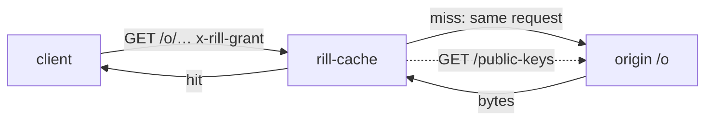

# Cache tier

`rill-cache` is the regional cache in front of the origin
([crate](../../crates/server/cache/src/lib.rs)). Objects never change, so a
cache near its clients answers object reads without asking the origin
anything: it checks each request's [read grant](../05-policy/permissions.md#read-grants)
against the origin's published grant keys and serves from local disk. The
origin is the `rill-server run` HTTP listener; `rill-server cache` runs the tier.



## Requests

`GET`/`HEAD /o/{repo}/{kind}/{hash}` with a grant in `x-rill-grant` (or
`?grant=`), and `?via=<manifest>` for a chunk:

1. The grant is verified with the origin's grant keys (`OriginKeys`). A grant
   naming an unknown key causes a refetch of the keys, at most once a second.
   The keys are also reread every `key_refresh` (60 s).
2. The object must be named by the grant. A chunk must be listed by a
   granted manifest, which the cache reads through itself. `derived` objects
   are never served.
3. On a hit, the bytes come from disk. On a miss, the request is forwarded
   to the origin with the client's own `Authorization` header and grant, so
   the origin decides exactly as if the client had asked (`Origin`). The
   cache holds no credentials of its own.
4. Bytes from the origin are hash-checked before they are kept or served.

The `{repo}` segment is not trusted. The grant names the repository, and
misses are fetched under its id. At this tier a grant is a bearer
credential: whoever holds it may fetch what it names until it expires (at
most ten minutes). Objects are keyed by hash alone, which is safe because a
grant names exact hashes.

Responses carry `ETag` and `Cache-Control: private, immutable, …`.
`GET /metrics` exports, as OpenMetrics:

* `rill_cache_hits`, `rill_cache_misses`, `rill_cache_coalesced`,
  `rill_cache_origin_fetches`, `rill_cache_denied` and
  `rill_cache_evictions` counters;
* the `rill_cache_bytes` gauge.

`GET /livez` answers `ok`.

## Coalescing

[`Coalescer`](../../crates/server/cache/src/coalesce.rs) makes concurrent
misses on one object share one origin fetch. A waiter takes the leader's
bytes when the fetch succeeds. When it fails, each waiter fetches with its
own credentials, because the failure may have been the leader's token.

## Disk

[`DiskCache`](../../crates/server/cache/src/disk.rs) keeps raw objects at
`<dir>/<kind>/<hh>/<hash-hex>`:

* the least recently used index lives in memory and is rebuilt from the
  directory at start, oldest access first;
* past `max_bytes`, the least recently used objects are evicted, and an
  object larger than the whole budget is not kept;
* every read is hash-checked, so a damaged file is dropped and refetched,
  never served;
* file work runs on blocking threads.

## Running

```sh
rill-server cache --origin https://rill.internal:7421 --dir /var/cache/rill \
  --max-bytes 500G --listen 0.0.0.0:7422 --origin-token "$CACHE_TOKEN"
```

The origin token is a service token (`rill auth token` for a
`service:` principal); the origin gives its redaction list only to service
principals and instance administrators.

| Flag | Environment | Default |
| --- | --- | --- |
| `--origin` | `RILL_CACHE_ORIGIN` | required |
| `--dir` | `RILL_CACHE_DIR` | required |
| `--max-bytes` | `RILL_CACHE_MAX_BYTES` | `10G` (`K`, `M`, `G`, `T` are powers of 1024) |
| `--listen` | `RILL_CACHE_LISTEN` | `0.0.0.0:7422` |
| `--redaction-poll` | `RILL_CACHE_REDACTION_POLL` | `10` (seconds) |
| `--origin-token` | `RILL_CACHE_ORIGIN_TOKEN` | none; needed to read redactions |

## Limitations

* One process per cache. There is no consistent-hash ring across cache
  nodes, no prefetching and no admission filter.
* There is no batch route. Clients fetch one object per request.
* The SDK reads unchunked blobs through the cache when `RILL_CACHE_URL`
  is set ([client daemon](../08-clients/daemon.md#regional-cache)); trees and
  chunked blobs still come from the origin.
* Revocation does not reach the cache: a grant stays usable until it
  expires.
* Redactions reach it by polling the origin's `GET /redactions` every
  `--redaction-poll` (10 s): newly redacted hashes are dropped from disk and
  refused with 451, so one is served for at most one poll interval. When
  the list has not been reread for six intervals (at least a minute), the
  cache answers every object request with 503 until it is.

## Code

* [`server/`](../../crates/server/cache/src/server/mod.rs): `Cache` and `CacheStats` (`cache.rs`), object routes (`objects.rs`), metrics (`metrics.rs`), the router and serving (`serve.rs`).
* [`keys.rs`](../../crates/server/cache/src/keys.rs), [`origin.rs`](../../crates/server/cache/src/origin.rs), [`coalesce.rs`](../../crates/server/cache/src/coalesce.rs), [`disk.rs`](../../crates/server/cache/src/disk.rs).
* Binary: [`rill-server/src/cache.rs`](../../crates/server/server/src/cache.rs). Test: `rill-cli/tests/cli/cache.rs`.

---
← Previous: [Observability](observability.md) · [Index](../index.md) · Next: [SDK](../08-clients/sdk.md) →
