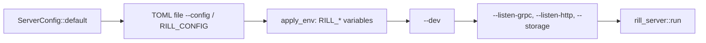

# Configuration

A server is configured by one `ServerConfig` value. It is built from an
optional TOML file, then `RILL_*` environment variables, then command-line
flags. Every field has a default, so an empty configuration gives a working
single-node server with in-memory storage, no verification and dev mode
off.

## Precedence

`ServerConfig::load(path)` reads the file, or uses the defaults when no
path is given, and then calls `apply_env`. `build_config` in
`rill-cli/src/server/mod.rs` then applies `--dev` and the individual flags.
A later step overrides an earlier one. A malformed file or variable is an
`Error::Config`, and the binary exits non-zero.

## The file

`ServerConfig` is `#[serde(default)]`, so any key may be omitted.
`rill-server init-config [--out FILE] [--force]` writes the serialized
defaults with a comment header that lists every alternative.

| Key | Default | Meaning |
| --- | --- | --- |
| `listen_grpc` | `127.0.0.1:7420` (`DEFAULT_GRPC_ADDR`) | gRPC API |
| `listen_http` | `127.0.0.1:7421` (`DEFAULT_HTTP_ADDR`) | object protocol and health |
| `dev_mode` | `false` | anonymous requests act as `dev`; ReBAC checks pass |
| `[storage] kind` | `memory` | backend, see below |
| `[auth] kind` | `static` with no tokens | token scheme, see below |
| `[lander]` | `LandPolicy::default()` | verify mode per risk class, `max_wait`, `batch_window`, `auto_revert`, `revert_grace`, `max_retries` |
| `[risk]` | `RiskConfig::default()` | risk rules, used when a repository has no stored `risk` policy |
| `[labels]` | `LabelSet::default()` | vote labels for every repository |
| `[verify]` | `enabled = false`, `sandbox = "local"`, `network = false` | pre-land `.rill/verify.toml` runs; when disabled the lander uses `AlwaysGreen` |
| `[postland]` | `enabled = false`, `interval_secs = 30`, `batch_size = 8` | post-land verifier loop |

`LandPolicy` durations use serde's default `Duration` form, a table of
`secs` and `nanos`. Per-repository submit and risk policies are not part of
this file. They are stored in the repository and set with `SetPolicy`
([submit policy](../05-policy/submit-policy.md)).

## Storage backends

`open_stores` (`state/app.rs`) maps `StorageConfig` to `Stores`:

| `kind` | Fields | Objects | Metadata |
| --- | --- | --- | --- |
| `memory` | none | in memory | in memory, lost on exit |
| `local` | `dir` | files under `dir` (`LocalStores::open`) | redb file in `dir` |
| `s3` | `url`, `prefix`, `meta_dir` | `ObjectStoreBackend::from_url` (for example `s3://bucket`) | redb file `LocalStores::META_FILE` in `meta_dir`, created if missing |

See [storage and keyspace](../02-data/storage-and-keyspace.md) for what the
stores hold.

## Authentication

* `static` takes a list of `[[auth.tokens]]` entries: `token`,
  `principal_name`, `kind` (`human` by default, or `agent` or `service`) and
  `teams`.
* `biscuit` takes a `root_public_key_hex` that verifies tokens and an
  optional `root_private_key_hex`. With the private key, the server issues
  tokens signed by that root.

Without a private key, `build_issuer` generates a process-local key.
Tokens from `IssueToken` then become invalid when the process restarts. The
server always trusts its own issuer, whatever the mode. See
[identity and auth](../05-policy/identity-and-auth.md).

## Environment variables

| Variable | Effect |
| --- | --- |
| `RILL_CONFIG` | config file path (same as `--config`) |
| `RILL_LISTEN_GRPC`, `RILL_LISTEN_HTTP` | socket addresses |
| `RILL_DEV_MODE` | boolean (`1/0`, `true/false`, `yes/no`, `on/off`) |
| `RILL_STORAGE` | `memory`, `local:<dir>` or `s3:<url>` |
| `RILL_S3_PREFIX`, `RILL_S3_META_DIR` | details for `s3:`; `RILL_S3_META_DIR` is required with it |
| `RILL_STATIC_TOKENS` | `token=name[:kind[:team,team]];...`; replaces auth with that static list |
| `RILL_ROOT_PUBLIC_KEY`, `RILL_ROOT_PRIVATE_KEY` | hex keys; switch auth to `biscuit` |
| `RILL_VERIFY_ENABLED`, `RILL_POSTLAND_ENABLED` | booleans |
| `RILL_POSTLAND_INTERVAL_SECS` | integer seconds |
| `RUST_LOG` | `tracing` filter for the binary (default `info`, logs to stderr) |

If both `RILL_STATIC_TOKENS` and `RILL_ROOT_PUBLIC_KEY` are set, Biscuit
wins because it is applied second. Clients use their own variables
(`RILL_ENDPOINT`, `RILL_TOKEN`); see [SDK](../08-clients/sdk.md).

## Dev mode

`rill-server --dev` sets `dev_mode = true`, forces `memory` storage, and
listens on `127.0.0.1:7470` (`DEV_GRPC_PORT`) and `127.0.0.1:7471`
(`DEV_HTTP_PORT`). It overrides the file and environment for those fields.
The explicit flags still override `--dev`. The server logs a warning at
startup. In dev mode:

* a request without a bearer token acts as the human principal `dev`;
* a request with a token must still authenticate, and its capability still
  limits it;
* the ReBAC layer of `Permit` is skipped.

## Limitations

* The `--storage` flag accepts only `memory` and `local:<dir>`. S3 needs the
  file or `RILL_STORAGE`.
* `[verify] sandbox` has a single value, `local`, which runs steps on the
  host. `network = false` is advisory there.
* Some fields have no environment variable: `lander`, `risk`, `labels`,
  `verify.network`, `postland.batch_size`. They are set only in the file.
* Configuration is read once at startup. There is no reload.

## Code

* [rill-server/src/config.rs](../../crates/rill-server/src/config.rs), [state/app.rs](../../crates/rill-server/src/state/app.rs), [auth/authenticator.rs](../../crates/rill-server/src/auth/authenticator.rs)
* [rill-cli/src/server/mod.rs](../../crates/rill-cli/src/server/mod.rs), [rill-cli/src/server/template.rs](../../crates/rill-cli/src/server/template.rs), [rill-cli/src/bin/rill_server.rs](../../crates/rill-cli/src/bin/rill_server.rs)
* [rill-lander/src/config.rs](../../crates/rill-lander/src/config.rs)

---
← Previous: [Events and workers](events-and-workers.md) · [Index](../index.md) · Next: [SDK](../08-clients/sdk.md) →
