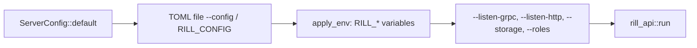

# Configuration

A server is configured by one `ServerConfig` value. It is built from an
optional TOML file, then `RILL_*` environment variables, then command-line
flags. Every field has a default, so an empty configuration gives a working
single-node server with in-memory storage, no verification and dev mode
off.

## Precedence

`ServerConfig::load(path)` reads the file, or uses the defaults when no
path is given, and then calls `apply_env`. `api_config` in
`rill-cli/src/server/mod.rs` then applies the individual flags of
`rill api`. (`rill dev` builds its own configuration; see below.)
A later step overrides an earlier one. A malformed file or variable is an
`Error::Config`, and the binary exits non-zero.

## The file

`ServerConfig` is `#[serde(default)]`, so any key may be omitted.
`rill api init-config [--out FILE] [--force]` writes the serialized
defaults with a comment header that lists every alternative.

| Key | Default | Meaning |
| --- | --- | --- |
| `listen_grpc` | `127.0.0.1:7420` (`DEFAULT_GRPC_ADDR`) | gRPC API |
| `listen_http` | `127.0.0.1:7421` (`DEFAULT_HTTP_ADDR`) | object protocol and health |
| `roles.api`, `roles.workers` | `true`, `true` | serve the gRPC API and object protocol; run landers, post-land, job workers, retention and repository discovery. Every process follows policy and relation changes. `RILL_ROLES=api,workers` |
| `shutdown.drain_secs`, `shutdown.grace_secs` | `5`, `30` | seconds unready before refusing requests; seconds for requests and jobs to finish before running jobs are given back ([server](server.md#startup-and-shutdown)) |
| `tls.cert`, `tls.key`, `tls.client_ca` | none (plain text) | PEM files for TLS on both listeners; `client_ca` makes it mutual: every connection must present a certificate that CA signed. `RILL_TLS_CERT`, `RILL_TLS_KEY`, `RILL_TLS_CLIENT_CA` |
| `telemetry.log_format`, `telemetry.otlp_endpoint`, `telemetry.service_name` | `text`, none, `rill` | log lines as text or JSON; OTLP/HTTP trace export ([observability](observability.md)). `RILL_LOG_FORMAT`, `OTEL_EXPORTER_OTLP_ENDPOINT`, `OTEL_SERVICE_NAME` |
| `dev_mode` | `false` | anonymous requests act as `dev`; ReBAC checks pass |
| `attestation_key` | none | path to a P-256 key file (hex secret scalar) the server signs every stored version with; without it a per-process key is generated (warned outside dev mode). Its public half is in `Health` |
| `[storage] kind` | `memory` | backend, see below |
| `[[auth.tokens]]` | none | static tokens, dev mode only |
| `[identity]` | local key service, default lifetimes | token keys, lifetimes, rotation and administrators, see below |
| `[lander]` | `LandPolicy::default()` | verify mode per risk class, `max_wait`, `batch_window`, `auto_revert`, `revert_grace`, `max_retries` |
| `[risk]` | `RiskConfig::default()` | risk rules, used when a repository has no stored `risk` policy |
| `[labels]` | `LabelSet::default()` | vote labels for every repository |
| `[verify]` | `enabled = false`, `sandbox = "local"`, `network = false` | pre-land `.rill/verify.toml` runs; when disabled the lander uses `AlwaysGreen` |
| `[postland]` | `enabled = false`, `interval_secs = 30`, `batch_size = 8` | post-land verifier loop |

`LandPolicy` durations use serde's default `Duration` form, a table of
`secs` and `nanos`. Per-repository submit and risk policies are not part of
this file. They are stored in the repository and set with `SetPolicy`
([submit policy](../05-policy/submit-policy.md)).

## Storage backends

`open_stores` (`state/stores.rs`) builds `Stores` from `[storage]`, which
picks the objects and a default for metadata, and `[metadata]`, which can
move metadata elsewhere:

| `[storage] kind` | Fields | Objects | Metadata by default |
| --- | --- | --- | --- |
| `memory` | none | in memory | in memory, lost on exit |
| `local` | `dir` | files under `dir/objects` | redb file in `dir` |
| `s3` | `url`, `prefix`, `meta_dir`, `allow_unconditional_put` | `ObjectStoreBackend::from_url` (for example `s3://bucket`) | redb file `LocalStores::META_FILE` in `meta_dir`, created if missing; `meta_dir` is required unless metadata is in FoundationDB |

| `[metadata] kind` | Fields | Metadata |
| --- | --- | --- |
| `storage` (default) | none | beside the objects, as above |
| `fdb` | `cluster_file` (optional, platform default), `root` (default `rill`) | FoundationDB, every key under the subspace `(root,)`, so one cluster can hold several deployments |

`fdb` needs a server built with the `fdb` feature (`cargo build -p
rill-cli --features fdb`), which links the FoundationDB client library;
other builds refuse the setting at start-up.

See [storage and keyspace](../02-data/storage-and-keyspace.md) for what the
stores hold.

## Identity

Every token is signed by the instance's P-256 keys, which servers generate,
wrap with the key service and keep in the metadata store
([token keys](../05-policy/token-keys.md)).

| Key | Default | Meaning |
| --- | --- | --- |
| `[identity.keys] backend` | `local` | `local` (`master_key_hex` or `master_key_file`, 64 hex characters; random per process without either), `vault` (`address`, `key`, `mount` = `transit`, `token` or `token_file` or `VAULT_TOKEN`), `aws-kms` (`key_id`, `region`, `endpoint`; `aws` builds), `gcp-kms` (`key_name`, `endpoint`; `gcp` builds) |
| `[identity.lifetimes]` | `human_secs = 3600`, `agent_secs = 900`, `service_secs = 43200` | longest token per principal kind |
| `[identity.rotation]` | `rotate_after_days = 30`, `activation_delay_secs = 60`, `grace_secs = 300` | key rotation |
| `identity.admins` | none | principal names that administer the instance |

Servers sharing a store must share the key service, or each mints its own
key. `[[auth.tokens]]` (`token`, `principal_name`, `kind` = `Human`,
`Agent` or `Service`, `teams`) are accepted only with `dev_mode`; a server
refuses to start with them otherwise. The first token for a production
instance comes from `rill api mint-token`. See
[identity and auth](../05-policy/identity-and-auth.md).

## Environment variables

| Variable | Effect |
| --- | --- |
| `RILL_CONFIG` | config file path (same as `--config`) |
| `RILL_LISTEN_GRPC`, `RILL_LISTEN_HTTP` | socket addresses |
| `RILL_DEV_MODE` | boolean (`1/0`, `true/false`, `yes/no`, `on/off`) |
| `RILL_STORAGE` | `memory`, `local:<dir>` or `s3:<url>` |
| `RILL_S3_PREFIX`, `RILL_S3_META_DIR` | details for `s3:` |
| `RILL_S3_ALLOW_UNCONDITIONAL_PUT` | boolean; start even when the service ignores conditional puts (see [storage](../02-data/storage-and-keyspace.md#object-backends)) |
| `RILL_FDB_CLUSTER_FILE`, `RILL_FDB_ROOT` | metadata in FoundationDB; an empty cluster file means the platform default |
| `RILL_STATIC_TOKENS` | `token=name[:kind[:team,team]];...`; replaces the static list (dev mode only) |
| `RILL_MASTER_KEY`, `RILL_MASTER_KEY_FILE` | local key service with that master key |
| `RILL_VAULT_ADDR`, `RILL_VAULT_KEY`, `RILL_VAULT_MOUNT`, `RILL_VAULT_TOKEN_FILE` | Vault Transit key service (token from `VAULT_TOKEN` otherwise) |
| `RILL_AWS_KMS_KEY`, `RILL_AWS_KMS_ENDPOINT` | AWS KMS key service (`AWS_REGION` and the default credential chain) |
| `RILL_GCP_KMS_KEY` | Google Cloud KMS key service (application default credentials) |
| `RILL_ADMINS` | comma-separated instance administrators |
| `RILL_VERIFY_ENABLED`, `RILL_POSTLAND_ENABLED` | booleans |
| `RILL_POSTLAND_INTERVAL_SECS` | integer seconds |
| `RUST_LOG` | `tracing` filter for the binary (default `info`, logs to stderr) |

When several key-service variables are set, the last in the order above
wins. Clients use their own variables
(`RILL_ENDPOINT`, `RILL_TOKEN`); see [SDK](../08-clients/sdk.md).

## Dev mode

`rill dev` runs with `dev_mode = true`, every role, storage in
`~/.rill/dev` (`--data DIR`, or `--memory`), and listens on
`127.0.0.1:7470` (`DEV_GRPC_PORT`) and `127.0.0.1:7471` (`DEV_HTTP_PORT`);
it reads no configuration file. Its token keys are wrapped with a master
key it writes to `master.key` in the data directory on first start (mode
0600), so keys survive restarts; `--memory` uses a per-process key. The server logs a warning at
startup. In dev mode:

* a request without a bearer token acts as the human principal `dev`;
* a request with a token must still authenticate, and its capability still
  limits it;
* the ReBAC layer of `Permit` is skipped.

## Limitations

* The `--storage` flag accepts only `memory` and `local:<dir>`. S3 needs the
  file or `RILL_STORAGE`.
* `[verify] sandbox` has a single value, `local`, which runs steps on the
  host. `network = false` is advisory there.
* Some fields have no environment variable: `lander`, `risk`, `labels`,
  `verify.network`, `postland.batch_size`. They are set only in the file.
* Configuration is read once at startup. There is no reload.
* `attestation_key` has no environment variable.

## Code

* [rill-api/src/config/](../../crates/rill-api/src/config/mod.rs), [state/stores.rs](../../crates/rill-api/src/state/stores.rs), [auth/authenticator.rs](../../crates/rill-api/src/auth/authenticator.rs)
* [rill-cli/src/server/mod.rs](../../crates/rill-cli/src/server/mod.rs), [rill-cli/src/server/template.rs](../../crates/rill-cli/src/server/template.rs)
* [rill-lander/src/config.rs](../../crates/rill-lander/src/config.rs)

---
← Previous: [Events and workers](events-and-workers.md) · [Index](../index.md) · Next: [Observability](observability.md) →
