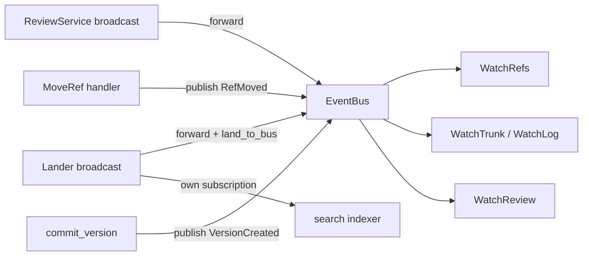

# Events and workers

Each repository has an in-process event bus. Review events, landing events,
ref moves and new versions fan into it, so watch streams have one thing to
subscribe to. Background workers run next to the bus: the lander loop, the
post-land verifier, the background deriver and the search indexer. The bus is lossy by design. The
store is the source of truth, and anything that must be exact re-reads it.

## Event bus

`EventBus` (`state/events.rs`) wraps one `tokio::sync::broadcast` channel of
`RepoEvent`, with capacity `EVENT_CAPACITY` = 4096. `publish` drops the event
silently when nobody is subscribed. A subscriber that falls behind gets
`RecvError::Lagged(n)` and has to recover from the store itself.

| `RepoEvent` | Produced by |
| --- | --- |
| `Review(ReviewEvent)` | the review service broadcast (capacity 1024), forwarded by a task |
| `Land(LandEvent)` | the lander broadcast (capacity 1024), forwarded through `land_to_bus` |
| `RefMoved {name, old, new, at}` | `MoveRef`, plus one synthesised `trunk` move for each `LandEvent::Landed` |
| `VersionCreated {hash}` | `commit_version`, the shared write path for change versions |

`ReviewEvent` covers submission, new versions, votes, comments, resolved
threads, stack and status changes. `LandEvent` covers `Queued`, `Landed`,
`Conflict`, `Failed`, `DependentsReady`, `Verification`, `Culprit` and
`Reverted`. When a forwarder lags, it logs a warning and skips the missed
events. It stops when its source channel closes.

## Watch streams

Each watch RPC subscribes to the bus and spawns a task that feeds an
`mpsc` channel (`STREAM_BUFFER` = 256) into the gRPC stream. The task ends
on the context's shutdown token, on bus close, or when a send fails because
the client went away. Lag handling differs per RPC:

* `WatchTrunk` and `WatchLog` keep a cursor (`after_seq` for trunk; for
  the log, the `after` versionstamp from an earlier `LogEntry`, empty to
  replay from the start; the current head when absent). They use bus events only as wake-ups. On each
  wake-up they read the store (`trunk_range`, or `log_after` in pages of
  `REPLAY_PAGE` = 512) from the cursor. They subscribe before the first
  read, so their output is exact even when the bus lags.
* `WatchRefs` forwards `RefMoved` events whose name starts with the prefix.
  It has no replay. Events lost to lag are not delivered.
* `WatchReview` maps bus events for one change to wire `ReviewEvent`s. It
  also has no replay, and lagged events are skipped.

## Workers

`workers::spawn_repo_workers` runs once per context, when `RepoRegistry::get`
first builds it. That happens at startup through `warm`, or on the first
request for a new repository. Every task watches the context's child
shutdown token.

| Worker | Trigger | On missed events or restart |
| --- | --- | --- |
| Review and land forwarders | broadcast receive | skip lagged events (see above) |
| Lander loop, `Lander::run_forever` | timer, every `LandPolicy::batch_window` | polls its in-memory queue, so it misses no events. Queued requests do not survive a restart |
| Post-land verifier, `PostLandVerifier::run_forever` | timer, every `postland.interval_secs` (minimum 1 s) | polls trunk against a cursor stored in the repository, so missed events and restarts lose nothing |
| Background deriver, `workers/deriver.rs` | its own `Lander::subscribe`, plus every 5 s | derives background kinds for trunk versions after a stored cursor (`derive_cursor`), so missed events and restarts lose nothing; see [derived data](../02-data/derived-data.md#when-values-are-computed) |
| Search indexer, `workers/indexer.rs` | its own `Lander::subscribe` | on lag, re-indexes only the trunk head |

The verifier exists only when `postland.enabled` is set. Each sweep
verifies up to `batch_size` landings after the stored cursor (default
`DEFAULT_BATCH_SIZE` = 8). It bisects a red batch and may auto-revert. A
sweep lock keeps two sweeps from racing on the cursor. See
[post-land verification](../04-workflow/post-land-verification.md).

The indexer indexes the trunk head at startup, then the root of every
`LandEvent::Landed`, and flushes after each one and again at shutdown.
Indexing is content-addressed: `index_root` returns early when a manifest
already exists for the root. That makes repeats and restarts idempotent. A
root that was skipped because of lag is indexed on demand by
`RepoContext::grep` the first time someone searches it. See
[search](../06-services/search.md).

Two more pieces are wired in at build time. They are adapters, not tasks.

* `ExecVerifier` (`workers/verifier.rs`) implements the lander's `Verifier`
  by running `.rill/verify.toml` through `rill_exec::verify_tree`. Without
  `verify.enabled`, the lander uses `AlwaysGreen`.
* `ReviewHooksAdapter` (`workers/hooks.rs`) implements `ReviewHooks`. It
  maps `mark_landing`, `mark_landed`, `return_to_owner` and `dependents_of`
  onto the current review service. `ReviewNotFound` is tolerated, because
  reverts and direct lands have no review. `return_to_owner` posts a comment
  as the lander principal that tells the owner to rebase.

## Limitations

* The bus is in-process only. Events never leave one server process, and
  nothing persists them.
* `WatchRefs` and `WatchReview` can silently drop events when a subscriber
  lags.
* The synthesised `trunk` `RefMoved` always has `old: None`.
* No subscriber in the server consumes `VersionCreated`.
* After lag, the indexer indexes only the head. Intermediate landed roots
  wait for an on-demand index.

## Code

* [state/events.rs](../../crates/rill-server/src/state/events.rs), [state/registry.rs](../../crates/rill-server/src/state/registry.rs)
* [workers/mod.rs](../../crates/rill-server/src/workers/mod.rs), [workers/indexer.rs](../../crates/rill-server/src/workers/indexer.rs), [workers/deriver.rs](../../crates/rill-server/src/workers/deriver.rs), [workers/verifier.rs](../../crates/rill-server/src/workers/verifier.rs), [workers/hooks.rs](../../crates/rill-server/src/workers/hooks.rs)
* [services/repo/watch.rs](../../crates/rill-server/src/services/repo/watch.rs), [services/review.rs](../../crates/rill-server/src/services/review.rs)
* [rill-lander/src/events.rs](../../crates/rill-lander/src/events.rs), [rill-lander/src/postland/worker.rs](../../crates/rill-lander/src/postland/worker.rs)

---
← Previous: [API surface](api-surface.md) · [Index](../index.md) · Next: [Configuration](configuration.md) →
