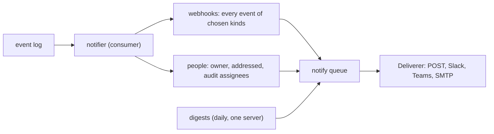

# Notifications

A repository can send its events to webhooks, and each person can choose
where to hear about what concerns them. Every delivery is a job in the
repository's `notify` queue (rill-jobs). A failing endpoint is retried
with backoff; after its last attempt the job goes to the dead-letter
queue rather than being dropped.

## Webhooks

Repository owners manage webhooks with `CreateWebhook`, `ListWebhooks`
and `DeleteWebhook` (`rill notify webhook add <url> [--secret NAME]
[--event KIND…]`, `list`, `rm <id>`). A repository keeps up to 20.

- **What is sent:** each webhook gets every event of the kinds it names
  (all when it names none). The body is
  `{ id, type, repo, timestamp, actor, data }`, where `data` is the
  event.
- **Signing:** deliveries follow [Standard Webhooks](https://www.standardwebhooks.com).
  - The headers are `webhook-id`, `webhook-timestamp` and
    `webhook-signature: v1,<base64 HMAC-SHA256 of "{id}.{timestamp}.{body}">`.
  - The key is an org secret, named on the webhook and kept in the
    [secret store](../06-services/exec.md#secrets). A `whsec_` value is the
    base64 of the key.
  - A secret limited to other repositories is refused.
- **Responses:** a delivery that gets a non-2xx response is retried.
  Redirects are not followed.

## Personal notifications

Each person sets their own preferences per repository
(`UpdateNotificationPrefs`; `rill notify prefs [--slack URL] [--teams URL]
[--email ADDR] [--topic …] [--digest] [--clear]`). These are:
- up to five channels: Slack or Teams incoming webhooks, or email;
- the topics they want;
- whether they want a daily digest.

| Topic | Sent when |
| --- | --- |
| `own_changes` | someone else opens a thread or votes negative on your change; it can land; it landed |
| `addressed` | a thread is addressed to you (owner-review escalations are) |
| `audits` | a landing is sampled for an audit assigned to you ([attention](../04-workflow/attention.md#sampled-audits)) |

Only `user:`/`agent:` entries are notified; a team entry names nobody
here. `SendTestNotification` (`rill notify test`) sends one message to
each channel.

**Digests.** Once a day, at `[notify] digest_hour_utc`, one server sends
each person who asked a summary of yesterday under every intent they own
(the [intent digest](../04-workflow/attention.md#digests)). The leader
election makes it one server; the marker `digest-sent:<day>` makes it
once per day.

## Delivery

[`Deliverer`](../../crates/server/runtime/src/notify/deliver.rs) sends
each kind of delivery:

- **Webhooks:** a JSON POST with a 10 s timeout.
- **Slack and Teams:** `{"text": …}`.
- **Email:** sent with [lettre](https://crates.io/crates/lettre) through
  `[notify] smtp_url`. That is `smtps://…` or `smtp://…` (STARTTLS), or
  `file:///dir` to write messages to files, for tests. Email fails while
  no URL is set.

URLs must be `https://` unless `allow_insecure_urls` is set.

| `[notify]` | Default | Meaning |
| --- | --- | --- |
| `smtp_url` | none | email transport |
| `from` | `rill@localhost` | sender |
| `allow_insecure_urls` | `false` | accept `http://` for webhooks and chat |
| `digest_hour_utc` | `8` | when digests go out |

## Limitations

- Preferences are per repository, not per org.
- Team owner entries are not expanded to their members.
- There is no delivery log beyond the queue's dead letters.

## Code

- [rill-runtime notify/](../../crates/server/runtime/src/notify/mod.rs): [sign.rs](../../crates/server/runtime/src/notify/sign.rs), [prefs.rs](../../crates/server/runtime/src/notify/prefs.rs), [deliver.rs](../../crates/server/runtime/src/notify/deliver.rs), [jobs.rs](../../crates/server/runtime/src/notify/jobs.rs)
- [workers/notifier.rs](../../crates/server/runtime/src/workers/notifier.rs), [workers/digests.rs](../../crates/server/runtime/src/workers/digests.rs)
- [api services/notify/](../../crates/server/api/src/services/notify/mod.rs), [notify.proto](../../crates/foundation/proto/proto/rill/v1/notify.proto)
- Test: [api access/notifications.rs](../../crates/server/api/tests/grpc/access/notifications.rs)

---
← Previous: [Events and workers](events-and-workers.md) · [Index](../index.md) · Next: [Configuration](configuration.md) →
