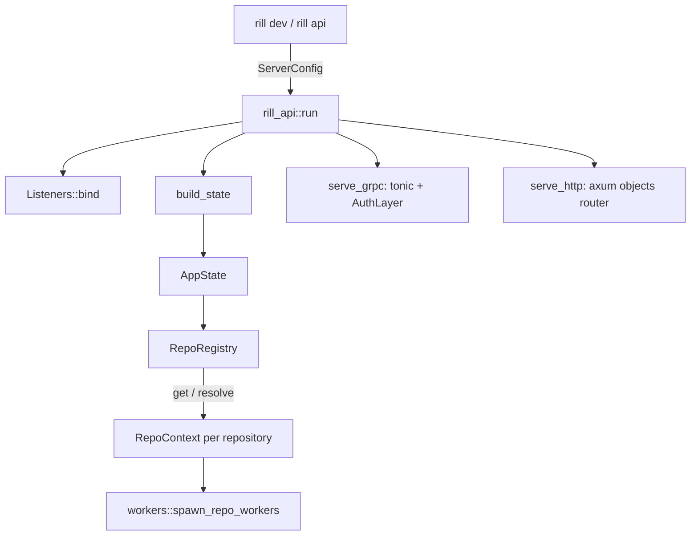
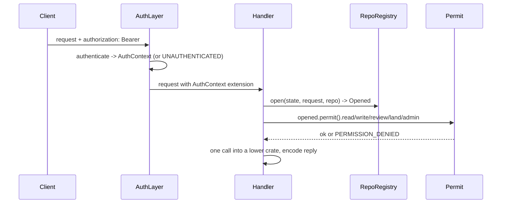

# Server

`rill-api` is the one process that owns every repository. It serves the
`rill.v1` gRPC API and the HTTP object protocol, and runs the background
workers for each repository. The crate is a library; `rill dev` and
`rill api` in `rill-cli` build a `ServerConfig` and call `rill_api::run`.

## Composition

There is one `AppState` per process. It holds the `Stores` opened from
`StorageConfig`, the `Arc<ServerConfig>`, the composite `Authenticator`, the
Biscuit `Issuer`, the `RepoRegistry`, the root `CancellationToken` and
`started_at`. `AppState::with_stores` builds state over stores that are
already open; tests use it. `build_state` opens the stores and then calls
`RepoRegistry::warm`, which builds the context of every existing
repository. Landers and job workers therefore run before the first request.

## RepoContext

`RepoRegistry` caches one `Arc<RepoContext>` per `RepoId` in a `DashMap`, for
the life of the process.

* `resolve(spec)` maps a request's `repo` field by name, then by id
  (`rp_<hex>` or bare hex); unknown is `NOT_FOUND`.
* `get(id)` builds a context on first use. Builds are serialised behind
  `build_lock`, so two concurrent first requests cannot start two landers for
  the same repository.
* `create` maps a store conflict to `Error::AlreadyExists`.

`RepoRegistry::build` wires the lower crates for one repository: `RepoStore`,
`TreeOps` (with `DEFAULT_TREE_CACHE`), `DeriveManager` (`DERIVE_CACHE` = 8192),
`CommitGraph`, the `ReviewService`, `Lander`, the optional `PostLandVerifier`
and `Runner`, `SearchIndex`, the ReBAC `Authorizer`, the `EventBus` (land-ticket
progress for `WatchReview`), the land
`tickets` map, the `LabelSet` and a child shutdown token.

The review service sits behind an `ArcSwap`. It is built from the stored
`policy:submit` and `policy:risk` records (`state/policy.rs`), falling back to
the default rules and `[risk]` from config. `reload_policy` rebuilds it after
`SetPolicy` and swaps it in. Handlers call `RepoContext::review()` per
request and must not hold the `Arc` across requests. The lander's
`ReviewHooksAdapter` holds the swap handle, so in-flight landings see the new
policy. The review broadcast sender is shared across rebuilds, so event
subscribers are unaffected.

## Request path

`AuthLayer` (`auth/layer.rs`) is a tower layer, not a tonic interceptor,
because authentication may need the store and interceptors are synchronous.
It wraps each of the six services; gRPC reflection and `tonic-health` are not
wrapped. In `authenticate`, a request without a bearer token acts as the
human `dev` in dev mode and is `UNAUTHENTICATED` otherwise. A token must
authenticate even in dev mode. The composite authenticator tries the static
table, then each Biscuit root, and always trusts the server's own `Issuer`
([identity and auth](../05-policy/identity-and-auth.md)).

Handlers stay thin. `services::common::open` pairs `auth::caller` with
`repos.resolve`. Then `Permit` (`auth/permit.rs`) runs two layers before
any store access:

1. If the caller holds a capability token, it must allow the verb on the
   path. This layer applies even in dev mode.
2. The ReBAC relation must hold on the path or an ancestor. This layer is
   skipped in dev mode and for a repository with no relation tuples (the
   bootstrap rule). `CreateRepo` grants `owner` to the creator.

`read_filter` gives the `PathFilter` that listings, diffs and grep use to
hide unreadable paths ([permissions](../05-policy/permissions.md)).

`resolve_root` (`services/common.rs`) turns a `RootSpec` into a root tree.
An absent spec means the trunk head. `commit_version`
(`services/repo/write.rs`) is the single write path for change versions. It
checks that parents and content exist, materialises the `RootTree` so a bad
change fails the request, updates review and publishes `VersionCreated`.

## Error mapping

Every lower crate's error converts into `rill_api::Error` (`error.rs`).
`Error::code()` picks the gRPC code from the meaning of the variant, not from
the crate that produced it. The status message is the error's `Display`
text, and `INTERNAL` errors are logged at error level.

| Code | Typical sources |
| --- | --- |
| `NOT_FOUND` | missing objects, keys, changes, trees, paths, reviews, threads, tickets |
| `INVALID_ARGUMENT` | `ConvertError`, bad paths/ids, hash mismatch, policy parse errors, bad labels or stacks, bad grep patterns |
| `FAILED_PRECONDITION` | missing parent or predecessor, ref not at expected target, invalid review status |
| `ABORTED` | store `Conflict` (lost compare-and-swap), review `Contended`, lander `RevertFailed` |
| `PERMISSION_DENIED` / `UNAUTHENTICATED` | `Permit` failures, rejected or expired tokens |
| `UNAVAILABLE` | I/O, store backend, lander `Shutdown`, search `RootNotIndexed` |
| `DATA_LOSS` | codec failures and content size mismatches |
| `INTERNAL` | config, exec, hook and verifier errors, derive and join failures |

The object protocol reuses this mapping through `ObjectError`; see
[API surface](api-surface.md#http-object-protocol).

## Startup and shutdown

`run` binds both listeners (port 0 picks a free port, reported by
`Listeners::addrs`), calls `build_state`, then `serve_with_state` runs gRPC
and HTTP together. On ctrl-c the binary cancels the root token. Both servers
drain in-flight requests, workers and watches stop on their child tokens,
and the index worker flushes. The lander releases its lease, so a standby
takes over at once; claimed jobs left unfinished are taken back when their
claims expire.

## Limitations

* The `RepoContext` cache never evicts. There is no path to unload a
  repository.
* Land tickets (`RepoContext::tickets`) and the lander queue are in memory,
  so pending landings and ticket lookups are lost on restart.
* `PutBlob` buffers the whole upload before it resolves the repository and
  checks write permission.
* `GetBlob` reads the whole blob into memory before it slices and streams it.
* `health_components` probes only the metadata store, the object store and
  uptime.

## Code

* [lib.rs](../../crates/rill-api/src/lib.rs), [serve.rs](../../crates/rill-api/src/serve.rs), [error.rs](../../crates/rill-api/src/error.rs)
* [state/app.rs](../../crates/rill-api/src/state/app.rs), [state/registry.rs](../../crates/rill-api/src/state/registry.rs), [state/policy.rs](../../crates/rill-api/src/state/policy.rs)
* [auth/layer.rs](../../crates/rill-api/src/auth/layer.rs), [auth/authenticator.rs](../../crates/rill-api/src/auth/authenticator.rs), [auth/permit.rs](../../crates/rill-api/src/auth/permit.rs), [auth/context.rs](../../crates/rill-api/src/auth/context.rs)
* [services/common.rs](../../crates/rill-api/src/services/common.rs), [services/repo/write.rs](../../crates/rill-api/src/services/repo/write.rs)

---
← Previous: [Git import](../06-services/git-import.md) · [Index](../index.md) · Next: [API surface](api-surface.md) →
