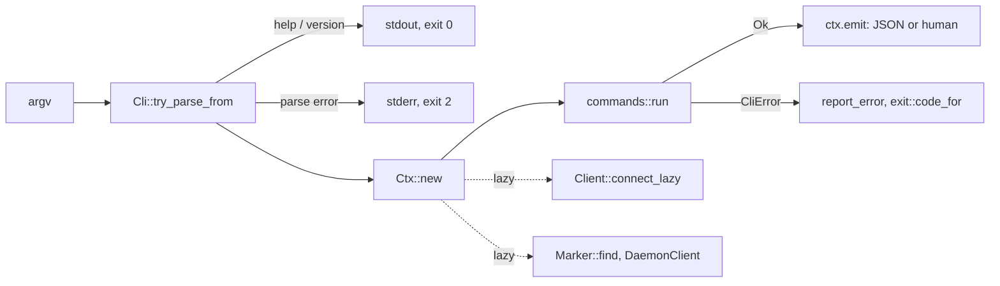

# CLI

`rill-cli` builds `rill`: the user command and the client daemon it starts
(`rill daemon run`). The binary is a thin `main` over the `rill_cli`
library, so tests run the CLI in-process with `run_cli_with_args`. The
services are a separate binary, `rill-server`. Every command builds
one JSON value with `rill_mcp::json`, the same encoding the MCP tools return.
It prints that value under `--json` and a human view of it otherwise.

## Flow

`run_cli` reads `-v` and `-q` before clap runs, so logging also covers
parsing. Logs go to stderr at `warn` by default, and `RUST_LOG` overrides
the level. Colour is on only when stdout is a terminal, `NO_COLOR` is unset,
and neither `--no-color` nor `--json` is given.

## Commands

Global options work in any position: `--endpoint`, `--token`, `--repo`,
`--json`, `-C/--cwd`, `--daemon-dir`, `-v` (repeatable), `-q`,
`--color auto|always|never` (`--no-color`), `--no-pager`.

| Group | Commands |
| --- | --- |
| Repositories | `repo list`, `repo create [--windows-safe]`, `repo show`; names are `org/name` or a name in the default org |
| Orgs | `org list`, `org show <name>`, `org create <name> [--description]` |
| Checkout | `clone [--eager]`, `checkout [--lazy \| --snapshot]`, `status [-s]`, `diff [--stat \| --name-status] [-U N]` |
| History | `log [--oneline] [--no-graph]`, `blame`, `show [--stat \| --name-status \| -s]`, `ls`, `cat`, `grep` |
| Changes | `new`, `commit`, `describe`, `amend` (no `-m`: your editor), `squash` (fold the working change into its parent), `split <paths>` (move paths into a new change on top), `sync`, `conflicts` (list), `resolve <paths> \| --all \| -i`, `undo`, `redo`, `op log`, `abandon` |
| Stacks | `stack show`, `stack sync`, `stack submit`, `stack land [--prefix]` (one ordered group: all or nothing, or the longest landable prefix) |
| Review | `submit`, `approve` / `reject` (the label's most or least, `Review` unless `--label`), `comment`, `inbox`, `review open` (full screen), `review show/list/vote/comment/reply/threads/resolve-thread/evaluate`, `review request [change] [--reviewer …]` and `review runs [change]` (agent reviews, [review agents](../04-workflow/review-agents.md)), `review audits`, `review audit trunk@N --pass\|--fail [--revert]`, `review batch --intent <id> [--approve <signature>]` ([human attention](../04-workflow/attention.md)), `review interdiff [change] [--from] [--to]`, `review comment … --line N [--end-line M] --suggest <text>`, `review apply <thread>`, `review reopen [change]` |
| Landing | `land [--wait] [--timeout 300] [--no-sync] [--onto release/<name>]`, `land cancel [ticket \| change] [-m reason]`, `queue` (requests waiting, with place and wait), `trunk` (status), `trunk health`, `trunk landings`, `trunk verify <seq>`, `trunk freeze [--reason]`, `trunk thaw`, `incidents [-n]`, `revert <seq>`, `revert --session/--model/--sponsor/--author/--intent [--since] [--until] [--apply]` (a preview without `--apply`), `bisect` |
| Policy | `policy show` (rules in force and their source), `policy simulate --policy <file> [--since] [--until]`, `policy guardrails get/set` (org), `why trunk@N [--facts]` ([submit policy](../05-policy/submit-policy.md)) |
| Notifications | `notify webhook add <url> [--secret] [--event …]`, `notify webhook list/rm`, `notify prefs [--slack] [--teams] [--email] [--topic …] [--digest] [--clear]`, `notify test` ([notifications](../07-runtime/notifications.md)) |
| Reviewers | `reviewer stats` (trust and outcomes per reviewer agent), `reviewer reinstate <agent>` |
| Owners | `owners show <path>` (the owner sets covering it), `owners explain [change]` (approvals and escalation per set) |
| Releases | `release cut <name> [--at SEQ]` (repository owners), `release list`; land on one with `land --onto release/<name>` or `stack land --onto` |
| Checks | `checks runs [--of-version]`, `checks run <id> [--watch]`, `checks log <run> <step> [--stderr] [--tail]`, `checks artifact <run> <step> <path> [-o]`, `checks nonhermetic`, `checks flaky [--min-score] [--limit]`, `checks history <target>`, `checks quarantine list/add/release` ([checks](../06-services/checks.md)) |
| Intents | `intent create/list/show/update/link/similar`, `intent scope <id> --path … [--forbid …] [--max-files] [--max-changes] [--expires] [--agent-quorum] [--human-sample] [--changes-per-day] [--lands-per-day]`, `intent approve <id> [--revision]`, `intent revoke <id>`, `intent explain [change]`, `intent digest <id> [--day]` |
| Workspaces, refs | `ws create/list/show/handoff/delete`, `ref list/show/set/delete` |
| Sign-in | `login [--org] [--provider]` (device flow through the org's identity provider), `logout`, `whoami`, `auth token` (an attenuated capability token for scripts) |
| Agents | `agent register/list/suspend/activate`; `agent register --reviewer-family --reviewer-model [--reviewer-prompt] [--max-vote] [--reviews-per-day]` makes a reviewer |
| Services | `dev`, `api [--roles]`, `cache --origin --dir --max-bytes` ([cache tier](../07-runtime/cache.md)) |
| Access | `access grant/revoke <subject> <relation> [path]`, `access list [--path] [--subject] [--relation]`, `access check <relation> [path] [--as]`, `access who <relation> [path]`, `access where <relation> [--as]` |
| Admin | `admin policy get/set` (of the current repository), `admin health`, `admin idp add/list/remove` (OIDC, or SAML with `--saml-metadata`), `admin user list/suspend/activate/roles`, `admin key list/rotate`, `admin revoke token/session`, `admin trust add/list/remove` (workload issuers), `admin kill --agent/--session/--sponsor/--model`, `admin scim create/list/revoke`, `admin audit list/watch/seal/verify/export`, `admin protect redact/approve/redactions/release/rotate-key`, `admin secret set/list/delete` (the value from standard input or `--from-file`, never an argument) |
| Other | `import git` (through the server), `export git` (mirror trunk to a git branch; `--follow` keeps it following), `watch trunk/refs/log/events` (`log` and `events` take `--after <cursor>` or `--from-start`; `events` filters with `--kind` (repeatable), `--change` and `--ref-prefix`), `completions <shell>`, `help [topic \| command]` (guides: getting-started, checkouts, stacks, conflicts, agents, config), `doctor`, `bug-report [-o]`, `man -o <dir>` (hidden; for packagers) |

Each group lives in `commands/<group>.rs`. `commands/parse.rs` holds the
shared positional parsers: `root_arg` (defaults to trunk), `seq_arg` (`7` or
`trunk@7`) and `change_ref` (`ch_<hex>` or a version hash).

Behaviours worth knowing:

- `rill new` with a previous working change: if that change has landed, the
  command clears it and starts fresh. Otherwise it updates the checkout onto
  the previous change's current version and snapshots a new change stacked on
  it. Only edits made since the last snapshot go into the new change.
- Checkout commands (`checkout`, `status`, `diff`, `new`, `amend`,
  `describe`, `sync`, `conflicts`, `resolve`, `undo`) go through the
  [client daemon](daemon.md), found from the checkout's `.rill/mount.json`
  and started in the background when it is not running. `--daemon-dir`
  (or `RILL_DAEMON_DIR`) picks another daemon; `rill daemon run | start |
  stop | status | unmount` manage it, and `rill doctor` reports the
  server, the daemon, reads per cache tier, each checkout and what to
  fix.
- `rill import git <path> --repo R` imports through the server the client
  is configured for (`rill-server import git --storage-dir DIR` imports
  into a storage directory instead). `rill export git <dir>` mirrors trunk into
  a git branch, and with `--follow` keeps exporting each landing. See [git import and export](../06-services/git-import.md).
- Every change the CLI creates has `Provenance {tool: "rill-cli"}`.
- `rill login` lists the org's providers through `SessionService`, runs the
  device flow against the chosen one's CLI client, prints the code and URL
  on stderr, exchanges the ID token for a Rill session and stores it
  (`credentials.rs`): in the OS keychain (service `rill`, account = the
  endpoint), or a 0600 JSON file when the keychain fails or
  `RILL_CREDENTIALS_FILE` names one (`~/.config/rill/credentials.json` by
  default). Later commands use the stored session, which refreshes itself
  and saves each rotated refresh token. `rill logout` ends the session on
  the server and forgets it.
- Under `RILL_WORKLOAD_TOKEN_FILE` with no token given, every command except
  `dev`, `api`, `login`, `logout` and `completions` connects first,
  exchanging the workload's JWT for an agent token
  (`Ctx::resolve_workload`).

## Presentation

The human output reads like git's, through one layer (`output/`):

- **Theme** (`theme.rs`): one style per semantic role (added, conflict,
  id, ref, author, date, hint, diff-add-word, graph-working, …), restyled
  in `[color]` of `~/.config/rill/config.toml` with git's spec syntax
  (`yellow bold`, `white on red`, `208`, `#ff8800`). Colour is on for a
  terminal; `--color`, `--no-color`, `NO_COLOR`, `CLICOLOR_FORCE` and
  `[color] ui` decide otherwise. Help and usage errors are coloured on a
  terminal only.
- **Pager** (`pager.rs`): `log`, `diff`, `show`, `blame`, `cat`, `grep` and
  `help` page through `$RILL_PAGER`, `[core] pager`, `$PAGER`, else
  `less` with `LESS=FRX`; `--no-pager` skips it; a reader that quits early
  is not an error.
- **Diffs** (`diff.rs`, `patch.rs`, `stat.rs`): file headers, hunks, the
  changed words of an edited line singled out (`similar`), and code
  coloured by language with delta-style line backgrounds (`syntect`;
  `[diff] syntax`, `[diff] theme`); `--stat` and `--name-status`.
- **History graph** (`graph.rs`): jj-style lanes following first parents:
  `@` working change, `○` unlanded, `◆` trunk, `×` conflicted; the
  checkout's unlanded stack is drawn on its own lane above trunk.
- **Status** prints sections and hints like `git status`; file paths are
  terminal hyperlinks (OSC 8) where supported. **Blame** colours lines by
  age. Dates are relative (`3 hours ago`). Tables fit the width
  (`$COLUMNS`, else the terminal's).
- **Interaction** only on a terminal and never with `--json` or `-q`:
  spinners (`indicatif`) for checkout, sync and `land --wait` (queue
  position and ETA live); `$RILL_EDITOR`/`$VISUAL`/`$EDITOR` for a missing
  message (`editor.rs`); prompts (`inquire`) for confirmations and
  `resolve -i`; `review open` is a full-screen `ratatui` view whose key
  handling is a pure state machine.
- **Aliases** (`aliases.rs`): `[alias] lg = "log --oneline"`; built-ins win.

`tests/cli/human.rs` snapshots the human output of the everyday commands
(plain and coloured) at a fixed width, beside the JSON schemas in
`tests/cli/schemas.rs`.

## Context resolution

`Ctx` (`context.rs`) resolves each setting lazily, at most once per
invocation.

| Setting | Order |
| --- | --- |
| endpoint | `--endpoint`, then the checkout's `endpoint`, then `ClientConfig::discover` (`RILL_ENDPOINT`, then the config file) |
| token | `--token`, then `RILL_TOKEN`, then the config file's token (only when the file also supplied the endpoint), then the session `rill login` stored for the endpoint |
| repository | `--repo`, then the checkout's `repo`, then `RILL_REPO`, else a usage error |
| checkout | `Marker::find` walks up from `-C` or the process cwd to the nearest `.rill/mount.json` |

The client uses `connect_lazy` with user agent `rill-cli/<version>`.
Commands that never call the server never dial it.

## Output, errors and exit codes

`Ctx::emit(value, human)` prints the JSON under `--json` (or
`--json-schema v1`, which pins the version and implies `--json`).
Otherwise it runs the human renderer against `Out`, which provides `line`,
`kv`, `table` (`comfy-table`) and style helpers.

Every JSON document is versioned: `{"schema": "rill.cli.v1.<command>",
"result": …}`, where `<command>` is the command's path with dots
(`rill.cli.v1.review.list`, `rill.cli.v1.trunk.landings`). Streams
(`watch`) print one compact `{"schema": "rill.cli.v1.watch.<kind>.event",
"event": …}` per line. `tests/cli/schemas.rs` runs a session against an
in-process dev server and snapshots each command's document (`insta`, with
hashes, ids, times and paths redacted); a changed snapshot is a changed
schema, and a breaking one needs a new version.

Errors go to stderr. A person sees the error worded by the server's reason
(`not allowed by policy: …`, `changed meanwhile: …`) and hints: what a
policy denial still needs, when to retry, what to do next. With `--json` an
error is `{"schema": "rill.cli.v1.error", "error": {code, reason, message,
missing, retry_after_ms, exit}}`: `code` is the snake_case status code,
`reason` the `ErrorReason` (`POLICY_DENIED`, `ETAG_MISMATCH`, …).

| Exit | Meaning |
| --- | --- |
| 0 | success, including `--help` and `--version` |
| 1 | failure: server error, not found, transport, I/O, storage, a request over a size limit |
| 2 | usage: parse error, `CliError::Usage`, `CliError::Invalid`, SDK `Config` error |
| 3 | needs attention: conflict, `LandFailed`, SDK `Conflict`, status `ABORTED` or `FAILED_PRECONDITION` (other than a policy denial) |
| 4 | denied: unauthenticated, `PERMISSION_DENIED`, reason `POLICY_DENIED` |
| 5 | retryable: `UNAVAILABLE`, `DEADLINE_EXCEEDED`, a client timeout, `RESOURCE_EXHAUSTED` with a wait (rate limit, full queue) |

Scripts and agents can rely on these codes: 3 means "read the output and
decide", 4 "get permission or approval", 5 "try again later".

The MCP server reports a failed tool the same way: its structured error
carries `code`, `reason`, `missing` and `retry_after_ms`.

## The services

The services are not in `rill`; they ship as `rill-server` ([server
binary](../07-runtime/server.md#the-rill-server-binary), ADR 020), so the
client links none of their crates. `rill dev [ARGS]` is the one exception
for convenience: it finds `rill-server` next to `rill` (else on `PATH`)
and replaces itself with `rill-server dev ARGS`
(`commands/dev.rs`).

## Limitations

- If the checkout marker fails to parse, the CLI acts as if it is outside
  a checkout.
- `rill import git` prints only its final result, with no progress output.
- The `--endpoint` help text gives `~/.config/rill/config.toml` as the config
  path. On macOS the SDK reads `~/Library/Application Support/rill/config.toml`.

## Code

- [lib.rs](../../crates/clients/cli/src/lib.rs), [cli.rs](../../crates/clients/cli/src/cli.rs), [context.rs](../../crates/clients/cli/src/context.rs), [error.rs](../../crates/clients/cli/src/error.rs), [exit.rs](../../crates/clients/cli/src/exit.rs)
- [commands/mod.rs](../../crates/clients/cli/src/commands/mod.rs), [commands/parse.rs](../../crates/clients/cli/src/commands/parse.rs), [commands/change/mod.rs](../../crates/clients/cli/src/commands/change/mod.rs), [commands/import/](../../crates/clients/cli/src/commands/import/mod.rs), [commands/export.rs](../../crates/clients/cli/src/commands/export.rs)
- [tests/cli/schemas.rs](../../crates/clients/cli/tests/cli/schemas.rs), [tests/cli/human.rs](../../crates/clients/cli/tests/cli/human.rs), [output/mod.rs](../../crates/clients/cli/src/output/mod.rs), [output/theme.rs](../../crates/clients/cli/src/output/theme.rs), [output/diff.rs](../../crates/clients/cli/src/output/diff.rs), [output/graph.rs](../../crates/clients/cli/src/output/graph.rs), [output/pager.rs](../../crates/clients/cli/src/output/pager.rs), [settings.rs](../../crates/clients/cli/src/settings.rs), [aliases.rs](../../crates/clients/cli/src/aliases.rs)
- [commands/review/browse/](../../crates/clients/cli/src/commands/review/browse/mod.rs), [commands/change/pick.rs](../../crates/clients/cli/src/commands/change/pick.rs), [commands/help.rs](../../crates/clients/cli/src/commands/help.rs), [guides/](../../crates/clients/cli/guides/getting-started.md)
- [commands/dev.rs](../../crates/clients/cli/src/commands/dev.rs) (`rill dev` hands over to [rill-server](../../crates/server/server/src/lib.rs))
- [bin/rill.rs](../../crates/clients/cli/src/bin/rill.rs)

---
← Previous: [Client daemon](daemon.md) · [Index](../index.md) · Next: [MCP server](mcp.md) →
