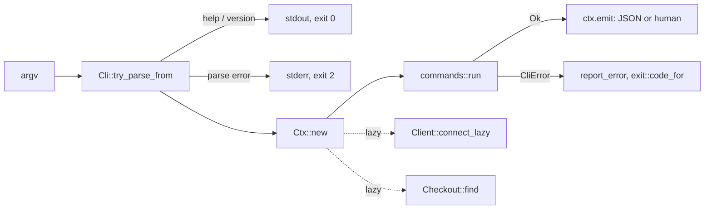

# CLI

`rill-cli` builds two binaries: `rill`, the user command, and `rill-server`,
the server process. Both are thin `main`s over the `rill_cli` library, so
tests run the CLI in-process with `run_cli_with_args`. Every command builds
one JSON value with `rill_mcp::json`, the same encoding the MCP tools return.
It prints that value under `--json` and a human view of it otherwise.

## Flow

`run_cli` reads `-v` and `-q` before clap runs, so logging also covers
parsing. Logs go to stderr at `warn` by default, and `RUST_LOG` overrides
the level. Colour is on only when stdout is a terminal, `NO_COLOR` is unset,
and neither `--no-color` nor `--json` is given.

## Commands

Global options work in any position: `--endpoint`, `--token`, `--repo`,
`--json`, `-C/--cwd`, `-v` (repeatable), `-q`, `--no-color`.

| Group | Commands |
| --- | --- |
| Repositories | `repo list`, `repo create [--windows-safe]`, `repo info` |
| Checkout | `checkout`, `status`, `diff` |
| History | `log`, `blame`, `show`, `ls`, `cat`, `grep` |
| Changes | `new`, `describe`, `amend`, `sync`, `resolve`, `undo` |
| Stacks | `stack show`, `stack sync`, `stack submit`, `stack land` |
| Review | `submit`, `review show/list/vote/comment/threads/resolve-thread/evaluate/abandon` |
| Landing | `land [--wait] [--timeout 300] [--no-sync]`, `trunk`, `landings`, `verify`, `revert`, `bisect` |
| Intents | `intent create/list/show/update/link/similar` |
| Workspaces, refs | `ws create/list/show/handoff/ops/delete`, `ref list/show/set/delete` |
| Admin | `admin whoami`, `admin token issue`, `admin relation add/remove/list`, `admin policy get/set`, `admin health` |
| Other | `import git`, `watch trunk/refs/log`, `completions <shell>` |

Each group lives in `commands/<group>.rs`. `commands/parse.rs` holds the
shared positional parsers: `root_arg` (defaults to trunk), `seq_arg` (`7` or
`trunk@7`) and `change_ref` (`ch_<hex>` or a version hash).

Behaviours worth knowing:

- `rill new` with a previous working change: if that change has landed, the
  command clears it and starts fresh. Otherwise it updates the checkout onto
  the previous change's current version and snapshots a new change stacked on
  it. Only edits made since the last snapshot go into the new change.
- `rill new` and `rill sync` change `working_change` through
  `checkout_meta::set_working_change`. This is the only place the CLI edits
  `.rill/checkout.toml` directly.
- `rill import git <path> --repo R --storage-dir DIR` opens `LocalStores`
  directly, not through a server, and rejects `--endpoint`. `--storage-dir`
  also reads `RILL_STORAGE_DIR`. See [git import](../06-services/git-import.md).
- Every change the CLI creates has `Provenance {tool: "rill-cli"}`.

## Context resolution

`Ctx` (`context.rs`) resolves each setting lazily, at most once per
invocation.

| Setting | Order |
| --- | --- |
| endpoint | `--endpoint`, then the checkout's `endpoint`, then `ClientConfig::discover` (`RILL_ENDPOINT`, then the config file) |
| token | `--token`, then `RILL_TOKEN`, then the config file's token (only when the file also supplied the endpoint) |
| repository | `--repo`, then the checkout's `repo`, then `RILL_REPO`, else a usage error |
| checkout | `Checkout::find` walks up from `-C` or the process cwd to the nearest `.rill/` |

The client uses `connect_lazy` with user agent `rill-cli/<version>`.
Commands that never call the server never dial it.

## Output, errors and exit codes

`Ctx::emit(value, human)` pretty-prints the JSON under `--json`. Otherwise it
runs the human renderer against `Out`, which provides `line`, `kv`, `table`
(`comfy-table`) and style helpers. `watch` prints one compact JSON object per
line through `emit_json_line`.

Errors go to stderr. With `--json` an error is printed as
`{"error": {code, message, exit}}`. `code` comes from `CliError::code`. For
SDK errors it is `rill_mcp::error::sdk_code`, the snake_case gRPC code.

| Exit | Meaning |
| --- | --- |
| 0 | success, including `--help` and `--version` |
| 1 | failure: server error, not found, permission denied, transport, I/O, storage |
| 2 | usage: parse error, `CliError::Usage`, `CliError::Invalid`, SDK `Config` error |
| 3 | needs attention: conflict, `LandFailed`, SDK `Conflict`, status `ABORTED` or `FAILED_PRECONDITION` |

Scripts and agents can rely on these codes. Exit 3 means "read the output
and decide".

## rill-server binary

`server/mod.rs` parses `--config PATH` (or `RILL_CONFIG`), `--dev`,
`--listen-grpc`, `--listen-http`, `--storage memory|local:<dir>`, and the
`init-config [--out PATH] [--force]` subcommand. `build_config` loads the
file and `RILL_*` environment through `ServerConfig::load`, then applies
the flags. `--dev` sets `dev_mode`, memory storage and ports 7470 / 7471
(`DEV_GRPC_PORT` / `DEV_HTTP_PORT`). Explicit flags still override those.
Ctrl-C cancels the root `CancellationToken`. The process exits 0 on clean
shutdown and 1 on error. `init-config` prints an annotated
`ServerConfig::default()`. See [configuration](../07-runtime/configuration.md).

## Limitations

- If checkout metadata fails to parse, the CLI logs a warning and acts as if
  it is outside a checkout.
- `rill import git` prints only its final result, with no progress output.
- `rill-server` has no flags for S3 storage or Biscuit keys. Those come
  from the config file or the environment.
- The `--endpoint` help text gives `~/.config/rill/config.toml` as the config
  path. On macOS the SDK reads `~/Library/Application Support/rill/config.toml`.

## Code

- [lib.rs](../../crates/rill-cli/src/lib.rs), [cli.rs](../../crates/rill-cli/src/cli.rs), [context.rs](../../crates/rill-cli/src/context.rs), [error.rs](../../crates/rill-cli/src/error.rs), [exit.rs](../../crates/rill-cli/src/exit.rs), [checkout_meta.rs](../../crates/rill-cli/src/checkout_meta.rs)
- [commands/mod.rs](../../crates/rill-cli/src/commands/mod.rs), [commands/parse.rs](../../crates/rill-cli/src/commands/parse.rs), [commands/change.rs](../../crates/rill-cli/src/commands/change.rs), [commands/import.rs](../../crates/rill-cli/src/commands/import.rs)
- [output/mod.rs](../../crates/rill-cli/src/output/mod.rs), [output/table.rs](../../crates/rill-cli/src/output/table.rs), [output/format.rs](../../crates/rill-cli/src/output/format.rs)
- [server/mod.rs](../../crates/rill-cli/src/server/mod.rs), [server/template.rs](../../crates/rill-cli/src/server/template.rs)
- [bin/rill.rs](../../crates/rill-cli/src/bin/rill.rs), [bin/rill_server.rs](../../crates/rill-cli/src/bin/rill_server.rs)

---
← Previous: [SDK](sdk.md) · [Index](../index.md) · Next: [MCP server](mcp.md) →
