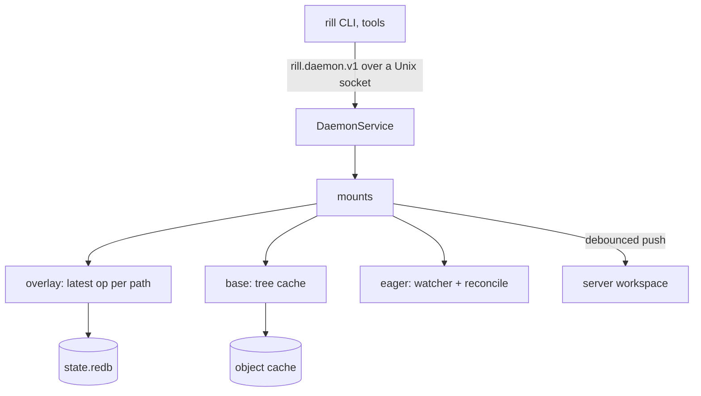

# Client daemon

`rill-daemon` (`rilld`) is the one process per user and host that owns
working copies. Every local tool (the CLI, editors, agents, build tools)
talks to it instead of keeping its own state, so one cache serves every
checkout on the host and `status` never walks a tree. The design target
is a 10M-file repository; the [checkouts](../04-workflow/checkouts.md)
page covers the workflows built on it.

## Directory and lifecycle

The daemon directory (`--daemon-dir`, `$RILL_DAEMON_DIR`, else the
user's local data directory under `rill/daemon`) holds `rilld.sock`
(mode 0600), `state.redb`, `cache/` and `rilld.log`. A CLI command that
needs the daemon connects, and starts `rill daemon run` in the background
(its own process group, output to the log) when none answers. `rill
daemon start | stop | status | run` manage it by hand. A daemon stops when
asked, on Ctrl-C, or when its socket file disappears or is replaced; it
removes the socket only if it is still its own. On start it resumes every
stored mount, and an eager mount begins with a full scan, which finds
edits made while the daemon was down.

Server clients are built per endpoint from the token the last caller
passed (kept in memory only), else `$RILL_TOKEN`, else the signed-in
session in the CLI's credential store.

## Object cache

Content-addressed files under `cache/objects/ab/<hash>`, written to a
temporary sibling and renamed, shared by every mount. An LRU with pins
(`cache/lru.rs`, pure, property-tested) keeps unpinned bytes within a
budget: 20% of the disk, at most 200 GB. Overlay content is pinned until
its entry goes, so unsynced edits are never evicted. On open the cache
re-indexes what is on disk by modification time. A blob fetched from the
server is checked against its hash before it is kept; chunked content is
trusted from the transport and its digest remembered. Trees go through a
second cache (moka in memory, the object cache on disk): a tree hash
names an immutable tree, so a cached one never goes stale.

## Overlay

Per mount, the latest operation on each path (`Set {digest, kind, size}`
or `Delete`, with a conflict flag and a sequence number), rather than an
append-only log: replaying is reading the table, and superseded entries
need no compaction. Every change is persisted in one redb transaction
before it is visible in memory, under a writer lock that keeps sequence
numbers ordered, so an acknowledged edit survives a crash. The base swap
of an update is part of the same transaction as its overlay changes.

## Sync

A mount's push loop waits for edits, lets them settle for the sync delay
(two seconds), and calls `SnapshotWorkspace` with edits: the entries above
the last pushed sequence, conditional on the workspace's etag. The first
push after creation or an update, or one whose etag is stale (another
writer moved the workspace), sends the whole overlay applied to the base
instead. Content above the inline threshold is checked with
`BatchCheckObjects` and uploaded only when missing; what was uploaded is
remembered per mount. While the server is unreachable the loop backs off
up to a minute and keeps the error for `daemon status`; local work
continues.

## Eager mounts

The base is written to disk. A `notify` watcher (inotify, FSEvents,
ReadDirectoryChangesW) queues the paths it reports; a task reconciles
them 20 ms later: a file whose size, mtime and kind match the stat cache
is not read; one whose digest matches what the working copy already has
records nothing; a removed directory deletes every known file below it.
`settle` makes a caller wait until every earlier edit is reconciled by
writing a cookie file and waiting for its event, as Watchman does; if the
watcher does not answer in five seconds, it rescans. An update holds the
reconcile lock while it rewrites files.

## API

`rill.daemon.v1.DaemonService` (`proto/rill/daemon/v1/daemon.proto`),
generated with the same buffa and connectrpc stack as the server and
served by axum on the Unix socket. Errors the daemon relays from the
server keep their code and details; its own map to `NOT_FOUND`,
`INVALID_FIELD`, `CONFLICTS_UNRESOLVED` (exit 3 in the CLI) and
`UNIMPLEMENTED`. `DaemonClient` turns every error back into a
`rill_sdk::Error`, so callers handle relayed and direct errors alike.

| RPC | Does |
| --- | --- |
| `GetDaemon` | Version, pid, cache counters |
| `CreateMount`, `GetMount`, `ListMounts`, `DeleteMount` | Mounts by name or by a path inside one |
| `GetStatus` | Changes against the base |
| `SyncMount` | Push now |
| `CommitMount` | New, amended or stacked change version |
| `UpdateMount` | Move the base, merging |
| `ResolvePaths` | Clear conflict flags |
| `Prefetch` | Fill the cache for prefixes |
| `Shutdown` | Stop |

## Limitations

* Only eager mounts exist yet; lazy (FUSE) and snapshot mounts are
  refused as unsupported.
* One daemon per user; a second writer to the same workspace is not
  detected, it only forces a full push.
* Windows has no local socket yet.

## Code

* [rill-daemon/src/](../../crates/clients/daemon/src/lib.rs): `cache/`, `overlay/`, `state/`, `view/`, `mount/`, `sync/`, `eager/`, `server/`, `client/`
* [rill-cli/src/commands/daemon.rs](../../crates/clients/cli/src/commands/daemon.rs)

---
← Previous: [SDKs in other languages](other-sdks.md) · [Index](../index.md) · Next: [CLI](cli.md) →
