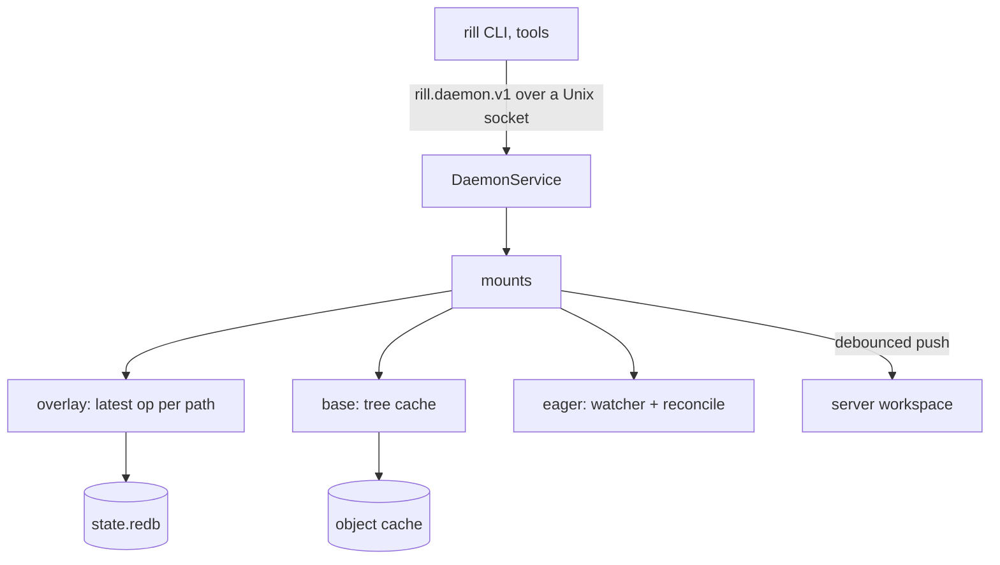

# Client daemon

`rill-daemon` (`rilld`) is the one process per user and host that owns
working copies. Every local tool (the CLI, editors, agents, build tools)
talks to it instead of keeping its own state, so one cache serves every
checkout on the host and `status` never walks a tree. The design target
is a 10M-file repository; the [checkouts](../04-workflow/checkouts.md)
page covers the workflows built on it.

## Directory and lifecycle

The daemon directory (`--daemon-dir`, `$RILL_DAEMON_DIR`, else the
user's local data directory under `rill/daemon`) holds `rilld.sock`
(mode 0600), `state.redb`, `cache/` and `rilld.log`. A CLI command that
needs the daemon connects, and starts `rill daemon run` in the background
(its own process group, output to the log) when none answers. `rill
daemon start | stop | status | run` manage it by hand. A daemon stops when
asked, on Ctrl-C, or when its socket file disappears or is replaced; it
removes the socket only if it is still its own. On start it resumes every
stored mount, and an eager mount begins with a full scan, which finds
edits made while the daemon was down.

Server clients are built per endpoint from the token the last caller
passed (kept in memory only), else `$RILL_TOKEN`, else the signed-in
session in the CLI's credential store.

## Object cache

Content-addressed files under `cache/objects/ab/<hash>`, written to a
temporary sibling and renamed, shared by every mount. An LRU with pins
(`cache/lru.rs`, pure, property-tested) keeps unpinned bytes within a
budget: 20% of the disk, at most 200 GB. Overlay content is pinned until
its entry goes, so unsynced edits are never evicted. On open the cache
re-indexes what is on disk by modification time. A blob fetched from the
server is checked against its hash before it is kept; chunked content is
trusted from the transport and its digest remembered. Trees go through a
second cache (moka in memory, the object cache on disk): a tree hash
names an immutable tree, so a cached one never goes stale.

## Overlay

Per mount, the latest operation on each path (`Set {digest, kind, size}`
or `Delete`, with a conflict flag and a sequence number), rather than an
append-only log: replaying is reading the table, and superseded entries
need no compaction. Every change is persisted in one redb transaction
before it is visible in memory, under a writer lock that keeps sequence
numbers ordered, so an acknowledged edit survives a crash. The base swap
of an update is part of the same transaction as its overlay changes.

## Sync

A mount's push loop waits for edits, lets them settle for the sync delay
(two seconds), and calls `SnapshotWorkspace` with edits: the entries above
the last pushed sequence, conditional on the workspace's etag. The first
push after creation or an update, or one whose etag is stale (another
writer moved the workspace), sends the whole overlay applied to the base
instead. Content above the inline threshold is checked with
`BatchCheckObjects` and uploaded only when missing; what was uploaded is
remembered per mount. While the server is unreachable the loop backs off
up to a minute and keeps the error for `daemon status`; local work
continues.

## Eager mounts

The base is written to disk. A `notify` watcher (inotify, FSEvents,
ReadDirectoryChangesW) queues the paths it reports; a task reconciles
them 20 ms later: a file whose size, mtime and kind match the stat cache
is not read; one whose digest matches what the working copy already has
records nothing; a removed directory deletes every known file below it.
`settle` makes a caller wait until every earlier edit is reconciled by
writing a cookie file and waiting for its event, as Watchman does; if the
watcher does not answer in five seconds, it rescans. An update holds the
reconcile lock while it rewrites files.

## Lazy and snapshot mounts

The view (`vfs/`) is the overlay over the base, independent of the
kernel interface: what each path is, directory listings, and the file
operations as async functions. Two front ends serve it:

* **Linux:** FUSE (`fuser`, pure-Rust mounting through `fusermount3`,
  eight worker threads); each kernel call runs its async work on the
  daemon's runtime from the worker that received it.
* **macOS:** an NFSv3 server on 127.0.0.1, one per mount (`nfsserve`),
  mounted by macOS's own NFS client (`mount_nfs`, NFSv3 over TCP, no
  lock daemon, `nobrowse`, `soft` so a dead daemon fails calls after
  about a minute instead of hanging them). No kernel extension and no
  privileges are needed: a user mounts onto a directory they own.

How the view behaves on both:

* `lookup`, `getattr` and `readdir` read trees only: no content is
  fetched to list or stat, so `find .` over a huge tree costs tree reads.
  A directory listing is taken at `opendir` and served by offset.
* Modification times are synthetic, derived from the content hash, so
  the same content always shows the same mtime and build tools never
  rebuild for a checkout or update that did not change a file. Files are
  owned by the daemon's user; modes come from the file kind.
* The first open of a file fetches it into the object cache; reads then
  come from the cached file, and the kernel keeps its page cache across
  opens (content never changes under a hash). Where the kernel supports
  FUSE passthrough and lets the daemon register backing files, reads go
  to the cached file without the daemon; otherwise the daemon serves them.
* An open for writing copies the file to a private scratch file under
  the daemon directory; a flush or close turns it into an overlay entry.
  Create, unlink, rename (files and whole directories, in one
  transaction), symlink, chmod (the executable bit) and truncate are
  supported. Directories are not versioned: `mkdir` and `rmdir` live in
  the view's memory, and a directory exists while it holds a file.
* The marker `.rill/mount.json` is a synthesized, read-only file.
* A mount left by a daemon that died (`ENOTCONN` on Linux, an NFS mount
  at the path on macOS) is detached before the directory is mounted
  again.

NFS has no open or close, so on macOS a file's writes collect in a
scratch copy and become an overlay entry once the file has been quiet
for 500 ms, before any rename or delete, and whenever the mount settles
(`status`, `commit`, unmount, daemon shutdown). Reads without a write
pending come straight from the cached object. The view also shows a
`.metadata_never_index` file so Spotlight skips the mount, and refuses
`.DS_Store` and `._*` files so Finder's bookkeeping never reaches the
overlay. File handles do not survive a daemon restart (the mount is
remounted), so a shell inside the mount must `cd` again.

A snapshot mount (`rill checkout --snapshot`, for CI) is the same view of
one version with no server workspace: writes stay in its overlay and are
never pushed, and `rill daemon unmount` discards them.

## Regional cache

With `RILL_CACHE_URL` (or `ClientConfig::with_cache`), the SDK reads
blobs through `rill-cache` (`GET /o/{repo}/blob/{hash}` with the read
grant the listing returned and the caller's token), checks the hash, and
falls back to `ReadBlob` on any failure. A CI host with a cold local cache
then reads from the region instead of the origin.

## API

`rill.daemon.v1.DaemonService` (`proto/rill/daemon/v1/daemon.proto`),
generated with the same buffa and connectrpc stack as the server and
served by axum on the Unix socket. Errors the daemon relays from the
server keep their code and details; its own map to `NOT_FOUND`,
`INVALID_FIELD`, `CONFLICTS_UNRESOLVED` (exit 3 in the CLI) and
`UNIMPLEMENTED`. `DaemonClient` turns every error back into a
`rill_sdk::Error`, so callers handle relayed and direct errors alike.

| RPC | Does |
| --- | --- |
| `GetDaemon` | Version, pid, cache counters |
| `CreateMount`, `GetMount`, `ListMounts`, `DeleteMount` | Mounts by name or by a path inside one |
| `GetStatus` | Changes against the base |
| `SyncMount` | Push now |
| `CommitMount` | New, amended or stacked change version |
| `UpdateMount` | Move the base, merging |
| `ResolvePaths` | Clear conflict flags |
| `Prefetch` | Fill the cache for prefixes |
| `Shutdown` | Stop |

## Limitations

* Lazy and snapshot mounts need Linux or macOS (Windows comes after
  phase 30). Chunked blobs and trees are not read through the regional
  cache yet. Inodes are never forgotten while a view is mounted.
* One daemon per user; a second writer to the same workspace is not
  detected, it only forces a full push.
* Windows has no local socket yet.

## Code

* [rill-daemon/src/](../../crates/clients/daemon/src/lib.rs): `cache/`, `overlay/`, `state/`, `view/`, `mount/`, `sync/`, `eager/`, `vfs/`, `fuse/`, `nfs/`, `server/`, `client/`
* [rill-sdk/src/cache_tier.rs](../../crates/clients/sdk/src/cache_tier.rs)
* [rill-cli/src/commands/daemon.rs](../../crates/clients/cli/src/commands/daemon.rs)

---
← Previous: [SDKs in other languages](other-sdks.md) · [Index](../index.md) · Next: [CLI](cli.md) →
