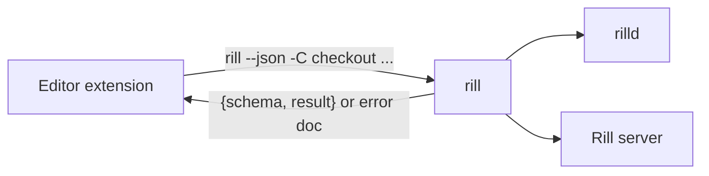

# IDE extensions

The editor extensions bring the working change, blame, conflicts, review
threads, the inbox, landing and trunk health into the editor. They hold no
protocol code of their own: they run the `rill` CLI with `--json` and read
its versioned `rill.cli.v1.*` documents ([CLI](cli.md)). The CLI talks to the
server and to the [client daemon](daemon.md), so an extension sees exactly
what `rill` sees, and a schema change the CLI's snapshot tests catch also
breaks the extensions' contract tests.

## VS Code

The extension lives in [`ide/vscode`](../../ide/vscode), a package of the
root pnpm workspace. It is TypeScript with no runtime dependencies;
`tsdown` bundles it into one `dist/extension.cjs` (`vscode` external), so
the `.vsix` carries a single file. It activates in a
workspace folder holding `.rill/mount.json`.

| Feature | How |
| --- | --- |
| Source Control | `rill status`. The working change's files go in two groups, *Conflicts* and *Working change*. Clicking a file diffs it against the base: the `rill-base:` scheme serves `rill cat --at <base>`. Quick diff gives gutter marks. The message box commits (`rill commit -m`); the title bar has sync, land and refresh. |
| Inline blame | `rill blame <path> --at <base>`, cached per base. The current line is annotated `author · trunk@N`, but only when its text still matches the blamed line. |
| Conflicts | CodeLens over each region of Rill's Jujutsu-style markers (`model/markers.ts`): *Take side #n* or *Take all sides*. Once a file has none left, *Mark resolved* runs `rill resolve <path>`. `rill resolve -i` opens in a terminal. |
| Review threads | `rill review threads` for the working change, through the Comments API. A new comment on a line runs `review comment --path --line`; a reply runs `review reply`; resolve and reopen run `review resolve-thread [--reopen]`. |
| Inbox | `rill inbox` as a tree in the Source Control side bar: *waiting on you* and *your changes*. Clicking an entry opens `rill review open <change>` in a terminal. |
| Status bar | The working change, and `rill trunk health` (green, failing with its steps, or frozen). |
| Land | `rill land --wait` with a progress notification. A failure offers *Sync onto trunk*. |

Refresh happens:

- when files change: `rill status`, debounced 500 ms;
- every `rill.refreshSeconds` (default 30): health, inbox and threads.

Settings: `rill.path`, `rill.blame.enabled`, `rill.refreshSeconds`.

Code is layered so most of it tests without VS Code:

- `src/cli/` runs the CLI and checks each document's schema; failures
  become `RillError` with the CLI's code, exit status and `missing`;
- `src/model/` is pure: blame text, health, inbox, thread placement,
  conflict markers;
- `src/features/` is the VS Code side.

### Tests

`pnpm --filter rill test` runs vitest (and `pnpm -r typecheck` runs
TypeScript 7 over the sources and tests):

- unit tests of the models, including the marker parser, against the
  formats `materialize.rs` writes;
- the CLI runner against a stand-in binary;
- a contract test that parses the CLI's own snapshot files
  (`crates/clients/cli/tests/cli/snapshots`).

With `RILL_BIN` set to a built `rill`, an end-to-end test also runs. It
starts `rill dev --memory` on free ports, with an isolated `HOME`, config
and daemon directory. It clones eagerly, then drives every command the
extension uses: status, commit, describe, submit, comment, reply, resolve,
inbox, land, health, blame, cat and sync. `pnpm --filter rill package` bundles and builds the `.vsix`.

## Limitations

- Blame is of the base version; lines edited in the working copy are not
  annotated.
- Thread anchors are placed on the lines they were made on, not moved
  through later versions.
- Threads on the change as a whole are not shown in the editor.
- No LSP features (cross-repository definitions from the search index) yet.

## Code

- [package.json](../../ide/vscode/package.json), [extension.ts](../../ide/vscode/src/extension.ts)
- [cli/run.ts](../../ide/vscode/src/cli/run.ts), [cli/rill.ts](../../ide/vscode/src/cli/rill.ts), [cli/schema.ts](../../ide/vscode/src/cli/schema.ts)
- [model/markers.ts](../../ide/vscode/src/model/markers.ts), [features/scm.ts](../../ide/vscode/src/features/scm.ts), [features/review.ts](../../ide/vscode/src/features/review.ts)

---
← Previous: [MCP server](mcp.md) · [Index](../index.md) · Next: [Development](../09-engineering/development.md) →
