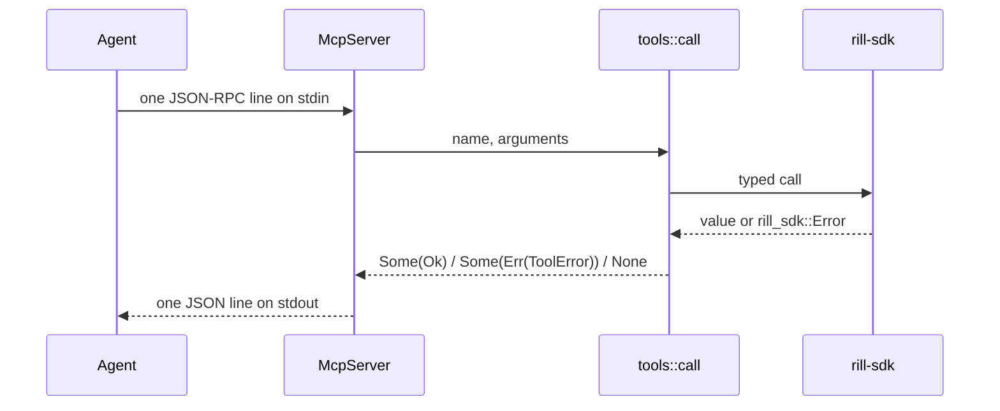

# MCP server

`rill-mcp` speaks the Model Context Protocol over stdio. It exposes the SDK
as 27 tools, so an agent can read history, edit, review and land without a
checkout. The protocol code is hand-written and small. Nothing an agent sends
can stop the session loop. A tool failure is returned as a result with
`isError: true`, malformed JSON-RPC gets a JSON-RPC error, and only a
transport failure ends `serve`.

## Framing and dispatch

`protocol/framing.rs` reads newline-delimited JSON and skips blank lines. A
line that does not parse gets `PARSE_ERROR` (-32700) with `id: null`, and the
loop continues. Replies are compact JSON plus `\n`. Compact JSON never
contains a raw newline, so the framing holds for any payload.

| Method | Result |
| --- | --- |
| `initialize` | `protocolVersion` `2025-06-18`, `tools.listChanged = false`, `serverInfo`, and `instructions` covering `repo`, root syntax and provenance |
| `ping` | `{}` |
| `tools/list` | every `ToolDef` with name, description and `inputSchema` |
| `tools/call` | a tool result; `INVALID_PARAMS` when `name` is missing or unknown |
| `notifications/*` | no reply |
| other | `METHOD_NOT_FOUND` |

A request without an `id` is a notification and never gets a reply. A batch
array gets `INVALID_REQUEST`. On success a call returns `content` (the value
as pretty JSON text), `structuredContent` (the value) and `isError: false`.
On failure it returns the text `error (<code>): <message>`,
`structuredContent: {error: {code, message}}` and `isError: true`.

## Configuration

The `rill-mcp` binary takes `--endpoint` (`RILL_ENDPOINT`), `--token`
(`RILL_TOKEN`), `--repo` (`RILL_REPO`) and `--list-tools`, which prints the
tool definitions as JSON and exits. Logs go to stderr at `warn` so they never
corrupt stdout. `McpConfig::resolve` uses the endpoint flag, or else
`ClientConfig::discover` ([sdk](sdk.md)). The connection is lazy, so
`initialize` and `tools/list` work while the server is down.

The MCP server does no authentication of its own. It acts as whatever
principal the bearer token names ([capability tokens](../05-policy/capability-tokens.md)).
`ToolContext::repo` takes the repository from the call's `repo` argument,
then the configured default, and otherwise fails with `ToolError::NoRepo`.

## Tools

`tools/mod.rs` builds the list from each group's `definitions()` in a fixed
order, and `call` tries the groups in that same order. `tools/schema.rs`
builds each `inputSchema` as `type: object` with `additionalProperties:
false`. `tools/args.rs` reads arguments with typed accessors. A missing or
mistyped argument is `ToolError::InvalidArgs` naming the key.

| Group (file) | Tools |
| --- | --- |
| repo (`repo.rs`) | `rill_repo_info`, `rill_list_dir`, `rill_read_file`, `rill_log`, `rill_blame`, `rill_diff`, `rill_grep` |
| write (`write.rs`) | `rill_apply_edits`, `rill_create_change_from_edits`, `rill_rebase`, `rill_resolve` |
| review (`review.rs`) | `rill_submit`, `rill_vote`, `rill_comment`, `rill_evaluate`, `rill_request_land`, `rill_land_status` |
| lander (`lander.rs`) | `rill_trunk_status` |
| intent (`intent.rs`) | `rill_intent_create`, `rill_intent_list`, `rill_intent_get`, `rill_intent_link`, `rill_intent_similar` |
| workspace (`workspace.rs`) | `rill_workspace_create`, `rill_workspace_diff`, `rill_workspace_handoff` |
| admin (`admin.rs`) | `rill_whoami` |

Notes on the less obvious tools:

- `rill_apply_edits` takes `edits` items `{op: set|delete|patch, path,
  content?, kind?, unified?}`. With `change_id` it amends that change.
  `rill_create_change_from_edits` follows the same path but never amends.
- `rill_rebase` and `rill_resolve` take a `change_id` or a `version`.
  `rill_resolve` takes `resolutions` with a path and either content or
  delete.
- `rill_comment` anchors to the change, a file (`path`) or a line range
  (`line`, `end_line`).
- `rill_diff` with `change_id` diffs that change's current version against
  its first parent.

## Provenance

Writing tools accept optional `model`, `session` and `prompt_ref` strings.
`tools::write::provenance` builds `Provenance {tool: "rill-mcp", model,
session, prompt_ref}` from them. `sponsor` cannot be set from MCP.

## JSON encoding

`json/*` is the one machine-readable rendering of SDK values, and
`rill --json` uses it too ([cli](cli.md)). From `json/primitives.rs`:

- Hashes are lowercase hex. Ids use their display form (`ch_<hex>`).
- Timestamps are `{rfc3339, millis}`.
- Fieldless enums are snake_case names (`InProgress` becomes `in_progress`).
- File bytes are `{encoding: utf8, size, text}` when valid UTF-8, otherwise
  `{encoding: hex, size, hex}`.
- Pages are `{items, next_page_token}`. `None` is `null`.

## Grep fallback

`grep.rs` issues the `Grep` RPC, turning `path` into a `<dir>/**` glob. If
the server answers `UNIMPLEMENTED`, it walks the tree with `list_dir` and
`get_blob` and skips binary files. The walk is bounded by `GrepOptions`
(2000 files, 32 MiB, 1000 matches). Both paths return the same shape:
`{matches: [{path, line_no, line}], files_searched, truncated}`. See
[search](../06-services/search.md).

## Errors

`ToolError` is `InvalidArgs`, `NoRepo`, `Sdk` or `Other`. `code()` gives
`invalid_arguments`, `no_repo`, `error`, or for SDK errors `sdk_code`: the
snake_case gRPC code (`not_found`, `failed_precondition`) or the SDK variant
name (`transport`, `conflict`, `land_failed`). The crate-level `Error`
(`Io`, `Config`, `Sdk`) is what ends `serve`.

## Limitations

- No `resources` or `prompts`, and no streaming tools. `WatchReview` and the
  `Watch*` RPCs are not exposed.
- The loop handles one request at a time, in order.
- No tools for workspace snapshot, undo or delete, or for revert and bisect.
- `rill_intent_list` accepts `page_token`, but the server never returns one.
- The `--endpoint` help text shows port 7420 as an example. The dev server
  listens on 7470.

## Code

- [lib.rs](../../crates/rill-mcp/src/lib.rs), [bin/rill_mcp.rs](../../crates/rill-mcp/src/bin/rill_mcp.rs), [config.rs](../../crates/rill-mcp/src/config.rs), [error.rs](../../crates/rill-mcp/src/error.rs), [server.rs](../../crates/rill-mcp/src/server.rs)
- [protocol/framing.rs](../../crates/rill-mcp/src/protocol/framing.rs), [protocol/rpc.rs](../../crates/rill-mcp/src/protocol/rpc.rs)
- [tools/mod.rs](../../crates/rill-mcp/src/tools/mod.rs), [tools/schema.rs](../../crates/rill-mcp/src/tools/schema.rs), [tools/args.rs](../../crates/rill-mcp/src/tools/args.rs), [tools/write.rs](../../crates/rill-mcp/src/tools/write.rs), [tools/repo.rs](../../crates/rill-mcp/src/tools/repo.rs), [tools/review.rs](../../crates/rill-mcp/src/tools/review.rs)
- [grep.rs](../../crates/rill-mcp/src/grep.rs)
- [json/mod.rs](../../crates/rill-mcp/src/json/mod.rs), [json/primitives.rs](../../crates/rill-mcp/src/json/primitives.rs), [json/history.rs](../../crates/rill-mcp/src/json/history.rs)

---
← Previous: [CLI](cli.md) · [Index](../index.md) · Next: [Development](../09-engineering/development.md) →
