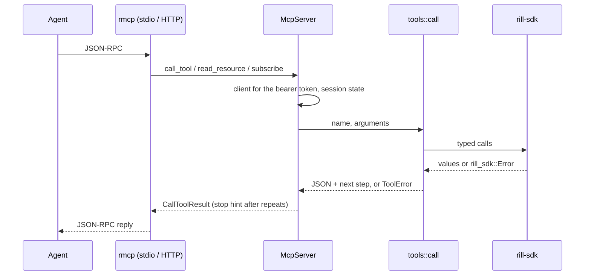

# MCP server

`rill-mcp` serves the Model Context Protocol on stdio or streamable HTTP.
Agents use it to read, edit, check, commit, review and land changes without
a checkout. The protocol layer is the official Rust SDK,
[`rmcp`](https://crates.io/crates/rmcp) (Apache-2.0, pinned). It handles
framing, `initialize` and version negotiation, `ping`, cancellation,
subscriptions and both transports. Rill implements only `ServerHandler`
([`server.rs`](../../crates/clients/mcp/src/server.rs)).

The tools are task-level, not one per RPC. There are thirteen of them, and
each:

- defaults to the session's current change;
- fits its output to a token budget;
- ends with a `next` step, so an agent can drive a change to trunk without
  reading these docs.

## The loop

| Tool | Does |
| --- | --- |
| `rill_context` | Start here. Returns who you are, the repository, the trunk head and how many changes are landing, the session's change with its review status, the next step, and the workflow. |
| `rill_read` | Reads by `mode`: `content` (line ranges), `list`, `history`, `blame` or `diff`, over a batch of `paths`. |
| `rill_search` | Regex search (server `Grep`) with path, glob, case and context options. |
| `rill_edit` | Applies `set`, `delete`, `patch` and `move` edits. With no current change it starts one on `base` (default trunk). Otherwise it amends the current change, keeping its earlier edits. |
| `rill_check` | Reports conflicted paths and the verification runs of the current version, each failing step with the tail of its log. `wait_seconds` waits for running checks. |
| `rill_commit` | Sets the final message, links an intent, and submits for review (by default). Returns the submit decision. It is idempotent once the change is submitted. |
| `rill_review_status` | Reports status, votes on the current version, open threads, the policy decision and why. |
| `rill_respond` | Runs `comment` (on the change, a file or lines), `reply`, `resolve`, `reopen` and `vote` actions in order. |
| `rill_land` | Requests a landing and waits (`wait_seconds`, default 60). The outcome is `landed` (with the sequence number), `pending` (with a `ticket` to pass back), or `failed` (with the error and the step that fixes it). |
| `rill_sync` | Rebases onto `onto` (default trunk). Conflicts are listed, not raised. |
| `rill_conflicts` | Returns each conflicted path's `sides` and `bases` as content. A `null` side means that side deleted the file. |
| `rill_resolve` | Sets merged content (or deletes) for conflicted paths. Returns what still conflicts. |
| `rill_watch` | Long-polls review events: it returns once something happens, or after `timeout_seconds`. |

`hints.rs` picks the next step from the change's state, in this order:

1. conflicts;
2. not submitted;
3. landed, abandoned or landing;
4. open threads;
5. allowed to land;
6. waiting on review, with the policy's reasons.

`rill_land` maps a failure message to the tool that fixes it: `rill_sync`
for conflicts, `rill_check` for failing checks, and `rill_review_status`
for policy.

## Sessions and changes

[`Session`](../../crates/clients/mcp/src/session.rs) holds:

- the current change for each repository;
- the repeat guard;
- legacy resource subscriptions.

`rill_edit` makes the change it creates current. A successful `rill_land`
clears it. Every tool takes `change`, and `ToolContext::change` falls back
to the session's change, or fails with `no_change`.

Reads (`rill_read`, `rill_search`) see the session's change by default, so
an agent reads its own edits. `at` picks another root.

Over stdio a process is one session. Over HTTP each MCP session gets a
fresh `Session` from the service factory. Clients on the stateless
2026-07-28 protocol pass `change` and `repo` explicitly; every result
returns the change id.

## Budgets and loops

[`budget.rs`](../../crates/clients/mcp/src/tools/budget.rs) handles output
size. `max_tokens` (default 8000, at about 4 characters per token) caps a
response. Tools add items until the budget is spent, always at least one,
then return `truncated: true` and a `next_cursor` (`item.inner`, for
example a path index and a line number). Passing the cursor back with the
same arguments continues exactly where the last page stopped. `history`
pages use the server's page token as the cursor instead.

[`guard.rs`](../../crates/clients/mcp/src/tools/guard.rs) detects loops. It
hashes the tool name and arguments of each failing call. On the third
identical failure in a row, the error carries `stop`, which tells the agent
to stop retrying and change its approach. Any success resets the count.

## Resources

[`resources/`](../../crates/clients/mcp/src/resources/uri.rs) exposes three
URI templates. A `/` inside the repository or root segment is written
`%2F`.

| URI | Content |
| --- | --- |
| `rill://{repo}/files/{root}/{path}` | The file at a root: text, or base64 for binary |
| `rill://{repo}/changes/{change}/diff` | `rill_read` diff JSON |
| `rill://{repo}/changes/{change}/review` | `rill_review_status` JSON |

`resources/list` returns the session's change resources. The diff and
review resources send `notifications/resources/updated` on every review
event of their change (`WatchReview`). Clients subscribe in one of two
ways:

- through 2026-07-28 `subscriptions/listen`: `accepted_subscription_filter`
  keeps only watchable URIs;
- through legacy `resources/subscribe`, where a task per URI, held in the
  session, is aborted on `unsubscribe` or when the session ends.

## Transports and auth

- `rill-mcp` with no flags speaks stdio.
- `rill-mcp --http ADDR` serves streamable HTTP at `/mcp` (axum with rmcp's
  `StreamableHttpService` and `LocalSessionManager`), until Ctrl-C.
- `Host` must be a loopback name unless it is added with `--allow-host`, to
  guard against DNS rebinding.

The server does no authentication of its own. It acts as the principal its
token names ([capability tokens](../05-policy/capability-tokens.md)):

- An HTTP request with `Authorization: Bearer <token>` acts as that token's
  principal. `ClientPool` keeps one lazily connected `Client` per token, and
  clears itself past 256 tokens.
- Otherwise the server uses the configured `--token` (`RILL_TOKEN`) or the
  SDK's discovered credentials.

Other flags:

- `--endpoint` (`RILL_ENDPOINT`), defaulting to `ClientConfig::discover`
  ([sdk](sdk.md));
- `--repo` (`RILL_REPO`);
- `--list-tools`, which prints the tool schemas and exits.

The connection is lazy, so `initialize` and `tools/list` work while the
Rill server is down. Logs go to stderr.

## Results and errors

- A successful result carries the JSON as pretty text and as
  `structuredContent`.
- A failure carries `isError: true` and
  `{error: {code, reason, message, missing, retry_after_ms, stop}}`.
- An unknown tool is an `invalid_params` protocol error.

`ToolError` has these variants:

- `InvalidArgs` (`invalid_arguments`);
- `NoRepo`;
- `NoChange`;
- `Sdk`, whose code comes from `sdk_code`: the snake_case gRPC code, or
  the SDK variant name;
- `Other`.

Writes record `Provenance {tool: "rill-mcp", model, session, prompt_ref}`
from the call's arguments. `sponsor` cannot be set from MCP.

## JSON encoding

`json/*` is the one machine-readable rendering of SDK values, and
`rill --json` uses it too ([cli](cli.md)):

- Hashes are lowercase hex, and ids use their display form (`ch_<hex>`).
- Timestamps are `{rfc3339, millis}`.
- Fieldless enums are snake_case names.
- Bytes are `{encoding: utf8|hex, size, text|hex}`.
- Pages are `{items, next_page_token}`.

Verification runs (`json/checks.rs`) and grep results (`json/search.rs`)
are shared with `rill checks` and `rill grep`.

## Tests

`tests/` drive real MCP sessions against an in-process dev server
(`rill_sdk::testing::DevServer`):

- `agent_loop.rs` runs read → edit → check → commit → review → land
  through MCP alone;
- `conflicts.rs` covers sync, conflicts and resolve;
- `limits.rs` checks that paged reads join up, and the stop hint;
- `resources.rs` covers listing, reading and update notifications;
- `http.rs` runs a session over streamable HTTP.

## Limitations

- No `prompts`, and no task-augmented (long-running) tool calls;
  `rill_land` and `rill_watch` block up to their timeouts instead.
- File resources do not notify; only change resources do.
- `rill_watch` streams from the moment it is called. Events between calls
  are not replayed; `rill_review_status` has the full state.
- Verification runs exist only once the lander verifies a change, so
  `rill_check` before landing reports `none`.

## Code

- [lib.rs](../../crates/clients/mcp/src/lib.rs), [bin/rill_mcp.rs](../../crates/clients/mcp/src/bin/rill_mcp.rs), [server.rs](../../crates/clients/mcp/src/server.rs), [http.rs](../../crates/clients/mcp/src/http.rs), [session.rs](../../crates/clients/mcp/src/session.rs), [pool.rs](../../crates/clients/mcp/src/pool.rs), [config.rs](../../crates/clients/mcp/src/config.rs), [error.rs](../../crates/clients/mcp/src/error.rs)
- [tools/dispatch.rs](../../crates/clients/mcp/src/tools/dispatch.rs), [tools/context.rs](../../crates/clients/mcp/src/tools/context.rs), [tools/budget.rs](../../crates/clients/mcp/src/tools/budget.rs), [tools/guard.rs](../../crates/clients/mcp/src/tools/guard.rs), [tools/hints.rs](../../crates/clients/mcp/src/tools/hints.rs), [tools/edit.rs](../../crates/clients/mcp/src/tools/edit.rs), [tools/read.rs](../../crates/clients/mcp/src/tools/read.rs), [tools/land.rs](../../crates/clients/mcp/src/tools/land.rs)
- [resources/uri.rs](../../crates/clients/mcp/src/resources/uri.rs), [resources/read.rs](../../crates/clients/mcp/src/resources/read.rs), [resources/follow.rs](../../crates/clients/mcp/src/resources/follow.rs)
- [json/mod.rs](../../crates/clients/mcp/src/json/mod.rs)

---
← Previous: [CLI](cli.md) · [Index](../index.md) · Next: [Development](../09-engineering/development.md) →
