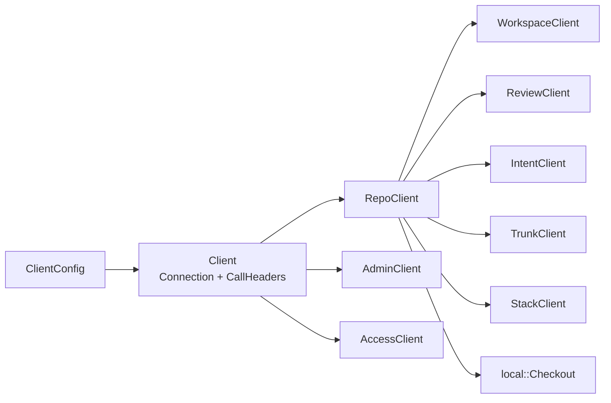
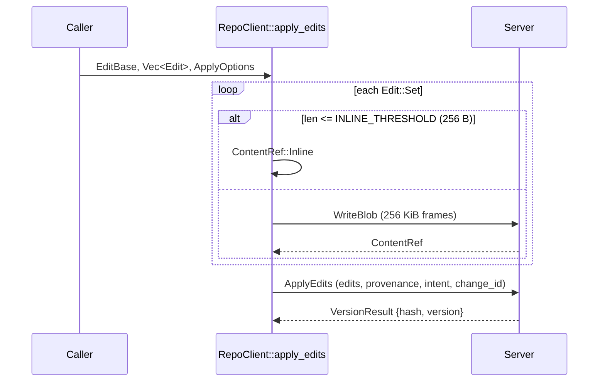

# SDK

`rill-sdk` is the typed Rust client for the `rill.v1` API. The CLI, the MCP
server and agents all use it. It returns server results as they are: an
error becomes `Error::Status` with its code unchanged. The only local
state it manages is a `.rill/` checkout.

## Shape

A `Client` is one pooled `connectrpc` connection plus `CallHeaders`, which
the SDK's `Transport` sets on every request: `authorization: Bearer
<token>` when a token is set, `x-rill-relations` with the relation versions
the client has seen (`Client::relations_seen`, shared by clones), and an
`x-request-id`. Calls use the Connect protocol over HTTP/2: cleartext
endpoints by prior knowledge, `https://` ones by ALPN, trusting the system
roots plus `ca_file`, with an optional client certificate. `AccessClient::grant` and
`revoke` record the version they produce, so every server honours a change
on the client's next request
([permissions](../05-policy/permissions.md#consistency-across-servers)).
Listings, path resolution, diffs and version reads return read grants; the
client keeps them by object hash (`Client::read_grants`, nine minutes) and
`get_blob` and `tree` send the one naming the object they fetch
([read grants](../05-policy/permissions.md#read-grants)). `Client::repo(name_or_id)` returns a `RepoClient`, which
puts the repository on every request and hands out the per-service clients.
Inputs and outputs are `rill-types` values where one exists. Otherwise they
are small structs in `types/`.

Nothing is dialled until the first request; a bad endpoint fails there.
`Client::connect` first exchanges a workload credential when one is
configured; `connect_lazy` awaits nothing, so the CLI and MCP server answer
`--help`, `initialize` and `tools/list` with no server running.
`with_connection` builds a client over an existing `Connection`, and
`connection_without_credentials` hands one to sign-in. Calls get the
`timeout` from the config. `repo_svc()`, `workspace_svc()` and the others
return fresh generated clients; `transport()` and `call_config()` build
any other.

## Configuration

`ClientConfig::new(endpoint)` has no token, a 30 s timeout and user agent
`rill-sdk/<version>`. `ClientConfig::discover` tries `from_env` first:
`RILL_ENDPOINT` (required) and `RILL_TOKEN` (empty means none). It then
falls back to `load(default_path())`, a TOML file with `[server] endpoint`
and optional `token` and `timeout_secs`. The path is
`dirs::config_dir()/rill/config.toml`: `~/.config` on Linux,
`~/Library/Application Support` on macOS.

Credentials ([auth/](../../crates/clients/sdk/src/auth/mod.rs)): every request
reads its bearer token from a `TokenSource`. `ClientConfig::token` gives a
`StaticToken`; `with_session(credentials, store)` gives a `SessionSource`,
which a background task refreshes through `SessionService.RefreshSession`
60 s before the access token expires, saving each rotated refresh token to
the `CredentialStore` (`KeychainStore`, `FileStore`). The task stops when
the client is dropped or the server refuses the refresh. `auth::login`
signs in through an org's provider with the device flow (`DeviceFlow`,
RFC 8628) and `ExchangeToken`; `sign_in_providers` lists the choices.
Agents use `WorkloadConfig` (`RILL_WORKLOAD_TOKEN_FILE`, `RILL_ORG`,
`RILL_AGENT`, `RILL_MODEL`): `Client::connect` exchanges the workload's JWT
(re-read from the file each time, so rotated tokens are used) for an agent
token, and a `WorkloadSource` exchanges again a minute before it expires.
`connect_lazy` refuses a workload credential, since the first request
needs a token.

For `https://` endpoints the channel uses TLS (`TlsOptions`): the server's
certificate is checked against the system's roots plus `ca_file`, and
`client_cert` / `client_key` are presented to servers that require them.
`ClientConfig::new` takes them from `RILL_CA_FILE`, `RILL_CLIENT_CERT` and
`RILL_CLIENT_KEY`; the config file's `[server]` section may set
`ca_file`, `client_cert` and `client_key`.

## Repository API

Repositories are named `org/name`, or by a bare name in the default org;
`RepoInfo.org` names the org. `AdminClient::create_org` and `list_orgs`
manage orgs (`OrgInfo`). Write methods send a `request_id`, so a
retried call returns the first call's result (see
[API surface](../07-runtime/api-surface.md#retries)).

`RepoClient` covers repository info, history (`log`, `log_page`,
`path_history`, `blame`), trees and files (`list_dir`, `read_file`), blobs,
diff and ancestry, refs and trunk, `grep`, derived data and `watch_*`
streams. Each module under `repo/` wraps one group of RPCs.
`watch_log(WatchStart)` starts `Now`, from the `Beginning` or `After` a
`Versionstamp` cursor, and yields `LogEntry { cursor, info }`, so a client
can stop and resume without missing or repeating a version.
`watch_events(WatchStart, EventQuery { kinds, change, ref_prefix })`
streams the event log the same way, yielding `LoggedEvent { cursor, event
}` with the `rill_types::Event`.

`Root` (`types/root.rs`) names a point in history: `Ref`, `Version`, `Tree`
or `Seq`. It parses from `trunk`, `trunk@N`, `tree:<hex>`, a 64-hex version
hash, or a ref name. `LogStart` is the same without `Tree`.

`get_blob` returns `ContentRef::Inline` bytes with no round trip. For other
content it joins the `BlobChunk` stream into one `Bytes`. `log_page` returns
a `next_start` cursor hash. History pages by cursor, not by token.

## Write path

`Edit` is `Set {path, bytes, kind}`, `Delete {path}` or `Patch {path,
unified}`. `EditBase::Root(root)` creates a change on top of a root, and
`EditBase::Change(id)` amends that change's current version. `rebase`,
`merge` and `resolve` also return `VersionResult`. A conflict is data in the
version (`conflicted_paths()`), not an error. `create_change_version` sends
a fully built `ChangeVersion` with detached signatures. Every write has a
`_with_op` twin that takes an `OperationId`; the plain form mints a fresh one.

`EventStream<T>` is a boxed `Stream<Item = Result<T>>`. Each wire message is
converted with `TryFrom`. A `Status` becomes one `Error::Status` item, and
the stream ends after it. List RPCs return `Page<T> {items,
next_page_token}`.

## Local checkouts

`local/` is a minimal working copy for the CLI. Agents do not need one.

- `.rill/checkout.toml` holds `CheckoutMeta`: endpoint, repo, workspace,
  base, base_version, working_change and sparse profile.
- `.rill/manifest.toml` maps each path to a `ManifestEntry` (content hash,
  local hash, size, mtime, kind, conflict flag). Both files, and the
  credential store, are written through `files::write_atomic` (a
  `tempfile` in the same directory, fsynced, then persisted over the
  target), so concurrent writers never interleave.
- `Checkout::create` lists the tree one `ListDirectory` at a time, never entering
  a directory outside the `SparseProfile`, and writes the files.
- `status` treats a file as unchanged when size and mtime match the
  manifest, and hashes it otherwise. `.rillignore` (gitignore syntax) hides
  untracked files only.
- `snapshot` turns status into edits and calls `apply_edits` with
  `EditBase::Root(base)` and `change_id = working_change`, so later
  snapshots amend the same change. An unresolved conflict is an
  `Error::Checkout`.
- `update(new_root)` classifies each path by upstream and local change. If
  both sides changed, it runs `rill_core::merge::merge_file`. A conflict is
  written as marker text and flagged in the manifest. It returns
  `UpdateReport {updated, removed, merged, conflicts}`. Filesystem work
  runs under `spawn_blocking`.

## Stacks

`StackClient` (`stack.rs`) combines review and repo calls. `submit_stack`
submits each change, then calls `set_stack`. `sync_stack` rebases bottom-up,
each change onto the previous result, and reports conflicts instead of
raising them. `land_stack` declares the stack, asks for it to land as one
ordered group (`RequestLandStack`, all or nothing, or `prefix`) and waits for
every ticket, returning a `StackLanding` of what landed and what did not. `await_land` polls land status with `Backoff`, a `backon`
exponential builder (250 ms initial, factor 1.6, 5 s max). It is not
jittered: one client polls its own ticket, and jitter only delayed noticing
the landing (up to 500 ms instead of 250). It returns `Error::LandFailed` on a failed or
cancelled land and `Error::Timeout` when the deadline passes.

## Errors

`Error` variants: `Status {code, message}`, `Transport`, `Convert`,
`Invalid`, `Config`, `Io`, `Timeout`, `Conflict {change_id, hash, paths}`,
`Checkout` and `LandFailed {ticket, status, message}`. Callers branch on
`Error::code()` and `is_not_found()`. See
[api surface](../07-runtime/api-surface.md) for status codes.

## Limitations

- `put_blob` never sets `expected_hash`. Integrity depends on the server
  hashing the bytes it receives.
- `get_blob_range` allocates the whole requested range before returning.
- A checkout has no rename detection. A moved file shows as `Deleted` plus
  `Added`. A symlink's content is its target string.
- When `RILL_ENDPOINT` is set, `discover` ignores the config file entirely.
- The server always returns `next_page_token: None`, so a page holds the
  whole limit-bounded result.
- Unary reads and calls carrying an operation id are retried
  (`retry_idempotent`: `UNAVAILABLE`, jittered `backon` backoff from 100 ms
  to 2 s, up to 20 s in total); other mutations and
  `watch_*` streams are not.
- `RepoClient::grep` has no fallback; the tree walk lives in [mcp](mcp.md).

## Code

- [lib.rs](../../crates/clients/sdk/src/lib.rs), [client.rs](../../crates/clients/sdk/src/client.rs), [config.rs](../../crates/clients/sdk/src/config.rs), [error.rs](../../crates/clients/sdk/src/error.rs), [stream.rs](../../crates/clients/sdk/src/stream.rs)
- [repo/mod.rs](../../crates/clients/sdk/src/repo/mod.rs), [repo/blobs.rs](../../crates/clients/sdk/src/repo/blobs.rs), [repo/write.rs](../../crates/clients/sdk/src/repo/write.rs), [repo/history.rs](../../crates/clients/sdk/src/repo/history.rs), [repo/watch.rs](../../crates/clients/sdk/src/repo/watch.rs)
- [types/root.rs](../../crates/clients/sdk/src/types/root.rs), [types/edit.rs](../../crates/clients/sdk/src/types/edit.rs), [types/page.rs](../../crates/clients/sdk/src/types/page.rs)
- [local/checkout.rs](../../crates/clients/sdk/src/local/checkout.rs), [local/meta.rs](../../crates/clients/sdk/src/local/meta.rs), [local/status.rs](../../crates/clients/sdk/src/local/status.rs), [local/update.rs](../../crates/clients/sdk/src/local/update.rs), [local/walk.rs](../../crates/clients/sdk/src/local/walk.rs)
- [stack.rs](../../crates/clients/sdk/src/stack.rs), [review.rs](../../crates/clients/sdk/src/review.rs), [workspace.rs](../../crates/clients/sdk/src/workspace.rs), [trunk.rs](../../crates/clients/sdk/src/trunk.rs), [admin.rs](../../crates/clients/sdk/src/admin.rs)

---
← Previous: [Cache tier](../07-runtime/cache.md) · [Index](../index.md) · Next: [CLI](cli.md) →
