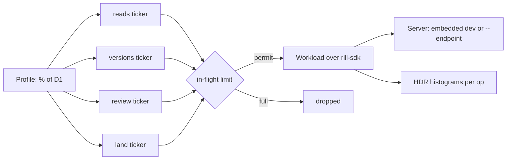

# Performance

Two tools measure Rill's speed. `rill-bench` times the hot algorithms on a
deterministic generated repository, to show that cost tracks the size of a
change and to catch regressions. `rill-load` drives a running server with
synthetic agents at a chosen fraction of the D1 design workload (the target
of 30,000 agents and 1,000 humans on one repository) and reports throughput
and latency per operation.

## Benchmarks

`rill-bench` builds a repository from a `Shape`: file count, directory
fan-out 32, 16 lines per file, fixed seed. The same shape always produces
the same files and trees. Benchmarks in `benches/core.rs`:

| Benchmark | 100k files | 1M files |
| --- | --- | --- |
| `commit_10_files` (build, store, derive root) | 0.58 ms | 0.84 ms |
| `diff_adjacent_roots` (10 files changed) | 0.18 ms | 0.27 ms |
| `rebase_10_files_over_20` | 0.20 ms | 0.29 ms |
| `diff_lines_2000` | 58 µs | 60 µs |
| `merge_file_2000` | 127 µs | 183 µs |

Baselines are from an Apple M-series laptop, release build, memory stores.
Ten times the files adds one directory level, not ten times the work:
commits, tree diffs and rebases are O(size of change). Building the 1M-file
corpus takes about a minute and 4.5 GB of memory.

```
cargo bench -p rill-bench --bench core
RILL_BENCH_FILES=1000000 cargo bench -p rill-bench --bench core
```

## Load



Each workload class has an open-loop ticker at its target rate. 100% of D1
is 50,000 reads, 35 new versions, 23 votes and 1.16 landings a second.

- **Reads** are 50% file reads, 20% directory listings, 15% grep and 15%
  log.
- **Versions** edit one file at trunk. A share (`--hot-share`) goes to five
  hot files.
- **Reviews** submit a draft and approve it.
- **Landings** request one and wait for the outcome; that latency is
  queue-to-trunk.

When the in-flight limit is reached, new work is counted as dropped rather
than queued, so overload shows in the report instead of inflating latency.

```
cargo run --release -p rill-load -- --percent 1 --duration 60
cargo run --release -p rill-load -- --endpoint http://host:7470 --percent 5 --json
```

Laptop results against the embedded single-process server:

| Load | Reads/s achieved | Read p99 | Errors |
| --- | --- | --- | --- |
| 1% of D1 | 500 | ≤ 2.5 ms | 0 |
| 5% of D1 | 2,500 | ≤ 2.3 ms | 0 |

Land latency is dominated by the lander's 2-second batch window.

## Limitations

- No benchmark covers search indexing, blame or path history yet.
- At low percentages the land ticker fires rarely, so a short run gives few
  land samples.
- The load harness creates its own repository. It cannot load an existing
  one.
- Results come from one machine. There is no tracked history of numbers and
  no regression gate.

## Code

- [rill-bench/src/lib.rs](../../crates/rill-bench/src/lib.rs), [rill-bench/benches/core.rs](../../crates/rill-bench/benches/core.rs)
- [rill-load/src/run.rs](../../crates/rill-load/src/run.rs), [workload.rs](../../crates/rill-load/src/workload.rs), [profile.rs](../../crates/rill-load/src/profile.rs), [stats.rs](../../crates/rill-load/src/stats.rs)

---
← Previous: [Simulation](simulation.md) · [Index](../index.md) · Next: [Architecture decisions](../10-decisions/README.md) →
