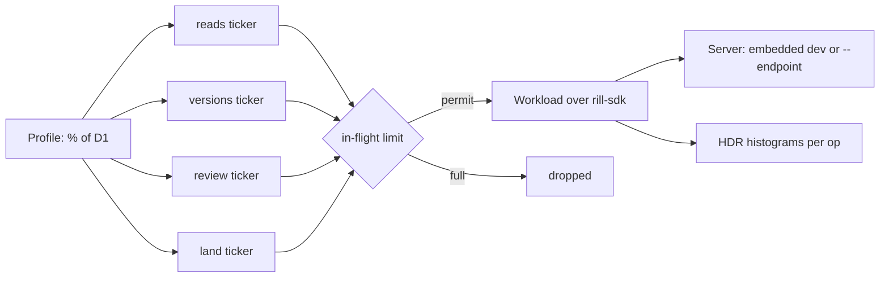

# Performance

Two tools measure Rill's speed. `rill-bench` times the hot algorithms on a
deterministic generated repository, to show that cost tracks the size of a
change and to catch regressions. `rill-load` drives a running server with
synthetic agents at a chosen fraction of the D1 design workload (the target
of 30,000 agents and 1,000 humans on one repository) and reports throughput
and latency per operation.

## Benchmarks

`rill-bench` builds a repository from a `Shape`: file count, directory
fan-out 32, 16 lines per file, fixed seed. The same shape always produces
the same files and trees. Benchmarks in `benches/core.rs`:

| Benchmark | 100k files | 1M files |
| --- | --- | --- |
| `commit_10_files` (build, store, derive root) | 0.57 ms | 0.82 ms |
| `diff_adjacent_roots` (10 files changed) | 0.21 ms | 0.31 ms |
| `rebase_10_files_over_20` | 0.23 ms | 0.33 ms |
| `diff_lines_2000` | 58 µs | 60 µs |
| `merge_file_2000` | 127 µs | 183 µs |

Baselines are from an Apple M-series laptop, release build, memory stores.
Ten times the files adds one directory level, not ten times the work:
commits, tree diffs and rebases are O(size of change). Building the 1M-file
corpus takes about a minute and 4.5 GB of memory.

```
cargo bench -p rill-bench --bench core
RILL_BENCH_FILES=1000000 cargo bench -p rill-bench --bench core
cargo bench -p rill-bench --bench meta
cargo bench -p rill-bench --bench trees
RILL_BENCH_FILES=1000000 cargo bench -p rill-bench --bench trees
```

`benches/trees.rs` times a one-file commit, a full walk and a one-file
diff in the deep corpus, and commits, lookups and diffs in one
200,000-entry directory, printing the tree nodes each one-file commit
writes; the numbers are in [trees](../03-core-algorithms/trees.md#scale).
The corpus is built as a chain of 5,000-file commits, since one change is
capped at 8 MiB.

`benches/meta.rs` times metadata round trips (conditional write, point
read, 100-row scan) on the memory and redb engines; the numbers are in
[metadata engines](../02-data/metadata-engines.md#performance).

## Load



Each workload class has an open-loop ticker at its target rate. 100% of D1
is 50,000 reads, 35 new versions, 23 votes and 1.16 landings a second.

- **Reads** are 50% file reads, 20% directory listings, 15% grep and 15%
  log.
- **Versions** edit one file at trunk. A share (`--hot-share`) goes to five
  hot files.
- **Reviews** submit a draft and approve it.
- **Landings** request one and wait for the outcome; that latency is
  queue-to-trunk.

When the in-flight limit is reached, new work is counted as dropped rather
than queued, so overload shows in the report instead of inflating latency.

```
cargo run --release -p rill-load --bin rill-load -- --percent 1 --duration 60
cargo run --release -p rill-load --bin rill-load -- --endpoint http://host:7470 --percent 5 --json
```

Laptop results against the embedded single-process server:

| Load | Reads/s achieved | Read p99 | Errors |
| --- | --- | --- | --- |
| 1% of D1 | 500 | ≤ 2.5 ms | 0 |
| 5% of D1 | 2,500 | ≤ 2.3 ms | 0 |

Land latency is dominated by the lander's 2-second batch window.

### On FoundationDB

A release `rill-api` with metadata in a local single-node
FoundationDB and `rill-load --percent 10` (3.5 commits, 5,000 reads a
second) on one laptop:

| Objects | Commit p50 | Commit p99 | Reads p99 |
| --- | --- | --- | --- |
| in memory | 22 ms | 30 ms | 2.4 ms |
| local files | 41 ms | 318 ms | 41 ms |

A commit is a handful of FoundationDB transactions (claim, commit,
response) plus object writes. With local files the tail is the object
store's fsync per file (macOS flushes the drive on every one), not the
metadata. At 50% of D1 the one laptop running load, server and database
saturates: reads are dropped and every latency rises, commits to 384 ms
p99.

### Contended landing

`--contended` seeds five plain-text registries declared `union` and a
`deps.lock` regenerated offline (`ls deps > deps.lock`) in
`.rill/merge.toml`; agents append registry entries (50%), add a
dependency (30%) or edit a file of their own (20%), and land their oldest
work first, so bases are stale and most landings conflict.
`--burst-every`/`--burst-secs` double the land rate in windows. The
report counts give-ups (requests that did not land) by reason and which
merge driver resolved each landing.

```
cargo run --release -p rill-load --bin rill-load -- --contended --percent 0 --lands-per-sec 10 \
  --burst-every 30 --burst-secs 10 --duration 90          # embedded server, 16 local workers
```

90 s, 10 lands/s with three 10 s bursts at 20/s (13.3/s on average), one
laptop:

| Server | Landed | Lands/s sustained | Land p50 | Give-ups | Resolved by a driver |
| --- | --- | --- | --- | --- | --- |
| embedded, memory | 1,199 | 13.3 | 254 ms | 0 | 68% |
| `rill-server run`, local FoundationDB, objects on local disk | 1,196 | about 11–12 | 21 s | 0 | 66% |
| same, steady 10/s for 30 s | 299 | 10.0 | 1.3 s | 0 | 70% |

On FoundationDB the lander keeps up with 10/s and absorbs bursts as a
backlog that drains afterwards. The limit is the lockfile: each
dependency change regenerates it on top of the one before, 100–250 ms a
step (rebase, building the input root, the action on a local worker that
writes ~800 input files), so lockfile landings top out near 4–6 a second.
Storing a version with its land-critical values takes about 20 ms
(one transaction; objects and tree nodes written concurrently).

### Execution

`exec_load` (in `rill-load`) puts verification-shaped load on remote
execution through REAPI: it seeds a pool of executed actions, then
submits at a fixed rate, repeating a pooled action (`--hit-share`, 0.85:
a step whose inputs did not change) or uploading and running a new one
(a step whose inputs did). It reports the rate, the share served from the
action cache and latency for each kind.

```
cargo run --release -p rill-load --bin exec_load -- --seconds 90      # in-process server, 16 local workers
cargo run --release -p rill-load --bin exec_load -- --endpoint http://127.0.0.1:7470 \
  --platform OSFamily=linux --platform container-image=rill-exec-runner
```

At 30% of D1's execution rate (50M actions a day, so 175 a second) for 90
s on one laptop, `rill dev` with two Buildbarn workers of 10 slots under
gVisor (`deploy/exec/run.sh`):

| Requests/s | From the cache | Executions/s | Hit p50 / p99 | Execution p50 / p99 | Errors |
| --- | --- | --- | --- | --- | --- |
| 175 | 85.2% | 25.9 | 0.2 / 0.6 ms | 21.7 / 43.8 ms | 0 |

The actions are trivial; the numbers measure scheduling, the cache and the
worker round trip, not build work.

### Trunk healing

`trunk_red` (in `rill-load`) is the self-healing gate. It starts an
embedded server with post-land verification on and pre-land verification
off (so every break reaches trunk), seeds a plan of two checks and a test
that flakes on demand, lands an unrelated change every 2 s throughout, and
runs five scenarios: a breaking change; two breaking changes a second
apart; a known-flaky test failing on three landings; a revert that
conflicts with a later edit (then the owner's `Fixes:` landing); and a
forward fix inside the grace period. Each culprit is timed from landing
to trunk showing red, to an incident naming it, and from there to its
revert (or recorded blocked revert, or fix), against detect ≤ 2 min,
attribute ≤ 5 min, repair ≤ grace + 2 min.

```
cargo run -p rill-load --bin trunk_red -- --grace 30 --interval 30 [--only "forward fix"]
```

At the server's default 30 s sweep interval and a 30 s grace, every
scenario passes: each break is detected and attributed in 27–30 s (one
sweep), reverted 30 s later (the grace), two breaks in one batch get one
incident each, flaky failures pass on a re-run with nothing blamed, a
conflicting revert is recorded as blocked and the owner's fix closes it,
and a forward fix within the grace period cancels the revert. A run takes
about 7 minutes.

### Client daemon

`daemon_gate` (in `rill-load`) is the client daemon's gate. It builds a
synthetic repository of 10M files on an embedded server (10,000 leaf
directories of 1,000 files, drawn from 100 distinct leaf trees and copied
into place a hundred directories per version, so storage stays small the
way content addressing deduplicates), then measures three things against
the targets lazy clone to a usable shell < 5 s, status p99 < 200 ms with
1k local edits, and a CI build at a ≥ 99% regional hit rate:

* a lazy mount (Linux) and a shell's first steps: list the root and `d/`,
  stat and read one file;
* `GetStatus` 200 times after 1,000 edits made through the filesystem,
  once the first status (which, on an eager mount, waits for the watcher
  to reconcile them) has answered;
* a host reading every file of one directory through a regional
  `rill-cache` another host warmed, from a cold local cache.

```
cargo run --release -p rill-load --bin daemon_gate [-- --dirs 10000 --files-per-dir 1000]
```

On an OrbStack Linux machine (arm64): the 10M-file repository builds in
4.5 s; the lazy mount takes 18 ms and the shell is usable at 26 ms; status
p99 is 0.66 ms (p50 0.60) with 1,000 edits; the cold CI host reads 1,000
files in 0.6 s with 1,000 regional hits and no misses. On macOS with the
NFS view: the shell is usable at 43 ms; status p99 is 1.6 ms (the first
status, which commits the 1,000 buffered writes, 0.99 s); the cold CI host
reads 1,000 files in 1.2 s, all regional hits. An eager checkout on macOS
has status p99 14 ms, each call settling the watcher with a cookie.

## Limitations

- No benchmark covers search indexing, blame or path history yet.
- At low percentages the land ticker fires rarely, so a short run gives few
  land samples.
- The load harness creates its own repository. It cannot load an existing
  one.
- Results come from one machine. There is no tracked history of numbers and
  no regression gate.

## Code

- [rill-bench/src/lib.rs](../../tools/bench/src/lib.rs), [rill-bench/benches/core.rs](../../tools/bench/benches/core.rs), [rill-bench/benches/meta.rs](../../tools/bench/benches/meta.rs)
- [rill-load/src/bin/exec_load.rs](../../tools/load/src/bin/exec_load.rs), [trunk_red.rs](../../tools/load/src/bin/trunk_red.rs), [healing/](../../tools/load/src/healing/mod.rs), [daemon_gate.rs](../../tools/load/src/bin/daemon_gate.rs)
- [rill-load/src/run.rs](../../tools/load/src/run.rs), [workload.rs](../../tools/load/src/workload.rs), [profile.rs](../../tools/load/src/profile.rs), [stats.rs](../../tools/load/src/stats.rs)

---
← Previous: [Simulation](simulation.md) · [Index](../index.md) · Next: [Architecture decisions](../10-decisions/README.md) →
