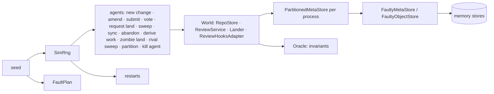

# Simulation

`rill-sim` runs simulated agents and reviewers against Rill's real stores,
review service and two landers, with store failures, process restarts
and network partitions, all
chosen by one seed. After each sweep, and once the run settles, it checks
invariants that must hold whatever happened. The same seed always replays
the same run, so a failing seed is a reproducible bug report. Concurrency
and crash bugs that example tests miss show up here first.

## A run



1. **Setup** (no faults): a repository with five files of eight lines lands
   as `trunk@1`.
2. **Steps:** each step picks an agent and a weighted action. Edits replace
   one line of a file read at the change's base. A share of edits targets
   one hot file, and a share of new changes starts from an older trunk
   position, so edits overlap, conflict and rebase. Votes come from two
   human reviewers.
3. **Restarts** rebuild every in-memory structure (caches, review service,
   lander, land queue and tickets) over the same stores, like a process
   restart. The old lander's lease is kept as a *zombie*: what a paused
   process still holds when it wakes up after being replaced.
4. **Background work:** a derive worker claims jobs from the `derive`
   queue and, 30% of the time, dies holding the claim. Once another lander
   holds the lease, the zombie tries to land an acknowledged version with
   its stale lease.
5. **Processes and partitions:** a second, rival process runs its own
   lander over its own view of the stores, so the two compete for the
   lander lease. A partition cuts one process off from the metadata store
   for 12 to 20 steps (simulated seconds), longer than the 10 s lease: the
   other process takes the lease while the cut one still holds its own
   claim, and must be fenced when it reconnects.
6. **Kill switch:** every simulated agent is registered in the instance's
   identity (over stores without faults), sponsored by one human, and the
   landers ask that identity view whether a change's author may still land,
   as `rill-api` wires them. An action suspends an agent at random, as
   `KillSwitch` does; the trunk length at that moment is read without
   faults (`World::truth`), since a failed read would date earlier landings
   after the kill.
7. **Settle:** faults stop, partitions heal and both landers sweep until
   the queue is empty.
   The clock then jumps past every lease and backoff, expired claims are
   reaped, dead jobs revived, and the derive queue is run dry. Then the
   final checks run.

`World` wires the services exactly as `rill-api` does, including its
`ReviewHooksAdapter`, so the simulator tests the production wiring rather
than a model of it.

## Faults

`FaultyMetaStore` and `FaultyObjectStore` wrap the memory stores. A write
can fail with no effect, or take effect and still report failure (a lost
acknowledgement, as when a process dies after committing). Reads can fail
at a quarter of the write rate, and an object read can return corrupted
bytes (first byte flipped), which `VerifiedObjectStore` must catch.
Actors treat store errors, injected faults and failed hash checks as
environmental, so a corrupt read retries instead of counting as a content
failure.

Each decision is a hash of the seed, the operation, the keys it touches
and how often that same operation has run. It is not a draw from a shared
sequence, because some code iterates hash sets and so issues store calls in
a different order on each run. Keyed decisions give a seed the same faults
regardless of order.

`PartitionedMetaStore` sits above the fault layer, one per process: while
its process is cut off every read, scan, counter and transaction fails
with an injected error, as a network partition does. Partitions run only in
`faulty`.

## Determinism

A run uses a current-thread tokio runtime with a paused clock.
`rill_types::testing::set_clock` and `set_id_seed` (feature `testing`) make
`Timestamp::now()` and new ids come from the seed on that thread. Agents set
change ids explicitly. A run's `digest` hashes every action and outcome, and
`a_seed_replays_identically` checks that equal seeds give equal digests.

## Invariants

| Invariant | Meaning |
| --- | --- |
| `TrunkDense` | Positions `1..=head` all exist |
| `TrunkStable` | An observed trunk position never changes |
| `LandsOnce` | A change lands at most once |
| `NoLandingAfterAbandon` | An abandoned change never lands |
| `AcknowledgedWritesSurvive` | A version whose write was acknowledged stays readable, across restarts |
| `RebaseNeverFailsOnContent` | Rebase fails only on storage errors |
| `LandRequestsResolve` | Every land request ends in a final, queryable outcome |
| `ReviewMatchesTrunk` | A change on trunk has a `Landed` review |
| `EventsMatchState` | The event log has exactly one `VersionStored` per version-log entry and one `Landed` per trunk position, nothing extra, and the event counter matches |
| `JobsFinish` | Every derive job finishes once faults stop, including those whose worker died, and every trunk version is derived |
| `DeposedHolderFenced` | A replaced lander's landing never moves trunk, even when its acknowledgement is lost |
| `LandingsWereAllowed` | Every landing of a reviewed change records the default policy's digest, and that policy allows it on the votes the landing records |
| `KilledAgentsDoNotLand` | No trunk position after an agent's suspension holds a version it wrote |

## Scenarios and known issues

| Scenario | Faults | Must hold |
| --- | --- | --- |
| `clean` | none | every invariant |
| `contended` | none; 16 agents, 70% of edits on the hot file | every invariant |
| `faulty` | 3% failed writes, 2% lost acknowledgements, 1% corrupt reads, 2% restarts, partitions | every invariant |

`known.rs` lists violations the current code is known to produce under
faults, with the roadmap phase whose redesign removes each; the list is
empty. `ReviewMatchesTrunk` and `LandsOnce` left it in phase 6 (one
transaction for the trunk move, landing record and review, and lost-reply
detection), and `LandRequestsResolve` in phase 8, when land requests moved
into the store so a restarted lander serves the ones its predecessor left.

A violation of any other invariant fails the tests. When a phase fixes a
known issue, its entry is removed. The faulty test also requires that some
worker died holding a job, some zombie tried to land, some process was
partitioned and the rival landed something, so the job and lease checks are
never vacuous; it also requires that some agent was killed. 50,000 faulty
seeds hold every invariant: they rerun 27,601 jobs, refuse 101,483 zombie
landings, partition 64,664 times and land 18,036 requests through the
rival. With the kill switch, 20,000 faulty seeds kill 24,052 agents and none
of their work lands after; without the landers' standing check, 30 of 300
seeds break `KilledAgentsDoNotLand`.

## Running

```
cargo test -p rill-sim                            # 1,000 clean, 300 contended, 1,000 faulty seeds
RILL_SIM_SEEDS=20000 cargo test -p rill-sim       # longer local run
cargo run --release -p rill-sim -- --scenario faulty --seeds 10000
cargo run --release -p rill-sim -- --scenario clean --seed 42    # replay one seed
```

A release build runs about 200 faulty seeds a second.

## Limitations

- Called as a library. There is no network between client and server, and
  the two processes take turns step by step; they never run concurrently
  inside one sweep.
- Restarts happen between actions, never in the middle of a sweep. A crash
  inside a landing shows up only through faults injected into its writes.
- Workspaces, intents, search and post-land verification are not simulated.
- Agents never run verification, so the verifier always passes.

## Code

- [rill-sim/src/run.rs](../../tools/sim/src/run.rs), [world.rs](../../tools/sim/src/world.rs), [actors/](../../tools/sim/src/actors/mod.rs), [oracle.rs](../../tools/sim/src/oracle.rs), [known.rs](../../tools/sim/src/known.rs), [processes.rs](../../tools/sim/src/processes.rs), [kill.rs](../../tools/sim/src/kill.rs)
- [rill-sim/src/faults/](../../tools/sim/src/faults/mod.rs), [rill-sim/tests/seeds.rs](../../tools/sim/tests/seeds.rs)
- [rill-types/src/testing/](../../crates/foundation/types/src/testing/mod.rs)

---
← Previous: [Testing](testing.md) · [Index](../index.md) · Next: [Performance](performance.md) →
