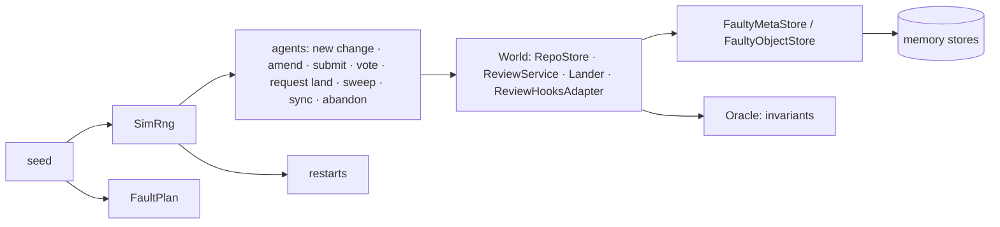

# Simulation

`rill-sim` runs simulated agents and reviewers against Rill's real stores,
review service and lander, with store failures and process restarts, all
chosen by one seed. After each sweep, and once the run settles, it checks
invariants that must hold whatever happened. The same seed always replays
the same run, so a failing seed is a reproducible bug report. Concurrency
and crash bugs that example tests miss show up here first.

## A run



1. **Setup** (no faults): a repository with five files of eight lines lands
   as `trunk@1`.
2. **Steps:** each step picks an agent and a weighted action. Edits replace
   one line of a file read at the change's base. A share of edits targets
   one hot file, and a share of new changes starts from an older trunk
   position, so edits overlap, conflict and rebase. Votes come from two
   human reviewers.
3. **Restarts** rebuild every in-memory structure (caches, review service,
   lander, land queue and tickets) over the same stores, like a process
   restart.
4. **Settle:** faults stop and the lander sweeps until the queue is empty.
   Then the final checks run.

`World` wires the services exactly as `rill-server` does, including its
`ReviewHooksAdapter`, so the simulator tests the production wiring rather
than a model of it.

## Faults

`FaultyMetaStore` and `FaultyObjectStore` wrap the memory stores. A write
can fail with no effect, or take effect and still report failure (a lost
acknowledgement, as when a process dies after committing). Reads can fail
at a quarter of the write rate, and an object read can return corrupted
bytes (first byte flipped), which `VerifiedObjectStore` must catch.
Actors treat store errors, injected faults and failed hash checks as
environmental, so a corrupt read retries instead of counting as a content
failure.

Each decision is a hash of the seed, the operation, the keys it touches
and how often that same operation has run. It is not a draw from a shared
sequence, because some code iterates hash sets and so issues store calls in
a different order on each run. Keyed decisions give a seed the same faults
regardless of order.

## Determinism

A run uses a current-thread tokio runtime with a paused clock.
`rill_types::testing::set_clock` and `set_id_seed` (feature `testing`) make
`Timestamp::now()` and new ids come from the seed on that thread. Agents set
change ids explicitly. A run's `digest` hashes every action and outcome, and
`a_seed_replays_identically` checks that equal seeds give equal digests.

## Invariants

| Invariant | Meaning |
| --- | --- |
| `TrunkDense` | Positions `1..=head` all exist |
| `TrunkStable` | An observed trunk position never changes |
| `LandsOnce` | A change lands at most once |
| `NoLandingAfterAbandon` | An abandoned change never lands |
| `AcknowledgedWritesSurvive` | A version whose write was acknowledged stays readable, across restarts |
| `RebaseNeverFailsOnContent` | Rebase fails only on storage errors |
| `LandRequestsResolve` | Every land request ends in a final, queryable outcome |
| `ReviewMatchesTrunk` | A change on trunk has a `Landed` review |

## Scenarios and known issues

| Scenario | Faults | Must hold |
| --- | --- | --- |
| `clean` | none | every invariant |
| `contended` | none; 16 agents, 70% of edits on the hot file | every invariant |
| `faulty` | 3% failed writes, 2% lost acknowledgements, 1% corrupt reads, 2% restarts | only known issues |

`known.rs` lists the violations the current code produces under faults,
with the roadmap phase whose redesign removes each:

| Invariant | Cause | Phase |
| --- | --- | --- |
| `LandRequestsResolve` | The land queue and tickets live in process memory; a restart forgets queued requests | 9 |

`ReviewMatchesTrunk` and `LandsOnce` were known issues until phase 6 made
the trunk move, landing record and review status one transaction and
taught the lander to recognise a land whose reply was lost; 10,000 faulty
seeds now show neither.

A violation of any other invariant fails the tests. When a phase fixes a
known issue, its entry is removed.

## Running

```
cargo test -p rill-sim                            # 1,000 clean, 300 contended, 1,000 faulty seeds
RILL_SIM_SEEDS=20000 cargo test -p rill-sim       # longer local run
cargo run --release -p rill-sim -- --scenario faulty --seeds 10000
cargo run --release -p rill-sim -- --scenario clean --seed 42    # replay one seed
```

A release build runs about 500 seeds a second.

## Limitations

- One process, called as a library. There is no network between client and
  server, and no concurrency between separate server processes. That needs a
  network simulator once the server is split into separate roles.
- Restarts happen between actions, never in the middle of a sweep. A crash
  inside a landing shows up only through faults injected into its writes.
- Workspaces, intents, search and post-land verification are not simulated.
- Agents never run verification, so the verifier always passes.

## Code

- [rill-sim/src/run.rs](../../crates/rill-sim/src/run.rs), [world.rs](../../crates/rill-sim/src/world.rs), [actors.rs](../../crates/rill-sim/src/actors.rs), [oracle.rs](../../crates/rill-sim/src/oracle.rs), [known.rs](../../crates/rill-sim/src/known.rs)
- [rill-sim/src/faults/](../../crates/rill-sim/src/faults/mod.rs), [rill-sim/tests/seeds.rs](../../crates/rill-sim/tests/seeds.rs)
- [rill-types/src/testing/](../../crates/rill-types/src/testing/mod.rs)

---
← Previous: [Testing](testing.md) · [Index](../index.md) · Next: [Performance](performance.md) →
