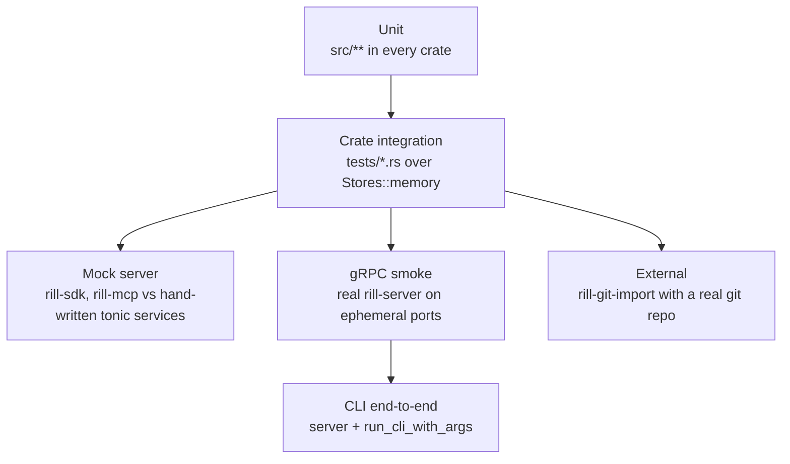

# Testing

Unit tests live next to the code in `#[cfg(test)] mod tests`. Tests that
cross modules or processes live in `crates/<name>/tests/`. Everything runs
in-process over memory stores, with no running server, network or external
service. The one exception is the git importer test, which runs the `git`
binary. Every bug fix adds a test, and the memory backends are the reference
the other backends must match.

## Test kinds



| Kind | What it checks | Where |
| --- | --- | --- |
| Unit | one module: encodings, parsers, policy evaluation, hash framing, exit codes | `src/**`; most in `rill-policy`, `rill-core`, `rill-proto`, `rill-search`, `rill-store` |
| Crate integration | a crate's public API over memory stores | `tests/` in `rill-store`, `rill-core`, `rill-review`, `rill-lander`, `rill-search` |
| Mock server | SDK and MCP against hand-written tonic services | `rill-sdk/tests`, `rill-mcp/tests` |
| gRPC end to end | the real server through generated clients and raw HTTP | `rill-server/tests/grpc/` |
| CLI | the real server driven through the CLI library; clap parsing alone | `rill-cli/tests/cli_e2e.rs`, `rill-cli/tests/landing.rs`, `rill-cli/tests/parse.rs` |
| External | import from a repository built with `git` | `rill-git-import/tests/real_git.rs` |

`rill-exec`, `rill-policy` and `rill-proto` have no `tests/` directory;
`rill-types/tests/merge_laws.rs` property-tests the `Merge` algebra. `rill-proto` keeps its conversion
round trips in `src/convert/roundtrip_tests.rs`.

## Fixtures

- **Store conformance** (`rill-store/tests/conformance/`): `fixtures()`
  always includes memory. It adds `local` (tempdir redb plus files) and an
  in-memory redb under feature `local`, `object_store::memory::InMemory`
  under feature `s3`, and FoundationDB under feature `fdb` (cluster file
  from `RILL_FDB_CLUSTER_FILE` or the default, a fresh root subspace per
  fixture, cleared afterwards). Every backend runs the same scenarios:
  objects, conditions, logs and scans (`meta.rs`), stamps, counters, split
  values at the row boundaries and the transaction budget (`layer.rs`),
  typed repository access (`repo.rs`), and 32 concurrent writers
  (`race.rs`): compare-and-swap with no lost or doubled update, landers
  racing for trunk at gap-free sequences, conflict-free adds and stamped
  appends, and one version stored by every writer at once logged once. A
  difference between backends is a bug.
- **Per-crate `Fixture` / `Harness` structs** in `rill-core`, `rill-review`,
  `rill-lander` and `rill-search` tests build a repository over
  `Stores::memory()`. The lander fixture takes pluggable `ReviewHooks` and
  `Verifier` implementations.
- **`rill-review/src/testing.rs`** (`pub(crate)`) is the shared unit
  fixture. `fixture()` builds a `ReviewService` over default policy with a
  human and an agent principal. The helpers are `root_change`,
  `child_change` and `amend`.
- **SDK mock** (`rill-sdk/tests/common/mod.rs`): `MockRepo` and `MockReview`
  are tonic services. Every RPC they do not implement answers
  `Unimplemented` through the `unimplemented_rpcs!` macro.
  `Harness::start(repo, review, token)` serves them on an ephemeral port and
  builds a `Client`.
- **MCP mock** (`rill-mcp/tests/common/mod.rs`): a smaller `MockRepo` in the
  same style. Its `Grep` answers `Unimplemented`, so the MCP tests exercise
  the tree-walk fallback.
- **Server harness** (`rill-server/tests/grpc/main.rs`): `TestServer` calls `Listeners::bind`
  on port 0, then `build_state` and `serve_with_state`
  ([server](../07-runtime/server.md)). `rill-cli/tests/common/mod.rs`
  embeds a dev-mode memory server the same way for every CLI test, on a
  multi-threaded tokio runtime. `rill-core/tests/common/mod.rs` holds the
  core history fixture.

## What is covered

- **Core**: building history, trees, merge, rebase, resolve and blame, and
  delete-versus-modify conflicts as data (`rill-core/tests/workflow.rs`);
  criss-cross merges against a virtual base (`criss_cross.rs`); subtree
  operations surviving rebase without clobbering (`rebase.rs`).
- **Formats and limits**: golden fixtures pin the bytes of every encoded
  object (`rill-types/tests/golden.rs`); every store backend refuses a
  store with another format marker (`rill-store/tests/conformance/`); a
  flipped byte on disk is reported as corrupt; a blob-stored symlink that
  escapes the repository is rejected and an existing case collision does
  not block unrelated edits (`rill-core/tests/validation.rs`).
- **Records and transactions**: votes from 24 reviewers at once never
  exhaust retries, and three votes cast together over a store with real
  latency reach the status they add up to (`rill-review/tests/
  concurrency.rs`, which fails without the post-vote re-check); a retried
  mutation returns its first response, a reused id with another request
  is refused, and a retry after a simulated crash between commit and reply
  returns the version already committed (`rill-server/tests/grpc/
  retries.rs`); undo restores the sparse profile and undoing the undo
  redoes (`grpc/workspaces.rs`); repositories are addressed within their
  org (`grpc/orgs.rs`); the land transaction lands batches at gap-free
  positions with records and `Landed` reviews, refuses a replayed batch,
  fences a replaced lander and stops at an abandoned change, on every
  backend (`conformance/repo.rs`).
- **Trees and derived data**: a directory built by random batches of
  adds, rewrites and deletes across the split threshold hashes the same
  as one built at once; a rewrite in a 200k-entry directory writes at most
  5 nodes and an insert at most 10; case collisions are found in split
  directories; diffs of split directories report exactly the changes
  (`rill-core/tests/large_dirs.rs`). Skip-pointer `is_ancestor` and
  `merge_base` agree with brute force on 2,000 queries over a random
  branching history (`tests/ancestry.rs`). The background deriver resumes
  from its cursor and skips a version after three failures
  (`tests/background.rs`). A one-file commit writes one node per directory
  level (`rill-bench/tests/node_writes.rs`). The server stores every
  land-critical value before replying to a commit.
- **Content**: streamed storage equals whole-content storage; a 4 KiB range
  read touches at most two chunks; a 1 GiB upload grows memory by less than
  64 MiB (`rill-core/tests/streaming_memory.rs`).
- **Landing from a checkout**: a stale change conflicts at landing and is
  reported as such, markers are refused by `resolve`, and the checkout
  syncs after landing (`rill-cli/tests/landing.rs`).
- **Review**: vote thresholds (human +2, or agents plus owner), vote carry-over
  on trivial rebase, thread re-anchoring and blocking, stack validation, the
  heuristic reviewer, and review context.
- **Landing**: empty trunk, independent changes in one run, rebase of a
  change behind trunk, a conflict returned to its owner, a red verifier,
  post-land bisect, a green batch, revert, auto-revert after grace, and
  `run_forever` shutdown.
- **Search**: case and glob filters, regex without literals, path filter,
  re-indexing as a no-op, flush and reopen, symbol lookup.
- **SDK**: streamed blob reassembly, chunked `PutBlob`, log conversion,
  `apply_edits` round trips, bearer metadata, status codes preserved,
  `watch_trunk`, `await_land` backoff and timeout, stack submit, sync and
  land, and checkout create, sparse, `.rillignore` and update with merge.
- **MCP**: `initialize`, `tools/list` schemas, unknown tool as a JSON-RPC
  error, bad input never stopping the loop, and the read, list, log and grep
  tools.
- **Server**: `dev_mode_end_to_end` (and, with `fdb`, `end_to_end_on_foundationdb`, the same flow with metadata in FoundationDB) covers repo create, `WatchTrunk`, edits,
  submit, vote, land, log, diff, grep, object `GET` with `ETag`, a malformed
  object path (400), `/healthz`, `WhoAmI`, `Health` and `AddRelation`.
  `static_auth_denies_unrelated_principal` checks `PERMISSION_DENIED`.
  `commits_enforce_path_rules` and
  `server_stamps_authorship_and_attests_commits` cover path rules, spoofed
  authorship and attestations.
- **CLI**: `create_checkout_land_and_sync` and
  `conflicting_sync_exits_three` check exit codes and `--json` output.
  `parse.rs` parses every command group without a server.
- **Workflow under faults**: [simulation](simulation.md) covers review and
  landing across thousands of seeded runs.

## Running

```
cargo test --workspace                       # the check job in CI
cargo test -p rill-store --features fdb,s3   # conformance on FoundationDB too
cargo test -p rill-server --features fdb --test grpc
cargo test -p rill-server --test grpc
cargo test -p rill-cli --test cli_e2e
RUST_LOG=debug cargo test -p rill-lander -- --nocapture
```

The test profile builds with line-table debuginfo to keep binaries small
([development](development.md)). The git importer test needs `git` on
`PATH`.

## Properties

`rill-types::testing` (feature `testing`) has `proptest` strategies:
- paths, including dots, spaces, mixed case and non-ASCII names, plus
  invalid components
- line-structured text with CRLF endings, a missing final newline and
  non-UTF-8 bytes, plus related edits
- content refs, file changes, merges and change versions

The properties they drive:

| Property | Where |
| --- | --- |
| `Merge` laws: simplify keeps the value and leaves no cancellable pair; flatten agrees with nested evaluation | `rill-types/tests/merge_laws.rs` |
| Change versions round-trip and re-encode byte-identically; a changed field changes the hash | `rill-types/tests/encoding.rs` |
| Valid paths round-trip; any invalid component is rejected | `rill-types/tests/paths.rs` |
| A rendered patch reproduces the edit at any context width; hunks rebuild both sides | `rill-core/tests/diff_properties.rs` |
| Materialized conflict markers parse back and re-materialize identically | `rill-core/tests/marker_properties.rs` |
| A tree diff reports exactly the paths that differ | `rill-core/tests/tree_properties.rs` |

## Fuzzing

`fuzz/` is a separate `cargo-fuzz` workspace (it needs nightly and
libFuzzer) with four targets for code that parses untrusted bytes:

| Target | Checks |
| --- | --- |
| `decode_objects` | `ChangeVersion`, `Tree` and `BlobManifest` decoding never panics; decoded values survive re-encoding |
| `conflict_markers` | Marker parsing never panics; parsed output re-materializes stably |
| `apply_patch` | Applying an arbitrary patch to arbitrary content never panics or grows unboundedly |
| `repo_path` | Accepted paths have no empty, `.`, `..`, `\` or control-character components, are NFC, and round-trip |
| `symlink_target` | An accepted symlink target never resolves above the repository root |
| `records` | Record decoding never panics; decoded records re-encode to the same value |

```
cd fuzz && cargo +nightly fuzz run decode_objects -- -max_total_time=600
```

Fuzzing is not part of CI. Each target ran 10 minutes without a crash when
added.

## Limitations

- No test runs against a real S3 bucket. The `s3` fixture uses an
  in-memory `object_store`.
- Pre-land verification through `rill-exec`'s sandbox is not driven
  end-to-end through the server. The post-land worker is tested in
  `rill-lander` directly, not through the server's worker spawning.
- Biscuit authentication is unit-tested only. The smoke test covers dev mode
  and static tokens.
- Object `PUT`, `HEAD`, the batch route and `/readyz` have no test beyond a
  unit test of the batch frame encoding.
- No property tests yet for rebase, derived data or review state
  transitions; the simulator covers those only through workflows.
- No test covers `Lagged` recovery in `Watch*` streams.
- MCP tools run only against a mock. Their JSON encoding is also exercised
  through the CLI e2e, which shares `rill_mcp::json`.

## Code

- [rill-store/tests/conformance/](../../crates/rill-store/tests/conformance/main.rs), [rill-core/tests/workflow.rs](../../crates/rill-core/tests/workflow.rs), [rill-review/tests/review_flow.rs](../../crates/rill-review/tests/review_flow.rs), [rill-review/src/testing.rs](../../crates/rill-review/src/testing.rs)
- [rill-lander/tests/landing.rs](../../crates/rill-lander/tests/landing.rs), [rill-search/tests/end_to_end.rs](../../crates/rill-search/tests/end_to_end.rs)
- [rill-sdk/tests/common/mod.rs](../../crates/rill-sdk/tests/common/mod.rs), [rill-sdk/tests/repo_rpc.rs](../../crates/rill-sdk/tests/repo_rpc.rs), [rill-sdk/tests/stack.rs](../../crates/rill-sdk/tests/stack.rs), [rill-sdk/tests/checkout.rs](../../crates/rill-sdk/tests/checkout.rs)
- [rill-mcp/tests/common/mod.rs](../../crates/rill-mcp/tests/common/mod.rs), [rill-mcp/tests/protocol.rs](../../crates/rill-mcp/tests/protocol.rs)
- [rill-server/tests/grpc/](../../crates/rill-server/tests/grpc/main.rs), [rill-cli/tests/cli_e2e.rs](../../crates/rill-cli/tests/cli_e2e.rs), [rill-cli/tests/parse.rs](../../crates/rill-cli/tests/parse.rs)
- [rill-git-import/tests/real_git.rs](../../crates/rill-git-import/tests/real_git.rs), [rill-proto/src/convert/roundtrip_tests.rs](../../crates/rill-proto/src/convert/roundtrip_tests.rs)

---
← Previous: [Development](development.md) · [Index](../index.md) · Next: [Simulation](simulation.md) →
