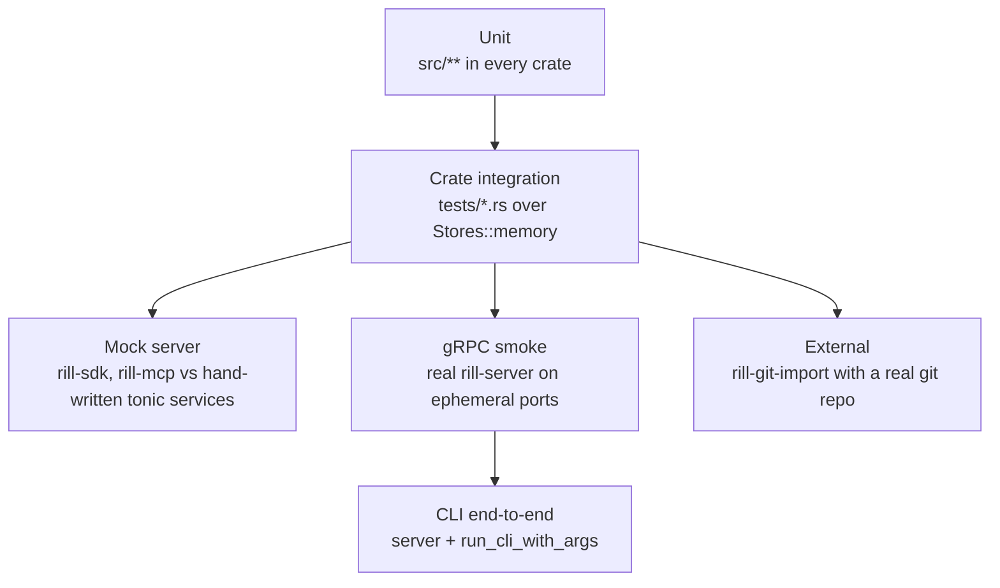

# Testing

Unit tests live next to the code in `#[cfg(test)] mod tests`. Tests that
cross modules or processes live in `crates/<name>/tests/`. Everything runs
in-process over memory stores, with no running server, network or external
service. The one exception is the git importer test, which runs the `git`
binary. Every bug fix adds a test, and the memory backends are the reference
the other backends must match.

## Test kinds



| Kind | What it checks | Where |
| --- | --- | --- |
| Unit | one module: encodings, parsers, policy evaluation, hash framing, exit codes | `src/**`; most in `rill-policy`, `rill-core`, `rill-proto`, `rill-search`, `rill-store` |
| Crate integration | a crate's public API over memory stores | `tests/` in `rill-store`, `rill-core`, `rill-review`, `rill-lander`, `rill-search` |
| Mock server | SDK and MCP against hand-written tonic services | `rill-sdk/tests`, `rill-mcp/tests` |
| gRPC smoke | the real server through generated clients and raw HTTP | `rill-server/tests/grpc_smoke.rs` |
| CLI | the real server driven through the CLI library; clap parsing alone | `rill-cli/tests/cli_e2e.rs`, `rill-cli/tests/landing.rs`, `rill-cli/tests/parse.rs` |
| External | import from a repository built with `git` | `rill-git-import/tests/real_git.rs` |

`rill-exec`, `rill-policy` and `rill-proto` have no `tests/` directory;
`rill-types/tests/merge_laws.rs` property-tests the `Merge` algebra. `rill-proto` keeps its conversion
round trips in `src/convert/roundtrip_tests.rs`.

## Fixtures

- **Store conformance** (`rill-store/tests/conformance.rs`): `fixtures()`
  always includes memory. It adds `local` (tempdir redb plus files) under
  feature `local`, and `object_store::memory::InMemory` under feature `s3`.
  The same object, metadata and repo scenarios run against each backend. A
  difference from memory is a bug.
- **Per-crate `Fixture` / `Harness` structs** in `rill-core`, `rill-review`,
  `rill-lander` and `rill-search` tests build a repository over
  `Stores::memory()`. The lander fixture takes pluggable `ReviewHooks` and
  `Verifier` implementations.
- **`rill-review/src/testing.rs`** (`pub(crate)`) is the shared unit
  fixture. `fixture()` builds a `ReviewService` over default policy with a
  human and an agent principal. The helpers are `root_change`,
  `child_change` and `amend`.
- **SDK mock** (`rill-sdk/tests/common/mod.rs`): `MockRepo` and `MockReview`
  are tonic services. Every RPC they do not implement answers
  `Unimplemented` through the `unimplemented_rpcs!` macro.
  `Harness::start(repo, review, token)` serves them on an ephemeral port and
  builds a `Client`.
- **MCP mock** (`rill-mcp/tests/common/mod.rs`): a smaller `MockRepo` in the
  same style. Its `Grep` answers `Unimplemented`, so the MCP tests exercise
  the tree-walk fallback.
- **Server harness** (`grpc_smoke.rs`): `TestServer` calls `Listeners::bind`
  on port 0, then `build_state` and `serve_with_state`
  ([server](../07-runtime/server.md)). `rill-cli/tests/common/mod.rs`
  embeds a dev-mode memory server the same way for every CLI test, on a
  multi-threaded tokio runtime. `rill-core/tests/common/mod.rs` holds the
  core history fixture.

## What is covered

- **Core**: building history, trees, merge, rebase, resolve and blame, and
  delete-versus-modify conflicts as data (`rill-core/tests/workflow.rs`);
  criss-cross merges against a virtual base (`criss_cross.rs`); subtree
  operations surviving rebase without clobbering (`rebase.rs`).
- **Landing from a checkout**: a stale change conflicts at landing and is
  reported as such, markers are refused by `resolve`, and the checkout
  syncs after landing (`rill-cli/tests/landing.rs`).
- **Review**: vote thresholds (human +2, or agents plus owner), vote carry-over
  on trivial rebase, thread re-anchoring and blocking, stack validation, the
  heuristic reviewer, and review context.
- **Landing**: empty trunk, independent changes in one run, rebase of a
  change behind trunk, a conflict returned to its owner, a red verifier,
  post-land bisect, a green batch, revert, auto-revert after grace, and
  `run_forever` shutdown.
- **Search**: case and glob filters, regex without literals, path filter,
  re-indexing as a no-op, flush and reopen, symbol lookup.
- **SDK**: streamed blob reassembly, chunked `PutBlob`, log conversion,
  `apply_edits` round trips, bearer metadata, status codes preserved,
  `watch_trunk`, `await_land` backoff and timeout, stack submit, sync and
  land, and checkout create, sparse, `.rillignore` and update with merge.
- **MCP**: `initialize`, `tools/list` schemas, unknown tool as a JSON-RPC
  error, bad input never stopping the loop, and the read, list, log and grep
  tools.
- **Server**: `dev_mode_end_to_end` covers repo create, `WatchTrunk`, edits,
  submit, vote, land, log, diff, grep, object `GET` with `ETag`, a malformed
  object path (400), `/healthz`, `WhoAmI`, `Health` and `AddRelation`.
  `static_auth_denies_unrelated_principal` checks `PERMISSION_DENIED`.
- **CLI**: `create_checkout_land_and_sync` and
  `conflicting_sync_exits_three` check exit codes and `--json` output.
  `parse.rs` parses every command group without a server.

## Running

```
cargo test --workspace                       # what CI runs
cargo test -p rill-store --features s3       # object_store fixture for one crate
cargo test -p rill-server --test grpc_smoke
cargo test -p rill-cli --test cli_e2e
RUST_LOG=debug cargo test -p rill-lander -- --nocapture
```

The test profile builds with line-table debuginfo to keep binaries small
([development](development.md)). The git importer test needs `git` on
`PATH`.

## Benchmarks

`rill-bench` generates a deterministic repository (`Shape`: file count,
fan-out 32, 16 lines per file, fixed seed) and runs criterion benchmarks
over it: `cargo bench -p rill-bench --bench core`, with `RILL_BENCH_FILES`
setting the size (default 100,000). Baselines on an Apple M-series laptop
(release, memory stores):

| Benchmark | 100k files | 1M files |
| --- | --- | --- |
| `commit_10_files` (build, store, derive root) | 0.58 ms | 0.84 ms |
| `diff_adjacent_roots` (10 files changed) | 0.18 ms | 0.27 ms |
| `rebase_10_files_over_20` | 0.20 ms | 0.29 ms |
| `diff_lines_2000` | 58 µs | 60 µs |
| `merge_file_2000` | 127 µs | 183 µs |

Ten times the files costs one more directory level, not ten times the
work: commits, diffs and rebases are O(size of change). Building the 1M-file
corpus takes about a minute and 4.5 GB of memory.

## Limitations

- No test runs against a real S3 bucket. The `s3` fixture uses an
  in-memory `object_store`.
- Pre-land verification through `rill-exec`'s sandbox is not driven
  end-to-end through the server. The post-land worker is tested in
  `rill-lander` directly, not through the server's worker spawning.
- Biscuit authentication is unit-tested only. The smoke test covers dev mode
  and static tokens.
- Object `PUT`, `HEAD`, the batch route and `/readyz` have no test beyond a
  unit test of the batch frame encoding.
- Property tests cover only the `Merge` algebra; there are no benchmarks or
  fuzzing.
- No test covers `Lagged` recovery in `Watch*` streams.
- MCP tools run only against a mock. Their JSON encoding is also exercised
  through the CLI e2e, which shares `rill_mcp::json`.

## Code

- [rill-store/tests/conformance.rs](../../crates/rill-store/tests/conformance.rs), [rill-core/tests/workflow.rs](../../crates/rill-core/tests/workflow.rs), [rill-review/tests/review_flow.rs](../../crates/rill-review/tests/review_flow.rs), [rill-review/src/testing.rs](../../crates/rill-review/src/testing.rs)
- [rill-lander/tests/landing.rs](../../crates/rill-lander/tests/landing.rs), [rill-search/tests/end_to_end.rs](../../crates/rill-search/tests/end_to_end.rs)
- [rill-sdk/tests/common/mod.rs](../../crates/rill-sdk/tests/common/mod.rs), [rill-sdk/tests/repo_rpc.rs](../../crates/rill-sdk/tests/repo_rpc.rs), [rill-sdk/tests/stack.rs](../../crates/rill-sdk/tests/stack.rs), [rill-sdk/tests/checkout.rs](../../crates/rill-sdk/tests/checkout.rs)
- [rill-mcp/tests/common/mod.rs](../../crates/rill-mcp/tests/common/mod.rs), [rill-mcp/tests/protocol.rs](../../crates/rill-mcp/tests/protocol.rs)
- [rill-server/tests/grpc_smoke.rs](../../crates/rill-server/tests/grpc_smoke.rs), [rill-cli/tests/cli_e2e.rs](../../crates/rill-cli/tests/cli_e2e.rs), [rill-cli/tests/parse.rs](../../crates/rill-cli/tests/parse.rs)
- [rill-git-import/tests/real_git.rs](../../crates/rill-git-import/tests/real_git.rs), [rill-proto/src/convert/roundtrip_tests.rs](../../crates/rill-proto/src/convert/roundtrip_tests.rs)

---
← Previous: [Development](development.md) · [Index](../index.md) · Next: [Architecture decisions](../10-decisions/README.md) →
