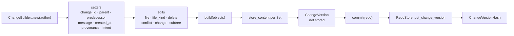

# Change builder

`ChangeBuilder` assembles a `ChangeVersion` by fluent calls, stores the
content of every `Set` as it builds, and hands back the version object
without storing it. It is the one place in `rill-core` that turns raw bytes
into `FileChange`s; everything about *what* the change should contain
(parents, identity, provenance, intent) is supplied by the caller. The
invariant it keeps is that a version returned by `build` references only
content that already exists in the object store.

## Flow

## Fields and defaults

| Field | Default from `new(author)` | Setter |
| --- | --- | --- |
| `change_id` | `ChangeId::new()` (fresh) | `change_id(id)` for amends and rebases |
| `parents` | empty (a root change) | `parent(hash)`, repeatable; the first is the base of `file_changes` |
| `predecessor` | `None` | `predecessor(hash)` |
| `author` | as given | none |
| `message` | empty | `message(..)` |
| `created_at` | `Timestamp::now()` | `created_at(ts)` |
| `provenance` | `Provenance::default()` | `provenance(p)` |
| `intent` | `None` | `intent(id)` |
| `subtree_changes` | empty | `subtree(path, SubtreeChange)` |
| `files` | empty | see below |
| `extra` | always empty `BTreeMap` | none |

## Recording edits

Edits are keyed by `RepoPathBuf`; a later call at the same path replaces an
earlier one. Each path setter validates the path with `RepoPathBuf::new`
and returns `Result<Self>`; an invalid path is `Error::Types`.

| Method | Pending entry | Stored at `build` |
| --- | --- | --- |
| `file(path, bytes)` | `Pending::Set(bytes, Regular)` | `FileChange::set(store_content(bytes), Regular)` |
| `file_kind(path, bytes, kind)` | `Pending::Set(bytes, kind)` | as above with `kind` |
| `delete(path)` | `Pending::Change(Delete)` | verbatim |
| `conflict(path, Merge<FileState>)` | `Pending::Change(Conflict(terms))` | verbatim |
| `change(path, FileChange)` | `Pending::Change(change)` | verbatim; content must already exist |
| `subtree(path, SubtreeChange)` | separate map | verbatim |

`build(objects)` iterates the pending map in path order, calls
`store_content` for every `Set` (chunked and hashed by `blobs.rs`), and
returns the `ChangeVersion`. `commit(repo)` is `build` on `repo.objects()`
followed by `RepoStore::put_change_version`, returning `(hash, cv)`.

## Where versions come from

The builder is one of three constructors of versions; the others produce the
struct directly.

| Producer | Input | Uses builder |
| --- | --- | --- |
| Server `ApplyEdits` ([repo/write.rs](../../crates/rill-server/src/services/repo/write.rs)) | Edits `SetContent` / `Delete` / `Patch` over a base resolved by `edit_base` | Yes: `change_id`, `parent`, `predecessor`, `intent`, `provenance`, then `change(path, FileChange)` per edit, `build` |
| Workspace `NewChange` ([services/workspace.rs](../../crates/rill-server/src/services/workspace.rs)) | `diff_trees(base_root, snapshot)` | No: `version_from_diff` maps each `TreeDiffEntry` to `Set` or `Delete` |
| `merge_changes`, `rebase` | Existing versions | No |
| git importer ([importer.rs](../../crates/rill-git-import/src/import/importer.rs)) | git commits | Yes |

A workspace snapshot therefore becomes a version through the tree diff, not
through the builder: the snapshot tree already holds stored content, and
the diff against the base root yields exactly the `file_changes` relative
to `parents[0]`.

## Validation

The builder validates paths only. It does not check that parents exist,
that `parents[0]` is consistent with the edits, that a path is not the
repository root, or that `Pending::Change` content exists. Those checks
live in the server's `commit_version`:

| Check | Error |
| --- | --- |
| Every parent and the predecessor exist | precondition |
| No `file_changes` key is the root path | invalid argument |
| Every `Set` content is present in the object store | from `check_content_exists` |
| The root tree materialises | `RootTree` is derived eagerly after `put_change_version` so a malformed change fails the request |

`ChangeBuilder::commit` performs none of these and is used by tests and the
importer.

## Provenance and signing

`Provenance` (`tool`, `model`, `session`, `prompt_ref`, `sponsor`,
`resolved_by`, `extra`) is a plain field: the builder stores whatever the
caller passes and it is hashed with the rest of the version. There is no
signing hook in the builder. Signatures are detached objects
(`Signature { signer, public_key, signature, signed_at }` over the version
hash) produced by `rill-policy`'s signer
([signing.rs](../../crates/rill-policy/src/signing.rs)) and stored beside
the version by `RepoStore::put_signatures`; the server's
`CreateChangeVersion` accepts them with the version. The hash of a
`ChangeVersion` excludes signatures, so signing never changes identity.

## Failure semantics

`build` stores blobs one path at a time; on an error part-way the blobs
already written stay in the store (content-addressed, harmless) and no
version is produced. `commit` stores the version only after every blob is
in place. Errors are `Error::Store` (object store), `Error::Types` (bad
path), or `Error::ContentSize` from blob storage.

## Limitations

* `extra` cannot be set through the builder.
* `copy_from` on `FileChange::Set` can only be recorded via
  `change(path, FileChange::Set { copy_from: Some(..), .. })`; there is no
  dedicated setter.
* No validation beyond path syntax; a version with an unknown parent or a
  root-path edit builds successfully and is rejected only by the server.
* The builder reads nothing: it cannot express "modify the parent's content
  at this path" without the caller fetching that content first (the
  server's `Patch` edit does this with `file_state` and `apply_unified`).

## Code

| File | Contents |
| --- | --- |
| [builder.rs](../../crates/rill-core/src/builder.rs) | `ChangeBuilder`, `Pending` |
| [blobs.rs](../../crates/rill-core/src/blobs.rs) | `store_content` |
| [rill-types objects/change.rs](../../crates/rill-types/src/objects/change.rs) | `ChangeVersion`, `FileChange`, `Provenance`, `Signature` |
| [server repo/write.rs](../../crates/rill-server/src/services/repo/write.rs) | `apply_edits_impl`, `commit_version`, `version_from_diff` |

## See

* [trees](trees.md) for how `file_changes` and `subtree_changes` become a
  root tree.
* [merge-and-rebase](merge-and-rebase.md) for the other producers of
  versions and for `conflict(..)` terms.
* [diff](diff.md) for `TreeDiffEntry`, the input of `version_from_diff`.
