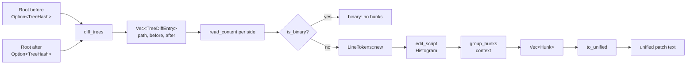

# Diff

The diff module turns two byte buffers into line hunks and two trees into a
list of changed paths. Both halves are pure functions over the object store;
the tree half never loads a subtree whose hash is equal on both sides, so a
tree diff costs O(changed paths × depth), not O(repository). The line half is
`imara-diff`'s Histogram algorithm over line tokens that include their
terminators, so output lines concatenate back to the input byte for byte.

## Pipeline

The server's `Diff` RPC
([services/diff.rs](../../crates/rill-server/src/services/diff.rs)) is the
canonical driver of this pipeline: `diff_trees`, then per entry
`read_content` (absent side treated as empty; content over
`MAX_DIFF_BYTES` reported as binary), `is_binary`, `diff_lines_with_context`,
and either `hunk_proto` or `to_unified` depending on `DiffFormat`.

## Line tokens

[`tokens.rs`](../../crates/rill-core/src/diff/tokens.rs) is shared by diff
and merge. `split_lines` yields each line *including* its `\n` (or `\r\n`);
the last line may be unterminated. Consequences:

| Property | Effect |
| --- | --- |
| Terminator is part of the token | `a\n` vs `a` is a change; CRLF vs LF is a change |
| Concatenation is lossless | Hunks and merge regions reproduce input bytes exactly |
| `LineTokens::missing_final_newline` | Renderers emit `\ No newline at end of file` |
| `line_content` | Strips `\n` then `\r`; used by consumers that want bare text |

`LineSource` implements `imara_diff::TokenSource` over borrowed `&[u8]`
slices; tokens are interned by `InternedInput`, so equal lines compare by
id.

## Line diff

[`lines.rs`](../../crates/rill-core/src/diff/lines.rs):

* `edit_script(old, new)` runs `Diff::compute(Algorithm::Histogram, ..)`,
  then `postprocess_lines`, and returns raw `(old_range, new_range)` edit
  pairs in line indices. It is `pub(crate)` and is the primitive the merge
  uses without context grouping.
* `diff_lines(old, new)` is `diff_lines_with_context` with
  `DEFAULT_CONTEXT = 3`.
* `group_hunks` merges consecutive edits whose gap is at most
  `2 * context` lines into one `Hunk`, pads `context` lines on each end
  (clamped to the buffer), and tags lines `Context`, `Removed`, `Added`.

A `Hunk` ([`hunk.rs`](../../crates/rill-core/src/diff/hunk.rs)) carries
1-based `old_start`/`new_start` and `old_len`/`new_len` counting context plus
side lines, exactly as `diff -u` reports them; `removed()`/`added()` count by
tag. Identical inputs produce an empty `Vec<Hunk>`.

There is no token- or word-level diff: "token" in this crate means line
token. Patience and Myers are not used; Histogram is the only algorithm.

## Unified rendering

[`unified.rs`](../../crates/rill-core/src/diff/unified.rs) `to_unified(path,
hunks, context)` writes `--- a/<path>` / `+++ b/<path>` headers, one
`@@ -s,l +s,l @@` per hunk (`s` alone when `l == 1`; `s-1,0` when `l == 0`),
prefix characters ` `, `-`, `+`, and `\ No newline at end of file` after
any unterminated line. A single hunk with `old_len == 0` labels the old side
`/dev/null`; `new_len == 0` does the same for the new side. The `context`
argument is accepted and ignored. Non-UTF-8 bytes are rendered with
`from_utf8_lossy`, so the string form is not byte-lossless; the `Hunk` form
is.

## Binary detection

[`binary.rs`](../../crates/rill-core/src/diff/binary.rs) `is_binary` reports
a NUL byte within the first `BINARY_SNIFF_LEN = 8 KiB`. The same heuristic
gates text merging in `merge_file_state`.

## Tree diff

[`tree.rs`](../../crates/rill-core/src/diff/tree.rs) `diff_trees(ops,
before, after)` takes `Option<TreeHash>` on each side (`None` is "no tree",
the parent of a root change) and returns `Vec<TreeDiffEntry>` sorted by
path, each with `before`/`after` as `Option<(ContentRef, FileKind)>`.

Algorithm: an explicit stack of `(dir, before_hash, after_hash)`; a frame
whose hashes are equal is skipped without loading either tree. For each
frame the union of entry names is visited in sorted order:

| Before | After | Result |
| --- | --- | --- |
| `Dir(h1)` | `Dir(h2)`, `h1 != h2` | Push subdirectory frame |
| `Dir(h)` | `Dir(h)` | Nothing |
| `File` | `File`, different `(content, kind)` | Entry with both sides |
| `File` | absent / `Dir` | Deleted-file entry; a `Dir` side also pushes a frame with `before = None` |
| absent / `Dir` | `File` | Added-file entry; a `Dir` side pushes a frame with `after = None` |

A file-to-directory swap therefore yields a delete of the file path plus
adds beneath it, in that order. Equality of a file is `ContentRef` and
`FileKind` equality: a mode change with the same content is reported.

What `diff_trees` does not do:

* No rename or copy detection. `FileChange::Set { copy_from }` exists in the
  object model, but `TreeDiffEntry` has no copy field and the diff does not
  read change versions.
* No content comparison; entries say "different `ContentRef`", not how.

`file_state(ops, root, path)` is the one-path convenience over
`TreeOps::lookup`, returning `None` for a missing root, a missing path, or a
directory. Merge and rebase use it per path.

## Cost

| Operation | Cost |
| --- | --- |
| `diff_trees` | Loads only directories on a path to a changed entry; each load is a `TreeOps` cache hit or one object fetch |
| `edit_script` | Histogram: O((N+M)·D) typical; `imara-diff` falls back internally on pathological inputs |
| `group_hunks` | Linear in edits and emitted lines |
| `to_unified` | Linear in hunk lines; allocates one `String` |

Results are collected, not streamed; the server applies its own `limit` and
reports `truncated`.

## Limitations

* `to_unified` lossy-decodes non-UTF-8 content.
* `is_binary` inspects only the first 8 KiB; a NUL beyond that is text.
* No rename detection and no whitespace-insensitive mode.
* Hunk coordinates are `u32`; buffers beyond 2^32 lines are not supported.

## Code

| File | Contents |
| --- | --- |
| [diff/mod.rs](../../crates/rill-core/src/diff/mod.rs) | Re-exports |
| [diff/tokens.rs](../../crates/rill-core/src/diff/tokens.rs) | `LineTokens`, `split_lines`, `line_content`, `LineSource` |
| [diff/lines.rs](../../crates/rill-core/src/diff/lines.rs) | `edit_script`, `diff_lines`, `diff_lines_with_context`, `group_hunks` |
| [diff/hunk.rs](../../crates/rill-core/src/diff/hunk.rs) | `Hunk`, `DiffLine`, `LineTag` |
| [diff/unified.rs](../../crates/rill-core/src/diff/unified.rs) | `to_unified` |
| [diff/binary.rs](../../crates/rill-core/src/diff/binary.rs) | `is_binary`, `BINARY_SNIFF_LEN` |
| [diff/tree.rs](../../crates/rill-core/src/diff/tree.rs) | `diff_trees`, `TreeDiffEntry`, `file_state` |

## See

* [trees](trees.md) for `TreeOps`, the cache `diff_trees` reads through.
* [merge-and-rebase](merge-and-rebase.md) for how `edit_script` and
  `LineTokens` feed the N-way merge.
* [Server diff service](../../crates/rill-server/src/services/diff.rs) for
  the RPC that composes this pipeline.
