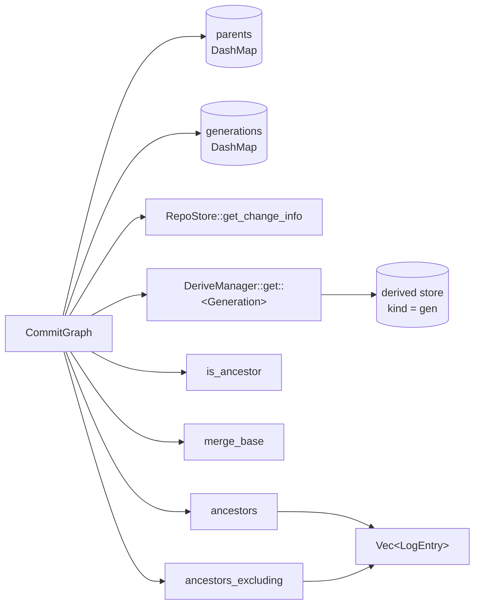
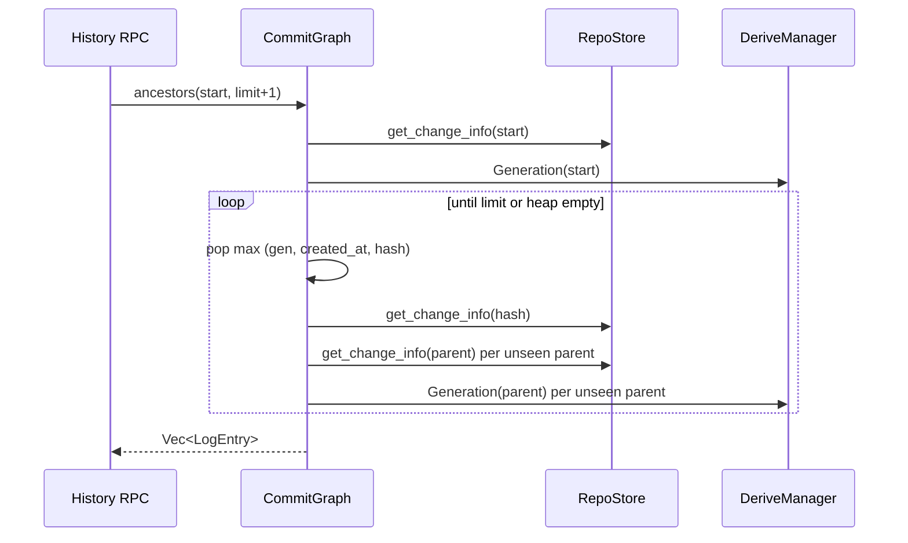

# Commit graph

`CommitGraph` answers ancestry questions over change versions: parents,
generation numbers, `is_ancestor`, `merge_base`, and the two walks behind
`log`. It reads `ChangeInfo` records from the `RepoStore` metadata keyspace
(never full `ChangeVersion`s, so a million-path version costs the same as an
empty one) and generation numbers from the `Generation` derivation. The
invariant every query relies on is that a parent's generation is strictly
lower than its child's, which lets every walk proceed in decreasing
generation order and stop early.

## Structure

| Owns | Does not own |
| --- | --- |
| Per-process caches of parents and generations | `ChangeInfo` records (written by the store on `put_change_version`) |
| Ancestry, merge-base and log algorithms | The `Generation` derivation itself (`derive/generation.rs`: `1 + max(parent generations)`, 1 for roots) |
| Deterministic ordering of results | Trunk sequence numbers (`ChangeInfo::trunk_seq` is joined in by the store) |

## Primitives

[`commit_graph.rs`](../../crates/rill-core/src/graph/commit_graph.rs):

| Method | Source of truth | Cache |
| --- | --- | --- |
| `info(hash)` | `RepoStore::get_change_info`; `None` → `Error::ChangeNotFound` | Populates `parents` as a side effect |
| `parents(hash)` | `info` | `DashMap<ChangeVersionHash, Arc<[ChangeVersionHash]>>` |
| `generation(hash)` | `DeriveManager::get::<Generation>` (stored derived value; first computation walks missing ancestors with an explicit stack) | `DashMap<ChangeVersionHash, u64>` |

Both caches are unbounded and process-local; versions are immutable so
entries never go stale.

## is_ancestor

`is_ancestor(ancestor, descendant)`: true when equal; otherwise a max-heap
on generation seeded with `descendant`. A popped version whose generation is
at or below `generation(ancestor)` is not expanded, since nothing beneath it
can reach the target. Every parent is compared with `ancestor` before being
queued, and a `seen` set stops re-expansion.

Cost: O(versions with generation > target reachable from `descendant`), one
`parents` lookup and one `generation` lookup each. The lander uses this to
detect an already-landed tip before rebasing.

## merge_base

`merge_base(a, b)` returns one best common ancestor: the candidate with the
highest generation, ties broken by the larger hash (`(gen, Reverse(hash))`
compared, so the ordering is total and reproducible). It is git's
`paint_down_to_common` with generation numbers:

1. Flags `LEFT = 1`, `RIGHT = 2`, `STALE = 4` per version; `a` starts
   `LEFT`, `b` starts `RIGHT`; both go on a max-heap by generation.
2. Pop the highest generation. A version flagged `LEFT | RIGHT` and not yet
   `STALE` is a candidate; it becomes `STALE`.
3. Each parent inherits the popped flags; a parent whose flags changed is
   pushed. Ancestors of a candidate therefore inherit `STALE` and are never
   reported.
4. Stop when every queued version is `STALE` (the heap is scanned for a
   non-stale entry before each pop; that scan is bounded by frontier width).

Returns `None` for disjoint histories. With multiple equally deep common
ancestors (criss-cross merges) one is chosen; there is no recursive
virtual-ancestor merge. `merge_changes` uses this base directly.

## Log walks

[`walk.rs`](../../crates/rill-core/src/graph/walk.rs). Both walks share the
heap key `Key(generation, created_at, hash)`, highest first, so a version
always precedes all of its parents, unrelated versions come newest first,
and the order is total.

| Method | Semantics | Stop condition |
| --- | --- | --- |
| `ancestors(start, limit)` | Up to `limit` ancestors of `start`, inclusive | Heap empty or `limit` reached |
| `ancestors_excluding(start, exclude, limit)` | Ancestors of `start` that are not ancestors of `exclude`, same order | `limit` reached, or nothing interesting queued |

`ancestors_excluding` walks both sides in one heap. A version popped while
marked uninteresting marks its parents uninteresting and is not emitted;
because the heap is ordered by generation, an uninteresting mark always
reaches a version before that version could be emitted. The result is "what
this change contributes on top of a base".

Each emitted `LogEntry { info: ChangeInfo, generation }` carries the
metadata projection: hash, `change_id`, parents, predecessor, author,
provenance, intent, message, `created_at`, `files_changed`, `has_conflicts`,
`trunk_seq`.

The server's history service
([repo/history.rs](../../crates/rill-server/src/services/repo/history.rs))
serves `log` from `ancestors` with `limit + 1` to detect truncation. There
is no first-parent-only walk and no path filter at this layer; `derive/`
owns path history.

## Cost

| Query | Store reads | Notes |
| --- | --- | --- |
| `parents` / `generation` | 0 after first use per version | Unbounded DashMaps |
| `is_ancestor` | O(reachable versions above target generation) | Prunes by generation, not by first parent |
| `merge_base` | O(versions above the base's generation on both sides) | Frontier scan per step is O(frontier) |
| `ancestors` | One `get_change_info` per emitted version plus one per queued parent | `info` always hits the store; only `parents` is served from cache |
| `ancestors_excluding` | As above on both sides until the interesting frontier empties | Can read far past `limit` when `exclude` is deep |
| First `Generation` of an un-derived version | O(all un-derived ancestors) | Computed once, stored under derived kind `gen` |

## Failure semantics

Every query is read-only. A missing version surfaces as
`Error::ChangeNotFound(hash)`; store and derive failures propagate as
`Error::Store` / `Error::Derive`. A walk that fails mid-way returns the
error, not a partial list.

## Limitations

* `merge_base` returns a single base; criss-cross histories get one of the
  equally deep candidates.
* Caches never evict; a long-lived process accumulates one entry per
  version it has touched.
* `ancestors` re-reads `ChangeInfo` for versions already visited as parents
  (it is read once when queued and again when popped).
* No first-parent walk, no date-bounded walk, no reverse (descendant) walk.

## Code

| File | Contents |
| --- | --- |
| [graph/mod.rs](../../crates/rill-core/src/graph/mod.rs) | Re-exports |
| [graph/commit_graph.rs](../../crates/rill-core/src/graph/commit_graph.rs) | `CommitGraph`, `info`, `parents`, `generation`, `is_ancestor`, `merge_base` |
| [graph/walk.rs](../../crates/rill-core/src/graph/walk.rs) | `LogEntry`, `ancestors`, `ancestors_excluding` |
| [derive/generation.rs](../../crates/rill-core/src/derive/generation.rs) | `Generation` derivation |
| [rill-types objects/change.rs](../../crates/rill-types/src/objects/change.rs) | `ChangeInfo` |

## See

* [merge-and-rebase](merge-and-rebase.md) for `merge_changes`, the consumer
  of `merge_base`.
* [Landing pipeline](../../crates/rill-lander/src/land/pipeline.rs) for the
  `is_ancestor` check before rebase.
