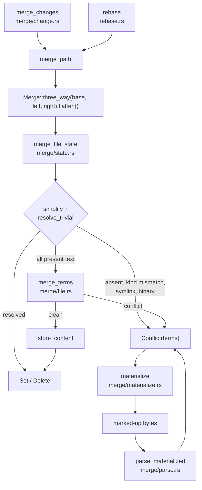

# Merge and rebase

Merging in Rill is an evaluation of the `Merge<T>` algebra from `rill-types`
followed, only when the algebra cannot decide, by a line-level N-way text
merge. Conflicts are never errors: a path that does not merge becomes
`FileChange::Conflict(Merge<FileState>)` in the resulting `ChangeVersion`,
and that term list is carried through further merges and rebases unchanged
in meaning. Every function here returns a `ChangeVersion` that is not yet
stored; the caller decides whether and where to persist it.

## Layers



## The algebra in one table

`Merge<T>` stores terms interleaved `[add0, remove0, add1, remove1, ..., addN]`
and means `add0 - remove0 + add1 - ...`. The operations the core relies on:

| Operation | Meaning | Used by |
| --- | --- | --- |
| `Merge::three_way(base, left, right)` | `[left, base, right]` | `merge_file`, `merge_path` |
| `Merge<Merge<T>>::flatten` | Substitute nested terms; a nested merge at a remove slot is negated by position | `merge_path` |
| `simplify` | Cancel equal add/remove pairs on the separate add and remove lists | `merge_file_state` |
| `resolve_trivial` | Resolved, or all adds equal after simplification | both text and state merges |
| `is_present_everywhere` | No `None` term in a `Merge<Option<T>>` | `merge_file_state` |

## Three-way file merge (`merge/file.rs`)

`merge_file(base, left, right) -> FileMergeResult` builds
`Merge::three_way` over `Bytes` and calls `merge_terms`, which handles any
odd-length term list (diff3 generalised to N sides):

1. `resolve_trivial` on whole contents; a hit returns one `Resolved` hunk.
2. Tokenise every term with `LineTokens`. Term index 1, the first remove,
   is the alignment base; `edit_script` (Histogram) is computed from it to
   every other term.
3. `align` partitions the base into regions: an untouched run, or a maximal
   run in which at least one term has an edit, extended while any edit on
   any term overlaps or abuts the current end. Adjacent edits with no
   unchanged base line between them therefore fall into one region and
   conflict, as in git. Each region maps to one line range per term.
4. Each region becomes `Merge<&[lines]>` and is tried with `resolve_trivial`.
   Clean regions append to the previous `Resolved` hunk; conflicting ones
   are `minimize`d zdiff3-style (lines equal across all terms at the start
   and end move out) and emitted as `MergeHunk::Conflict(Merge<Bytes>)`.
5. An empty result becomes a single empty `Resolved` hunk.

`FileMergeResult::Resolved(Vec<u8>)` when `resolved_bytes` succeeds, else
`Conflicted { hunks }`, where hunks concatenate to the whole file.

## File-state merge (`merge/state.rs`)

`merge_file_state(terms: Merge<FileState>, reader, objects) -> FileChange`
is the single decision procedure for one path, where
`FileState = Option<(ContentRef, FileKind)>`:

| Step | Outcome |
| --- | --- |
| `terms.simplify()` then `resolve_trivial` | `FileChange::set` or `Delete` via `to_change`; no content read |
| any term `None` (edit vs delete) | `Conflict(terms)` |
| any `FileKind::Symlink`, or kinds differ | `Conflict(terms)` |
| any content `is_binary` | `Conflict(terms)` |
| `merge_terms` clean | content stored with `store_content`, returned as `Set` with the shared kind |
| `merge_terms` conflicts | `Conflict(terms)` (the simplified file-state terms, not the text hunks) |

The stored `Conflict` carries file states, so the text conflict is
recomputed on demand by `materialize`. `merge_states(removes, adds, ..)` is
the explicit-list entry; `change_terms(&FileChange)` lifts a change to its
terms (`Conflict` → its terms, `Set`/`Delete` → a resolved state).

## Change-level merge (`merge/change.rs`)

`merge_changes(derive, graph, left, right, MergeChangeOptions)` produces a
version with `parents = [left, right]`:

1. `base = graph.merge_base(left, right)`; root trees of base (if any),
   `left` and `right` through `RootTree`.
2. Candidate paths = `diff_trees(base_root, right_root)` ∪ conflicted paths
   of both tips. Paths only `left` touched are already in the first parent
   and need no entry.
3. Per path: `base_state`, `left_terms = tip_terms(left_cv, ..)`,
   `right_terms = tip_terms(right_cv, ..)`. `tip_terms` returns a tip's
   recorded `Conflict` terms instead of the first-add state its tree holds,
   so two conflicted tips combine rather than one being picked silently.
4. `merge_path` = `Merge::three_way(resolved(base), left, right).flatten()`
   → `merge_file_state`.
5. `is_same_as(change, left_state)` drops entries that leave the path as
   the first parent has it.

`MergeChangeOptions` supplies `author`, `message`, `created_at`,
`change_id` (fresh `ChangeId::default()` when `None`) and `provenance`;
`intent` is always `None` and `subtree_changes` empty.

## Conflict markers (`merge/materialize.rs`, `merge/parse.rs`)

`materialize(&Merge<Option<Bytes>>) -> Vec<u8>` renders a file-level merge.
Absent terms are mapped to empty bytes for the text merge and listed in the
header as `absent: term <i>` (one-based interleaved index). Clean regions
are written as plain text; each conflicting region is:

```text
<<<<<<< Conflict 1 of 2 (2 sides; absent: term 3)
%%%%%%% Changes from base #1 to side #1
-old line
+new line
 context line
+++++++ Contents of side #2
other line
>>>>>>> Conflict 1 of 2 ends
```

| Marker | Content |
| --- | --- |
| `<<<<<<<` header | Index, total, side count, optional absent list |
| `%%%%%%%` (one per remove `r_i`) | Line diff `r_i → a_i` with ` `, `-`, `+` prefixes |
| `+++++++` | Last add `a_N` verbatim |
| `>>>>>>>` | End |
| `\ No newline at end of file` | Follows any unterminated content line |

Marker length is `max(7, longest leading run of <>%+- in any content line + 2)`
so content is never mistaken for a marker; `ConflictLabels` can name sides
in headers (`side #1 (trunk)`). The caller converts `Merge<FileState>` to
`Merge<Option<Bytes>>` by reading each `ContentRef` (the SDK does this in
[local/update.rs](../../crates/rill-sdk/src/local/update.rs)).

`parse_materialized(bytes) -> Option<Merge<Option<Bytes>>>` is the inverse.
It takes the marker length from the longest `<` run, accumulates plain text
into every term, reconstructs adds from `+++++++` and `%`-section diffs and
removes from the `-`/` ` lines, applies the absent list, and returns `None`
on malformed input (unterminated conflict, side count changing between
conflicts, unknown section, bad prefix). A file with no markers parses as
`Merge::resolved(Some(bytes))`. The round trip is value-preserving under the
algebra and byte-identical on re-materialisation: regions that auto-merged
come back as the merged text in every term, which is an equivalent merge.
`parse_materialized` has no caller outside `rill-core` today; the SDK's
`Checkout::mark_resolved` clears a manifest flag without parsing.

## File conflict lifecycle

```mermaid
stateDiagram-v2
    [*] --> Clean: FileChange::Set / Delete
    Clean --> Conflicted: merge_file_state returns Conflict(terms)
    Conflicted --> Clean: simplify / resolve_trivial on a later merge or rebase
    Conflicted --> Materialized: materialize(terms) into the working copy
    Materialized --> Conflicted: parse_materialized recovers terms
    Materialized --> Clean: file edited to plain text, snapshot stores Set
    Conflicted --> Conflicted: rebase onto an unrelated parent keeps terms
```

A `Conflict` entry is stored in the tree as its first add's state (or
absent) by `TreeOps::materialize`, so trees are always plain; the conflict
exists only in the change.

## Rebase (`rebase.rs`)

`rebase(derive, version, new_parent, created_at) -> ChangeVersion` builds the
next version of the same change:

1. `paths = diff_trees(old_parent_root, old_root)` ∪ conflicted paths of the
   version, minus any path strictly beneath a `subtree_changes` key.
2. Per path, `merge_path(base = old parent state, left = new parent state,
   right = tip_terms(version))` and drop the entry when it equals the new
   parent's state.
3. `parents = [new_parent] + other old parents (excluding new_parent)`,
   `predecessor = Some(version)`, `change_id`, `author`, `provenance`,
   `intent`, `message`, `extra` and `subtree_changes` copied verbatim,
   `created_at` as given.

Trivial outcomes come from the algebra before any content is read: a path
the new parent did not touch since the old parent (`left == base`)
simplifies to the version's own state; a path the new parent changed
identically resolves to that value; a path the version only touched in a
way the new parent now also has is dropped. A conflicted version rebased
onto a parent that equals one of its terms simplifies back to a plain value
(`rill-types` test `rebase_simplifies_away_base`); rebased onto an unrelated
parent, the new parent becomes the first add and the old terms follow,
flattened and simplified.

```mermaid
sequenceDiagram
    participant L as Lander / Rebase RPC
    participant R as rebase
    participant D as DeriveManager
    participant T as TreeOps / diff
    participant S as merge_file_state
    L->>R: rebase(version, new_parent, now)
    R->>D: change(version), RootTree(old parent, version, new_parent)
    R->>T: diff_trees(old_parent_root, old_root)
    T-->>R: paths
    loop each path
        R->>T: file_state(base), file_state(left), file_state(right)
        R->>S: three_way(base, left, right).flatten()
        S->>S: simplify, resolve_trivial
        S->>S: read contents, merge_terms
        S-->>R: Conflict(terms)
    end
    R-->>L: ChangeVersion{predecessor: version, file_changes: {path: Conflict}}
    L->>L: store version; has_conflicts = true
```

## Failure semantics

| Condition | Result |
| --- | --- |
| Version, parent or base missing | `Error::ChangeNotFound` from `DeriveManager::change`, `TreeNotFound` from tree loads |
| Content unreadable | `Error::Store` propagated; nothing partial is stored except blobs already written by `store_content` for earlier paths |
| Any path conflicts | Not an error: `Conflict` entry; `ChangeVersion::has_conflicts()` is true |

No function here writes a change version. `merge_changes` and `rebase` write
only merged blob content; the server
([repo/write.rs](../../crates/rill-server/src/services/repo/write.rs)) and
the lander ([land/pipeline.rs](../../crates/rill-lander/src/land/pipeline.rs))
store the version afterwards.

## Limitations

* Symlinks never text-merge: any symlink term is an immediate conflict.
* Executable-vs-regular with identical content is a conflict (kinds must
  agree before content is compared).
* `merge_changes` sets `intent = None` and carries no `subtree_changes`.
* `rebase` copies `subtree_changes` verbatim and does not re-validate that
  `SubtreeChange::Copy` sources still exist on the new parent.
* `parse_materialized` is wired to no caller; hand-resolved conflicts reach
  the server as plain `Set` content.

## Code

| File | Contents |
| --- | --- |
| [merge/mod.rs](../../crates/rill-core/src/merge/mod.rs) | Re-exports |
| [merge/file.rs](../../crates/rill-core/src/merge/file.rs) | `merge_file`, `merge_terms`, `align`, `minimize`, `MergeHunk`, `FileMergeResult` |
| [merge/state.rs](../../crates/rill-core/src/merge/state.rs) | `merge_file_state`, `merge_states`, `to_change`, `change_terms` |
| [merge/change.rs](../../crates/rill-core/src/merge/change.rs) | `merge_changes`, `MergeChangeOptions`, `tip_terms`, `merge_path`, `is_same_as`, `root_of` |
| [merge/materialize.rs](../../crates/rill-core/src/merge/materialize.rs) | `materialize`, `materialize_with`, `ConflictLabels`, `MIN_MARKER_LEN` |
| [merge/parse.rs](../../crates/rill-core/src/merge/parse.rs) | `parse_materialized` |
| [rebase.rs](../../crates/rill-core/src/rebase.rs) | `rebase` |
| [rill-types merge.rs](../../crates/rill-types/src/merge.rs) | `Merge<T>` algebra |
| [rill-types objects/change.rs](../../crates/rill-types/src/objects/change.rs) | `FileChange`, `FileState`, `ChangeVersion` |

## See

* [diff](diff.md) for `edit_script` and `LineTokens`.
* [graph](graph.md) for `merge_base`.
* [trees](trees.md) for how a `Conflict` entry is projected into a tree.
* [builder](builder.md) for recording a `Conflict` in a hand-built version.
