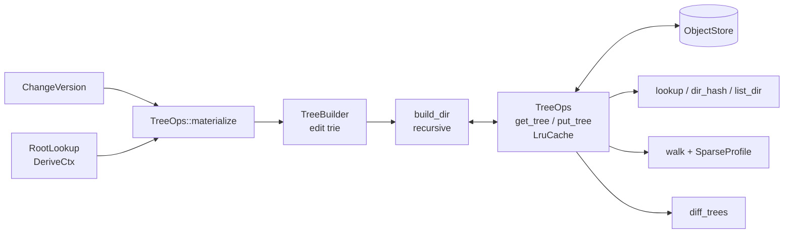

# Trees

A `Tree` is a directory: a `BTreeMap<String, TreeEntry>` whose entries are
files (`ContentRef` + `FileKind`) or subdirectories (`TreeHash` +
`DirSummary`), encoded canonically and addressed by hash. `rill-core` reads
and writes trees through `TreeOps`, builds new roots from path edits with
`TreeBuilder`, projects a `ChangeVersion` onto its parent's root, and walks
or looks up paths. The invariant that every operation preserves is that a
root is a pure function of its content: equal directories have equal hashes,
so an unchanged subtree is never loaded, rewritten or re-walked.

## Components

## Ownership

| `rill-core` trees own | They do not own |
| --- | --- |
| Decoding, caching and storing `Tree` objects | The `Tree` type and its hash (`rill-types` `Encodable`: postcard body, `ObjectHash::digest(ObjectKind::Tree, ..)`) |
| Applying `SubtreeChange` and `FileChange` to a root | Blob content (`blobs.rs`) |
| Sorted lookups, listings and walks | Writing files to a filesystem: the SDK checkout ([local/checkout.rs](../../crates/rill-sdk/src/local/checkout.rs)) and the verification runner ([rill-exec materialize.rs](../../crates/rill-exec/src/materialize.rs)) do that |
| Deciding which root a version has (through `RootTree`, a derivation) | Ignore files; no ignore logic exists in `rill-core` |

## TreeOps

[`ops.rs`](../../crates/rill-core/src/tree/ops.rs). `TreeOps::new(objects,
cache_size)` binds an `Arc<dyn ObjectStore>` to an `LruCache<TreeHash,
Arc<Tree>>` (`DEFAULT_TREE_CACHE = 4096` decoded trees). `TreeOps` is
`Clone`; clones share the cache.

| Method | Behaviour |
| --- | --- |
| `get_tree(&hash)` | Cache hit or `get_object`; missing object is `Error::TreeNotFound` |
| `put_tree(&tree)` | `put_object` (hash-verified by the store) and cache insert; returns the hash |
| `empty_tree()` | Stores `Tree::empty()` so its hash is always loadable |
| `lookup(root, path)` | Walks components; the root path yields `Dir { hash: root, summary }`; a file in the middle of the path yields `None` |
| `dir_hash(root, path)` | `Some(hash)` only for a directory |
| `list_dir(root, path)` | Entries sorted by name; `Error::NotADirectory` for a file or missing path |

## TreeBuilder

[`builder.rs`](../../crates/rill-core/src/tree/builder.rs) accumulates
`Edit`s in a trie keyed by path component, then `build(ops, base)` walks the
trie once:

| `Edit` | Effect at the path |
| --- | --- |
| `Set(ContentRef, FileKind)` | Entry becomes a file |
| `Delete` | Entry removed, whether file or whole directory |
| `Dir(TreeHash)` | Entry becomes that directory; its `DirSummary` is read from the stored tree |

`build_dir` loads a base subtree only when an edit lies beneath it, applies
the node's own edits, then recurses into children. Rules that fall out of
the implementation:

* A later `edit` at the same path replaces an earlier one.
* An edit at the root path is ignored; the root is always a directory. With
  no edits at all, `build` returns `base` unchanged, or stores and returns
  the empty tree when `base` is `None`.
* Nested edits beneath a name that currently holds a file build a fresh
  directory there (the file is replaced); beneath an existing directory
  they edit it in place.
* A subtree that becomes empty is removed from its parent, so empty
  directories never exist in a stored tree.
* `changed` is tracked per directory; an unchanged directory returns its
  base hash without a `put_tree`. Rewrites are therefore confined to the
  spine from each edited path to the root.
* `DirSummary` (`file_count`, `dir_count`, `total_size`) is recomputed for
  every rewritten directory from its entries, so size and count queries
  never walk.

Cost: O(edited paths × depth) tree loads and at most that many writes.

## Applying a change version

[`materialize.rs`](../../crates/rill-core/src/tree/materialize.rs)
`TreeOps::materialize(parent_root, cv, roots)` produces a version's root
from its first parent's root. `RootTree` (a derivation) calls it with the
first parent's root; `DeriveCtx` implements `RootLookup` so subtree copies
can resolve another version's root.

Order of application:

1. `subtree_changes`, in path order. `SubtreeChange::Delete` → `Edit::Delete`;
   `SubtreeChange::Copy { from_path, from_version }` → `roots.root_tree`,
   `dir_hash`, `Edit::Dir(hash)`. A missing source directory is
   `Error::NotADirectory(from_path)`; a root-path subtree change is
   `Error::InvalidChange`.
2. `file_changes`, in path order. `Set` → `Edit::Set`; `Delete` →
   `Edit::Delete`; `Conflict(terms)` → the first add's state (`Edit::Set`
   or `Edit::Delete`). A root-path file change is `Error::InvalidChange`.
3. `TreeBuilder::build(self, parent_root)`.

Because file edits are recorded after subtree edits in the same trie, a
file change under a copied subtree overrides the copied entry. A `Delete`
at a path that is a prefix of `Set` paths replaces a file with a directory.
Conflicts leave no trace in the tree; see
[merge-and-rebase](merge-and-rebase.md).

`NoRoots` is a `RootLookup` that fails every lookup with
`Error::ChangeNotFound`, for callers that know a version has no subtree
copies.

## Walk

[`walk.rs`](../../crates/rill-core/src/tree/walk.rs) `TreeOps::walk(root,
prefix, sparse) -> Vec<WalkEntry>` lists every file under `prefix` in path
order, each as `(path, ContentRef, FileKind)`:

* A `prefix` that names a file yields that single entry (if the sparse
  profile contains it); a missing prefix yields nothing.
* `SparseProfile { include, exclude }` filters files with `contains`
  (excluded prefix wins; empty `include` means everything). Directories are
  pruned with `dir_may_contain`: skipped when under an `exclude`, or when
  includes exist and none is an ancestor or descendant of the directory.
  Pruned directories are never loaded.
* Traversal is an explicit stack; the output is sorted by path at the end,
  so order is total and independent of traversal.
* The result is collected, not streamed. Callers paging a large repository
  pass a narrower `prefix`.

## Invariants

| Invariant | Enforced by |
| --- | --- |
| Entries sorted by name | `Tree.entries` is a `BTreeMap`; encoding is deterministic |
| Hash = f(content) | `Encodable::hash` over the postcard body |
| No empty directories | `build_dir` removes a child whose rebuilt tree `is_empty()` |
| `DirSummary` on a parent entry equals the child's `Tree::summary()` | Set at every `insert_dir` |
| Unchanged subtree ⇒ same hash, no write | `changed` tracking in `build_dir` |
| Conflicts never appear in a tree | `materialize` projects to the first add |

## Limitations

* `FileKind` is the only mode information; `Executable` and `Symlink` are
  stored as kinds and interpreted by whoever writes to disk, not here.
* Symlink targets are ordinary content; the tree layer does not validate
  them.
* No path normalisation beyond `RepoPathBuf` validation; case folding is
  not handled.
* `walk` on a full repository allocates the whole listing.

## Code

| File | Contents |
| --- | --- |
| [tree/mod.rs](../../crates/rill-core/src/tree/mod.rs) | Re-exports |
| [tree/ops.rs](../../crates/rill-core/src/tree/ops.rs) | `TreeOps`, `DEFAULT_TREE_CACHE` |
| [tree/builder.rs](../../crates/rill-core/src/tree/builder.rs) | `TreeBuilder`, `Edit`, `build_dir` |
| [tree/materialize.rs](../../crates/rill-core/src/tree/materialize.rs) | `TreeOps::materialize`, `RootLookup`, `NoRoots` |
| [tree/walk.rs](../../crates/rill-core/src/tree/walk.rs) | `TreeOps::walk`, `WalkEntry`, `dir_may_contain` |
| [util/lru.rs](../../crates/rill-core/src/util/lru.rs) | `LruCache` |
| [rill-types objects/tree.rs](../../crates/rill-types/src/objects/tree.rs) | `Tree`, `TreeEntry`, `EntryKind`, `DirSummary` |

## See

* [diff](diff.md) for `diff_trees`, which reads through the same cache.
* [merge-and-rebase](merge-and-rebase.md) for what a `Conflict` entry means.
* [builder](builder.md) for how `file_changes` are assembled.
* `RootTree` in [derive/root_tree.rs](../../crates/rill-core/src/derive/root_tree.rs)
  for the derivation that calls `materialize`.
