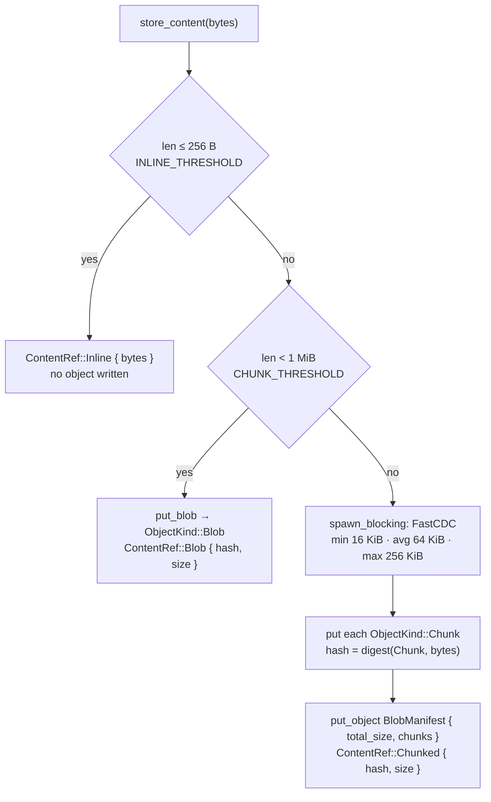

# Blobs

File content enters the object store through `rill_core::blobs::store_content`
and leaves it through `read_content`. The size of the bytes alone decides the
representation: inline in the change, one `Blob` object, or a `BlobManifest`
over FastCDC `Chunk` objects. The thresholds are constants in `rill-types`,
so every producer (server, CLI, importer) makes the same choice for the same
bytes and `ContentRef`s dedup across clients. The invariant readers rely on:
`read_content` returns exactly `ContentRef::size()` bytes or fails with
`Error::ContentSize`.

## Representation by size

| Constant | Value | Defined in | Meaning |
| --- | --- | --- | --- |
| `INLINE_THRESHOLD` | 256 bytes | `rill-types/objects/blob.rs` | at or below: bytes live inside the `FileChange` / `Tree` entry |
| `CHUNK_THRESHOLD` | 1 MiB | `rill-types/objects/blob.rs` | at or above: chunked; below: one blob |
| `CHUNK_MIN` | 16 KiB | `rill-core/blobs.rs` | FastCDC minimum chunk |
| `CHUNK_AVG` | 64 KiB | `rill-core/blobs.rs` | FastCDC target chunk |
| `CHUNK_MAX` | 256 KiB | `rill-core/blobs.rs` | FastCDC maximum chunk; `ChunkRef.size` is a `u32` |

`ContentRef::content_hash()` gives a dedup key for any variant: the blob or
manifest hash, or `digest(Blob, bytes)` for inline content.
`stored_hash()` names what to fetch from the object store (`None` for
inline). `is_inline()` and `size()` are the other accessors.

## Write path

`store_content(objects, bytes)`:

1. `len <= INLINE_THRESHOLD`: return `Inline` without touching the store.
2. `len < CHUNK_THRESHOLD`: `objects.put_blob(bytes)`, which hashes under
   `ObjectKind::Blob` and `put`s; return `Blob { hash, size }`.
3. Otherwise `chunk_boundaries(&data)` runs on `spawn_blocking` because
   FastCDC scans every byte; it yields `(offset, length)` cuts that cover
   the input contiguously. Each chunk is sliced from the original `Bytes`
   (no copy), hashed under `ObjectKind::Chunk`, and `put` sequentially.
   The `BlobManifest { total_size, chunks: Vec<ChunkRef { hash, size }> }`
   is then stored with `put_object` and its hash returned in
   `Chunked { hash, size }`.

Every `put` verifies the hash (see [storage](storage.md)); a chunk that is
already present is a no-op, which is where content-defined chunking pays:
an edit in the middle of a large file re-uploads only the chunks whose
boundaries moved. A failure in the middle of step 3 leaves orphan chunks
and no manifest; the caller sees the store error and the `ContentRef` is
never produced.

## Read path

`read_content(objects, content)`:

| Variant | Steps | Errors |
| --- | --- | --- |
| `Inline` | clone the bytes | none |
| `Blob` | `get_required(Blob, hash)`, check `len == size` | `rill_store::Error::ObjectNotFound`, `Error::ContentSize { expected, actual }` |
| `Chunked` | `get_object_required::<BlobManifest>(hash)`, then one `get_many` over every `(Chunk, hash)`, concatenate into a `BytesMut` of `size`, checking each part against `ChunkRef.size` and the total against `size` | `ObjectNotFound` for the manifest or any chunk, `ContentSize` for a part or the total |

`get_many` is one call, so backends with a native batch (S3: 16 in flight)
fetch chunks concurrently; the memory and local stores loop. The whole file
is assembled in memory; there is no streaming read.

`BlobReader` is the trait form of `read_content`, implemented for
`Arc<dyn ObjectStore>` so merge and blame code can take any reader.

## Limitations

* Content is read and written whole; a file must fit in memory twice on
  write (the original and the compressed frame) and once on read.
* Chunk objects are hashed and stored one at a time; a large file is
  `chunks` sequential round-trips to the object store.
* No chunk-level dedup check before upload beyond `put`'s existence
  no-op; every chunk's bytes still cross to the store.
* `read_content` does not re-verify chunk hashes against their bytes; it
  trusts the store, which verified on `put`, and checks sizes only.
* The manifest records `total_size` and `ChunkRef.size`; there is no
  per-chunk offset, so random access requires summing sizes.
* Nothing removes orphan chunks left by a failed `store_content`.

## Code

* [blobs.rs](../../crates/rill-core/src/blobs.rs): `store_content`, `read_content`, `chunk_boundaries`, `BlobReader`.
* [objects/blob.rs](../../crates/rill-types/src/objects/blob.rs): `ContentRef`, `ChunkRef`, `BlobManifest`, thresholds.
* [object.rs](../../crates/rill-store/src/object.rs): `put_blob`, `get_many`, `verify`.

## See

* [Objects](objects.md): `ContentRef` inside `FileChange::Set` and `Tree` entries.
* [Storage](storage.md): object store backends and the on-disk frame.
* [Derived data](derived-data.md): blame reads content through `read_content`.
