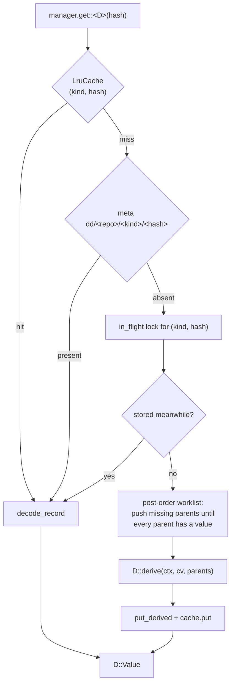

# Derived data

A derived value is a pure function of a change version's content and the
same value for its parents. The `derive` module in `rill-core` defines the
`Derivable` trait, the `DeriveManager` that fetches or computes values, and
five built-in derivations: root tree, generation, change summary, path
history and blame. The invariant that makes the framework simple: a derived
value is keyed by `(kind@version, version hash)`, and a change version is
immutable, so nothing is ever invalidated. A new version is a new key; a
changed algorithm is a new `VERSION` and therefore a new key family.

## Flow

## Traits and context

| Item | Role |
| --- | --- |
| `Derivable::KIND` | short name in the storage key (`root`, `gen`, `summary`, `phist`) |
| `Derivable::VERSION` | `u8` computation version; `derived_kind_key::<D>()` = `"{KIND}@{VERSION}"` |
| `Derivable::NEEDS_PARENTS` | default `true`; when `false` the manager passes an empty `parents` vector and never walks ancestors |
| `Derivable::Value` | `Serialize + DeserializeOwned + Clone`; stored with `encode_record` |
| `Derivable::derive(ctx, cv, parents)` | `parents[i]` is the value for `cv.parents[i]` |
| `DeriveCtx` | `repo()`, `trees()` (`TreeOps`), `objects()`, `manager()` for cross-derivable lookups; implements `RootLookup` by delegating to `RootTree` |
| `DeriveManager::new(repo, trees, cache_size)` | one per repository; the server builds it with `DERIVE_CACHE = 8192` and a `TreeOps` cache of `DEFAULT_TREE_CACHE = 4096` trees |

## Manager

`get::<D>(hash)`:

1. `load`: cache lookup on `(kind, hash)`, else `repo.get_derived(kind,
   hash)` from the `dd/` table, caching the encoded bytes.
2. On a miss, take the per-key `Arc<Mutex<()>>` from `in_flight`
   (`DashMap`) so concurrent requests for one value compute it once and the
   rest read it from the store after the lock is released.
3. `compute`: an explicit stack in post-order. The target is pushed; for a
   `NEEDS_PARENTS` derivation, every parent without a stored value is
   pushed above it. A version is derived once all of its parents have
   stored values, stored immediately, and popped. Histories can be millions
   of versions deep, so there is no recursion. A parent value that vanishes
   between the check and the read is `Error::Derive { kind, hash, reason }`.
4. Missing versions surface as `Error::ChangeNotFound(hash)` from
   `manager.change()`.

`get_keyed` / `put_keyed` read and write arbitrary `(kind, ObjectHash)`
rows without the `Derivable` machinery; blame uses them with a key that
digests `(version, path)`.

Storage: `dd/<repo>/<kind>/<hash>` in the meta store (see
[storage](storage.md)). The in-process cache is `LruCache<(String,
ObjectHash), Bytes>` with approximate LRU (oldest eighth evicted when full);
values are decoded on every hit. Entries are never removed from the store
or the cache except by eviction.

## Built-in derivations

| Derivation | Key | `Value` | Parents | What `derive` does |
| --- | --- | --- | --- | --- |
| `RootTree` | `root@1` | `TreeHash` | yes | `trees.materialize(parents[0], cv, ctx)`: apply `subtree_changes` then `file_changes` to the first parent's tree; a conflict contributes its first add. Subtree copies resolve `from_version` through `ctx` as `RootLookup`, which recursively derives that version's root. |
| `Generation` | `gen@1` | `u64` | yes | `1 + max(parents)`, 1 for a root; used by the commit graph to prune ancestry walks |
| `ChangeSummary` | `summary@1` | `ChangeSummary` | no | reads the first parent's root through `manager.get::<RootTree>` and, per path, `file_state` before the change; counts added / modified / deleted / conflicted files, `bytes_added`, `bytes_removed`, touched extensions (`languages`), `top_level_dirs`, `subtree_changes` |
| `PathHistory` | `phist@1` | `ObjectHash` of a `HistoryNode` | yes | builds a trie of the touched paths and rewrites only the `HistoryNode`s along those paths, sharing every other node with the first parent's history; nodes are `Encodable` with kind `Derived` and live in the object store, not in `dd/` |
| `Blame` | `blame@1` via `get_keyed` | `Vec<BlameLine>` per `(version, path)` | manual | walks first parents back to a stored blame, the file's creation, or its absence; replays forward one line diff at a time, storing every intermediate `(version, path)` so later requests on the path are incremental |

`HistoryNode { entries: BTreeMap<String, HistoryEntry { version, subtree:
Option<ObjectHash> }> }` records, per entry, the last version along the
first-parent line that touched that name or anything beneath it; `subtree`
is `None` for files and for directories replaced wholesale by a subtree
copy. `DeriveManager::history(path, from, limit)` follows the links: the
node at `from` names the last version `v` that touched `path`, the node at
`v`'s first parent names the one before, and so on. The root path yields the
first-parent line itself.

`DeriveManager::blame(version, path)` returns `Error::PathNotFound` when the
path is absent at `version` and `Error::BinaryContent` when any version in
the replay is binary. `BlameLine { version, author, line_no }` attributes a
line to the version that introduced it along the first-parent line; a
stored blame shorter than its file falls back to attributing the extra
lines to the current step.

## What triggers computation

| Trigger | Derivation |
| --- | --- |
| `PutChange` on the server: after `put_change_version`, `derive.get::<RootTree>` is called so an invalid change fails the request, not a later read | `RootTree` |
| Any tree read (`common.rs` root lookups, review content, lander rebase and revert, conflict graph, post-land worker) | `RootTree` on demand, ancestors first |
| `GetDerived` RPC with `compute` set | `root@1`, `phist@1`, `gen@1`, `summary@1` on demand; any other kind is read as stored |
| History and blame RPCs, review agent context | `PathHistory`, `Blame` |
| Commit-graph ancestry queries | `Generation` |

There is no background derivation worker; every value is computed lazily
by the first reader. Because the key includes the version hash, a rebase or
amend produces a new version and starts from its parents' already-stored
values. Recomputation of an existing key never happens; bumping
`Derivable::VERSION` leaves the old `kind@old` rows in `dd/` unread.

## Limitations

* `dd/` rows and `Derived` objects are never deleted; there is no garbage
  collection or size bound in the store, only the in-process cache limit.
* `compute` holds the `in_flight` lock for the target key only; parallel
  requests for different descendants of the same missing ancestor can both
  derive that ancestor (last `put_derived` wins, values are equal).
* `ChangeSummary` is `NEEDS_PARENTS = false` but still derives the first
  parent's `RootTree`, which in turn walks the whole first-parent line if
  nothing is stored yet.
* History and blame follow first parents only; changes reachable only
  through a merge's second parent are not visited, matching how
  `file_changes` are stored.
* Blame is not reachable through the `GetDerived` compute path; only the
  blame RPC and review agents populate it.

## Code

* [derive/mod.rs](../../crates/rill-core/src/derive/mod.rs), [derive/traits.rs](../../crates/rill-core/src/derive/traits.rs), [derive/ctx.rs](../../crates/rill-core/src/derive/ctx.rs), [derive/manager.rs](../../crates/rill-core/src/derive/manager.rs)
* [derive/root_tree.rs](../../crates/rill-core/src/derive/root_tree.rs), [derive/generation.rs](../../crates/rill-core/src/derive/generation.rs), [derive/summary.rs](../../crates/rill-core/src/derive/summary.rs), [derive/history.rs](../../crates/rill-core/src/derive/history.rs), [derive/blame.rs](../../crates/rill-core/src/derive/blame.rs)
* [tree/materialize.rs](../../crates/rill-core/src/tree/materialize.rs), [util/lru.rs](../../crates/rill-core/src/util/lru.rs)
* [rill-server services/repo/refs.rs](../../crates/rill-server/src/services/repo/refs.rs): `derived()` compute dispatch; [services/repo/write.rs](../../crates/rill-server/src/services/repo/write.rs): eager root tree on `PutChange`; [state/registry.rs](../../crates/rill-server/src/state/registry.rs): manager construction.

## See

* [Objects](objects.md): `ChangeVersion` and why the root tree is not a field.
* [Storage](storage.md): the `dd/` table and `ObjectKind::Derived`.
* [Blobs](blobs.md): `read_content`, used by blame.
