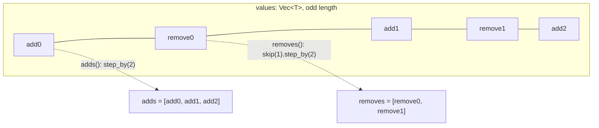

# Merge algebra

`Merge<T>` is the representation of a merge result that never fails. A value
of `Merge<T>` is the formal sum `A + (C − B) + (E − D)`: N+1 *adds* (the
sides) and N *removes* (the bases). A resolved value is one add and no
removes. Because the representation is closed under further merging and
rebasing, a conflict is ordinary data that travels through any number of
operations without nesting; it is stored inside a change as
`FileChange::Conflict(Merge<FileState>)`. The invariant that keeps the
algebra sound: terms are stored interleaved, and `simplify` cancels pairs on
separate add and remove lists, never on the interleaved vector.

## Structure



| Constructor | Shape | Use |
| --- | --- | --- |
| `Merge::resolved(v)` | `[v]` | a conflict-free value |
| `Merge::absent()` | `[None]` as `Merge<Option<T>>` | "deleted" with no conflict |
| `Merge::three_way(base, left, right)` | `[left, base, right]` = `left + (right − base)` | one three-way merge |
| `Merge::from_removes_adds(removes, adds)` | interleaves; panics unless `adds.len() == removes.len() + 1` | rebuilding after simplification, N-way merges |
| `Merge::from_vec(values)` | as given; `Err(Error::InvalidMerge)` on even length | decoding externally supplied term lists |

| Accessor | Result |
| --- | --- |
| `num_sides()` | `len / 2 + 1` |
| `is_resolved()` / `as_resolved()` / `into_resolved()` | `len == 1` |
| `first()` | `add0`, conventionally "our" side; the state a tree is materialized from when a conflict is still open |
| `adds()`, `removes()`, `iter()`, `as_slice()`, `into_vec()` | views over the terms |
| `map`, `into_map`, `try_map`, `zip` | shape-preserving transforms; `zip` panics on mismatched shapes |
| `Merge<Option<T>>::is_absent()` / `is_present_everywhere()` | every term `None` / every term `Some` |
| `Debug` | `Resolved(v)` or `Conflict(a0 - r0 + a1 ...)` |

Serde derives on the struct encode the interleaved vector as-is, so a
conflict inside a `ChangeVersion` hashes deterministically like every other
field.

## Simplify and trivial resolution

`simplify` (requires `T: PartialEq`) splits the terms into `adds` and
`removes`, then repeatedly removes one add and one equal remove until no
equal pair exists, restarting the scan from the first add after every
cancellation so a later add can cancel an earlier remove. The result is
rebuilt with `from_removes_adds`. The value is unchanged; only the term count
drops. Deleting a pair from the interleaved vector instead would shift the
parity of every term between them and turn adds into removes.

`resolve_trivial` returns a value when, after simplification, the merge is
resolved or all remaining adds are equal (both sides made the same change).
It returns a reference into `self`, found by equality, so the caller keeps
borrowing the original. `into_trivially_resolved` is the owned form; on
failure it returns the simplified merge.

`Merge<Merge<T>>::flatten` substitutes inner merges into the outer one by
concatenating term lists. An inner list has odd length, so splicing keeps
the outer interleaving; at a remove slot the inner terms land on alternating
remove/add positions, which negates the inner value term by term
(`−(a0 − r0 + a1) == −a0 + r0 − a1`).

## Conflicts inside a change

`FileState = Option<(ContentRef, FileKind)>`; `None` is "absent on this
side". `rill-core` produces a `FileChange` for a path by:

1. taking each side's terms: a side that is itself a conflicted version
   contributes its stored `Merge<FileState>` (`tip_terms`), otherwise
   `Merge::resolved(state)`;
2. forming `Merge::three_way(Merge::resolved(base), left, right).flatten()`;
3. `merge_file_state`: `simplify`, then `resolve_trivial`; a hit becomes
   `Set` or `Delete`. Otherwise, when every term is present, all of the same
   non-symlink kind and none is binary, the contents are text-merged; a
   clean text merge is stored and returned as `Set`, anything else is
   `FileChange::Conflict(terms)` carrying the simplified terms.

When the tree of a conflicted version is materialized, `terms.first()`
supplies the entry (or deletes it if the first add is `None`), so trees never
contain conflict markers; the conflict exists only in the change.

## Worked example

Base `A`, left side wrote `C`, right side wrote `B`. The merge is
`C + (B − A)`, stored as `[C, A, B]`; `num_sides() == 2`; `resolve_trivial()`
is `None` because `C ≠ B`.

Rebase that conflict onto `D` (three-way with base `C`, left `D`, right the
conflict):

```text
three_way(resolved(C), resolved(D), [C, A, B])
  = [[D], [C], [C, A, B]]      outer: D + (conflict − C)
flatten
  = [D, C, C, A, B]            D − C + C − A + B
simplify   (adds [D, C, B], removes [C, A])
  = [D, A, B]                  D + (B − A)
```

The base `C` cancelled; the conflict follows the rebase with the new side
`D` in place of `C`, exactly as a clean change would. Reverting a conflict
cancels completely: `E = C + (B − A)`, then `E + (C − E)` flattens to
`[C, A, B, C, A, B, C]` and simplifies to `[C]`, resolved. Both derivations
are the tests `rebase_simplifies_away_base` and `revert_of_conflict_is_clean`.

If instead both sides wrote `B`, `[B, A, B]` does not simplify (no add equals
the remove `A`) but `resolve_trivial()` returns `B` because all adds agree.

## Invariants

| Invariant | Enforced by |
| --- | --- |
| `values.len()` is odd | every constructor; `from_vec` returns `Error::InvalidMerge` |
| adds are at even indices, removes at odd | `adds()`/`removes()` definitions; `simplify` rebuilds through `from_removes_adds` |
| `simplify` never changes the value, only the term count | cancelling `x` on both sides of `+x − x` |
| `zip` requires equal shapes | `assert_eq!` on lengths |
| `first()` is the conventional "ours" | callers: `three_way` puts `left` first |

## Limitations

* `simplify` is O(adds × removes) per cancellation with a restart; merges
  are small (one term per side) so this never matters, but a pathological
  N-way merge would be quadratic.
* `from_removes_adds` and `zip` panic on shape errors rather than returning
  `Result`; callers construct shapes from known-good inputs.
* `Merge<T>` carries no record of which side is which beyond position;
  provenance of a term (which parent, which workspace) is not stored.

## Code

* [merge.rs](../../crates/rill-types/src/merge.rs): the algebra and its tests.
* [objects/change.rs](../../crates/rill-types/src/objects/change.rs): `FileChange::Conflict`, `FileState`.
* [rill-core merge/state.rs](../../crates/rill-core/src/merge/state.rs): `merge_file_state`, algebra first, text second.
* [rill-core merge/change.rs](../../crates/rill-core/src/merge/change.rs): `tip_terms`, `merge_path`.
* [rill-core tree/materialize.rs](../../crates/rill-core/src/tree/materialize.rs): first add wins when building a tree.

## See

* [Objects](objects.md): `ChangeVersion` and `FileChange`.
* [Derived data](derived-data.md): root trees from conflicted versions.
* [docs/ARCHITECTURE.md](../../docs/ARCHITECTURE.md): principle 5, conflicts are data.
