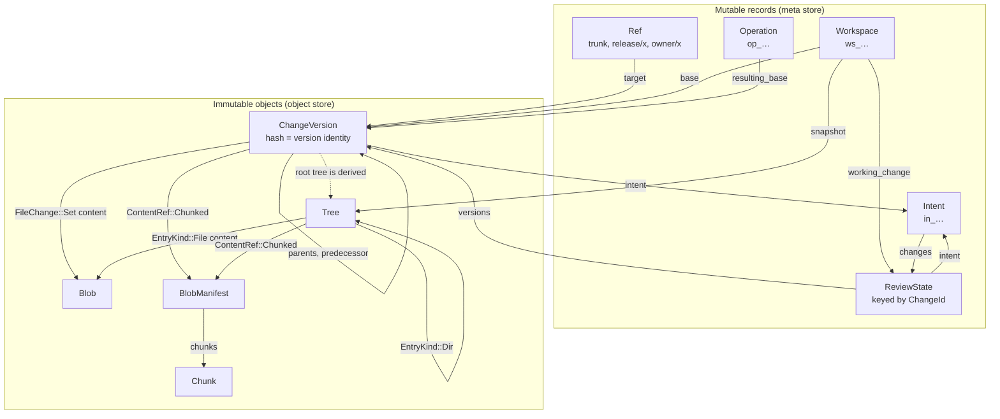

# Object model

Everything Rill stores is either an immutable, content-addressed object or a
small mutable record that points at one. Immutable objects (`Blob`, `Chunk`,
`BlobManifest`, `Tree`, `ChangeVersion`, derived nodes) are named by the
BLAKE3 digest of their canonical encoding; mutable records (refs, workspaces,
review state, intents) are named by random 128-bit ids or by a string key.
The invariant that holds everything together: a `ChangeVersion`'s hash is the
identity of one concrete version, while its `change_id` is the identity of
the change across every amend and rebase. All of this lives in `rill-types`,
which has no I/O.

## Relationships

## Identity

| Type | Width | Prefix | How it is produced |
| --- | --- | --- | --- |
| `ObjectHash` | 32 bytes | none; hex | `ObjectHash::digest(kind, bytes)` = BLAKE3 over `"rill:" ++ kind.as_str() ++ ":" ++ bytes` |
| `ChangeId` | 16 bytes | `ch_` | `ChangeId::new()` (random) or `ChangeId::derived(namespace, name)` (BLAKE3 of `"rill:id:ch:<ns>:<name>"`, first 16 bytes) |
| `IntentId` | 16 bytes | `in_` | same macro |
| `WorkspaceId` | 16 bytes | `ws_` | same macro |
| `PrincipalId` | 16 bytes | `pr_` | same macro; `Principal::human/agent/service` use `derived(kind, name)` |
| `RepoId` | 16 bytes | `rp_` | same macro |
| `OperationId` | 16 bytes | `op_` | same macro; doubles as the idempotency key for write RPCs |
| `TrunkSeq` | `u64` | `trunk@N` | assigned by `RepoStore::land_on_trunk`, gap-free |
| `RefName` | string ≤ 256 | none | validated: `[A-Za-z0-9/_.:@-]`, no leading/trailing `/`, no `//`, no `..` |

`ObjectKind` is mixed into every hash as a domain separator, so a blob whose
bytes equal a tree's encoding never collides with that tree. The kinds are
`Blob=1`, `Chunk=2`, `BlobManifest=3`, `Tree=4`, `ChangeVersion=5`,
`Derived=6`; `as_str()` yields `blob`, `chunk`, `manifest`, `tree`, `cv`,
`derived`, which also name the directories in the object store layout.
`ObjectHash::ZERO` is a sentinel that no digest produces.

`ObjectHash::digest_parallel` uses BLAKE3's rayon tree hashing; the store's
`verify` switches to it at 1 MiB. `ObjectHash::hasher(kind)` is the streaming
form and produces the same digest as the one-shot call.

## Canonical encoding

Every `Encodable` type declares `KIND`, `VERSION` (a `u8`) and `NAME`.
`encode` writes one version byte followed by the postcard body; `decode`
refuses any other version byte with `Error::UnsupportedFormat { kind, found,
expected }`. `hash()` is `ObjectHash::digest(KIND, encode())`.

Determinism rests on three facts:

* postcard has no map reordering and no whitespace;
* every map in the object model is a `BTreeMap`, so iteration order is the
  key order;
* no postcard-encoded type uses `skip_serializing_if`. A field that is
  sometimes written and sometimes omitted would give one value two
  encodings and therefore two hashes. `#[serde(default)]` is allowed (it
  only affects decoding) and is used on every field added after v1.

| Encodable type | `KIND` | `VERSION` |
| --- | --- | --- |
| `ChangeVersion` | `ChangeVersion` | 1 |
| `Tree` | `Tree` | 1 |
| `BlobManifest` | `BlobManifest` | 1 |
| `HistoryNode` (rill-core) | `Derived` | 1 |

Blobs and chunks are not `Encodable`: their bytes are the file content
itself, hashed under `Blob` or `Chunk` with no version byte.

Mutable records are encoded by `rill-store::repo::encode_record`, which is
the same shape (version byte `1` + postcard) but is never hashed; see
[storage](storage.md).

## Objects and records

| Type | Addressed by | Fields |
| --- | --- | --- |
| `Blob` | `ObjectHash` (kind `Blob`) | raw bytes; `≤ 1 MiB` before chunking applies |
| `Chunk` | `ObjectHash` (kind `Chunk`) | raw bytes of one FastCDC chunk |
| `BlobManifest` | `ObjectHash` (kind `BlobManifest`) | `total_size: u64`, `chunks: Vec<ChunkRef { hash, size: u32 }>` |
| `ContentRef` | inline in a change or tree | `Inline { bytes }` (≤ `INLINE_THRESHOLD` = 256 B), `Blob { hash, size }`, `Chunked { hash, size }` |
| `Tree` | `ObjectHash` (kind `Tree`) | `entries: BTreeMap<String, TreeEntry>`; entry `kind` is `File { content: ContentRef, kind: FileKind }` or `Dir { hash: TreeHash, summary: DirSummary }` |
| `DirSummary` | inline on a `Dir` entry | `file_count`, `dir_count`, `total_size`; `Tree::summary()` aggregates children so size queries never walk |
| `FileKind` | inline | `Regular`, `Executable`, `Symlink` (the only modes) |
| `ChangeVersion` | `ObjectHash` (kind `ChangeVersion`) | see below |
| `ChangeInfo` | `ci/` record, keyed by version hash | projection of a version without `file_changes`: `hash`, `change_id`, `parents`, `predecessor`, `author`, `provenance`, `intent`, `message`, `created_at`, `files_changed`, `has_conflicts`, `trunk_seq` |
| `Signature` | `sig/` record, keyed by version hash | `signer: Principal`, `public_key` (Ed25519, 32 B), `signature` (64 B), `signed_at`; stored beside the version, never inside its hash |
| `RefUpdate` | request, not stored | `name`, `expected: Option<hash>` (`None` = must not exist), `target: Option<hash>` (`None` = delete) |
| `Workspace` | `WorkspaceId` | `id`, `repo`, `owner: Principal`, `name`, `base: ChangeVersionHash`, `working_change: ChangeId`, `snapshot: Option<TreeHash>`, `sparse: SparseProfile`, `head_op: Option<OperationId>`, `created_at`, `updated_at` |
| `Operation` | `OperationId`, sequenced per workspace | `id`, `workspace`, `parent`, `actor`, `kind: OperationKind`, `resulting_base`, `resulting_snapshot`, `at` |
| `SparseProfile` | inline in `Workspace` | `include`, `exclude` directory prefixes; empty `include` means the whole repo; `exclude` wins |
| `ReviewState` | `ChangeId` | `change_id`, `versions` (creation order, last is current), `status`, `intent`, `owner`, `votes: Vec<LabelVote>`, `threads: Vec<Thread>`, `risk: RiskClass`, `risk_reasons`, `stack: Vec<ChangeId>`, `landed_seq`, `created_at`, `updated_at`, `extra` |
| `Label` | configuration | `name`, `range: LabelRange { min, max }` (i8), `copy_on_trivial_rebase`, `max_requires_human`; built-ins `Review` (−2..+2), `Verified` (−1..+1), `Owner` (−1..+1, max requires human) |
| `LabelVote` | inside `ReviewState` | `label`, `value`, `voter`, `version` (votes are per version), `voted_at`, `reason` |
| `Thread` | inside `ReviewState` | `id: String`, `anchor: ThreadAnchor` (`Change`, `File { version, path }`, `Lines { version, path, start, end, context_hash }`), `comments: Vec<Comment>`, `resolved`, `to` |
| `Comment` | inside `Thread` | `author`, `body`, `created_at`, `category: Option<CommentCategory>`, `confidence: Option<u8>` |
| `Intent` | `IntentId` | `id`, `title`, `body`, `kind: IntentKind`, `status: IntentStatus`, `owner`, `parent`, `risk_override: Option<RiskClass>`, `changes: Vec<ChangeId>`, `created_at`, `updated_at` |
| `Principal` | `PrincipalId` (embedded by value wherever used) | `id`, `kind: PrincipalKind` (`Human`, `Agent`, `Service`), `name`, `identity: Option<String>`; displays as `alice`, `agent:x`, `svc:x` |
| `Timestamp` | inline | `i64` milliseconds since the Unix epoch, UTC; serde-transparent; formats as RFC 3339 |
| `RepoPathBuf` | inline | normalized `/`-separated relative path; empty is the root; rejects `.`, `..`, empty components, `\`, NUL |

Enum vocabularies: `IntentKind` = `Feature | Bug | Refactor | Chore |
Experiment | System`; `IntentStatus` = `Open | InProgress | Done |
Abandoned`; `RiskClass` = `Trivial < Low < Normal < Sensitive < Critical`
(`bump()` moves one step up, capped); `ReviewStatus` = `Draft | Open |
Landable | Landing | Landed | Abandoned`; `OperationKind` = `Create |
Snapshot | NewChange | Describe | Rebase | Resolve | SetSparse | Handoff |
Undo | Other`.

## ChangeVersion

| Field | Type | Meaning |
| --- | --- | --- |
| `change_id` | `ChangeId` | stable identity; unchanged by amend and rebase |
| `parents` | `Vec<ChangeVersionHash>` | empty for a root, one for a linear change, more for a merge |
| `predecessor` | `Option<ChangeVersionHash>` | the version this one amends or rebases; walks a change's evolution |
| `subtree_changes` | `BTreeMap<RepoPathBuf, SubtreeChange>` | whole-directory `Copy { from_path, from_version }` (shallow, reuses the tree hash) or `Delete`; applied before file changes |
| `file_changes` | `BTreeMap<RepoPathBuf, FileChange>` | per-path effect relative to `parents[0]` |
| `author` | `Principal` | who authored it |
| `provenance` | `Provenance` | `tool`, `model`, `session`, `prompt_ref`, `sponsor: Option<Principal>`, `resolved_by`, `extra: BTreeMap<String, String>`; hashed into the version |
| `intent` | `Option<IntentId>` | the why |
| `message` | `String` | `summary()` is the first line |
| `created_at` | `Timestamp` | |
| `extra` | `BTreeMap<String, Bytes>` | forward-compatible extension slots |

`FileChange` has three variants and no add/modify distinction:

| Variant | Meaning |
| --- | --- |
| `Set { content: ContentRef, kind: FileKind, copy_from: Option<CopySource { path, version }> }` | the path now has this content; a rename is a `Set` with `copy_from` plus a `Delete` of the source |
| `Delete` | the path no longer exists; may be a prefix of `Set` paths (file replaced by directory) |
| `Conflict(Merge<FileState>)` | unresolved; each term is `Option<(ContentRef, FileKind)>`, `None` meaning absent on that side. See [merge algebra](merge-algebra.md) |

`has_conflicts()` and `conflicted_paths()` scan `file_changes`;
`resolved_state()` returns `None` for a conflict. The root tree is not a
field: it is computed from `parents[0]`'s tree plus the changes, and cached
as [derived data](derived-data.md). When a tree is materialized from a
conflicted version the first add's state is used, so trees are always
plain; the conflict lives only in the change.

## Limitations

* A `ChangeVersion` is hashed without its signatures; a signature is
  evidence about a hash, stored in `sig/`, and nothing in `rill-types`
  verifies one.
* `ChangeInfo.files_changed` counts `file_changes` entries only;
  `subtree_changes` are not included.
* `Principal.identity` and `Provenance` are informational: no type-level
  validation of SPIFFE ids, model names or session references.
* `RefName` validation accepts any shape that passes the character rules;
  the `trunk` / `release/` / `<owner>/` taxonomy is convention, enforced by
  callers.
* `Merge<T>` terms inside `FileChange::Conflict` are stored interleaved;
  nothing in the type prevents a caller from building a merge whose adds
  reference content that was never uploaded.

## Code

* [ids.rs](../../crates/rill-types/src/ids.rs), [hash.rs](../../crates/rill-types/src/hash.rs), [encoding.rs](../../crates/rill-types/src/encoding.rs), [time.rs](../../crates/rill-types/src/time.rs), [path.rs](../../crates/rill-types/src/path.rs), [principal.rs](../../crates/rill-types/src/principal.rs)
* [objects/blob.rs](../../crates/rill-types/src/objects/blob.rs), [objects/tree.rs](../../crates/rill-types/src/objects/tree.rs), [objects/change.rs](../../crates/rill-types/src/objects/change.rs)
* [objects/refs.rs](../../crates/rill-types/src/objects/refs.rs), [objects/workspace.rs](../../crates/rill-types/src/objects/workspace.rs), [objects/review.rs](../../crates/rill-types/src/objects/review.rs), [objects/intent.rs](../../crates/rill-types/src/objects/intent.rs)
* [error.rs](../../crates/rill-types/src/error.rs)

## See

* [Merge algebra](merge-algebra.md): `Merge<T>` and conflicts as data.
* [Storage](storage.md): where each object and record lives, and the keys.
* [Blobs](blobs.md): inline, blob and chunked content.
* [Derived data](derived-data.md): root trees, generations, history, blame.
* [docs/ARCHITECTURE.md](../../docs/ARCHITECTURE.md): principles and invariants.
