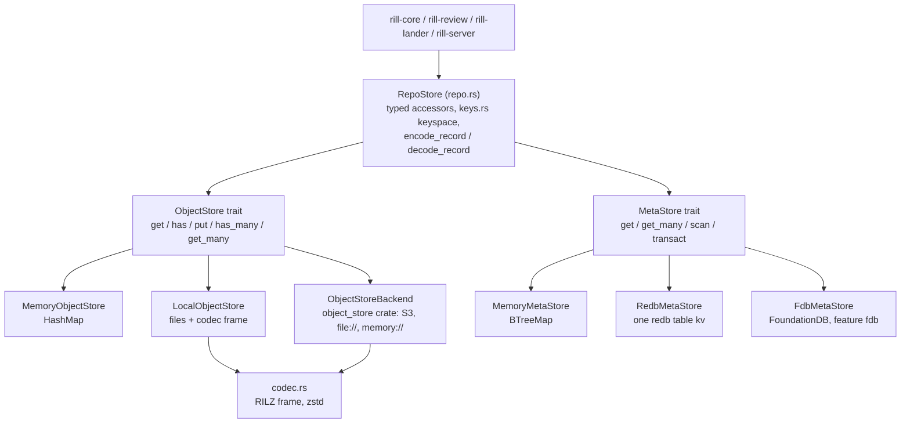

# Storage

`rill-store` splits persistence into two traits with different access
patterns: `ObjectStore`, an immutable content-addressed byte store keyed by
`(ObjectKind, ObjectHash)`, and `MetaStore`, an ordered key-value space with
conditional, atomic transactions for everything mutable or sequenced.
`RepoStore` layers a typed keyspace for one repository over the pair so
services never build raw keys. The invariant every backend shares: `put`
verifies that the bytes hash to the claimed identity, and a `MetaStore`
transaction commits all of its mutations or none, only when every condition
holds.

## Layering

## ObjectStore

| Method | Semantics |
| --- | --- |
| `get(kind, hash)` | `Ok(None)` when absent |
| `has(kind, hash)` | existence |
| `put(kind, hash, bytes)` | `verify` first: `Error::HashMismatch { expected, actual }` if the digest differs; storing an existing object is a no-op and never overwrites |
| `has_many`, `get_many` | default loops; local and S3 override |

`verify` hashes under the kind's domain separator and uses
`digest_parallel` for payloads of 1 MiB or more. `ObjectStoreExt` (blanket
impl) adds `get_required` (`Error::ObjectNotFound`), `put_object<T:
Encodable>` (encode, hash, put, return hash), `get_object`,
`get_object_required` and `put_blob`.

## MetaStore

A `Transaction` is a list of `Condition`s and `Mutation`s.

| Item | Variants |
| --- | --- |
| `Condition` | `Equals { key, value: Option<Bytes> }` (`None` = must be absent), `Absent { key }`, `Present { key }` |
| `Mutation` | `Set { key, value }`, `Delete { key }`, `AppendLog { prefix, value }` |
| `TxOutcome` | `appended: Vec<u64>`, one sequence per `AppendLog`, in order |

`transact` checks every condition against one snapshot before applying any
mutation and returns `Error::Conflict(..)` if a condition fails; nothing is
written in that case. `AppendLog` writes `prefix ++ be64(seq)` where `seq` is
one more than the highest existing key under the prefix (1 for an empty
log), so sequences are dense and lexical order is numeric order
(`seq_key`, `seq_from_key`). `scan(KeyRange)` takes inclusive/exclusive
bounds, `limit` and `reverse`; `KeyRange::prefix` computes its end with
`prefix_end` (increment the last non-0xFF byte). `set` is sugar for a
one-mutation transaction.

## Keyspace

Every key is `<table>/<repo-id bytes>/...`, joined with `/`, so one prefix
scan covers a repo's rows in a table and deleting a repo is a prefix delete
per table. Ids and hashes are raw bytes (16 and 32), not hex.

| Table | Key | Value | Written by |
| --- | --- | --- | --- |
| `cv` | `cv/<repo>/<hash>` | encoded `ChangeVersion` | declared in `keys::table`; not used by `RepoStore`, versions live in the object store |
| `ci` | `ci/<repo>/<hash>` | record `ChangeInfo` (with `trunk_seq: None`) | `put_change_version` |
| `sig` | `sig/<repo>/<hash>` | record `Vec<Signature>` | `put_signatures` |
| `ch` | `ch/<repo>/<change-id>` | record `ReviewState` | `put_review` (optional CAS on the previous encoding) |
| `log` | `log/<repo>/<be64 seq>` | version hash | `put_change_version` via `AppendLog`; the write-ahead log of every version |
| `chv` | `chv/<repo>/<change-id>/<be64 seq>` | version hash | `put_change_version` via `AppendLog`; versions of a change in order |
| `trunk` | `trunk/<repo>/<be64 seq>` | version hash | `land_on_trunk` |
| `trunkh` | `trunkh/<repo>/<hash>` | be64 seq | `land_on_trunk`; reverse index for `trunk_seq_of` |
| `ref` | `ref/<repo>/<name>` | version hash | `update_ref`, `land_on_trunk` (for `trunk`) |
| `ws` | `ws/<repo>/<workspace-id>` | record `Workspace` | `put_workspace`, `append_operation` |
| `op` | `op/<repo>/<workspace-id>/<be64 seq>` | record `Operation` | `append_operation` via `AppendLog` |
| `opi` | `opi/<repo>/<operation-id>` | be64 seq | `append_operation`; idempotency lookup (`has_operation`) |
| `in` | `in/<repo>/<intent-id>` | record `Intent` | `put_intent` |
| `dd` | `dd/<repo>/<kind>/<hash>` | derived bytes | `put_derived`; `kind` is `name@version`, see [derived data](derived-data.md) |
| `repo` | `repo/<repo-id>` | record `RepoConfig { id, name, description, created_at, trunk }` | `Stores::create_repo` |
| `repon` | `repon/<name>` | repo id bytes | `Stores::create_repo` (`expect_absent` makes names unique) |
| `rebac` | `rebac/<repo>/<object>/<relation>/<subject>` | empty | `add_relation` |
| `misc` | `misc/<repo>/<name>` | arbitrary bytes (policy text, settings) | `set_misc` |

Records are framed by `encode_record`: one version byte (`RECORD_VERSION =
1`) followed by postcard; `decode_record` rejects any other version byte
with `Error::Codec`. Records are not hashed, so `#[serde(default)]` fields
can be added freely.

## RepoStore

`Stores { objects: Arc<dyn ObjectStore>, meta: Arc<dyn MetaStore> }` is the
deployment pair; `Stores::repo(id)` yields a `RepoStore`.

| Accessor | Transaction boundary |
| --- | --- |
| `put_change_version(cv)` | returns early if `ci/` exists; else `put_object` to the object store, then one meta transaction: `ci/` set + `AppendLog log/` + `AppendLog chv/`. The object put and the meta transaction are not atomic with each other. |
| `get_change_version`, `get_change_version_required` | object store read by hash |
| `get_change_info` | `ci/` read, then `trunkh/` read to fill `trunk_seq` |
| `change_versions(id)` | prefix scan of `chv/` |
| `log_after(after, limit)`, `log_head()` | range scan of `log/`; head is a reverse scan with limit 1 |
| `update_ref(name, expected, target)` | one transaction: `Equals(expected)` + set or delete; `Error::Conflict` on mismatch |
| `land_on_trunk(expected, hash)` | reads `trunk_head` (reverse scan), then one transaction: `Equals(ref/trunk == expected)`, `Absent(trunk/<seq>)`, set `ref/trunk`, `trunk/<seq>`, `trunkh/<hash>`. Returns `TrunkSeq`; a racing lander gets `Error::Conflict("trunk moved")` or a failed condition. |
| `trunk_head`, `trunk_at`, `trunk_seq_of`, `trunk_range(from, to]` | scans and point reads over `trunk/`, `trunkh/` |
| `put_review(state, expected)` | optional `Equals` on the previous record encoding, then set |
| `append_operation(ws, op)` | transaction: `Absent(opi/<op>)` + `AppendLog op/` + set `ws/`; then a second, separate `set` of `opi/<op>` → seq |
| `list_operations(ws, limit)` | reverse scan with limit, then reversed: the newest `limit` operations, oldest first |
| `put_workspace`, `delete_workspace`, `list_workspaces` | single-key writes and a prefix scan |
| `put_intent`, `get_intent`, `list_intents` | single-key writes and a prefix scan |
| `get_derived`, `put_derived` | `dd/` point reads and unconditional sets |
| `add_relation`, `remove_relation`, `relations_of` | `rebac/` set, delete, prefix scan |

## Backends

| Backend | Feature | Trait | Storage | Tested |
| --- | --- | --- | --- | --- |
| `MemoryObjectStore` | always | `ObjectStore` | `RwLock<HashMap<(kind, hash), Bytes>>` | unit tests, conformance; the reference semantics |
| `MemoryMetaStore` | always | `MetaStore` | `RwLock<BTreeMap<Bytes, Bytes>>`; `transact` holds the write lock across check and apply | unit tests, conformance |
| `LocalObjectStore` | `local` (default) | `ObjectStore` | `<root>/<kind>/<hh>/<hash-hex>`, each file a codec frame | unit tests, conformance via `LocalStores::open` |
| `RedbMetaStore` | `local` (default) | `MetaStore` | single redb file, one table `kv`; `temporary()` uses redb's in-memory backend | unit tests, conformance |
| `ObjectStoreBackend` | `s3` | `ObjectStore` | `<prefix>/<kind>/<hh>/<hash-hex>` on any `object_store::ObjectStore`; built by `from_url` (`s3://`, `file://`, `memory://`) | unit tests and conformance against `object_store::memory::InMemory` and `file://` only |
| `FdbMetaStore` | `fdb` | `MetaStore` | keys under a byte `prefix` in a FoundationDB cluster | no tests; not wired into the server |

`LocalStores::open(dir)` creates `<dir>/objects` and `<dir>/meta.redb`. The
server's `open_stores` maps `StorageConfig::Memory`, `Local { dir }` and
`S3 { url, prefix, meta_dir }` (S3 objects plus a local redb for metadata);
there is no FDB configuration path.

**Local objects.** Every filesystem call runs under
`tokio::task::spawn_blocking`. `write` creates the shard directory, writes a
`.tmp-<pid>-<counter>-<short hash>` file with `create_new`, fsyncs it,
re-checks for a winner, renames into place and fsyncs the directory. A
reader never sees a partial object; a crash leaves at worst a stray `.tmp-*`
file. `put` of an existing object returns before writing. Compression level
is per store (`open_with_level`, default `codec::DEFAULT_LEVEL = 3`).

**redb meta.** One `Transaction` is one redb write transaction: conditions
are read up front from the write snapshot, checked with the shared
`check_conditions`, then mutations applied in order and committed; any error
aborts. redb serialises writers, which is the isolation the conditional
protocol needs. Reads use `begin_read` on a blocking thread. `apply` mirrors
`MemoryMetaStore::transact` step for step.

**Object store (S3).** `put` verifies and compresses on a blocking thread,
then `put_opts` with `PutMode::Create`; `AlreadyExists` is success because
the content is identical by construction. `has` is a `HEAD`; `has_many` and
`get_many` run 16 requests in flight. Frames over 64 KiB are decompressed
on a blocking thread. Assumptions: the service honours conditional create
(S3-compatible stores without `If-None-Match` support fail `put` with a
backend error), and reads after a successful create return the object
(read-after-write consistency). Credentials and region come from the
environment as `object_store::parse_url` documents.

**FoundationDB meta.** A `Transaction` runs inside `Database::run`, which
retries FDB conflicts and transient errors; store errors (`Conflict`,
`Codec`) are wrapped in `FdbBindingError::CustomError` and returned
unretried. Each condition is a read inside the transaction, so serialisable
isolation makes check and commit atomic. `AppendLog` does a reverse range
read of one key over the prefix, which puts the log tail in the read
conflict range and serialises concurrent appenders. The process must call
`foundationdb::boot` once before use.

## Codec

Persistent object stores wrap bytes in a 7-byte header: `RILZ`, frame
version `1`, method (`Raw = 0`, `Zstd = 1`), zstd level, then the payload.
`compress_with_level` stores raw when the object is under `RAW_THRESHOLD`
(64 bytes) or does not shrink; `decompress` returns `Error::Codec` on bad
magic, version or method. The memory backend stores unframed bytes.

## Limitations

* Only the memory and local backends run in CI conditions; the S3 backend
  is exercised against in-process `object_store` stores, never a real S3
  endpoint, and the FDB backend has no tests at all and no server wiring.
* `put_change_version` is idempotent by a pre-check on `ci/`, not by a
  condition in the transaction; two concurrent first puts of the same
  version can both pass the check and append two `log/` and `chv/` entries
  for one hash.
* `append_operation` writes `opi/` after the transaction commits; a crash
  between the two leaves an operation without its idempotency index.
* `land_on_trunk` computes the next sequence from a read outside the
  transaction; the `Absent(trunk/<seq>)` condition makes a stale read fail
  with `Error::Conflict` rather than reuse a slot.
* `MemoryMetaStore::scan` with `KeyRange::prefix` on an all-0xFF prefix is
  unbounded at the end; only `FdbMetaStore` special-cases this.
* `keys::table::CHANGE_VERSION` (`cv/`) is declared but `RepoStore` keeps
  versions in the object store only.
* No backend deletes objects; there is no garbage collection.

## Code

* [lib.rs](../../crates/rill-store/src/lib.rs), [error.rs](../../crates/rill-store/src/error.rs)
* [object.rs](../../crates/rill-store/src/object.rs), [meta.rs](../../crates/rill-store/src/meta.rs), [codec.rs](../../crates/rill-store/src/codec.rs), [keys.rs](../../crates/rill-store/src/keys.rs), [repo.rs](../../crates/rill-store/src/repo.rs)
* [memory.rs](../../crates/rill-store/src/memory.rs), [local/mod.rs](../../crates/rill-store/src/local/mod.rs), [local/objects.rs](../../crates/rill-store/src/local/objects.rs), [local/meta.rs](../../crates/rill-store/src/local/meta.rs), [s3.rs](../../crates/rill-store/src/s3.rs), [fdb.rs](../../crates/rill-store/src/fdb.rs)
* [tests/conformance.rs](../../crates/rill-store/tests/conformance.rs): one scenario, every backend.
* [rill-server state/app.rs](../../crates/rill-server/src/state/app.rs): `open_stores`.

## See

* [Objects](objects.md): what the stored bytes are.
* [Blobs](blobs.md): how file content maps onto `Blob`, `Chunk` and `BlobManifest` objects.
* [Derived data](derived-data.md): the `dd/` table's consumers.
* [docs/ARCHITECTURE.md](../../docs/ARCHITECTURE.md): every meta write is O(size of change).
