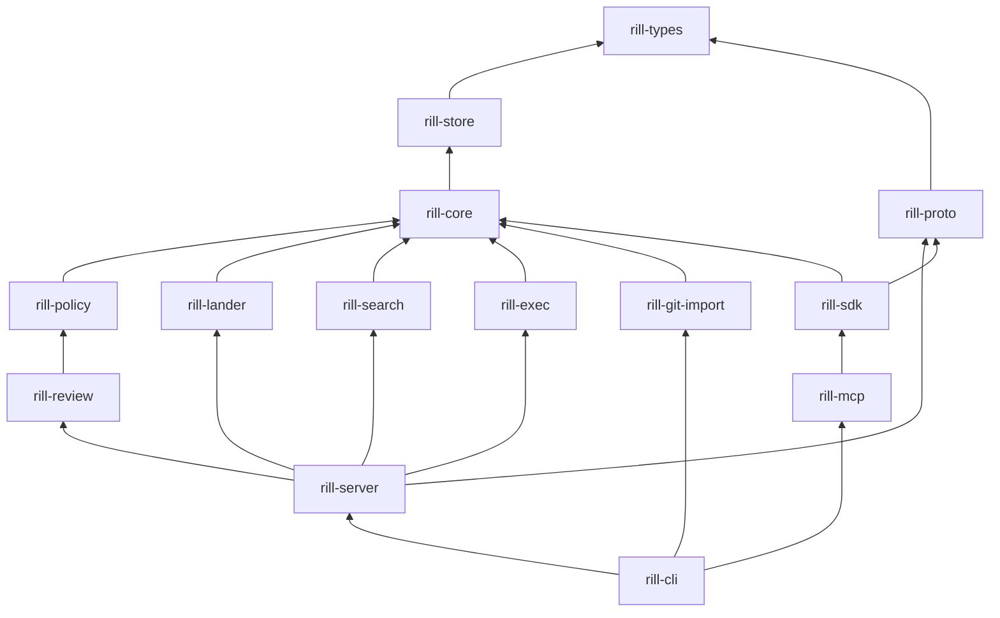

# Development

Rill is one Cargo workspace of fourteen crates under `crates/`, Rust 2021,
`rust-version = 1.85`, resolver 2. The invariant every change must respect
is the layering in `CLAUDE.md`: lower crates never depend on higher ones,
no crate below `rill-proto` depends on tonic, and only `rill-server`
depends on axum. `docs/ARCHITECTURE.md` lists the design decisions that
are treated as invariants rather than preferences.

## Workspace layout

| Path | Contents |
| --- | --- |
| `Cargo.toml` | workspace members, `[workspace.package]`, `[workspace.dependencies]`, build profiles |
| `rustfmt.toml` | `edition = "2021"`, `max_width = 100` |
| `CLAUDE.md` | code style and layering rules for contributors |
| `docs/` | `ARCHITECTURE.md` (short design), `GETTING_STARTED.md`, `USER_GUIDE.md` |
| `architecture/` | these pages: `core/`, `data/`, `policy/`, `workflow/`, `runtime/`, `integrations/`, `engineering/` |
| `research/` | production-readiness briefs |
| `crates/<name>/src` | one crate; `lib.rs` declares modules, `error.rs` holds the `thiserror` enum and `Result<T>` alias |
| `crates/<name>/tests` | cross-module and integration tests ([testing](testing.md)) |
| `crates/rill-proto/proto/rill/v1` | the `.proto` sources |
| `.gitignore` | `/target`, `*.rs.bk`, `.rill/` (checkouts), `*.redb` |

## Layering



Declared rule: `rill-types` ← `rill-store` ← `rill-core` ← `rill-policy` /
`rill-review` / `rill-lander` / `rill-search` / `rill-exec` ← `rill-server`
← `rill-sdk` ← `rill-cli` / `rill-mcp`. Two edges in the manifests refine
it: `rill-sdk` depends on `rill-proto` and `rill-core` but not on
`rill-server` (the SDK is a client of the wire surface, not of the server
crate), and `rill-cli` depends on `rill-mcp` for the shared JSON encoding,
on `rill-server` for the `rill-server` binary and on `rill-git-import`
and `rill-store` for `rill import git`. `rill-git-import` sits beside the
other `rill-core` consumers. The library crates (`core`, `policy`,
`review`, `lander`, `exec`, `search`) have no RPC dependency.

Cross-crate adaptation happens in `rill-server`: `rill-lander` does not
depend on `rill-review`; the server's `ReviewHooksAdapter` bridges them, and
`ExecVerifier` bridges `rill-exec` into the lander's `Verifier` trait.

## Build profiles

| Profile | Settings | Reason |
| --- | --- | --- |
| `dev` | `opt-level = 1`, `debug = "line-tables-only"` | tests and the dev server are usable without a release build; full debuginfo made each test binary several hundred MB, line tables keep backtraces readable |
| `dev.package."*"` | `opt-level = 2` | dependencies (BLAKE3, zstd, redb, regex, cedar) run near release speed in debug builds |
| `test` | `debug = "line-tables-only"` | same size control for test binaries |
| `release` | `lto = "thin"`, `codegen-units = 4`, `debug = 1` | cross-crate inlining with bounded link time; line tables kept for production backtraces |

No `protoc` is needed: `rill-proto/build.rs` compiles the protobufs with
`protox` and embeds the descriptor set ([protocol](../runtime/protocol.md)).
`rill-store` features: `local` (default; redb + files), `s3`
(`object_store`), `fdb` (FoundationDB, needs `libfdb_c` at link time).
`rill-server` enables `s3`; nothing in the workspace enables `fdb` by
default.

## Lints and formatting

* `cargo clippy --all-targets` must be clean and `cargo fmt` a no-op. There
  is no `[workspace.lints]` table; defaults apply, with
  `#![warn(missing_docs)]` in `rill-sdk`, `rill-cli` and `rill-mcp`, and
  `allow(clippy::large_enum_variant, clippy::doc_lazy_continuation)` on the
  generated `rill::v1` module.
* Every public item gets a one-line doc comment. Comments explain
  invariants and non-obvious choices, never what a line does.
* Small modules: one concern per file, ~400 lines is the split signal, a
  folder's `mod.rs` only declares and re-exports. `ARCHITECTURE.md` names
  the files still over the limit (the gRPC handler files and
  `rill-store/src/repo.rs`).
* No `unwrap` outside tests unless a comment proves it cannot fail. No
  `println!` in libraries; `tracing` with structured fields.
* Async is `tokio`; traits crossing crates use `async_trait`; redb and
  filesystem work go through `spawn_blocking`.
* Postcard-encoded serde types never use `skip_serializing_if`.

## Dependency policy

Every external dependency is declared once in `[workspace.dependencies]`
with its version and features; crates reference it as `{ workspace = true
}` and add features locally only when they differ. The internal crates are
declared there too as `path` dependencies. Notable pins: `tonic` /
`tonic-prost` / `prost` 0.14, `axum` 0.8, `redb` 4, `object_store` 0.14,
`cedar-policy` 4, `biscuit-auth` 6, `gix` 0.73 with default features off,
`reqwest` with `rustls-tls` and default features off. Dev-only crates
(`tempfile`, `proptest`, `similar-asserts`) are in the same table.

## Running locally

```
cargo build --workspace
cargo run -p rill-cli --bin rill-server -- --dev        # memory storage, dev principal, :7470 / :7471
cargo run -p rill-cli --bin rill -- --endpoint http://127.0.0.1:7470 repo create demo
cargo run -p rill-cli --bin rill -- --endpoint http://127.0.0.1:7470 checkout demo ./demo
cd demo && echo 'fn main() {}' > main.rs
rill new -m "initial" && rill submit && rill land --wait
```

Inside the checkout the endpoint and repository come from
`.rill/checkout.toml`, so `--endpoint` is needed only until the checkout
exists; `RILL_ENDPOINT`, `RILL_TOKEN` and `RILL_REPO` work everywhere
([cli](../integrations/cli.md)). `rill-server init-config > rill.toml`
writes the annotated default configuration for a persistent server
(`--storage local:<dir>` or the `[storage]` section). `rill-mcp
--endpoint ... --repo demo` runs the agent surface over stdio, and
`rill-mcp --list-tools` prints the tool schemas. `RUST_LOG` controls
logging in all three binaries.

## Where things live

| Concern | Location |
| --- | --- |
| Object model, ids, `Merge<T>`, canonical encoding | `rill-types/src`, `rill-types/src/objects` |
| Store traits, backends, `RepoStore` keyspace | `rill-store/src`, `rill-store/src/local` |
| Diff, merge, trees, graph, derived data | `rill-core/src/{diff,merge,tree,graph,derive}` |
| Risk, Cedar submit, ReBAC, tokens | `rill-policy/src/{risk,submit,rebac,tokens}` |
| Review state machine | `rill-review/src/{lifecycle,votes,threads,agents}` |
| Landing pipeline, post-land | `rill-lander/src/{land,postland}` |
| Search index | `rill-search/src/{index,trigram,symbols,query}` |
| Sandboxed verification | `rill-exec/src/sandbox` |
| Wire schema and conversions | `rill-proto/proto`, `rill-proto/src/convert` |
| gRPC handlers, auth, objects, workers | `rill-server/src/{services,auth,objects,workers,state}` |
| Client, checkout, stacks | `rill-sdk/src/{repo,local,stack.rs}` |
| Commands, output, server binary | `rill-cli/src/{commands,output,server}` |
| Tools, JSON encoding, MCP protocol | `rill-mcp/src/{tools,json,protocol}` |
| Git importer | `rill-git-import/src/{reader,import}` |

## Limitations

* No CI configuration is checked in; `cargo fmt`, `cargo clippy
  --all-targets` and `cargo test --workspace` are run by hand.
* No `deny.toml`, `cargo-audit` configuration or MSRV check beyond
  `rust-version`.
* `proptest` is declared as a `rill-types` dev-dependency but no test uses
  it.

## Code

* [Cargo.toml](../../Cargo.toml), [rustfmt.toml](../../rustfmt.toml), [CLAUDE.md](../../CLAUDE.md), [docs/ARCHITECTURE.md](../../docs/ARCHITECTURE.md), [README.md](../../README.md)
* [rill-proto/build.rs](../../crates/rill-proto/build.rs), [rill-store/Cargo.toml](../../crates/rill-store/Cargo.toml), [rill-cli/Cargo.toml](../../crates/rill-cli/Cargo.toml)
* [rill-cli/src/server/mod.rs](../../crates/rill-cli/src/server/mod.rs), [rill-server/src/lib.rs](../../crates/rill-server/src/lib.rs)

## See

* [testing](testing.md) for the test taxonomy and how to run it
* [server](../runtime/server.md) for configuration and dev mode
* [cli](../integrations/cli.md), [mcp](../integrations/mcp.md)
* [core](../core/README.md), [policy](../policy/README.md), [workflow](../workflow/README.md)
