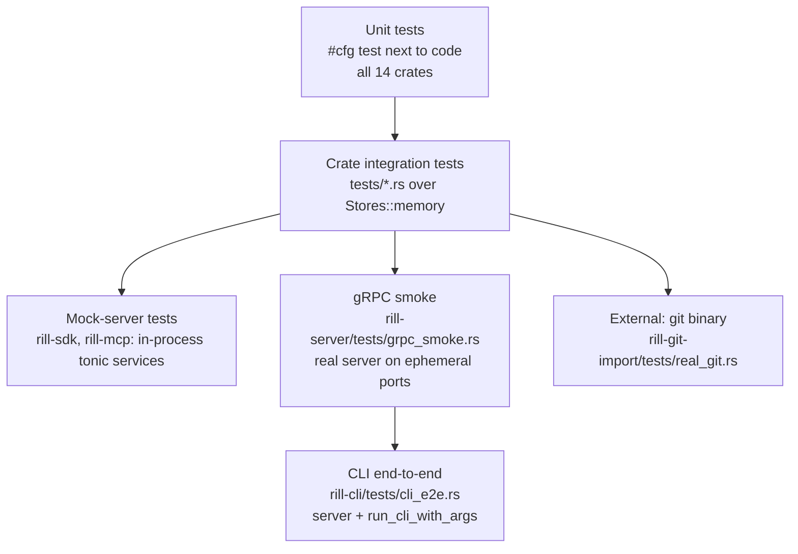

# Testing

Tests live in two places: `#[cfg(test)] mod tests` next to the code for
units, and `crates/<name>/tests/` for behaviour that crosses modules or
processes. Everything runs in-process over memory stores; no test needs a
running server, a network, or an external service, with one exception: the
git importer shells out to a `git` binary. The invariant: every bug fix
adds a test, and the memory backends are the reference the other backends
are measured against.

## Taxonomy



| Layer | What it exercises | Where |
| --- | --- | --- |
| Unit | one function or module: encodings, parsers, policy evaluation, hash framing, exit-code mapping | `src/**` in every crate (`rill-policy` 57 tests, `rill-core` 42, `rill-proto` 27, `rill-search` 27, `rill-store` 24, `rill-types` 22, `rill-review` 22) |
| Crate integration | a crate's public API over `Stores::memory()` | `rill-core/tests/workflow.rs`, `rill-review/tests/review_flow.rs`, `rill-lander/tests/landing.rs`, `rill-search/tests/end_to_end.rs`, `rill-store/tests/conformance.rs` |
| Mock server | SDK and MCP against hand-written tonic services | `rill-sdk/tests/{repo_rpc,stack,checkout}.rs`, `rill-mcp/tests/protocol.rs` |
| gRPC smoke | the real `rill-server` with generated clients and raw HTTP | `rill-server/tests/grpc_smoke.rs` |
| CLI e2e | the real server driven through the CLI as a library | `rill-cli/tests/cli_e2e.rs`; `rill-cli/tests/parse.rs` is clap-only |
| External | import from a repository made with `git` and read with `gix` | `rill-git-import/tests/real_git.rs` |

## Crate integration tests

| File | Fixture | Covers |
| --- | --- | --- |
| `rill-store/tests/conformance.rs` | `fixtures()`: memory always; `local` (tempdir redb + files) under feature `local`; `object_store` in-memory backend under feature `s3` | one object and metadata scenario run against every backend; divergence from memory is the bug |
| `rill-core/tests/workflow.rs` | memory stores, `ChangeBuilder` | build history, derive trees, merge, rebase, resolve, blame |
| `rill-review/tests/review_flow.rs` | `Harness` over memory stores | vote thresholds (human +2 or agents plus owner), trivial rebase vote carry-over, thread re-anchoring and blocking, stack validation, heuristic reviewer, review context with blame and intent |
| `rill-lander/tests/landing.rs` | `Fixture` with pluggable `ReviewHooks` and `Verifier` | empty-trunk land, independent changes in one run, rebase of a change behind trunk, conflict returned to owner, red verifier, post-land bisect, green batch, revert, auto-revert after grace |
| `rill-search/tests/end_to_end.rs` | `Fixture` indexing a small tree | case and glob search, regex without literals, path filter, re-index as no-op sharing blobs |

`rill-review/src/testing.rs` (`pub(crate)`) is the shared unit fixture:
`fixture()` builds a memory repository with a `ReviewService` over default
policy, risk config and labels, principals `alice` (human) and `bot`
(agent), and helpers `root_change`, `child_change`, `amend`.

## Mock-server tests

`rill-sdk/tests/common/mod.rs` implements `MockRepo` (trees keyed by root
label, a blob store, a canned log, echoing writes) and `MockReview` (land
tickets with scripted status sequences) as tonic services; every other RPC
answers `Unimplemented` through an `unimplemented_rpcs!` macro. `Harness::
start(repo, review, token)` serves them on an ephemeral port and builds a
`Client`. `repo_rpc.rs` checks streamed blob reassembly, chunked `PutBlob`,
log conversion, `apply_edits` round trips, bearer metadata, and status code
preservation; `stack.rs` checks `await_land` backoff, submit and sync;
`checkout.rs` checks create, status, `.rillignore`, snapshot and update.

`rill-mcp/tests/common/mod.rs` is a smaller `MockRepo` in the same style;
`protocol.rs` feeds newline-delimited JSON-RPC through `McpServer::serve`
and asserts the `initialize` handshake, that `tools/list` has every tool
with a schema, that an unknown tool is a JSON-RPC error, that bad input
never stops the loop, and that `rill_read_file`, `rill_list_dir`,
`rill_log` and `rill_grep` return the documented shapes. Because the mock
answers `Grep` with `Unimplemented`, this is where the walk-the-tree
fallback is exercised.

## gRPC smoke

`rill-server/tests/grpc_smoke.rs` starts a `TestServer` with
`Listeners::bind` on port 0, `build_state` and `serve_with_state`, and
drives it through the generated `*ServiceClient`s plus a raw `hyper` HTTP
client. `dev_mode_end_to_end` creates a repository, opens `WatchTrunk`
before anything lands, applies edits, submits, votes, lands, and checks
trunk, log, diff, grep, an object `GET` with its `ETag`, a malformed
object path (400), `/healthz`, `WhoAmI`, `Health` and `AddRelation`.
Object `PUT`, `HEAD`, `/readyz` and the batch handler have no test; only
the batch frame encoding has a unit test.
`static_auth_denies_unrelated_principal` runs with static tokens and
asserts `PERMISSION_DENIED` for a principal without relations.

## CLI end-to-end

`rill-cli/tests/cli_e2e.rs` embeds the same server (`Server::start`, dev
mode, memory storage, multi-threaded tokio) and calls
`rill_cli::run_cli_with_args` with a capture buffer, asserting exit codes
and `--json` output. `create_checkout_land_and_sync` covers `repo create`,
`checkout`, `new`, `submit`, `review vote`, `land --wait`, `cat`, `grep`, a
second checkout and `sync`; `conflicting_sync_exits_three` asserts exit 3
with conflict markers. `parse.rs` parses every command group through
`Cli::try_parse_from` without a server (`global_flags_anywhere`,
`repo_group`, `checkout_and_local_commands`, `stack_submit_review`,
`landing_group`, and more).

## Running

```
cargo test --workspace                       # everything, memory backends
cargo test -p rill-store --features s3       # add the object_store conformance fixture
cargo test -p rill-server --test grpc_smoke  # one server smoke run
cargo test -p rill-cli --test cli_e2e
cargo test -p rill-proto                     # unit + convert round trips
RUST_LOG=debug cargo test -p rill-lander -- --nocapture
```

Debug and test profiles use `opt-level = 1` with `line-tables-only`
debuginfo so the suite builds and runs quickly without giant binaries
([development](development.md)). The git importer test needs `git` on
`PATH`; the `fdb` conformance fixture needs `libfdb_c` and is not built
unless the feature is enabled.

## Not covered

* No tests run against a real S3 bucket or a FoundationDB cluster; the
  `s3` fixture uses `object_store::memory::InMemory`, the `fdb` backend has
  no conformance run in the default build.
* `rill-exec` and `rill-policy` have unit tests only; the pre-land
  verification path (`verify.enabled = true`, `LocalSandbox`) is not driven
  end-to-end through the server.
* The post-land verifier worker (`postland.enabled`) is tested in
  `rill-lander` directly, not through `rill-server`'s worker spawning.
* Biscuit authentication is unit-tested in `rill-server/src/auth`; the
  smoke test covers dev mode and static tokens only.
* No property-based tests: `proptest` is a `rill-types` dev-dependency with
  no user.
* The object protocol's `PUT` (hash verification), `HEAD`, batch route and
  `/readyz` are untested beyond the frame-encoding unit test.
* No benchmarks, fuzzing, or concurrency tests for the lander's in-process
  lock; no test of `Lagged` recovery in `Watch*` streams.
* No CI runs the suite; `cargo test --workspace` is manual.
* The `rill-mcp` protocol test uses a mock, so tool behaviour against a
  real server is covered only indirectly through the CLI e2e (which shares
  `rill_mcp::json`).

## Code

* [rill-store/tests/conformance.rs](../../crates/rill-store/tests/conformance.rs), [rill-core/tests/workflow.rs](../../crates/rill-core/tests/workflow.rs), [rill-review/tests/review_flow.rs](../../crates/rill-review/tests/review_flow.rs), [rill-review/src/testing.rs](../../crates/rill-review/src/testing.rs), [rill-lander/tests/landing.rs](../../crates/rill-lander/tests/landing.rs), [rill-search/tests/end_to_end.rs](../../crates/rill-search/tests/end_to_end.rs)
* [rill-sdk/tests/common/mod.rs](../../crates/rill-sdk/tests/common/mod.rs), [rill-sdk/tests/repo_rpc.rs](../../crates/rill-sdk/tests/repo_rpc.rs), [rill-sdk/tests/stack.rs](../../crates/rill-sdk/tests/stack.rs), [rill-sdk/tests/checkout.rs](../../crates/rill-sdk/tests/checkout.rs)
* [rill-mcp/tests/common/mod.rs](../../crates/rill-mcp/tests/common/mod.rs), [rill-mcp/tests/protocol.rs](../../crates/rill-mcp/tests/protocol.rs)
* [rill-server/tests/grpc_smoke.rs](../../crates/rill-server/tests/grpc_smoke.rs)
* [rill-cli/tests/cli_e2e.rs](../../crates/rill-cli/tests/cli_e2e.rs), [rill-cli/tests/parse.rs](../../crates/rill-cli/tests/parse.rs)
* [rill-git-import/tests/real_git.rs](../../crates/rill-git-import/tests/real_git.rs)
* [rill-proto/src/convert/roundtrip_tests.rs](../../crates/rill-proto/src/convert/roundtrip_tests.rs)

## See

* [development](development.md) for profiles, lints and running a dev server
* [server](../runtime/server.md) for `build_state` / `serve_with_state`, the embedding API the harnesses use
* [sdk](../integrations/sdk.md), [cli](../integrations/cli.md), [mcp](../integrations/mcp.md)
