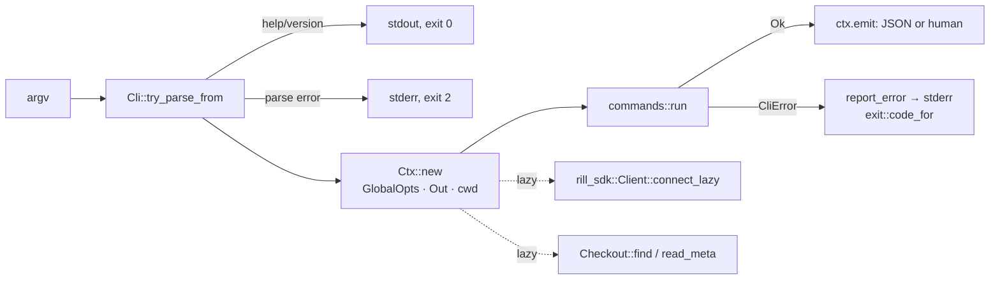

# CLI

`rill-cli` builds two binaries: `rill`, the user command, and
`rill-server`, the server process. Both are thin `main`s over the
`rill_cli` library so tests drive the CLI in-process through
`run_cli_with_args` and capture its output. The invariant: every command
produces one JSON value, rendered by `rill_mcp::json` (the same encoding the
MCP server returns), and either prints it (`--json`) or a human view of the
same data; exit codes are stable and documented in `exit.rs`.

## Flow

`run_cli` peeks at `-v`/`-q` before clap so logging (`tracing` to stderr,
`RUST_LOG` honoured, default `warn`) covers parsing, then builds a tokio
runtime and calls `run_cli_with_args` with a buffered stdout lock. Colour is
on only when stdout is a terminal, `NO_COLOR` is unset, and neither
`--no-color` nor `--json` is given.

## Command tree

Global options (`GlobalOpts`, accepted anywhere): `--endpoint URL`,
`--token TOKEN`, `--repo REPO`, `--json`, `-C/--cwd DIR`, `-v` (repeatable),
`-q`, `--no-color`.

| Group | Commands | Module |
| --- | --- | --- |
| Repositories | `repo list`, `repo create`, `repo info` | `commands/repo.rs` |
| Checkout | `checkout <repo> [dir] [--at ROOT] [--sparse PREFIX]... [--no-workspace]`, `status`, `diff` | `checkout.rs`, `status.rs` |
| History and trees | `log`, `blame`, `show`, `ls`, `cat`, `grep` | `history.rs` |
| Changes | `new -m MSG [--intent]`, `describe -m`, `amend [-m]`, `sync [--to ROOT]`, `resolve [--list|--all] [paths]`, `undo` | `change.rs` |
| Stacks | `stack show`, `stack sync`, `stack submit`, `stack land` | `stack.rs` |
| Review | `submit`, `review show|list|vote|comment|threads|resolve-thread|evaluate|abandon` | `review.rs` |
| Landing | `land [change] [--wait] [--timeout 300]`, `trunk`, `landings [-n] [--before]`, `verify <seq>`, `revert <seq> -r`, `bisect <good> <bad> [--target]` | `land.rs` |
| Intents | `intent create|list|show|update|link|similar` | `intent.rs` |
| Workspaces | `ws create|list|show|handoff|ops|delete` | `ws.rs` |
| Refs | `ref list|show|set|delete` | `refs.rs` |
| Admin | `admin whoami`, `admin token issue`, `admin relation add|remove|list`, `admin policy get|set`, `admin health` | `admin.rs` |
| Import | `import git <path> --repo R --storage-dir DIR [--ref HEAD] [--no-land]` | `import.rs` |
| Watch | `watch trunk`, `watch refs`, `watch log` | `watch.rs` |
| Shell | `completions <shell>` | `cli.rs` via `clap_complete` |

Shared positional parsing lives in `commands/parse.rs`: `root_arg`
(`trunk`, `trunk@N`, hash, ref; trunk when absent), `seq_arg` (`7` or
`trunk@7`) and `change_ref` (`ch_<hex>` or a 64-hex version hash → a
`ChangeRef` resolved through `current_version` or `change_info`).

`rill new` is the only command that edits `.rill/checkout.toml` outside the
SDK (`checkout_meta::set_working_change`): when the previous working change
has landed it clears the key and snapshots a fresh change; otherwise it
updates the checkout to the previous change's current version so the new
change stacks on it, carrying only edits made since the last snapshot.
`rill import git` runs against a storage directory with `LocalStores`, not
a server, and refuses `--endpoint`.

## Context resolution

`Ctx` (`context.rs`) resolves everything lazily and once per invocation.

| Setting | Order |
| --- | --- |
| endpoint | `--endpoint` → enclosing checkout's `.rill/checkout.toml` `endpoint` → `RILL_ENDPOINT` → `~/.config/rill/config.toml` `[server] endpoint` |
| token | `--token` → `RILL_TOKEN` (when endpoint came from a flag or checkout) → config file `token` (only when the config file supplied the endpoint) |
| repository | `--repo` → checkout `repo` → `RILL_REPO` → usage error |
| checkout | `Checkout::find(cwd)` walks up from `-C` or the process cwd to the nearest `.rill/` |

The client is `Client::connect_lazy` with user agent `rill-cli/<version>`,
so commands that never touch the server (completions, import, parse errors)
never dial. Provenance on every change the CLI creates is `Provenance
{tool: "rill-cli"}`.

## Output

`Ctx::emit(value, human)` prints `serde_json::to_string_pretty(value)` under
`--json`, else runs the human closure against `Out` (`output/mod.rs`): `line`,
`kv` (right-aligned dimmed keys), `table` (`comfy-table` with the `NOTHING`
preset, dynamic arrangement, bold headers when coloured; an empty table
renders as nothing so callers print a "nothing here" line), and style
helpers `bold`, `dim`, `good`, `bad`, `warn`, `id`. Streams (`watch`) print
one compact JSON object per line via `emit_json_line`. `output/format.rs`
gives `short` (12 hex chars), `when` (RFC 3339 without fractional seconds)
and `yes_no`.

## Errors and exit codes

`CliError` variants: `Usage`, `Conflict`, `Sdk(rill_sdk::Error)`,
`Invalid(rill_types::Error)`, `Io`, `Import`, `Store`, `Json`, `Other`.
`describe_sdk` turns gRPC codes into plain words (`not found: ...`,
`permission denied: ...`) so `rill` never prints `NotFound:` at a user.
With `--json` errors go to stderr as `{"error": {code, message, exit}}`
where `code` is the stable string from `CliError::code` (for SDK statuses
the snake_case gRPC code from `rill_mcp::error::sdk_code`).

| Exit | Constant | When |
| --- | --- | --- |
| 0 | `OK` | success; also `--help` and `--version` |
| 1 | `ERROR` | server error, not found, permission denied, transport failure, bad local state, I/O, import, storage, JSON |
| 2 | `USAGE` | clap parse error; `CliError::Usage`; `CliError::Invalid`; `rill_sdk::Error::Config` |
| 3 | `CONFLICT` | `CliError::Conflict`; `rill_sdk::Error::Conflict` or `LandFailed`; a status of `ABORTED` or `FAILED_PRECONDITION` |

Scripts and agents rely on the reading: 3 means look at the output and
decide, 1 means something is broken, 2 means fix the invocation.

## rill-server binary

`server/mod.rs` parses `ServerArgs`: `--config PATH` (or `RILL_CONFIG`),
`--dev`, `--listen-grpc ADDR`, `--listen-http ADDR`, `--storage memory |
local:<dir>`, and the `init-config [--out PATH] [--force]` subcommand.
`build_config` applies file (or defaults), then `RILL_*` environment via
`ServerConfig::load`, then flags; `--dev` sets `dev_mode`, memory storage
and ports `DEV_GRPC_PORT` 7470 / `DEV_HTTP_PORT` 7471 before the explicit
flags override it. The process logs at `info` by default, warns loudly in
dev mode, spawns a ctrl-c watcher that cancels the root
`CancellationToken`, and calls `rill_server::run`. Exit is 0 on clean
shutdown, 1 on any error.

`server/template.rs` produces the `init-config` output: a comment header
listing every `RILL_*` override and the storage and auth alternatives,
followed by `ServerConfig::default().to_toml()`, so every key and default
is exactly what the server would use; a unit test parses the template back
to the default.

## Limitations

* `--token` without `--endpoint` or a checkout still goes through
  `ClientConfig::discover`, so a config-file token is replaced but an
  environment endpoint is required.
* Checkout metadata that fails to parse is logged and ignored; the command
  then behaves as if run outside a checkout.
* `rill import git` has no progress output beyond its final JSON.
* There is no `rill-server` flag for S3 storage or Biscuit keys; those come
  from the file or environment only.

## Code

* [lib.rs](../../crates/rill-cli/src/lib.rs), [cli.rs](../../crates/rill-cli/src/cli.rs), [context.rs](../../crates/rill-cli/src/context.rs), [error.rs](../../crates/rill-cli/src/error.rs), [exit.rs](../../crates/rill-cli/src/exit.rs)
* [commands/mod.rs](../../crates/rill-cli/src/commands/mod.rs), [commands/parse.rs](../../crates/rill-cli/src/commands/parse.rs), [commands/change.rs](../../crates/rill-cli/src/commands/change.rs), [commands/import.rs](../../crates/rill-cli/src/commands/import.rs)
* [checkout_meta.rs](../../crates/rill-cli/src/checkout_meta.rs)
* [output/mod.rs](../../crates/rill-cli/src/output/mod.rs), [output/table.rs](../../crates/rill-cli/src/output/table.rs), [output/format.rs](../../crates/rill-cli/src/output/format.rs)
* [server/mod.rs](../../crates/rill-cli/src/server/mod.rs), [server/template.rs](../../crates/rill-cli/src/server/template.rs)
* [bin/rill.rs](../../crates/rill-cli/src/bin/rill.rs), [bin/rill_server.rs](../../crates/rill-cli/src/bin/rill_server.rs)

## See

* [sdk](sdk.md) for the client and checkout the commands drive
* [mcp](mcp.md) for the shared JSON encoding
* [server](../runtime/server.md) for the configuration the binary builds
* [testing](../engineering/testing.md) for the in-process e2e harness
