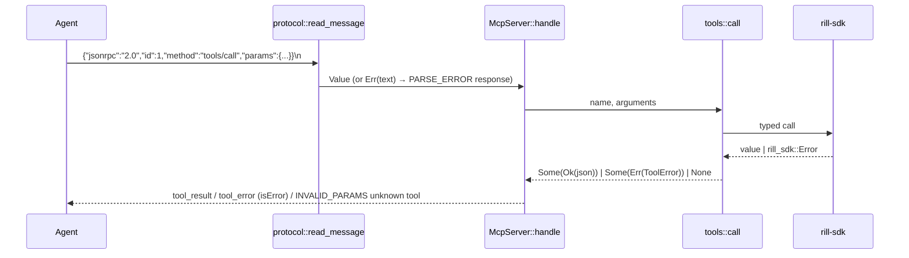

# MCP server

`rill-mcp` speaks the Model Context Protocol over stdio and exposes the SDK
as 27 tools so an agent can read history, edit, review and land without a
checkout. The protocol is implemented by hand (`initialize`, `ping`,
`tools/list`, `tools/call` and notifications are the whole surface). The
invariant: nothing an agent sends can stop the session loop; tool failures
are results with `isError: true`, only malformed JSON-RPC becomes a
JSON-RPC error, and only a transport failure ends `serve`.

## Framing and dispatch

`protocol/framing.rs` reads newline-delimited JSON: blank lines are
skipped, an unparseable line is reported to the caller as `Err(text)` so
the loop answers `PARSE_ERROR (-32700)` with `id: null` and continues.
`write_message` emits compact JSON plus `\n`; compact encoding never holds a
raw newline, so framing survives any payload. `protocol/rpc.rs` defines
`Request {jsonrpc, id: Option<Id>, method, params}`, `Response` with exactly
one of `result`/`error`, `RpcError {code, message, data}` and the standard
codes.

`McpServer::handle` (`server.rs`) dispatches by method:

| Method | Result |
| --- | --- |
| `initialize` | `protocolVersion` `2025-06-18`, `capabilities.tools.listChanged = false`, `serverInfo {name: rill-mcp, version}`, and `instructions` telling the model about `repo`, root syntax and provenance fields |
| `ping` | `{}` |
| `tools/list` | `{tools: [ToolDef::to_json()...]}` |
| `tools/call` | `INVALID_PARAMS` without `name` or for an unknown tool; else a tool result |
| `notifications/*` | no response |
| anything else | `METHOD_NOT_FOUND` |

A request without `id` is a notification and never gets a reply. Batch
arrays answer `INVALID_REQUEST`. A successful call returns `{content:
[{type: text, text: <pretty JSON>}], structuredContent: <value>, isError:
false}`; a `ToolError` returns `content` text `error (<code>): <message>`,
`structuredContent: {error: {code, message}}` and `isError: true`.

## Configuration and auth

The binary (`bin/rill_mcp.rs`) takes `--endpoint` (`RILL_ENDPOINT`),
`--token` (`RILL_TOKEN`), `--repo` (`RILL_REPO`) and `--list-tools`
(prints the definitions and exits). Logs go to stderr at `warn` by default
so they never corrupt stdout. `McpConfig::resolve` fills the endpoint from
the flag or `ClientConfig::discover` (environment, then
`~/.config/rill/config.toml`), the token from the flag, then the resolved
config, then `RILL_TOKEN`, and the default repository from the flag or
`RILL_REPO`. `connect_lazy` defers the TCP connection so `initialize` and
`tools/list` succeed with the server down. The bearer token is attached by
the SDK's `AuthInterceptor`; the MCP server has no auth of its own and acts
as whatever principal the token names.

`ToolContext::repo(args)` picks the repository from the call's `repo`
argument, else the default, else `ToolError::NoRepo`.

## Tool registry

`tools/mod.rs` concatenates each group's `definitions()` in a stable order
(repo, write, review, lander, intent, workspace, admin) and `call` tries
the groups in the same order; `None` means no tool has that name.
`tools/schema.rs` builds the `inputSchema` with `Props::repo()` (adds the
optional `repo` string), `req`/`opt`, and the scalar builders `string`,
`string_enum`, `integer`, `boolean`, `string_array`, `root`; every schema is
`type: object` with `additionalProperties: false`. `provenance_props` adds
the optional `model`, `session` and `prompt_ref` strings to writing tools.
`tools/args.rs` is the typed reader over `arguments`: `str`, `opt_str`,
`opt_u64`, `i64`, `bool_or`, `limit` (clamped to `u32`), `parse`/`opt_parse`
(`FromStr`), `root_or_trunk`, `path_or_root`, `path`, `seq` (integer or
`trunk@N`), `opt_str_list`, `opt_paths`, `objects`. Every miss is
`ToolError::InvalidArgs` naming the key.

## Tools

| Tool | Arguments (required in bold) | Backing SDK call |
| --- | --- | --- |
| `rill_repo_info` | repo | `RepoClient::info` |
| `rill_list_dir` | repo, path, at | `list_dir_full` |
| `rill_read_file` | repo, **path**, at | `read_file` |
| `rill_log` | repo, start, limit (20), path, first_parent | `log_page` |
| `rill_blame` | repo, **path**, at | `resolve_root` + `blame` |
| `rill_diff` | repo, base, target, change_id, paths, unified, context_lines (3), limit | `diff_with` (`change_id` diffs current version against first parent) |
| `rill_grep` | repo, **pattern**, at, path, glob, ignore_case, max_matches (1000) | `rill_mcp::grep::grep` → `RepoClient::grep` |
| `rill_apply_edits` | repo, **message**, **edits**, base, change_id, intent, model, session, prompt_ref | `apply_edits` |
| `rill_create_change_from_edits` | as above without `change_id` | `apply_edits` (never amends) |
| `rill_rebase` | repo, change_id or version, onto | `current_version`, `resolve_root`, `rebase` |
| `rill_resolve` | repo, change_id or version, **resolutions** [{path, content, kind, delete}], provenance | `resolve` |
| `rill_submit` | repo, **change_id** | `ReviewClient::submit` |
| `rill_vote` | repo, **change_id**, **label**, **value**, reason, version | `vote` |
| `rill_comment` | repo, **change_id**, **body**, path, line, end_line, version, category, confidence | `comment` (anchor: change, file or line range) |
| `rill_evaluate` | repo, **change_id** | `evaluate_submit` |
| `rill_request_land` | repo, **change_id** | `request_land` |
| `rill_land_status` | repo, **ticket** | `land_status` |
| `rill_trunk_status` | repo, recent_limit (10) | `LanderClient::trunk_status` |
| `rill_intent_create` | repo, **title**, body, kind, parent | `IntentClient::create` |
| `rill_intent_list` | repo, status[], kind[], owner, parent, limit, page_token | `list` |
| `rill_intent_get` | repo, **id** | `get` |
| `rill_intent_link` | repo, **intent**, **change_id** | `link_change` |
| `rill_intent_similar` | repo, **title**, body, limit (10) | `find_similar` |
| `rill_workspace_create` | repo, **name**, base, include[], exclude[] | `WorkspaceClient::create` |
| `rill_workspace_diff` | repo, **workspace**, paths, unified, context_lines (3) | `diff` |
| `rill_workspace_handoff` | repo, **workspace**, **to**, to_kind | `handoff` |
| `rill_whoami` | (none) | `AdminClient::whoami` |

`edits` items are `{op: set|delete|patch, path, content?, kind?,
unified?}`; `set` content is a UTF-8 string, uploaded as a blob by the SDK
when it exceeds the inline threshold.

## Provenance on writes

`tools::write::provenance(args)` builds `Provenance {tool: "rill-mcp",
model, session, prompt_ref}` from the call's optional fields; `apply_edits`
passes it through `ApplyOptions::with_provenance`, `resolve` passes it
directly, and `rill_create_change_from_edits` is the same path with amends
disabled. The server merges a resolve's provenance with the previous
version's and sets `resolved_by` from the caller's principal kind. `sponsor`
is not settable from MCP.

## JSON encoding

`json/*` is the single machine-readable rendering of SDK and `rill-types`
values; `rill --json` uses the same functions. Rules from
`json/primitives.rs`:

| Value | Encoding |
| --- | --- |
| hashes | lowercase hex string |
| ids | their display form (`ch_<hex>`, `rp_<hex>`, ...) |
| principals | `{id, kind, name, identity, display}` |
| timestamps | `{rfc3339, millis}` |
| fieldless enums | `snake_case` from the `Debug` name (`InProgress` → `in_progress`) |
| byte content | `{encoding: utf8, size, text}` when valid UTF-8, else `{encoding: hex, size, hex}` |
| pages | `{items, next_page_token}` |
| `Option` | value or `null` |

Per-type encoders: `history.rs` (repo, change info/version with
provenance, log and path-history pages, dir entries, file changes, refs,
land events, `version_result`), `diff.rs`, `review.rs` (states, threads,
tickets, land progress, sync results), `lander.rs`, `intent.rs`,
`workspace.rs`, `admin.rs`, `local.rs` (checkout status and update reports
for the CLI).

## Grep fallback

`grep.rs` is the one place the client tolerates an older server. It issues
`Grep` through `RepoClient::grep`, mapping `path` to a `<dir>/**` glob; on
`UNIMPLEMENTED` it walks the tree with `list_dir` and `get_blob`, skipping
binary files, bounded by `GrepOptions {max_files 2000, max_bytes 32 MiB,
max_matches 1000}`, and reports `truncated`. The result shape is the same
either way: `{matches: [{path, line_no, line}], files_searched, truncated}`;
`files_searched` on the server path is the number of distinct paths in the
hits.

## Errors

`ToolError` is `InvalidArgs`, `NoRepo`, `Sdk(rill_sdk::Error)` or `Other`;
`code()` gives `invalid_arguments`, `no_repo`, the snake_case gRPC code
(`not_found`, `failed_precondition`) or the SDK variant name (`transport`,
`conflict`, `land_failed`), or `error`. The CLI reuses `sdk_code` for its
own `--json` errors. `Error` (`Io`, `Config`, `Sdk`) is what ends `serve`.

## Limitations

* No `resources`, `prompts` or streaming tools; `WatchReview` and the
  `Watch*` RPCs are not exposed.
* Single-threaded loop: one request is handled at a time, in order.
* `rill_grep`'s description still says the search is implemented
  client-side; the server-side index is the normal path now.
* `rill_intent_list` accepts `page_token` but the server never returns one.
* No workspace snapshot, undo or delete tools; no revert or bisect tools.

## Code

* [lib.rs](../../crates/rill-mcp/src/lib.rs), [bin/rill_mcp.rs](../../crates/rill-mcp/src/bin/rill_mcp.rs), [config.rs](../../crates/rill-mcp/src/config.rs), [error.rs](../../crates/rill-mcp/src/error.rs), [server.rs](../../crates/rill-mcp/src/server.rs)
* [protocol/framing.rs](../../crates/rill-mcp/src/protocol/framing.rs), [protocol/rpc.rs](../../crates/rill-mcp/src/protocol/rpc.rs)
* [tools/mod.rs](../../crates/rill-mcp/src/tools/mod.rs), [tools/schema.rs](../../crates/rill-mcp/src/tools/schema.rs), [tools/args.rs](../../crates/rill-mcp/src/tools/args.rs), [tools/write.rs](../../crates/rill-mcp/src/tools/write.rs), [tools/repo.rs](../../crates/rill-mcp/src/tools/repo.rs), [tools/review.rs](../../crates/rill-mcp/src/tools/review.rs)
* [grep.rs](../../crates/rill-mcp/src/grep.rs)
* [json/mod.rs](../../crates/rill-mcp/src/json/mod.rs), [json/primitives.rs](../../crates/rill-mcp/src/json/primitives.rs), [json/history.rs](../../crates/rill-mcp/src/json/history.rs)

## See

* [sdk](sdk.md) for the calls behind each tool
* [cli](cli.md), the other consumer of `json/*`
* [protocol](../runtime/protocol.md) for the status codes that become tool error codes
* [policy](../policy/README.md) for the capability tokens an agent runs under
