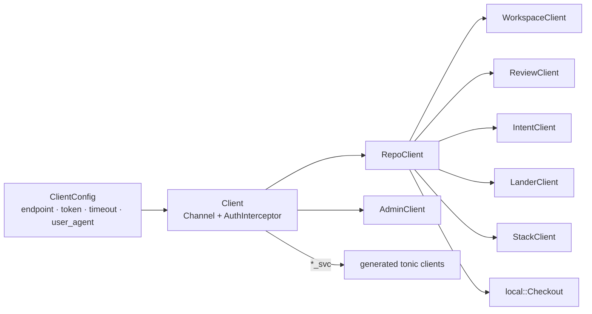
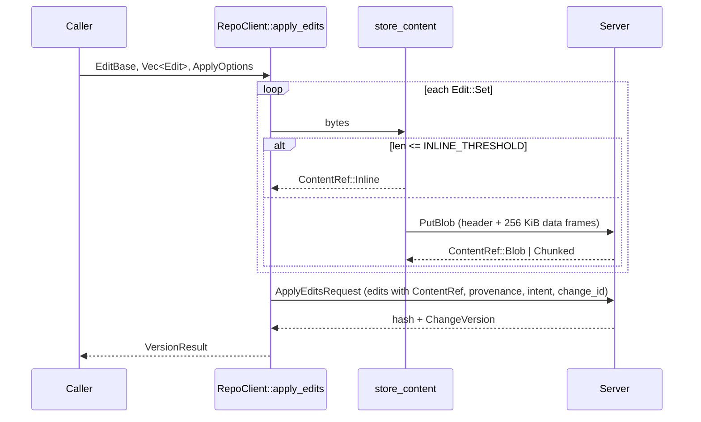

# SDK

`rill-sdk` is the typed Rust client over the `rill.v1` API, used by the
CLI, the MCP server and agents. A `Client` is one HTTP/2 channel plus a
bearer-token interceptor; it hands out repository-scoped clients whose
inputs and outputs are `rill-types` values where one exists and small
structs in `types/` otherwise. The invariant: the SDK never reinterprets
server results; a gRPC status comes back as `Error::Status` with its code
intact, and the only local state it manages is a `.rill/` checkout.

## Shape

`Client::connect` dials eagerly so configuration errors surface before the
first request; `connect_lazy` defers the TCP connection (the CLI and MCP
server use it so `--help`, `initialize` and `tools/list` work without a
server). `with_channel` wraps an existing `Channel` (tests). The endpoint
sets a 10 s connect timeout, 30 s TCP and HTTP/2 keepalives and the optional
per-request `timeout` (default 30 s; streams ignore it). Every `*_svc()`
call builds a fresh generated client over `InterceptedService<Channel,
AuthInterceptor>`; the interceptor inserts `authorization: Bearer <token>`
when a token is configured and nothing otherwise.

## Configuration

`ClientConfig::discover` is environment first, then file:

| Source | Fields |
| --- | --- |
| `ClientConfig::new(endpoint)` | token `None`, timeout 30 s, user agent `rill-sdk/<version>` |
| `from_env` | `RILL_ENDPOINT` (required), `RILL_TOKEN` (empty means none) |
| `load(path)` / `parse` | TOML `[server] endpoint, token?, timeout_secs?`; a missing section is `Error::Config` |
| `default_path` | `dirs::config_dir()/rill/config.toml` |

## Repository reads

`RepoClient` (`repo/mod.rs`) carries the repository name or id on every
request. `Root` (`types/root.rs`) names a point in history: `Ref`,
`Version`, `Tree`, `Seq`; it parses from `trunk`, `trunk@N`, `tree:<hex>`,
64 hex chars, or a ref name, and encodes to `pb::RootSpec`. `LogStart` is
the same without `Tree`.

| Module | Methods | RPC |
| --- | --- | --- |
| `repo/mod.rs` | `info`; `Client::list_repos`, `create_repo[_with_op]` | `GetRepo`, `ListRepos`, `CreateRepo` |
| `repo/history.rs` | `change_version[_signed]`, `change_info`, `change_versions`, `current_version`, `log`, `log_page`, `path_history`, `blame` | `GetChangeVersion`, `GetChangeInfo`, `GetChangeVersions`, `Log`, `PathHistory`, `Blame` |
| `repo/tree.rs` | `tree`, `list_dir`, `list_dir_full` → `DirListing`, `resolve_path`, `read_file` | `GetTree`, `ListDir`, `ResolvePath` (+ `GetBlob`) |
| `repo/blobs.rs` | `get_blob`, `get_blob_range`, `put_blob[_with_op]`, `store_content`, `has_objects` | `GetBlob`, `PutBlob`, `HasObjects` |
| `repo/compare.rs` | `diff`, `diff_with(DiffOptions)`, `merge_base`, `is_ancestor` | `Diff`, `MergeBase`, `IsAncestor` |
| `repo/refs.rs` | `resolve_ref`, `resolve_root`, `list_refs`, `move_ref[_with_op]`, `trunk_head`, `trunk_range` | `ResolveRef`, `ListRefs`, `MoveRef`, `TrunkHead`, `TrunkRange` |
| `repo/search.rs` | `grep(root, GrepQuery)` → `GrepResult` | `Grep` |
| `repo/derived.rs` | `derived`, `wait_derived` | `GetDerived`, `WaitDerived` |
| `repo/watch.rs` | `watch_trunk`, `watch_refs`, `watch_log` | `WatchTrunk`, `WatchRefs`, `WatchLog` |

`get_blob` answers `ContentRef::Inline` without a round-trip and otherwise
reassembles the `BlobChunk` stream into one `Bytes`. `log` returns entries
only; `log_page` also returns `next_start`, the hash to pass as the next
`LogStart::Version` (history paging is by cursor, not token).

## Write path

`Edit` is `Set {path, bytes, kind}`, `Delete {path}` or `Patch {path,
unified}`. `EditBase` is `Root(Root)` (new change on top) or
`Change(ChangeId)` (amend its current version); `ApplyOptions::amending`
pins an amend onto a root base. `rebase`, `merge` and `resolve` return
`VersionResult {hash, version}`; conflicts are in the version, never an
error (`conflicted_paths()`). `create_change_version` sends a fully built
`ChangeVersion` with detached `Signature`s. Every write has a `_with_op`
twin taking an `OperationId`; the plain form mints one.

## Streams

`EventStream<T>` (`stream.rs`) is `Pin<Box<dyn Stream<Item = Result<T>> +
Send>>`. `repo::watch::convert_stream` maps each wire message through
`TryFrom` and each `Status` into `Error::Status`; the error item ends the
stream. `ReviewClient::watch` uses the same adapter for `WatchReview`.

## Local checkouts

`local/` gives the CLI a minimal working copy; agents do not need one.

| File | Role |
| --- | --- |
| `meta.rs` | `.rill/checkout.toml` (`CheckoutMeta`: endpoint, repo, workspace, base, base_version, working_change, sparse) and `.rill/manifest.toml` (`Manifest`: path → `ManifestEntry {content_hash, local_hash, size, mtime_ms, kind, conflict}`); both written atomically via temp file + rename |
| `checkout.rs` | `Checkout::create` (list tree inside the `SparseProfile`, materialize, save), `open`, `read_meta`, `find` (walk up for `.rill/`), `status`, `edits`, `snapshot`, `mark_resolved`, `set_workspace` |
| `remote.rs` | `list_tree` walks directories one `ListDir` at a time, never entering a directory outside the profile; `fetch` reads a file |
| `fs.rs` | `stat`, `read_entry`, `write_entry`, `remove_entry`, `prune_empty_dirs`, `local_hash` (BLAKE3 blob digest of the bytes written) |
| `walk.rs` | `walk_files` with the `ignore` crate, `.rillignore` at every level (gitignore syntax), `.rill/` skipped; ignore rules hide untracked files only |
| `status.rs` | `compute_status`: size + mtime equal to the manifest means unchanged, else hash; `LocalChangeKind::{Added, Modified, Deleted, Conflict}` |
| `update.rs` | `Checkout::update(new_root)` → `UpdateReport {updated, removed, merged, conflicts}` |

`snapshot` turns status into edits (`Set` for added/modified, `Delete` for
deleted; a `Conflict` entry is `Error::Checkout`), calls `apply_edits` with
`EditBase::Root(base)` and `change_id = working_change` so later snapshots
amend, then records the resulting change id. Blocking filesystem work runs
under `spawn_blocking`.

`update` classifies every path by upstream change (old base vs new root)
and local change (old base vs working copy): one side changed takes that
side; both changed runs `rill_core::merge::merge_file` with the old base
content, writing a clean merge as a local modification and a conflict as
marker text flagged `conflict: true`. A merged or conflicted entry records
the upstream content hash as its comparison base so status keeps reporting
it until the working copy matches the new root. A file deleted locally but
changed upstream is merged as a delete-vs-modify conflict.

## Stacks

`StackClient` (`stack.rs`) composes review and repo calls: `submit_stack`
(submit each, then `set_stack`), `sync_stack` (rebase bottom-up, each onto
the previous result; conflicts reported in `SyncResult`, never raised),
`land_stack` (request land per change, `await_land` before the next), and
`await_land`, which polls `GetLandStatus` with `Backoff {initial 250 ms,
factor 1.6, max 5 s}` and returns `Error::LandFailed` on `Failed` or
`Cancelled`, `Error::Timeout` when the deadline passes.

## Errors

| Variant | Meaning | Source |
| --- | --- | --- |
| `Status {code, message}` | server answered with a gRPC status; `code()` and `is_not_found()` branch on it | `From<tonic::Status>` |
| `Transport` | connection failed or dropped | `tonic::transport::Error` |
| `Convert` | wire message did not decode to a `rill-types` value | `ConvertError` |
| `Invalid` | client-built value rejected (bad path, ref, hash) | `rill_types::Error` |
| `Config` | missing or malformed endpoint/token/file | `Error::config` |
| `Io` | local filesystem | `std::io::Error` |
| `Timeout(Duration)` | a client-side wait exceeded its deadline | `await_land` |
| `Conflict {change_id, hash, paths}` | a clean result was required and the version conflicts | callers of `VersionResult` |
| `Checkout(String)` | `.rill/` missing or malformed, unresolved conflict at snapshot | `local` |
| `LandFailed {ticket, status, message}` | landing ended `Failed`/`Cancelled` | `await_land` |

## Pagination

List RPCs return `Page<T> {items, next_page_token}` (`types/page.rs`);
`has_more` is `next_page_token.is_some()`. The server currently always
returns `None`, so a page is the whole limit-bounded result. `log_page` and
`path_history` page by cursor hash instead.

## Grep

`RepoClient::grep` issues the `Grep` RPC and nothing else; paths the caller
may not read are filtered server-side. The walk-the-tree fallback described
in `docs/ARCHITECTURE.md` lives in `rill_mcp::grep`, not in the SDK: it
retries with `ListDir` + `GetBlob` only when the status is `UNIMPLEMENTED`
([mcp](mcp.md#grep-fallback)).

## Limitations

* `put_blob` never sets `expected_hash`; integrity relies on the server's
  own hashing of the received bytes.
* `get_blob_range` allocates the whole requested range before returning.
* A symlink's content is its target string (`read_entry`); there is no
  rename detection, so a moved file is a `Deleted` plus an `Added`.
* `from_env` ignores the config file entirely when `RILL_ENDPOINT` is set.
* No retry or reconnect policy beyond tonic's channel behaviour.

## Code

* [lib.rs](../../crates/rill-sdk/src/lib.rs), [client.rs](../../crates/rill-sdk/src/client.rs), [config.rs](../../crates/rill-sdk/src/config.rs), [error.rs](../../crates/rill-sdk/src/error.rs), [stream.rs](../../crates/rill-sdk/src/stream.rs)
* [repo/mod.rs](../../crates/rill-sdk/src/repo/mod.rs), [repo/blobs.rs](../../crates/rill-sdk/src/repo/blobs.rs), [repo/write.rs](../../crates/rill-sdk/src/repo/write.rs), [repo/watch.rs](../../crates/rill-sdk/src/repo/watch.rs), [repo/search.rs](../../crates/rill-sdk/src/repo/search.rs)
* [types/root.rs](../../crates/rill-sdk/src/types/root.rs), [types/edit.rs](../../crates/rill-sdk/src/types/edit.rs), [types/page.rs](../../crates/rill-sdk/src/types/page.rs)
* [local/checkout.rs](../../crates/rill-sdk/src/local/checkout.rs), [local/meta.rs](../../crates/rill-sdk/src/local/meta.rs), [local/status.rs](../../crates/rill-sdk/src/local/status.rs), [local/update.rs](../../crates/rill-sdk/src/local/update.rs), [local/walk.rs](../../crates/rill-sdk/src/local/walk.rs)
* [stack.rs](../../crates/rill-sdk/src/stack.rs), [review.rs](../../crates/rill-sdk/src/review.rs), [workspace.rs](../../crates/rill-sdk/src/workspace.rs), [admin.rs](../../crates/rill-sdk/src/admin.rs)

## See

* [protocol](../runtime/protocol.md) for the wire surface and codes
* [server](../runtime/server.md) for what each RPC does
* [cli](cli.md) and [mcp](mcp.md), the two consumers
* [merge and rebase](../core/merge-and-rebase.md) for the file merge `update` uses
