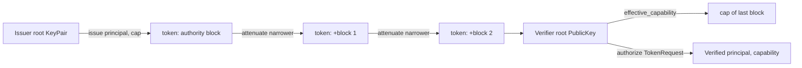

# Capability tokens

A capability token is a [Biscuit](https://www.biscuitsec.org) signed by the
instance's root Ed25519 key. Its authority block names the principal and
carries Datalog checks for one `Capability`: a repository, optional
workspace, path prefixes, verbs and an expiry. A holder appends blocks
offline to narrow it; the server verifies the chain and then intersects the
capability with ReBAC. The invariant: checks accumulate across blocks, so no
block can ever grant more than the one before it, and the principal is read
only from the authority block.

## Capability

[`Capability`](../../crates/rill-policy/src/tokens/capability.rs):

| Field | Type | Semantics |
| --- | --- | --- |
| `repo` | `RepoId` | The one repository the token applies to. |
| `workspace` | `Option<WorkspaceId>` | When set, only requests on this workspace pass the Datalog check. |
| `paths` | `Vec<RepoPathBuf>` | Prefixes covered; the root covers everything; empty covers nothing and fails `validate`. |
| `verbs` | `Vec<Verb>` | Any of `Read`, `Write`, `Land`, `Review`, `Admin` (wire names lowercase). |
| `expires_at` | `Timestamp` | `is_expired_at(now)` is `now >= expires_at`. |

`Capability::repo_wide(repo, verbs, expires_at)` starts at the root;
`with_workspace` and `with_paths` narrow it. `validate` requires at least
one verb and one path. `check_narrower_than(parent)` returns
`Error::Widening` unless: same `repo`; workspace equal to the parent's, or
newly pinned when the parent has none (a pinned parent cannot be unpinned);
`verb_set()` a subset; every path under one of the parent's prefixes
(`starts_with`, so `srcx` is not under `src`); `expires_at` no later.

## Datalog

[`datalog.rs`](../../crates/rill-policy/src/tokens/datalog.rs) translates a
capability into one block. Every block, authority and attenuation alike,
carries the checks for its capability plus the capability's JSON as the
block context, so `inspect` can read a token's grant back without
re-deriving it. The authority block additionally holds the identity fact.
For a read/write token on `src` and `docs` in a pinned workspace:

```datalog
// authority block
principal("pr_…", "agent", "reviewer-7");
check if request_repo("rp_…");
check if request_workspace("ws_…");
check if request_verb($v), {"read", "write"}.contains($v);
check if request_path($p), $p == "src" || $p.starts_with("src/") || $p == "docs" || $p.starts_with("docs/");
check if time($t), $t < 2026-10-21T00:00:00Z;
```

A root prefix omits the `request_path` check entirely. Expiry is rounded
down to whole seconds (`millis.div_euclid(1000)`) so a token never outlives
its capability. Terms are bound through `code_with_params`, never string
formatting, so a path or name cannot inject Datalog.

[`Verifier::verify_full`](../../crates/rill-policy/src/tokens/verifier.rs)
supplies the request side and a policy that accepts once every check holds:

```datalog
request_repo("rp_…");
request_path("src/billing/invoice.rs");
request_verb("write");
time(2026-10-20T12:00:00Z);
request_workspace("ws_…");   // only when TokenRequest.workspace is set
allow if true;
```

The principal is recovered with `authorizer.query(...)`, not `query_all`,
which sees only the authority block; an attenuation block that adds its own
`principal(...)` fact is ignored.

## Issuing and verifying



[`Issuer`](../../crates/rill-policy/src/tokens/issuer.rs) holds the root
`KeyPair` (`generate`, `from_private_key_bytes`, `private_key_bytes`,
`public_key`). `issue(principal, capability)` builds the authority block and
returns base64. `attenuate(token, root, narrower)` parses the parent with the
root public key, reads its effective capability, enforces
`check_narrower_than`, appends a `capability_block(narrower)` and re-encodes.
A client that skips the narrowing check still cannot escape the parent,
because Biscuit evaluates every block's checks. `inspect(token, root)`
returns the effective capability without authorizing anything.

`effective_capability(token)` walks `token.context()` in block order,
deserialises each capability, checks each one is narrower than the previous
and returns the last. A block without context, or a JSON mismatch, is
`Error::Token`; a widening block is `Error::Widening`.

`verify_full(token, request)`:

1. `Biscuit::from_base64(token, root)`: signature chain. Failure is `Error::Token`.
2. `effective_capability`: block consistency.
3. `capability.is_expired_at(request.now)`: `Error::TokenExpired { expires_at }`.
4. Build the authorizer from the request facts and run it. A failed check is
   `Error::TokenRejected(logic)`; other Biscuit errors are `Error::Token`.
5. Query the `principal` fact from the authority block and rebuild a
   `Principal` (`identity: None`); unknown kinds are `Error::Token`.

`TokenRequest` carries `now` explicitly so verification is deterministic.

## Server use

Authentication: [`BiscuitAuthenticator`](identity-and-authentication.md)
calls `inspect` and then `verify_full` with a probe request taken from the
capability itself, so a token that verifies becomes an `AuthContext` with
`capability: Some(cap)`. Per-request enforcement is then
`AuthContext::capability_allows(repo, path, verb)` in
[`Permit::check`](../../crates/rill-server/src/auth/permit.rs), evaluated
in Rust rather than through Datalog, and applied before the ReBAC check and
even under `dev_mode`. The two layers intersect: a token can only remove
rights, so the effective permission is `capability ∧ relations`.

`AdminService.IssueToken`
([admin.rs](../../crates/rill-server/src/services/admin.rs)) mints tokens
server-side; no client calls `attenuate` directly today.

| Step | Rule |
| --- | --- |
| Scopes | Each `pb::Capability.scope` is `repo:<name>[/<dir>][/*]`; all must name one repository. |
| Actions | `repo.read`/`read`, `repo.write`/`write`, `lander.land`/`repo.land`/`land`, `review.vote`/`repo.review`/`review`, `repo.admin`/`admin`. |
| Expiry | `expires_at` or now + 24 h (`DEFAULT_TOKEN_TTL_MS`); a past value is `INVALID_ARGUMENT`. |
| Authority | A caller holding a capability must satisfy `check_narrower_than` (a `Widening` error is `INVALID_ARGUMENT`); a caller without one must pass `permit().admin()`. |
| Subject | `for_principal`, or the caller. |

`WhoAmI` reports the caller's capability as one `pb::Capability` per
verb × path with scope `repo:<name>/<path>/*` and the token's expiry.

## Limitations

* The server never enforces `Capability::workspace`; see
  [identity-and-authentication](identity-and-authentication.md).
* There is no revocation: a token is valid until `expires_at`. Rotating
  `root_public_key_hex` invalidates every token signed by the old root, and
  tokens from a process-local issuer die with the process.
* `IssueToken` does not restrict `for_principal`; any admin, or any token
  holder delegating a narrower scope, can mint for any principal name.
* Tokens carry no `identity` or teams; teams for Biscuit principals are
  always empty in the server.

## Code

* [`tokens/mod.rs`](../../crates/rill-policy/src/tokens/mod.rs): re-exports.
* [`tokens/capability.rs`](../../crates/rill-policy/src/tokens/capability.rs): `Capability`, `Verb`, `check_narrower_than`.
* [`tokens/datalog.rs`](../../crates/rill-policy/src/tokens/datalog.rs): `capability_block`, `authority_block`, `effective_capability`, `principal_from_fact`.
* [`tokens/issuer.rs`](../../crates/rill-policy/src/tokens/issuer.rs): `Issuer`, `attenuate`, `inspect`.
* [`tokens/verifier.rs`](../../crates/rill-policy/src/tokens/verifier.rs): `TokenRequest`, `Verified`, `Verifier`.
* [`tokens/tests.rs`](../../crates/rill-policy/src/tokens/tests.rs): issue, attenuate and reject cases.
* [`services/admin.rs`](../../crates/rill-server/src/services/admin.rs): `IssueToken`, `WhoAmI`, `parse_scope`, `parse_action`.

## See

* [identity-and-authentication](identity-and-authentication.md) for how a token becomes an `AuthContext`.
* [permissions](permissions.md) for the relation layer the capability is intersected with.
