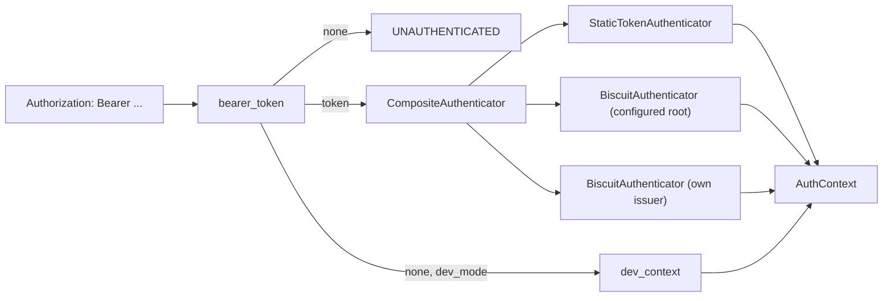
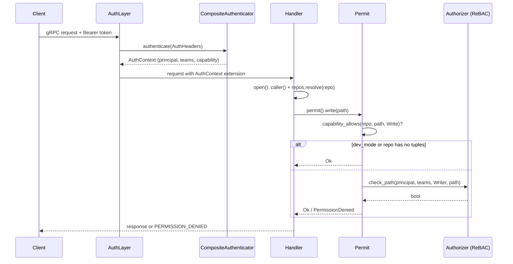

# Identity and authentication

Every request runs as a `Principal`, resolved from its `Authorization` header
before any handler executes. `rill-policy` defines the credential model
(`AuthHeaders` → `Authenticator` → `AuthContext`) without seeing tonic or
axum; `rill-server/src/auth/` adapts both transports onto it and wraps the
result in `Permit`, the two-layer check every handler runs before touching a
repository. The invariant: a handler never reads a principal from request
fields; it reads the `AuthContext` the middleware attached, and a request
with no context is `UNAUTHENTICATED` even if the middleware was simply not
wired.

## Principals

[`Principal`](../../crates/rill-types/src/principal.rs) is the actor recorded
on every change, vote and landing.

| Field | Type | Notes |
| --- | --- | --- |
| `id` | `PrincipalId` | 16 bytes. The constructors derive it deterministically: `PrincipalId::derived("human" \| "agent" \| "service", name)` is BLAKE3 over `rill:id:` + prefix + namespace + name, so the same name always maps to the same id. |
| `kind` | `PrincipalKind` | `Human`, `Agent`, `Service`. Wire names `human`, `agent`, `service`. |
| `name` | `String` | Handle. `Display` renders `alice`, `agent:reviewer-7`, `svc:lander`. |
| `identity` | `Option<String>` | Informational only (email, SPIFFE id). Never consulted by policy. |

`Principal` has no sponsor field. Sponsorship lives on
[`Provenance::sponsor`](../../crates/rill-types/src/objects/change.rs), the
human who delegated an agent's work; it is signed into the change version
and carried forward on amends (`write.rs` copies `previous.sponsor` when the
new version omits it). Nothing in `rill-policy` reads it today.

## From header to AuthContext

[`AuthHeaders`](../../crates/rill-policy/src/identity.rs) carries `bearer`
(prefix stripped) and `principal_hint`; no built-in authenticator honours the
hint. [`AuthContext`](../../crates/rill-policy/src/identity.rs) is what a
request runs as:

| Field | Meaning |
| --- | --- |
| `principal` | The authenticated actor. |
| `teams` | Team names for `Subject::Team` tuples. |
| `capability` | `Some` when the credential was a Biscuit token; `None` means the principal is bound only by relationship checks. |

`AuthContext::capability_allows(repo, path, verb)` is `true` without a
capability, otherwise `cap.repo == repo && cap.allows(verb) &&
cap.covers_path(path)`. It does not look at `cap.workspace`.

Authenticators, all `async_trait` implementations of `Authenticator`:

| Authenticator | Credential | Result |
| --- | --- | --- |
| `StaticTokenAuthenticator` | Exact match in a `HashMap<token, (Principal, teams)>` | `capability: None`. Unknown or missing token → `Error::Unauthenticated`. |
| `BiscuitAuthenticator` | Base64 Biscuit signed by the verifier's root | `tokens::inspect` reads the effective capability, then `Verifier::verify_full` runs with a probe `TokenRequest` built from the capability's own first path and verb, so only the signature chain, block consistency and expiry are tested. Teams come from a `TeamResolver` (`NoTeams` returns none). `TokenExpired` passes through; every other failure becomes `Unauthenticated`. |
| `CompositeAuthenticator` ([server](../../crates/rill-server/src/auth/authenticator.rs)) | Either | Tries the static table, then each Biscuit verifier in order. A `TokenExpired` from any verifier returns immediately; otherwise the last error wins, or a generic "unknown or invalid bearer token" when a static table exists. |

`build_authenticator` always appends a `BiscuitAuthenticator` for the
server's own `Issuer`, so tokens minted by `IssueToken` authenticate under
every `AuthConfig`. `build_issuer` uses `root_private_key_hex` when present
and otherwise `Issuer::generate()`, logging that issued tokens die with the
process.

`authenticate(state, header)` is the single entry point: no header in dev
mode yields [`dev_context()`](../../crates/rill-server/src/auth/context.rs)
(the human `dev`, no teams, no capability); no header otherwise is
`Error::Unauthenticated`; a header must authenticate even in dev mode, so
tests and tools act as specific principals.

## Transport layers

[`AuthLayer`](../../crates/rill-server/src/auth/layer.rs) is a tower layer,
not a tonic `Interceptor`, because team lookup may need the store and
interceptors are synchronous. `serve_grpc` wraps every service
(`Repo`, `Workspace`, `Review`, `Intent`, `Lander`, `Admin`) in it; the
reflection and health services are not wrapped. `AuthService::call` reads
`AUTHORIZATION`, runs `authenticate`, inserts the `AuthContext` into the
request extensions and calls the inner service, or short-circuits with
`Status::from(e).into_http()`. `caller(&request)` is how handlers read it
back; a missing extension is reported as `UNAUTHENTICATED`.

[`http::require_auth`](../../crates/rill-server/src/auth/http.rs) is the
axum mirror for the object protocol. `objects::router` applies it to
`/o/{repo}/{kind}/{hash}` and `/o/{repo}/batch` but not to `/healthz` or
`/readyz`; failure replies `401` with the error text as the body.

## Request flow

## Permit

[`Permit`](../../crates/rill-server/src/auth/permit.rs) is built by
`Opened::permit()` from the caller, the `RepoContext` and `dev_mode`. Each
method maps an operation onto a `(Verb, Relation, path)` triple and runs
`check`:

| Method | Verb | Relation | Path |
| --- | --- | --- | --- |
| `read(path)` | `Read` | `Reader` | the path |
| `write(path)` | `Write` | `Writer` | the path |
| `review()` | `Review` | `Reviewer` | root |
| `land()` | `Land` | `Writer` | root |
| `admin()` | `Admin` | `Owner` | root |
| `owns_or_admin(owner)` | — | — | passes when `owner.id == caller.id`, otherwise `admin()` |

`check` order: (1) `capability_allows` must hold, even in dev mode, because a
token is an attenuation of whatever the principal could otherwise do; (2) if
`dev_mode` or the repository's tuple snapshot is empty (`bootstrap`), the
check passes; (3) otherwise `Authorizer::check_path` must grant the relation
on the path's directory or an ancestor. Failures are `Error::denied(...)`
(`PERMISSION_DENIED`) with a message naming the principal, relation, path
and repository. `read_filter()` returns `PathFilter::allow_all()` under dev
mode or bootstrap and otherwise the caller's `Reader` paths; see
[permissions](permissions.md). `resolved_by()` yields the caller's kind as the
`Provenance::resolved_by` string.

The bootstrap rule means a repository with zero tuples is open to any
authenticated principal. `CreateRepo` grants `owner` on `repo` to its
caller, so repositories made through the API leave that state immediately.

## Configuration

[`AuthConfig`](../../crates/rill-server/src/config.rs) is tagged by `kind`;
the default is `static` with no tokens, which rejects every bearer token.

| Key | Variant | Meaning |
| --- | --- | --- |
| `auth.kind = "static"` | `Static` | Fixed token table. |
| `auth.tokens[].token` | `Static` | Bearer value. |
| `auth.tokens[].principal_name` | `Static` | Name the token acts as. |
| `auth.tokens[].kind` | `Static` | `human` (default), `agent`, `service`. |
| `auth.tokens[].teams` | `Static` | Team names, default empty. |
| `auth.kind = "biscuit"` | `Biscuit` | Verify Biscuit tokens against a root key. |
| `auth.root_public_key_hex` | `Biscuit` | Hex Ed25519 public key. |
| `auth.root_private_key_hex` | `Biscuit` | Optional; when present `IssueToken` signs with it, otherwise with a per-process key. |
| `dev_mode` | top level | Anonymous requests act as `dev`; relationship checks are skipped. |
| `RILL_STATIC_TOKENS` | env | `token=name[:kind[:team,team]];...`, replaces the static list. |
| `RILL_ROOT_PUBLIC_KEY`, `RILL_ROOT_PRIVATE_KEY` | env | Switch `auth` to `Biscuit`. |
| `RILL_DEV_MODE` | env | Boolean. |

## Limitations

* `capability_allows` ignores `Capability::workspace`; a workspace-pinned
  token is accepted for any workspace by `Permit`. Only `Verifier::verify`
  with an explicit `TokenRequest.workspace` enforces it, and the server does
  not call it per request.
* `TeamResolver` is never wired in the server: `BiscuitAuthenticator::new`
  uses `NoTeams`, so Biscuit-authenticated principals have no teams. Teams
  exist only for static tokens.
* `Provenance::sponsor` is informational; no check ties an agent's token or
  votes to its sponsor.
* The HTTP object path authenticates but `/healthz` and `/readyz` are open.

## Code

* [`identity.rs`](../../crates/rill-policy/src/identity.rs): `AuthHeaders`, `AuthContext`, `Authenticator`, `StaticTokenAuthenticator`, `BiscuitAuthenticator`, `TeamResolver`, `NoTeams`.
* [`principal.rs`](../../crates/rill-types/src/principal.rs): `Principal`, `PrincipalKind`.
* [`auth/authenticator.rs`](../../crates/rill-server/src/auth/authenticator.rs): `build_issuer`, `build_authenticator`, `CompositeAuthenticator`, `authenticate`.
* [`auth/context.rs`](../../crates/rill-server/src/auth/context.rs): `caller`, `bearer_token`, `dev_context`, `DEV_PRINCIPAL`.
* [`auth/layer.rs`](../../crates/rill-server/src/auth/layer.rs): `AuthLayer`, `AuthService`.
* [`auth/http.rs`](../../crates/rill-server/src/auth/http.rs): `require_auth`.
* [`auth/permit.rs`](../../crates/rill-server/src/auth/permit.rs): `Permit`.
* [`services/common.rs`](../../crates/rill-server/src/services/common.rs): `Opened`, `open`.
* [`config.rs`](../../crates/rill-server/src/config.rs): `AuthConfig`, `StaticToken`.

## See

* [capability-tokens](capability-tokens.md) for what a Biscuit token encodes and how `IssueToken` mints one.
* [permissions](permissions.md) for the relationship layer `Permit` consults.
* [signing](signing.md) for the provenance that identifies agents on changes.
