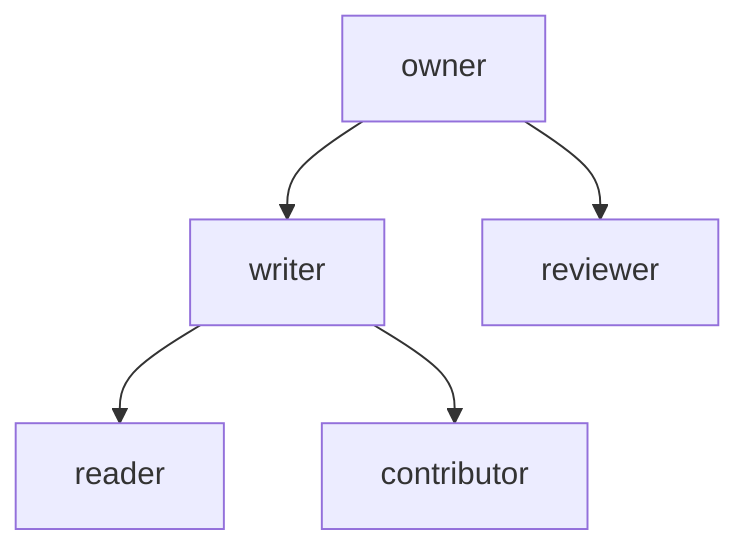

# Permissions

Access to a repository is a set of `(object, relation, subject)` tuples
stored in the repository's metadata keyspace. Objects are the repository
(`repo`) or directories (`dir:/src/billing`); subjects are a principal, a
team, a principal kind or everyone. `Authorizer::check` applies the userset
rewrite `owner ⊇ writer ⊇ reader` and directory inheritance over a
short-lived snapshot of the tuples. The invariant: a relation granted on a
directory applies to its whole subtree, and the authorizer denies on any
store error rather than failing open.

## Model

An arrow means "satisfies": a check for the lower relation accepts a tuple
holding the upper one. [`Relation::satisfied_by`](../../crates/rill-policy/src/rebac/model.rs)
is the table:

| Check for | Accepted tuples |
| --- | --- |
| `owner` | `owner` |
| `writer` | `owner`, `writer` |
| `reader` | `owner`, `writer`, `reader` |
| `reviewer` | `owner`, `reviewer` |
| `contributor` | `owner`, `writer`, `contributor` |

`writer` does not imply `reviewer`: a writer cannot vote unless granted
`reviewer` separately. `contributor` is defined and checked but no server
handler asks for it.

Subjects (`Subject`, parsed by `FromStr`):

| Form | Variant | Matches |
| --- | --- | --- |
| `principal:<PrincipalId>` | `Principal(id)` | `id == principal.id` |
| `team:<name>` | `Team(name)` | `name` in the caller's `AuthContext::teams`; names may not be empty or contain `/` |
| `kind:human` / `kind:agent` / `kind:service` | `Kind(k)` | `principal.kind == k` |
| `*` | `Any` | everyone |

Objects: `REPO_OBJECT` is `"repo"`; `dir_object(path)` is `"repo"` for the
root and `dir:/<path>` otherwise. `inheritance_chain(object)` lists the
object, each ancestor directory and finally `repo`, nearest first; an
object that is not a directory (for example `intent:abc`) has no ancestors.

## Persistence

Tuples are keys with empty values in the repository's `meta` store under
[`table::REBAC`](../../crates/rill-store/src/keys.rs); `RepoStore::add_relation`
sets the key, `remove_relation` deletes it in a transaction, and
`relations_of(object)` scans one object's prefix.

| Key | Value |
| --- | --- |
| `rebac/<repo>/<object>/<relation>/<subject>` | empty |

`Snapshot::load` scans the whole `rebac/<repo>/` prefix and parses each tail
from the right (`rsplit_once('/')` twice), because object ids contain `/`
but relations and subjects never do. A row that fails to parse is logged
with `tracing::warn!` and skipped rather than failing every check.

## Snapshot and authorizer

[`Snapshot`](../../crates/rill-policy/src/rebac/snapshot.rs) is an
immutable `Vec<Tuple>` with a `taken_at` instant. `check(principal, teams,
relation, object)` is true when any tuple has an accepted relation, an
object in the inheritance chain and a matching subject. `granted_dirs`
returns the directories (root for `repo`) on which the principal directly
holds an accepted tuple; each implies its subtree.

[`SnapshotCache`](../../crates/rill-policy/src/rebac/snapshot.rs) holds one
`Arc<Snapshot>` behind a `std::sync::Mutex` and reloads it when older than
its TTL. [`Authorizer`](../../crates/rill-policy/src/rebac/authorizer.rs)
owns a `RepoStore` and a cache with `DEFAULT_SNAPSHOT_TTL` of 500 ms, so a
request that runs many checks scans once:

| Method | Behaviour |
| --- | --- |
| `grant(object, relation, subject)` | `add_relation` then `invalidate`. |
| `revoke(object, relation, subject)` | `remove_relation` then `invalidate`. |
| `invalidate()` | Drops the cached snapshot. |
| `snapshot()` | Current snapshot, reloading when stale. |
| `check(...)` | `Snapshot::check`; a store error is logged at `error` and returns `false`. |
| `check_path(principal, teams, relation, path)` | `check` on `dir_object(path)`. |
| `allowed_paths(principal, teams)` | `PathFilter` for `Reader`. |
| `allowed_paths_for(principal, teams, relation)` | `PathFilter::under(granted_dirs)`; a store error yields `deny_all`. |

A write that bypasses the authorizer (direct `add_relation`) is invisible
until `invalidate` or the TTL elapses. Grants and revokes are individual
key writes; there is no multi-tuple transaction.

## Read filtering

[`PathFilter`](../../crates/rill-policy/src/rebac/authorizer.rs) wraps an
`Arc<dyn Fn(&RepoPath) -> bool>`. `under(roots)` allows paths at or below
any root; a root entry means `allow_all`, an empty list means `deny_all`.
`retain` prunes a `Vec` in place. The filter is built once per request from
the snapshot and applied to every candidate path without touching the store.

`Permit::read_filter()` returns `allow_all` under `dev_mode` or bootstrap
and otherwise `allowed_paths_for(..., Reader)`. Server call sites:

| RPC | Use |
| --- | --- |
| `ListDir` ([trees.rs](../../crates/rill-server/src/services/repo/trees.rs)) | Drops entries whose joined path fails the filter, so names of unreadable directories do not leak. |
| `Diff` ([trees.rs](../../crates/rill-server/src/services/repo/trees.rs)) and `WorkspaceDiff` ([workspace.rs](../../crates/rill-server/src/services/workspace.rs)) | `DiffOptions.filter`; `file_diffs` skips entries the filter rejects. |
| `Grep` ([grep.rs](../../crates/rill-server/src/services/repo/grep.rs)) | Passed to `RepoContext::grep` as the `allowed` predicate on search hits. |

Point reads (file content in `trees.rs`, path history and blame in
`history.rs`) call `permit().read(path)` instead, which checks the path's
directory chain.

## Enforcement in the server

[`Permit`](../../crates/rill-server/src/auth/permit.rs) is the only caller
of the authorizer outside admin. `check` runs the capability layer first,
then skips the relation layer under `dev_mode` or when the repository has
no tuples (`bootstrap`), then `check_path`. Denial is `Error::denied` →
`PERMISSION_DENIED`. Mapping of handlers to relations:

| Relation | Handlers |
| --- | --- |
| `Reader` | Every read: trees, refs, history, watch, review and intent reads, `ListRelations`, `GetPolicy`, object `GET`/`HEAD`, batch. |
| `Writer` on a path | `CreateChangeVersion` per `file_changes` path; `ApplyEdits`; workspace `Snapshot` per entry. |
| `Writer` on root | Workspace create/update, intents, review submit, object `PUT`, `Land`, `Revert`, `ReportVerification` (`Permit::land`). |
| `Reviewer` | `Vote`, `Comment`, thread resolution. |
| `Owner` | `AddRelation`, `RemoveRelation`, `SetPolicy`, `IssueToken` without a capability, `owns_or_admin` fallbacks. |

`CreateRepo` ([refs.rs](../../crates/rill-server/src/services/repo/refs.rs))
grants `owner` on `repo` to the creator immediately after the repository
record exists, which is what takes a new repository out of the open
bootstrap state.

## Admin RPCs

[`AdminService`](../../crates/rill-server/src/services/admin.rs) names the
repository inside the object string instead of a `repo` field:

| RPC | Object syntax | Check | Effect |
| --- | --- | --- | --- |
| `AddRelation` | `repo:<name>` or `path:<name>/<dir>` | `admin()` | `Authorizer::grant` |
| `RemoveRelation` | same | `admin()` | `Authorizer::revoke` |
| `ListRelations` | same, optional `relation` filter | `read(root)` | `RepoStore::relations_of`, objects rendered back as `repo:<name>` / `path:<name>/<dir>` |

`parse_subject` strips a trailing `#member` (so `team:infra#member` is
`team:infra`) before `Subject::from_str`; an unparseable subject, relation
or object is `INVALID_ARGUMENT`.

## Limitations

* No tuple validation on write: a `principal:<id>` subject is accepted for
  any 16-byte id, and the relation layer cannot tell a typo from a
  principal that has never connected.
* Teams are populated only by static tokens; `team:` tuples never match a
  Biscuit-authenticated principal in the current server wiring.
* A repository whose last tuple is removed reverts to the open bootstrap
  state.
* Checks are per repository; there is no cross-repository or global role.
* The snapshot is a full scan of the repository's tuples on every reload;
  cost is linear in tuple count with no index by subject.
* `Snapshot::check` accepts any object in the chain regardless of whether a
  deeper tuple denies; there are no negative tuples.

## Code

* [`rebac/mod.rs`](../../crates/rill-policy/src/rebac/mod.rs): re-exports.
* [`rebac/model.rs`](../../crates/rill-policy/src/rebac/model.rs): `Relation`, `Subject`, `REPO_OBJECT`, `dir_object`, `dir_of_object`, `inheritance_chain`.
* [`rebac/snapshot.rs`](../../crates/rill-policy/src/rebac/snapshot.rs): `Tuple`, `Snapshot`, `SnapshotCache`, `parse_tail`.
* [`rebac/authorizer.rs`](../../crates/rill-policy/src/rebac/authorizer.rs): `Authorizer`, `PathFilter`, `DEFAULT_SNAPSHOT_TTL`.
* [`rebac/tests.rs`](../../crates/rill-policy/src/rebac/tests.rs): rewrite, inheritance, team/kind/wildcard and filter cases.
* [`rill-store/src/keys.rs`](../../crates/rill-store/src/keys.rs): `rebac`, `rebac_object_prefix`.
* [`rill-store/src/repo.rs`](../../crates/rill-store/src/repo.rs): `add_relation`, `remove_relation`, `relations_of`.
* [`auth/permit.rs`](../../crates/rill-server/src/auth/permit.rs): `Permit`.

## See

* [identity-and-authentication](identity-and-authentication.md) for `AuthContext`, dev mode and the bootstrap rule.
* [capability-tokens](capability-tokens.md) for the token layer intersected with relations.
