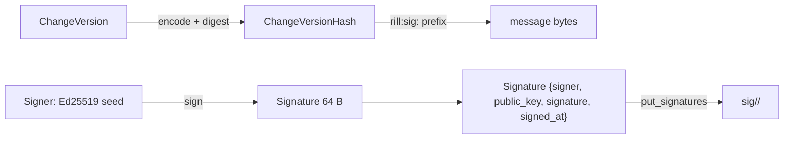

# Signing

`signing.rs` produces and checks Ed25519 signatures over object hashes. A
`Signer` holds a keypair; `sign` yields a detached
[`Signature`](../../crates/rill-types/src/objects/change.rs) naming the
signing principal, and `verify` checks it against the public key the
signature itself carries. The invariant: the signed message is
`"rill:sig:" || hash`, so a signature over a Rill object hash can never be
replayed as a signature over arbitrary bytes in another protocol using the
same key.

## What is signed

A signature covers an `ObjectHash`, which is itself a BLAKE3 digest of a
kind-prefixed encoding (see `ObjectHash::digest(kind, bytes)`). In
practice the signed object is a change version: `RepoStore::put_signatures`
and `get_signatures` are keyed by `ChangeVersionHash`, and a version's hash
covers its author, provenance, parents and file changes. Signing the hash
therefore attests to the whole version, including its
[`Provenance`](../../crates/rill-types/src/objects/change.rs).

| `Signature` field | Content |
| --- | --- |
| `signer` | The `Principal` on whose behalf the key signed. |
| `public_key` | 32-byte Ed25519 verifying key. |
| `signature` | 64-byte Ed25519 signature over `rill:sig:` + hash. |
| `signed_at` | Informational; not covered by the signature. |

## Keys

| API | Behaviour |
| --- | --- |
| `Signer::generate()` | Fresh keypair from `OsRng`. |
| `Signer::from_seed(&[u8; 32])` | Deterministic from a seed. |
| `Signer::from_bytes(&[u8])` | As above; any length other than 32 is `Error::InvalidKey`. |
| `Signer::seed()` | The secret seed. |
| `Signer::public_key()` | 32 bytes. |
| `KeyFile::encode(signer)` | 64 hex characters plus `\n`. |
| `KeyFile::decode(text)` | Trims whitespace, hex-decodes, `from_bytes`. |
| `KeyFile::encode_public` / `decode_public` | Hex for the verifying key; wrong length is `InvalidKey`. |

`Debug` for `Signer` prints only the public key. The crate defines the
key-file format but does not read or write files; no caller persists a
signing key today.

## Signing and verification

`Signer::sign(hash, principal)` calls `sign_at` with `Timestamp::now()`.
`verify(sig, hash)` rebuilds the message, parses `sig.public_key` and
`sig.signature` (wrong lengths return `false`, never panic) and runs
`VerifyingKey::verify_strict`. It establishes that the key in the signature
signed this hash. It does not establish that the key belongs to
`sig.signer`; that binding is the caller's job, and no key directory exists
in the codebase.

## Provenance for agents

`Provenance` is part of the hashed change version, so a signature over the
version hash also fixes:

| Field | Meaning |
| --- | --- |
| `tool` | Agent role or tool name (`claude-code`, `reviewer`, `lander`). |
| `model` | Model identifier for agent-authored versions. |
| `session` | Session or run id linking to a transcript. |
| `prompt_ref` | Reference to the prompt or spec. |
| `sponsor` | Human who delegated the work when the author is an agent. |
| `resolved_by` | Which stage of the conflict pipeline produced the version; the server sets it from `Permit::resolved_by()` (`human`, `agent`, `service`) in `ApplyEdits`. |
| `extra` | Free-form map (the lander records `REVERTS_KEY` here). |

The server copies `sponsor` forward on amends when the new version omits it
([write.rs](../../crates/rill-server/src/services/repo/write.rs)). The risk
classifier reads `resolved_by == "agent"` to bump a change's class; see
[submit-policy](submit-policy.md).

## Server path

`CreateChangeVersion` accepts `signatures` alongside the version, converts
each with `Signature::try_from`, commits the version and then
`put_signatures(&hash, &signatures)` when the list is non-empty.
`GetChangeVersion` returns `get_signatures(&hash)` next to the version, and
the SDK exposes both (`history.rs`, `write.rs`). Signatures are stored as a
postcard-encoded `Vec<Signature>` under one key:

| Key | Value |
| --- | --- |
| `sig/<repo>/<hash>` | encoded `Vec<Signature>` |

The server does not call `verify` on submitted signatures, does not check
that `sig.signer` matches the authenticated caller, and does not sign
anything itself. `ApplyEdits` and the lander produce versions without
signatures.

## Limitations

* `Signer` and `verify` have no callers outside `rill-policy`; neither the
  CLI, the SDK nor the server signs or verifies. Signing is a complete
  library with an unwired integration.
* Storing signatures is a separate write after the version commit, so a
  failure between the two leaves an unsigned version.
* `put_signatures` replaces the whole list; a second `CreateChangeVersion`
  for the same hash with different signatures overwrites rather than
  appends.
* There is no key directory binding public keys to principals, so a stored
  signature proves possession of some key, not the identity in `signer`.
* `signed_at` is unsigned metadata.

## Code

* [`signing.rs`](../../crates/rill-policy/src/signing.rs): `Signer`, `verify`, `KeyFile`, `DOMAIN`.
* [`objects/change.rs`](../../crates/rill-types/src/objects/change.rs): `Signature`, `Provenance`.
* [`rill-store/src/repo.rs`](../../crates/rill-store/src/repo.rs): `put_signatures`, `get_signatures`; [`keys.rs`](../../crates/rill-store/src/keys.rs): `signatures`.
* [`services/repo/write.rs`](../../crates/rill-server/src/services/repo/write.rs): `create_change_version_impl`.
* [`services/repo/history.rs`](../../crates/rill-server/src/services/repo/history.rs): signatures on read.
* [`rill-sdk/src/repo/write.rs`](../../crates/rill-sdk/src/repo/write.rs), [`history.rs`](../../crates/rill-sdk/src/repo/history.rs): client surface.

## See

* [identity-and-authentication](identity-and-authentication.md) for the `Principal` named in `signer`.
* [capability-tokens](capability-tokens.md) for the other Ed25519 key in the system, the Biscuit root, which is unrelated to signing keys.
* [submit-policy](submit-policy.md) for how provenance feeds risk.
