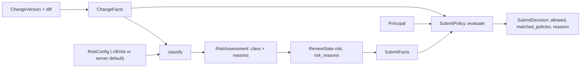
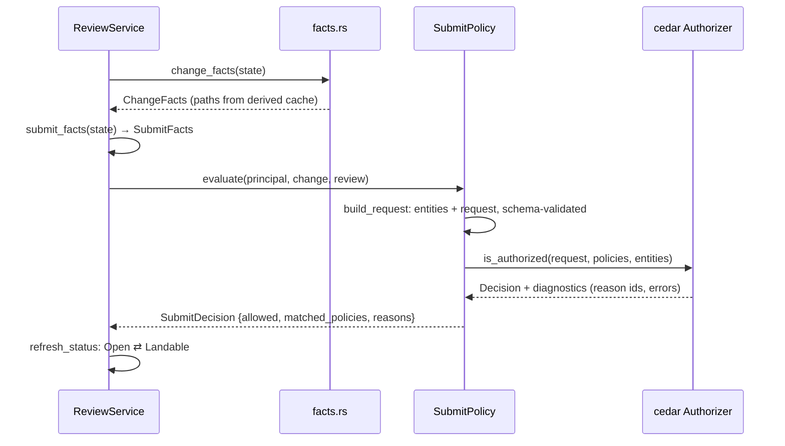

# Submit policy

Whether a change may land is decided in two deterministic stages. The risk
classifier (`risk/`) maps facts about a change version to a `RiskClass`
and the list of features that fired. The submit policy (`submit/`) is a
Cedar policy set evaluated against a `Rill::Principal`, a `Rill::Change`
built from the risk class and the review's votes and threads, and the
`Rill::Action::"land"` action. Neither stage reads the object store; the
review service assembles `ChangeFacts` and `SubmitFacts` and passes them in,
so evaluation is cheap enough to run on every vote. The invariant: a Cedar
`forbid` always wins over any `permit`.



## Facts

[`ChangeFacts`](../../crates/rill-policy/src/risk/facts.rs) is a projection
assembled by [`ReviewService::version_facts`](../../crates/rill-review/src/facts.rs)
from the version, its tree diff against the first parent, and its intent:

| Field | Source |
| --- | --- |
| `author`, `provenance` | The `ChangeVersion`. |
| `paths: Vec<PathFacts>` | One per `diff_trees` entry plus conflicted paths with no tree difference; cached as derived data `review-paths@1`. |
| `total_files`, `total_lines` | Derived from `paths` by `ChangeFacts::new`; a caller that truncates `paths` keeps the true count. |
| `intent_kind`, `risk_override` | The linked `Intent`, when `cv.intent` resolves. |
| `stack_depth` | Position of the change in `ReviewState::stack`. |

`PathFacts` carries `added`, `modified`, `deleted`, `conflict`,
`lines_added`, `lines_removed` and `cosmetic_only: Option<bool>`. Line
counts and `cosmetic_only` are filled only when both sides are text under
`MAX_DIFF_BYTES` (1 MiB); `cosmetic_only` is true when the texts match after
stripping whitespace and lines starting with `//` or `#`.

[`SubmitFacts::from_review`](../../crates/rill-policy/src/submit/facts.rs)
reads the `ReviewState`: `risk`, one `VoteSummary` per label over
`current_votes()` (votes on the current version only), `unresolved_threads`,
`unresolved_blocking_threads` (unresolved threads with a `Bug` or `Security`
comment) and `touches_sensitive` (`risk_reasons` contains a
`sensitive path ` entry). `VoteSummary::from_votes` keeps one vote per
voter (the latest) and reports `max`, `min`, `human_max`, `agent_max`,
`human_votes`, `agent_votes`, `human_approvals`, `agent_approvals`; service
votes count toward `max`/`min` only.

## Risk classification

[`RiskConfig`](../../crates/rill-policy/src/risk/config.rs) is declarative
and compiled once into `CompiledRiskConfig` (globset with
`literal_separator`, so `*` stops at `/`). An invalid pattern is
`Error::InvalidGlob`.

| Field | Default | Role |
| --- | --- | --- |
| `sensitive: Vec<SensitiveGlob {glob, class}>` | empty | Matching path raises the floor to `class`. |
| `trivial_extensions` | `md`, `txt`, `rst`, `adoc` | Documentation files (case-insensitive extension). |
| `test_globs` | `**/tests/**`, `**/test/**`, `**/*_test.*`, `**/*.test.*`, `**/*_spec.*` | Test files. |
| `max_files` | 50 | More files bumps one step. |
| `max_lines` | 1000 | More lines bumps one step. |

[`classify(facts, config)`](../../crates/rill-policy/src/risk/classify.rs)
evaluates a fixed, ordered feature list; every feature that fires is named
in `RiskAssessment::reasons`, which the review stores as `risk_reasons`:

| Order | Feature | Effect | Reason text |
| --- | --- | --- | --- |
| 1 | No paths | `Trivial` | `no paths touched` |
| 1 | Every path docs or `cosmetic_only == Some(true)`, and `total_files <= paths.len()` | `Trivial` | `docs or comments only` |
| 1 | Every path a test, list complete | `Low` | `tests only` |
| 1 | Otherwise | `Normal` | none |
| 2 | Sensitive glob match | `max(class, floor)` | `sensitive path <p> matches "<glob>" (at least <class>)` |
| 2 | First component is `.rill` | `Critical` | `policy file <p> under .rill/` |
| 3 | `provenance.resolved_by == "agent"` | `bump()` | `conflict resolved by agent` |
| 3 | Any path in conflict | `bump()` | `unresolved conflicts` |
| 3 | `total_files > max_files` | `bump()` | `<n> files exceeds <max>` |
| 3 | `total_lines > max_lines` | `bump()` | `<n> lines exceeds <max>` |
| 4 | `risk_override` on the intent | replaces the class | `intent risk override <class>` |

`RiskClass::bump` is `Trivial → Low → Normal → Sensitive → Critical`, and
`Critical` saturates. A truncated path list never lowers the baseline. The
`.rill/` rule is unconditional because a change there can change who may
land what.

## Cedar schema

[`SCHEMA_SRC`](../../crates/rill-policy/src/submit/schema.rs) is parsed
once per process. Labels are entity tags on `Rill::Change` so a policy can
address any label by name without the schema enumerating them.

| Entity / type | Attributes |
| --- | --- |
| `Rill::Principal` | `kind`, `name` |
| `Rill::Change` | `risk`, `author_kind`, `intent_kind` (`feature`, `bug`, `refactor`, `chore`, `experiment`, `system`, `none`), `unresolved_threads`, `unresolved_blocking_threads`, `touches_sensitive`, `has_agent_resolution`, `label_names: Set<String>`; tags `VoteSummary` |
| `Rill::VoteSummary` | `max`, `min`, `human_max`, `agent_max`, `human_votes`, `agent_votes`, `human_approvals`, `agent_approvals` (all `Long`) |
| `Rill::Action::"land"` | principal `[Principal]`, resource `[Change]` |

[`entities.rs`](../../crates/rill-policy/src/submit/entities.rs) builds
`Rill::Principal::"<id>"` and `Rill::Change::"current"` with one tag per
label in `SubmitFacts.labels`, validates the `Entities` and `Request`
against the schema, and uses an empty context.

## Default policy

[`DEFAULT_POLICY`](../../crates/rill-policy/src/submit/default_policy.rs),
verbatim:

```cedar
// ---- blocking rules ----------------------------------------------------

@id("block_review_veto")
forbid(principal, action == Rill::Action::"land", resource)
when {
    resource.hasTag("Review") && resource.getTag("Review").min <= -2
};

@id("block_unresolved_bug_or_security")
forbid(principal, action == Rill::Action::"land", resource)
when { resource.unresolved_blocking_threads > 0 };

// ---- permits by risk class ----------------------------------------------

// Trivial and low-risk changes land on a passing verification alone.
@id("land_trivial_or_low")
permit(principal, action == Rill::Action::"land", resource)
when {
    (resource.risk == "trivial" || resource.risk == "low")
    && resource.hasTag("Verified") && resource.getTag("Verified").max >= 1
};

// Normal changes need one human +2 on Review.
@id("land_normal_human_review")
permit(principal, action == Rill::Action::"land", resource)
when {
    resource.risk == "normal"
    && resource.hasTag("Review") && resource.getTag("Review").human_max >= 2
};

// ... or two distinct agent approvals on Review plus a human owner's +1.
@id("land_normal_agent_review_with_owner")
permit(principal, action == Rill::Action::"land", resource)
when {
    resource.risk == "normal"
    && resource.hasTag("Review") && resource.getTag("Review").agent_approvals >= 2
    && resource.hasTag("Owner") && resource.getTag("Owner").human_max >= 1
};

// Sensitive and critical changes need both a human owner and a human +2.
@id("land_sensitive_or_critical")
permit(principal, action == Rill::Action::"land", resource)
when {
    (resource.risk == "sensitive" || resource.risk == "critical")
    && resource.hasTag("Owner") && resource.getTag("Owner").human_max >= 1
    && resource.hasTag("Review") && resource.getTag("Review").human_max >= 2
};
```

Requirements by class under the default policy, all subject to the two
`forbid` rules (any `Review` vote of −2 or lower; any unresolved `Bug` or
`Security` thread):

| Class | Requirement |
| --- | --- |
| `trivial`, `low` | `Verified.max >= 1` |
| `normal` | `Review.human_max >= 2`, or `Review.agent_approvals >= 2` and `Owner.human_max >= 1` |
| `sensitive`, `critical` | `Owner.human_max >= 1` and `Review.human_max >= 2` |

## Evaluation



[`SubmitPolicy::from_source`](../../crates/rill-policy/src/submit/policy.rs)
parses the text (`Error::PolicyParse`), renames each policy to its
`@id("...")` annotation (duplicates are `PolicyParse`), and validates in
`ValidationMode::Strict` against the schema (`Error::PolicyValidation`); a
policy referencing an unknown attribute is rejected at load, not at land.
`default_rules()` loads `DEFAULT_POLICY`. An empty set denies everything.

`evaluate(principal, change, review)` returns `SubmitDecision`:

| Field | Content |
| --- | --- |
| `allowed` | `Decision::Allow`. |
| `matched_policies` | Sorted ids from `diagnostics().reason()`: the forbids that fired when denied, otherwise the permits. |
| `reasons` | One `<id>: permit|forbid (<description>)` line per matched policy, `no permit rule matched` when none, plus `evaluation error: ...` for each Cedar error (also logged at `warn`). |

[`ReviewService::evaluate`](../../crates/rill-review/src/evaluate.rs)
evaluates as the review's owner; `evaluate_for` takes an explicit actor;
`refresh_status` flips `Open` ⇄ `Landable` and leaves other statuses alone.
`Error::PolicyEvaluation` surfaces as gRPC `INTERNAL`.

## Storage and hot swap

[`state/policy.rs`](../../crates/rill-server/src/state/policy.rs) keeps
both documents per repository as JSON `StoredPolicy { text, updated_at,
updated_by }` in the misc keyspace:

| Key | Name | Text |
| --- | --- | --- |
| `misc/<repo>/policy:submit` | `submit` | Cedar |
| `misc/<repo>/policy:risk` | `risk` | JSON `RiskConfig` |

`effective_submit` returns the stored policy or `default_rules()`;
`effective_risk` returns the stored config or `ServerConfig.risk`, compiled.
[`RepoContext::build_review`](../../crates/rill-server/src/state/registry.rs)
constructs the `ReviewService` with both as `Arc`s.

`AdminService.SetPolicy` (`<repo>/submit` or `<repo>/risk`) requires
`permit().admin()`, runs `policy::validate` (full parse, Cedar validation or
glob compilation; failure is `INVALID_ARGUMENT` and nothing is stored),
writes the record, then `RepoContext::reload_policy` rebuilds the
`ReviewService` and swaps it into an `ArcSwap`. In-flight requests holding
the old `Arc` finish on the old policy; event subscribers are unaffected
because the broadcast sender is shared. `GetPolicy` requires `read` and
returns the stored record or the default text attributed to the lander
principal at the repository's `created_at`.

## Limitations

* `.rill/risk.toml` and `.rill/submit.cedar` in the tree are not read; the
  only sources are the stored records and `ServerConfig.risk`. The
  `.rill/` → `Critical` rule guards files that nothing loads yet.
* `stack_depth` and `author_kind` are computed and exposed but no default
  rule uses them.
* `Provenance::sponsor` is not an entity attribute; `Owner` votes must be
  cast by a human directly.
* Changing a stored policy does not re-evaluate existing reviews until
  their next vote, comment or refresh.
* `VoteSummary` values are `i8`/`u32` widened to Cedar `Long`; vote values
  outside the label set's range are not validated here.

## Code

* [`risk/facts.rs`](../../crates/rill-policy/src/risk/facts.rs): `ChangeFacts`, `PathFacts`.
* [`risk/config.rs`](../../crates/rill-policy/src/risk/config.rs): `RiskConfig`, `SensitiveGlob`, `CompiledRiskConfig`.
* [`risk/classify.rs`](../../crates/rill-policy/src/risk/classify.rs): `classify`, `RiskAssessment`, `SENSITIVE_REASON_PREFIX`, `touches_sensitive`.
* [`submit/schema.rs`](../../crates/rill-policy/src/submit/schema.rs): `SCHEMA_SRC`, `schema`.
* [`submit/entities.rs`](../../crates/rill-policy/src/submit/entities.rs): `build_request`, `change_entity`, `principal_entity`.
* [`submit/facts.rs`](../../crates/rill-policy/src/submit/facts.rs): `SubmitFacts`, `VoteSummary`.
* [`submit/default_policy.rs`](../../crates/rill-policy/src/submit/default_policy.rs): `DEFAULT_POLICY`.
* [`submit/policy.rs`](../../crates/rill-policy/src/submit/policy.rs): `SubmitPolicy`, `SubmitDecision`, `apply_id_annotations`.
* [`submit/tests.rs`](../../crates/rill-policy/src/submit/tests.rs): default-policy cases.
* [`rill-review/src/facts.rs`](../../crates/rill-review/src/facts.rs), [`evaluate.rs`](../../crates/rill-review/src/evaluate.rs): fact assembly and status refresh.
* [`state/policy.rs`](../../crates/rill-server/src/state/policy.rs), [`services/admin.rs`](../../crates/rill-server/src/services/admin.rs): storage, `GetPolicy`, `SetPolicy`.

## See

* [permissions](permissions.md) for who may call `SetPolicy`.
* [identity-and-authentication](identity-and-authentication.md) for the principal kinds that `human_max` and `agent_approvals` distinguish.
* [signing](signing.md) for the provenance that marks agent resolutions.
