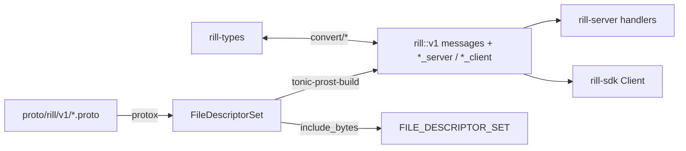
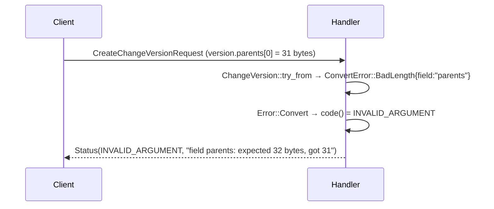

# The rill.v1 protocol

`rill-proto` holds the `rill.v1` protobuf package: six gRPC services, the
wire mirrors of the `rill-types` object model, and the `convert` module that
maps between them. The invariant: no crate below `rill-proto` depends on
tonic, every wire message that mirrors a `rill-types` type converts with
`From` outward and `TryFrom` inward, and decoding never guesses: a bad field
is a `ConvertError` naming that field, which becomes `INVALID_ARGUMENT`.

## Build

`build.rs` compiles the seven files under `proto/rill/v1/` with `protox`
(no `protoc` binary), writes the `FileDescriptorSet` to `OUT_DIR` for
`rill_proto::FILE_DESCRIPTOR_SET` (gRPC reflection), and runs
`tonic-prost-build` with `.btree_map(".rill.v1")` and `.bytes(".rill.v1")`
so maps are ordered and byte fields are `bytes::Bytes`, matching
`rill-types`. Server and client stubs are both generated.

## Services

### RepoService (`repo.proto`)

| Group | RPCs |
| --- | --- |
| Repositories | `GetRepo`, `ListRepos`, `CreateRepo` |
| History | `GetChangeVersion`, `GetChangeInfo`, `GetChangeVersions`, `Log`, `PathHistory`, `Blame` |
| Search | `Grep` |
| Trees and blobs | `GetTree`, `ListDir`, `ResolvePath`, `GetBlob` (server stream of `BlobChunk`), `PutBlob` (client stream: one `PutBlobHeader` then `data`), `HasObjects` |
| Comparison | `Diff`, `MergeBase`, `IsAncestor` |
| Writes | `CreateChangeVersion`, `ApplyEdits`, `Rebase`, `Merge`, `Resolve` |
| Refs and trunk | `ResolveRef`, `ListRefs`, `MoveRef`, `TrunkHead`, `TrunkRange` |
| Watches | `WatchRefs` → `RefEvent`, `WatchTrunk` → `LandEvent`, `WatchLog` → `ChangeInfo` |
| Derived data | `GetDerived`, `WaitDerived` |

### WorkspaceService (`workspace.proto`)

`CreateWorkspace`, `GetWorkspace`, `ListWorkspaces`, `SetSparseProfile`,
`Snapshot`, `NewChange`, `UpdateBase`, `Handoff`, `Undo`, `ListOperations`,
`DeleteWorkspace`, `WorkspaceDiff`.

### ReviewService (`review.proto`)

`GetReview`, `ListReviews`, `SubmitForReview`, `Vote`, `Comment`,
`ReplyThread`, `ResolveThread`, `SetStack`, `EvaluateSubmit`, `Abandon`,
`RequestLand` → `LandTicket`, `GetLandStatus`, `WatchReview` → stream of
`ReviewEvent`. `LandStatus` is `QUEUED | REBASING | LANDED | FAILED |
CANCELLED`; the server folds `Verifying`/`Landing` into `REBASING` and
`Returned` into `CANCELLED`.

### IntentService (`intent.proto`)

`CreateIntent`, `GetIntent`, `UpdateIntent`, `ListIntents`, `LinkChange`,
`FindSimilarIntents` → `ScoredIntent`.

### LanderService (`lander.proto`)

`GetTrunkStatus`, `ListLandings`, `GetVerification`, `ReportVerification`,
`RevertSeq`, `Bisect`. `VerificationStatus` and `VerificationReport` carry
both the post-land verifier's own records and reports filed by external
runners.

### AdminService (`admin.proto`)

`WhoAmI`, `IssueToken`, `AddRelation`, `RemoveRelation`, `ListRelations`,
`GetPolicy`, `SetPolicy`, `Health`. Admin requests carry no `repo` field;
the repository is encoded in the object (`repo:<repo>`,
`path:<repo>/<dir>`), scope (`repo:<repo>[/<dir>[/*]]`) or policy name
(`<repo>/submit`, `<repo>/risk`).

## Message conventions

Stated at the top of `types.proto` and enforced by `convert`:

| Convention | Wire form | Decoder |
| --- | --- | --- |
| Object hashes | 32 raw `bytes` (BLAKE3) | `hash_from_proto(field, bytes)` → `BadLength` otherwise |
| Record ids (`ChangeId`, `IntentId`, `WorkspaceId`, `PrincipalId`, `RepoId`, `OperationId`) | 16 raw `bytes` | `id_from_proto::<I: RillId>`; `opt_*` treats empty as absent |
| Repository paths | normalized `/`-separated string, `""` is the root | `path_from_proto` → `ConvertError::Invalid` |
| Ref names | string | `ref_name_from_proto` |
| Timestamps | `int64` milliseconds since the Unix epoch, UTC | `timestamp_from_proto` |
| Trunk sequence | `uint64` | `trunk_seq_from_proto` |
| Enums | `*_UNSPECIFIED = 0` plus named values | `enum_from_proto` rejects 0 and unknown values with `BadEnum` |
| Required message fields | `optional` in proto3 terms | `required(field, Option)` → `Missing` |
| `Merge<T>` terms | `MergeTerms.terms`, interleaved `[add0, remove0, add1, ..., addN]`, odd length | `merge_terms_from_proto` → `Merge::from_vec`, even length is `Invalid` |
| `FileState` | `FileState {content?, kind}`; no `content` means absent | `file_state_from_proto` |
| `ContentRef` | `oneof ref { inline bytes, blob BlobRef, chunked BlobRef }` with `size` | `TryFrom<pb::ContentRef>` |
| `RootSpec` | `oneof root { ref, version_hash, tree_hash, trunk_seq }`; absent means trunk head | server `resolve_root` |
| Repository addressing | `string repo` on every repo-scoped request: name, `rp_<hex>` or bare hex | `RepoRegistry::resolve` |
| Idempotency key | `bytes operation_id` on every write request | parsed by `common::operation_id`; a fresh id when empty |
| Limits | `uint32 limit`; 0 means the server default | `common::limit(requested, default, max)` |
| Pages | `optional string page_token` / `next_page_token` | always `None` from the server |

## Conversion rules

`convert/mod.rs` re-exports the scalar helpers from `primitives.rs` and
the per-type modules provide `impl From<&T> for pb::T`, `impl From<T>` and
`impl TryFrom<pb::T> for T`:

| Module | Types |
| --- | --- |
| `primitives.rs` | hashes, ids (`RillId` trait over every `define_id!` type), paths, ref names, timestamps, trunk seq, `enum_from_proto`, `required` |
| `content.rs` | `FileKind`, `ContentRef`, `FileState`, `MergeTerms` |
| `change.rs` | `CopySource`, `FileChange`, `SubtreeChange`, `ChangeVersion`, `ChangeInfo`, `Signature` |
| `principal.rs` | `PrincipalKind`, `Principal`, `Provenance` |
| `tree.rs` | `DirSummary`, `TreeEntry`, `Tree` |
| `refs.rs` | `RefUpdate` |
| `review.rs` | `Label`, `LabelVote`, `ThreadAnchor`, `CommentCategory`, `Comment`, `Thread`, `ReviewStatus`, `ReviewState`, `confidence_from_proto` (0–100) |
| `intent.rs` | `RiskClass`, `IntentKind`, `IntentStatus`, `Intent` |
| `workspace.rs` | `SparseProfile`, `Workspace`, `OperationKind` (every variant), `Operation` |

Field names in errors are dotted paths (`copy_from.version`,
`content_ref.blob.hash`, `merge_terms.terms`) so a client can be told which
part of a nested request was malformed. `ConvertError` is `Clone +
PartialEq` and carries the `rill_types::Error` source for `Invalid`.

## Error mapping

`ConvertError` → `tonic::Status::invalid_argument` directly. Inside the
server every lower crate's error converts into `rill_server::Error`, whose
`code()` picks the gRPC code from the meaning of the underlying variant,
not the crate it came from (`error.rs`):

| Code | Server variants and lower errors |
| --- | --- |
| `NOT_FOUND` | `NotFound`; store `ObjectNotFound`/`KeyNotFound`/`NotFound`; core `ChangeNotFound`/`TreeNotFound`/`PathNotFound`; review `ReviewNotFound`/`NoVersions`/`VersionNotFound`/`ThreadNotFound`; lander `NotLanded`/`ChangeNotFound`/`UnknownTicket` |
| `ALREADY_EXISTS` | `AlreadyExists`; review `AlreadySubmitted` |
| `INVALID_ARGUMENT` | `InvalidArgument`, `Types`, `Convert`; store `HashMismatch`; core `NotADirectory`/`NotAFile`/`BinaryContent`/`InvalidChange`; policy parse/validation/glob/key/widening; review `WrongChange`/`UnknownLabel`/`VoteOutOfRange`/`InvalidStack`; search `InvalidPattern`/`InvalidGlob` |
| `FAILED_PRECONDITION` | `FailedPrecondition`; review `InvalidStatus`/`ThreadAlreadyResolved` |
| `PERMISSION_DENIED` | `PermissionDenied`; policy `TokenRejected`; review `MaxRequiresHuman` |
| `UNAUTHENTICATED` | `Unauthenticated`; policy `Token`/`Unauthenticated`/`TokenExpired` |
| `ABORTED` | store `Conflict` (compare-and-swap lost); review `Contended`; lander `RevertFailed` |
| `DEADLINE_EXCEEDED` | review `ReviewerTimeout` |
| `UNAVAILABLE` | `Io`, `Transport`; store `Backend`/`Io`; lander `Shutdown`; search `RootNotIndexed` |
| `DATA_LOSS` | store `Codec`; core `ContentSize`/`Codec` |
| `UNIMPLEMENTED` | `Unimplemented` (no handler returns it today) |
| `INTERNAL` | `Config`, `Internal`, `Exec`, policy `PolicyEvaluation`, core `Derive`/`Join`, review `ReviewerFailed`, lander `Hook`/`Verifier`/`Codec`; logged at error level |

The status message is the error's `Display` text. The reverse
`From<Status> for Error` keeps `NotFound`, `PermissionDenied`,
`Unauthenticated`, `InvalidArgument`, `FailedPrecondition`,
`AlreadyExists`, `Unimplemented` and folds the rest into `Internal`. On the
client, `rill_sdk::Error::Status {code, message}` preserves the code
unchanged ([sdk](../integrations/sdk.md)).

## Versioning

The package is `rill.v1`; there is no other version and no compatibility
shim. Additions are new fields and RPCs inside `v1`. A client that calls an
RPC the server lacks gets `UNIMPLEMENTED` from tonic's router; the only
client-side accommodation for that is the `Grep` fallback in `rill-mcp`
([sdk](../integrations/sdk.md#grep)). Enum zero values are reserved as
`UNSPECIFIED` and never valid, so adding enum values is backward compatible
for encoders and a decode error for older servers.

## Round-trip tests

`convert/roundtrip_tests.rs` encodes each value to proto, runs it through
prost `encode_to_vec`/`decode` (`wire()`), converts back and asserts
equality: `change_version_roundtrip`, `change_version_minimal_roundtrip`,
`change_version_errors_name_fields`, `change_info_roundtrip`,
`signature_roundtrip`, `review_state_roundtrip`, `label_roundtrip`,
`workspace_roundtrip`, `operation_roundtrip_every_kind`,
`tree_roundtrip_through_wire`, and `descriptor_set_is_embedded_and_parses`.
Unit tests next to `primitives.rs` and `content.rs` cover length checks,
`UNSPECIFIED` rejection, field naming and odd-length `MergeTerms`.

## Limitations

* `next_page_token` exists on every list response but the server never
  sets it.
* `operation_id` is carried on every write but only workspace RPCs persist
  it; there is no server-side idempotency table.
* `MergeBaseResponse.bases` is repeated but the server returns at most one.
* `GrepRequest` has no `path` field; a directory restriction is expressed
  as a `path_globs` entry (`<dir>/**`).

## Code

* [proto/rill/v1/types.proto](../../crates/rill-proto/proto/rill/v1/types.proto), [repo.proto](../../crates/rill-proto/proto/rill/v1/repo.proto), [workspace.proto](../../crates/rill-proto/proto/rill/v1/workspace.proto), [review.proto](../../crates/rill-proto/proto/rill/v1/review.proto), [intent.proto](../../crates/rill-proto/proto/rill/v1/intent.proto), [lander.proto](../../crates/rill-proto/proto/rill/v1/lander.proto), [admin.proto](../../crates/rill-proto/proto/rill/v1/admin.proto)
* [build.rs](../../crates/rill-proto/build.rs), [src/lib.rs](../../crates/rill-proto/src/lib.rs), [src/error.rs](../../crates/rill-proto/src/error.rs)
* [convert/mod.rs](../../crates/rill-proto/src/convert/mod.rs), [convert/primitives.rs](../../crates/rill-proto/src/convert/primitives.rs), [convert/content.rs](../../crates/rill-proto/src/convert/content.rs), [convert/change.rs](../../crates/rill-proto/src/convert/change.rs), [convert/roundtrip_tests.rs](../../crates/rill-proto/src/convert/roundtrip_tests.rs)
* [rill-server/src/error.rs](../../crates/rill-server/src/error.rs)

## See

* [server](server.md) for handlers, auth and the object protocol
* [objects](../data/objects.md) for the `rill-types` model these messages mirror
* [merge algebra](../data/merge-algebra.md) for `Merge<T>` term ordering
* [sdk](../integrations/sdk.md) for the typed client over this surface
