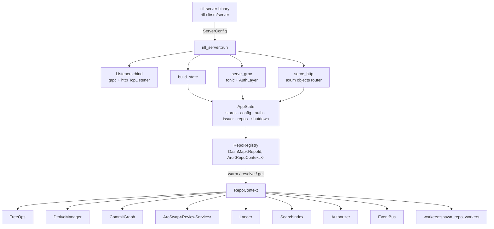
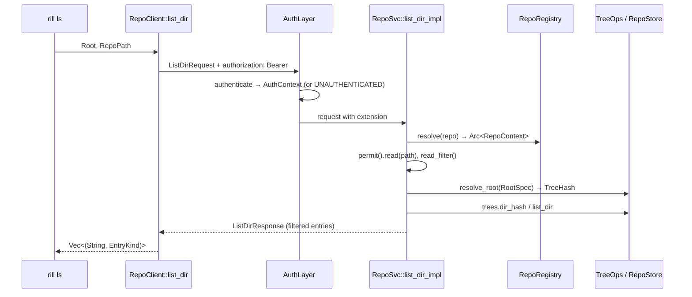

# Server runtime

`rill-server` is the process that owns every repository: it serves the
`rill.v1` gRPC API, the HTTP object protocol, a per-repository event bus and
the background workers (lander, post-land verifier, search indexer). The
crate is a library; the `rill-server` binary in `rill-cli` parses flags,
builds a `ServerConfig` and calls `rill_server::run`. The invariant that
shapes everything here: one `AppState` per process, one `RepoContext` per
repository, built lazily and cached for the life of the process, and every
handler is thin: decode, `Permit` check, one call into a lower crate, encode.

## Composition

`AppState` (`state/app.rs`) holds the `Stores` opened from
`StorageConfig`, the `Arc<ServerConfig>`, the composite `Authenticator`,
the Biscuit `Issuer`, the `RepoRegistry`, the root `CancellationToken` and
`started_at`. `AppState::new` opens storage; `AppState::with_stores` builds
over stores already open (tests). `build_state` then calls
`RepoRegistry::warm`, which builds every existing repository's context so
landers and indexers run before the first request.

`RepoRegistry::resolve(spec)` turns a request's `repo` field into an
`Arc<RepoContext>`: a name lookup first (`get_repo_by_name`), then an id
parse (`rp_<hex>` or bare hex). `get` serialises first builds behind
`build_lock` so two concurrent first requests cannot spawn two landers for
one repository. `create` maps a store conflict to `Error::AlreadyExists`.

`RepoRegistry::build` wires a `RepoContext` from the lower crates:

| Field | Type | Built from |
| --- | --- | --- |
| `repo` | `RepoStore` | `stores.repo(id)` |
| `trees` | `TreeOps` | objects + `DEFAULT_TREE_CACHE` |
| `derive` | `Arc<DeriveManager>` | repo, trees, `DERIVE_CACHE = 8192` |
| `graph` | `Arc<CommitGraph>` | repo, derive |
| `review` | `Arc<ArcSwap<ReviewService>>` | stored submit/risk policy (`state/policy.rs`) or defaults; shared `broadcast::Sender<ReviewEvent>` |
| `runner` | `Option<Arc<Runner>>` | only when `verify.enabled`; `LocalSandbox::new(verify.network)` |
| `lander` | `Arc<Lander>` | `ReviewHooksAdapter`, `ExecVerifier` or `AlwaysGreen`, `config.lander` |
| `postland` | `Option<Arc<PostLandVerifier>>` | only when `postland.enabled` |
| `search` | `Arc<SearchIndex>` | `SearchIndex::open(repo, derive, IndexConfig::default())` |
| `authorizer` | `Arc<Authorizer>` | repo (ReBAC tuples) |
| `events`, `tickets`, `labels`, `shutdown` | `EventBus`, `DashMap<u64, TicketInfo>`, `Arc<LabelSet>`, child token | fresh per context |

`RepoContext::review()` returns the current `Arc<ReviewService>`;
`reload_policy` rebuilds it after `SetPolicy` and stores it into the
`ArcSwap`, so handlers must not hold the `Arc` across requests. The lander's
`ReviewHooksAdapter` holds the swap handle, so in-flight landings see the
reload.

## Request path

Every gRPC request passes through `AuthLayer` (a tower layer, because
authentication may hit the store and tonic interceptors are synchronous).
It reads `authorization`, calls `auth::authenticate` and stores the
`AuthContext` in request extensions; failure short-circuits with a
`tonic::Status`. Handlers call `services::common::open(state, request, repo)`,
which pairs `auth::caller(request)` with `repos.resolve(repo)` into an
`Opened`, then `opened.permit().read|write|review|land|admin()` before any
store access. `Permit::check` (`auth/permit.rs`) runs two layers: the
capability token must allow the verb on the path even in dev mode, then the
ReBAC relation must hold unless `dev_mode` or the repository has no tuples
(the bootstrap rule; `CreateRepo` grants `owner` to the creator so API-made
repositories are never open).

`resolve_root` (`services/common.rs`) maps a `RootSpec` to a `Resolved
{version, root}`: `None` is the trunk head, `Ref` reads the ref, `TrunkSeq`
reads `trunk_at`, `VersionHash` derives the `RootTree`, `TreeHash` checks the
tree exists and yields no version. An empty repository resolves to the empty
tree. `Error` → `Status` mapping is in [protocol](protocol.md).

## gRPC services

All six are registered in `serve.rs` behind `AuthLayer`, alongside
`tonic-reflection` (from `rill_proto::FILE_DESCRIPTOR_SET`) and
`tonic-health`, which reports every service as serving at startup.

| Service | File | Backing crate | One line |
| --- | --- | --- | --- |
| `RepoService` | `services/repo/{history,trees,write,refs,watch,grep}.rs` | `rill-core`, `rill-search`, `rill-store` | history, trees, blobs, diffs, versions, refs, watches, derived data |
| `WorkspaceService` | `services/workspace.rs` | `rill-core` | server-side working copies with an operation log and `Undo` |
| `ReviewService` | `services/review.rs` | `rill-review`, `rill-lander` | votes, threads, stacks, submit evaluation, `RequestLand` hand-off |
| `IntentService` | `services/intent.rs` | `rill-store` | intents and change links |
| `LanderService` | `services/lander.rs` | `rill-lander` | trunk status, verification records, revert, bisect |
| `AdminService` | `services/admin.rs` | `rill-policy` | identity, Biscuit issuance, relations, policies, health |

`services/diff.rs` builds `FileDiff` records for `Diff` and `WorkspaceDiff`:
files over `MAX_DIFF_BYTES` (4 MiB) or binary are reported without hunks,
`DEFAULT_DIFF_LIMIT` is 1000 files, and the caller's `PathFilter` hides
paths it cannot read. `services/patch.rs` applies unified diffs for
`ApplyEdits` `patch` ops and rejects hunks whose context does not match.

`commit_version` (`services/repo/write.rs`) is the single write path for
versions: it checks parents and predecessor exist (`FAILED_PRECONDITION`),
checks referenced blobs were uploaded, calls `put_change_version`,
materialises the `RootTree` so a bad change fails the request, tells the
review service (`add_version`, ignoring `ReviewNotFound`), and publishes
`RepoEvent::VersionCreated`.

## Objects HTTP protocol

`objects/mod.rs` builds the axum router. Object URLs are immutable, so
responses carry `ETag: "<hash>"` and `Cache-Control: public, immutable,
max-age=31536000`; a CDN can front them.

| Route | Handler | Auth | Behaviour |
| --- | --- | --- | --- |
| `GET /o/{repo}/{kind}/{hash}` | `handlers::get_object` | read on root | raw bytes, `application/octet-stream`; 404 when absent |
| `HEAD /o/{repo}/{kind}/{hash}` | `handlers::head_object` | read on root | headers only |
| `PUT /o/{repo}/{kind}/{hash}` | `handlers::put_object` | write on root | `rill_store::object::verify` checks the body hashes to `{hash}` under `{kind}` (400 otherwise); 201 new, 200 existed; body limit `MAX_PUT_BYTES` = 256 MiB |
| `POST /o/{repo}/batch` | `batch::batch` | read on root | JSON `[{"kind","hash"}]` (≤ `MAX_BATCH` 10 000) → `application/vnd.rill.objects` stream |
| `GET /healthz` | `healthz` | none | `ok` |
| `GET /readyz` | `readyz` | none | 200 when every `health_components` entry is ok, else 503 with failing names |

Batch frames are `kind u8 · hash [32] · length u64 BE · bytes`, in request
order, with `length = u64::MAX` for a missing object; frames are produced
lazily by `futures::stream::unfold` so a batch never sits in memory. The
`require_auth` middleware (`auth/http.rs`) mirrors `AuthLayer` and answers
401 with the error text. `ObjectError` maps gRPC codes onto HTTP statuses
(`NotFound` 404, `PermissionDenied` 403, `Unauthenticated` 401,
`InvalidArgument`/`FailedPrecondition` 400, `AlreadyExists`/`Aborted` 409,
`Unavailable` 503, else 500).

## Event bus

`state/events.rs` gives each repository one `tokio::sync::broadcast`
channel of `RepoEvent` with capacity `EVENT_CAPACITY = 4096`. The channel is
lossy by design: a lagging receiver gets `RecvError::Lagged(n)` and must
re-sync from the store.

| `RepoEvent` | Source | Forwarded by |
| --- | --- | --- |
| `Review(ReviewEvent)` | `ReviewService` broadcast sender | `events.forward(review().subscribe(), ..)` |
| `Land(LandEvent)` | `Lander::subscribe` | `events.forward(lander.subscribe(), land_to_bus)` |
| `RefMoved {name, old, new, at}` | `MoveRef`, plus a synthesized `trunk` move for every `LandEvent::Landed` (`old` is `None` there) | handlers / `land_to_bus` |
| `VersionCreated {hash}` | `commit_version` | handlers |

The `Watch*` RPCs (`services/repo/watch.rs`) subscribe before replaying
from the store so nothing is missed. `WatchRefs` forwards bus events
filtered by prefix. `WatchTrunk` and `WatchLog` treat bus events as
wake-ups and read the actual rows (`trunk_range`, `log_after` in pages of
`REPLAY_PAGE = 512`) from a cursor, so output is exact even when the bus
lags. Each watch runs in a spawned task that ends on `ctx.shutdown`, bus
close, or client disconnect; the task-to-stream buffer is `STREAM_BUFFER =
256`. `WatchReview` in `services/review.rs` follows the same pattern.

## Workers

`workers::spawn_repo_workers(ctx)` runs when a context is first built:

| Worker | File | Lifecycle |
| --- | --- | --- |
| Review and land forwarders | `EventBus::forward` | until the source broadcast closes |
| Lander loop | `Lander::run_forever(shutdown)` | one per repo per process; serialises landings in-process |
| Post-land verifier | `PostLandVerifier::run_forever(interval, shutdown)` | only when `postland.enabled`; sweeps `batch_size` landings every `interval_secs` (min 1) |
| Search indexer | `workers/indexer.rs` | indexes the trunk head, then every `LandEvent::Landed`; on lag re-indexes head; flushes at shutdown |
| `ExecVerifier` | `workers/verifier.rs` | not a task: the lander's `Verifier` impl running `verify_tree` through `rill-exec` |
| `ReviewHooksAdapter` | `workers/hooks.rs` | not a task: `ReviewHooks` impl mapping `mark_landing`, `mark_landed`, `return_to_owner` (posts a comment from the lander principal), `dependents_of` (stack suffix) onto the review service; `ReviewNotFound` is tolerated |

`RepoContext::grep` serves `Grep` from the trigram index and indexes the
root on demand when the indexer has not reached it; `rill_search::Error::
RootNotIndexed` maps to `UNAVAILABLE`.

## Configuration

`ServerConfig` (`config.rs`) is `#[serde(default)]` TOML; every section has
a default giving a usable single-node development server. `load(path)`
reads the file (or defaults) and then `apply_env` over `RILL_*` variables.

| Key | Type / default | Meaning |
| --- | --- | --- |
| `listen_grpc` | `SocketAddr`, `127.0.0.1:7420` | gRPC API |
| `listen_http` | `SocketAddr`, `127.0.0.1:7421` | objects and health |
| `dev_mode` | `bool`, `false` | anonymous requests act as human `dev`; ReBAC skipped |
| `[storage] kind` | `memory` (default) · `local {dir}` · `s3 {url, prefix, meta_dir}` | `open_stores`: `Stores::memory`, `LocalStores::open`, `ObjectStoreBackend::from_url` + `RedbMetaStore` |
| `[auth] kind` | `static {tokens: [{token, principal_name, kind=human, teams=[]}]}` (default empty) · `biscuit {root_public_key_hex, root_private_key_hex?}` | `build_authenticator`; the server's own issuer is always trusted too |
| `[lander]` | `rill_lander::LandPolicy::default()` | verification modes, retries, auto-revert |
| `[risk]` | `rill_policy::RiskConfig::default()` | fallback when no stored `risk` policy |
| `[labels]` | `rill_review::votes::LabelSet::default()` | vote labels for every repository |
| `[verify] enabled, sandbox, network` | `false`, `local`, `false` | pre-land `.rill/verify.toml` runs; disabled means `AlwaysGreen` |
| `[postland] enabled, interval_secs, batch_size` | `false`, `30`, `DEFAULT_BATCH_SIZE` | post-land verifier loop |

Environment overrides: `RILL_LISTEN_GRPC`, `RILL_LISTEN_HTTP`,
`RILL_DEV_MODE`, `RILL_STORAGE` (`memory` | `local:<dir>` | `s3:<url>` with
`RILL_S3_PREFIX`, `RILL_S3_META_DIR`), `RILL_STATIC_TOKENS`
(`token=name[:kind[:team,team]];...`, replaces the list),
`RILL_ROOT_PUBLIC_KEY`/`RILL_ROOT_PRIVATE_KEY` (switch to Biscuit),
`RILL_VERIFY_ENABLED`, `RILL_POSTLAND_ENABLED`,
`RILL_POSTLAND_INTERVAL_SECS`. Bad values are `Error::Config`.

Per-repository policy (`state/policy.rs`) lives in the misc keyspace under
`policy:submit` (Cedar) and `policy:risk` (JSON `RiskConfig`) as
`StoredPolicy {text, updated_at, updated_by}`; `validate` parses before
storing.

## Startup and shutdown

`run`: bind both listeners (port 0 picks a free port; `Listeners::addrs`
reports it), `build_state` (open stores, warm every repository, spawn
workers), then `serve_with_state` spawns `serve_grpc` and `serve_http` and
joins them. The binary cancels the root token on ctrl-c;
`serve_with_incoming_shutdown` and axum's `with_graceful_shutdown` drain
in-flight requests, workers and watch tasks observe their child tokens, and
the indexer flushes. `--dev` forces `dev_mode`, memory storage and ports
7470/7471; the server logs a warning that every request is permitted.

## Limitations

* `operation_id` on write requests is parsed but not used for
  deduplication; only workspace RPCs use it, as the `Operation` record id.
* Every list RPC returns `next_page_token: None`; `limit` truncates and
  there is no continuation.
* `GetBlob` reads the whole blob into memory before slicing and chunking;
  `PutBlob` buffers the whole upload before hashing.
* `RepoContext` cache never evicts; a deleted repository has no path out of
  the registry.
* `health_components` probes `meta_store`, `object_store` and uptime only.
* `land_to_bus` synthesises `RefMoved` for trunk with `old: None`.

## Code

* [lib.rs](../../crates/rill-server/src/lib.rs), [serve.rs](../../crates/rill-server/src/serve.rs), [config.rs](../../crates/rill-server/src/config.rs), [error.rs](../../crates/rill-server/src/error.rs)
* [state/app.rs](../../crates/rill-server/src/state/app.rs), [state/registry.rs](../../crates/rill-server/src/state/registry.rs), [state/events.rs](../../crates/rill-server/src/state/events.rs), [state/policy.rs](../../crates/rill-server/src/state/policy.rs)
* [auth/layer.rs](../../crates/rill-server/src/auth/layer.rs), [auth/authenticator.rs](../../crates/rill-server/src/auth/authenticator.rs), [auth/permit.rs](../../crates/rill-server/src/auth/permit.rs)
* [objects/mod.rs](../../crates/rill-server/src/objects/mod.rs), [objects/handlers.rs](../../crates/rill-server/src/objects/handlers.rs), [objects/batch.rs](../../crates/rill-server/src/objects/batch.rs)
* [services/common.rs](../../crates/rill-server/src/services/common.rs), [services/diff.rs](../../crates/rill-server/src/services/diff.rs), [services/repo/mod.rs](../../crates/rill-server/src/services/repo/mod.rs), [services/repo/write.rs](../../crates/rill-server/src/services/repo/write.rs), [services/repo/watch.rs](../../crates/rill-server/src/services/repo/watch.rs)
* [workers/mod.rs](../../crates/rill-server/src/workers/mod.rs), [workers/indexer.rs](../../crates/rill-server/src/workers/indexer.rs), [workers/hooks.rs](../../crates/rill-server/src/workers/hooks.rs), [workers/verifier.rs](../../crates/rill-server/src/workers/verifier.rs)
* [rill-cli/src/server/mod.rs](../../crates/rill-cli/src/server/mod.rs)

## See

* [protocol](protocol.md) for the wire surface and error mapping
* [sdk](../integrations/sdk.md), [cli](../integrations/cli.md), [mcp](../integrations/mcp.md)
* [policy](../policy/README.md) for tokens, ReBAC and Cedar
* [workflow](../workflow/README.md) for review and landing
