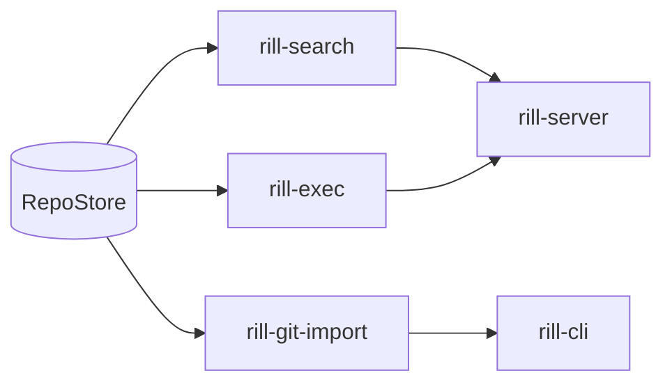

# Services

The service crates sit between the data layer and the server. Each is a
library with no RPC dependency; `rill-server` wires them to repositories,
workers and the gRPC surface. They share one invariant: everything they
produce is derived data or content-addressed results that can be rebuilt
from the object store.

| Page | Crate | What it owns |
| --- | --- | --- |
| [search](search.md) | `rill-search` | Trigram index keyed by blob hash, per-root manifests, regex query execution, symbol tables; the server's `Grep` RPC and indexer worker. |
| [exec](exec.md) | `rill-exec` | Actions and their content-addressed result cache, tree materialization, sandboxes, `.rill/verify.toml` plans; the server's pre-land verifier. |
| [git-import](git-import.md) | `rill-git-import` | One-way conversion of git commits into change versions, mainline landing on trunk, the persisted sha map; `rill import git`. |

See [ARCHITECTURE.md](../system.md) for the crate layering.
